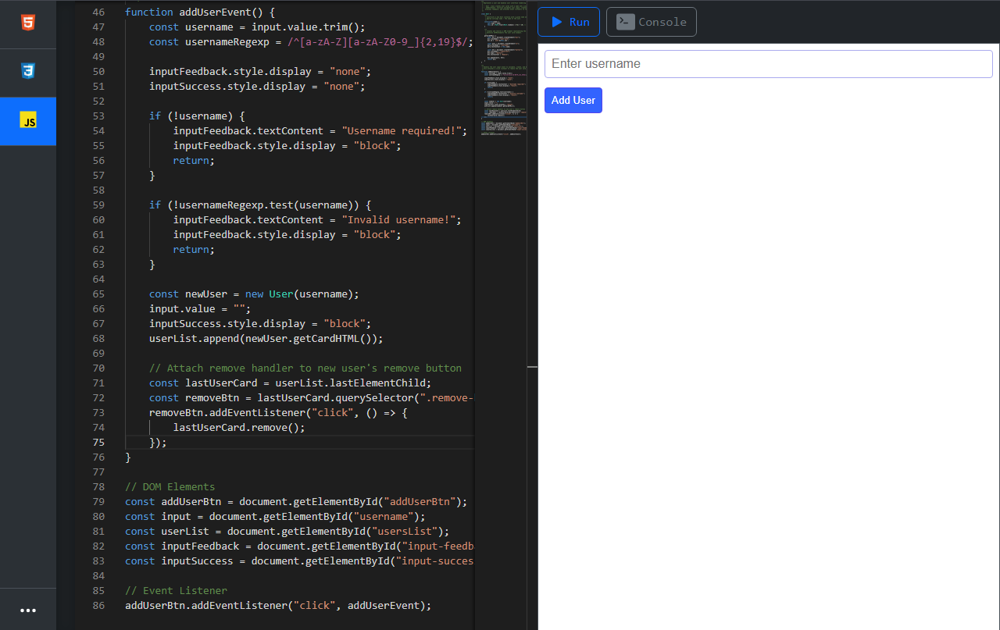

# Code Learning

> Des cours de programmation **en français**, des blocs de code **exécutables dans le navigateur** et un **éditeur HTML / CSS / JS en ligne**, dans une seule application Django.




## Sommaire

- [Fonctionnalités](#fonctionnalités)
- [Cours disponibles](#cours-disponibles)
- [Stack technique](#stack-technique)
- [Installation](#installation)
- [Utilisation](#utilisation)
- [Raccourcis clavier](#raccourcis-clavier)
- [Architecture](#architecture)
- [Ajouter ou modifier un cours](#ajouter-ou-modifier-un-cours)
- [Code exécutable dans les cours](#code-exécutable-dans-les-cours)
- [Configuration (`.env`)](#configuration-env)
- [Sécurité](#sécurité)
- [Déploiement en production](#déploiement-en-production)
- [Tests](#tests)
- [Dépannage](#dépannage)
- [Licence et auteur](#licence-et-auteur)

## Fonctionnalités

**Cours**
- 22 pages de cours écrites en Markdown, converties en pages web à onglets (une section = un onglet).
- Accueil avec catalogue filtrable par catégorie et par texte.
- Dans chaque cours : barre latérale des sections, plan « Sur cette page » avec suivi du défilement, boutons précédent / suivant, recherche plein texte, barre de progression de lecture, bouton « retour en haut ».
- Coloration syntaxique (Pygments), bouton **Copier** sur chaque bloc de code, ancres sur les titres.
- Thème clair / sombre, mémorisé dans le navigateur.

**Code exécutable**
- Les blocs JavaScript, TypeScript et Python ont un bouton **Exécuter** : ils deviennent un éditeur modifiable avec sa zone de résultat.
- Tout s'exécute **dans le navigateur** (Web Worker isolé pour JS, Pyodide pour Python) : aucun code utilisateur n'est exécuté sur le serveur.

**Éditeur en ligne**
- Trois onglets HTML / CSS / JS propulsés par Monaco Editor (le moteur de VS Code), avec Emmet et des snippets JavaScript.
- Aperçu dans une iframe isolée, console intégrée, aperçu automatique avec délai réglable, option Bootstrap en un clic.
- **Projets** enregistrés par utilisateur, **import / export .zip**.
- Préférences d'éditeur (retour à la ligne, taille de tabulation, minimap...) propres à chaque compte.

**Comptes et sécurité**
- Toute page exige une connexion ; pas d'inscription publique (les comptes sont créés par l'administrateur).
- Blocage temporaire après plusieurs échecs de connexion, protection CSRF, aperçu en bac à sable, import zip plafonné. Détails : [Sécurité](#sécurité).

## Cours disponibles

| Catégorie | Contenu |
|---|---|
| **Langages & outils** | CSS, JavaScript, TypeScript, Python, PHP, Langage C, Git, Algorithmique |
| **Frameworks** | Angular, Django |
| **Modules** | Modules Python (bibliothèque standard), BeautifulSoup |
| **Exercices** | JavaScript, TypeScript, C, Algorithmique |
| **Corrigés** | JavaScript, TypeScript, C, Algorithmique |
| **Projets** | JavaScript (Node.js), C |

## Stack technique

| Couche | Technologies |
|---|---|
| Backend | Python, Django 5.1+, Django REST framework |
| Contenu | Markdown, Pygments, BeautifulSoup 4, cache en base (modèle `PageContent`) |
| Données | SQLite (`db.sqlite3`) : utilisateurs, projets, préférences, contenu des cours |
| Frontend | JavaScript natif (modules ES), CSS maison avec thème clair / sombre |
| Éditeur | Monaco Editor 0.47, Emmet |
| Exécution navigateur | Web Workers, TypeScript (compilateur de Monaco), Pyodide (CPython 3.14 en WebAssembly) |
| Option de l'éditeur | Bootstrap 5.3, activable dans l'aperçu |

Monaco, Pyodide et Bootstrap sont **embarqués** dans le dépôt (`static/`) : l'application ne dépend d'aucun CDN externe.

## Installation

### Prérequis

- Python 3.12 ou plus récent (testé avec Python 3.12 et Django 6.1)
- `git` et `pip`

### Étapes

```bash
# 1. Récupérer le code
git clone https://github.com/styjii/code-learning.git
cd code-learning

# 2. Environnement virtuel
python -m venv .venv
source .venv/bin/activate          # Windows (PowerShell) : .venv\Scripts\Activate.ps1

# 3. Dépendances
pip install -r requirements.txt

# 4. Configuration
cp .env.example .env               # Windows : copy .env.example .env
```

Éditez ensuite `.env` :

```ini
DJANGO_SECRET_KEY=<une clé générée, voir ci-dessous>
DJANGO_DEBUG=1                     # développement local
```

Pour générer une clé secrète :

```bash
python -c "from django.core.management.utils import get_random_secret_key as g; print(g())"
```

```bash
# 5. Base de données et premier compte
python manage.py migrate
python manage.py createsuperuser

# 6. Lancer
python manage.py runserver
```

Ouvrez <http://127.0.0.1:8000/> et connectez-vous.

> **Important en local :** gardez `DJANGO_DEBUG=1`. Avec `DJANGO_DEBUG=0` (valeur du `.env.example`), la redirection HTTPS est active et `runserver` ne sert plus les fichiers statiques.

## Utilisation

1. **Connexion** sur `/accounts/login/`. Il n'y a pas d'inscription : créez les comptes avec `createsuperuser`, ou dans `/admin/` (*Utilisateurs > Ajouter*).
2. **Premier lancement** : l'accueil convertit les cours un par un et affiche une barre de progression (annulable). Les pages sont ensuite servies depuis le cache.
3. **Cours** : choisissez une carte sur l'accueil, naviguez par sections, recherchez avec `/` ou `Ctrl + K`.
4. **Éditeur** : bouton `</>` en haut d'un cours, ou <http://127.0.0.1:8000/editor/>.
   - Onglets HTML / CSS / JS, bouton **Exécuter**, bouton **Console**.
   - Menu `⋯` : **Projets** (créer, changer, supprimer), **Import / export .zip**, **Aperçu automatique**, **Bibliothèques (CDN)** (active Bootstrap dans l'aperçu, servi depuis le projet).
   - L'export produit `index.html`, `style.css` et `script.js` ; l'import relit une archive de cette forme.

## Raccourcis clavier

| Contexte | Raccourci | Action |
|---|---|---|
| Cours | `/` ou `Ctrl/Cmd + K` | Ouvrir la recherche |
| Cours | `Échap` | Fermer la recherche |
| Bloc de code exécutable | `Ctrl + Entrée` | Relancer le code |
| Éditeur | `Ctrl + Entrée` | Exécuter |
| Éditeur | `Ctrl + 1` / `2` / `3` | Onglet HTML / CSS / JS |
| Éditeur | `Maj + Alt + F` | Formater le document |
| Éditeur | `Ctrl + Maj + P` | Palette de commandes |
| Éditeur | `Ctrl + Alt + W` | Activer / désactiver le retour à la ligne |
| Éditeur | `Ctrl + Alt + L` | Activer / désactiver le défilement après la dernière ligne |

## Architecture

```text
code-learning/
├── config/        réglages Django (settings.py), routes, WSGI / ASGI
├── accounts/      connexion avec limitation des tentatives, tests d'accès
├── webapp/        accueil : catalogue des cours, préparation du contenu
├── language/      pages de cours (config.py = catalogue, topics/ = Markdown)
├── core/          conversion Markdown -> HTML à onglets
├── editor/        éditeur Monaco, projets, aperçu, import/export zip, préférences
├── templates/     base.html et partials partagés (thème, logo, déconnexion)
├── static/        CSS/JS communs, polices, icônes, Bootstrap, Pyodide
├── manage.py
├── requirements.txt
└── .env.example
```

### Comment un cours devient une page

1. `language/config.py` est la **source unique de vérité** : il alimente les routes, l'accueil, le sélecteur de cours et la conversion.
2. À la première visite, `core/markdown_to_tabbed_html.py` convertit le `.md` en HTML structuré (un onglet par section).
3. Le résultat est stocké dans `db.sqlite3` (modèle `language.models.PageContent`), avec une **signature** (version du convertisseur + date et taille du fichier).
4. Quand un `.md` change, ou que `CONVERTER_VERSION` est incrémenté, la page est **régénérée automatiquement** à la visite suivante. Pour tout régénérer d'un coup : `python manage.py build_pages`.

### Éditeur : points d'API

| Route | Rôle |
|---|---|
| `GET/POST /editor/api/projects/` | liste / création des projets de l'utilisateur |
| `GET/PUT/DELETE /editor/api/projects/<id>/` | lecture / modification / suppression |
| `GET /editor/api/load-monaco-config/` | options Monaco de l'utilisateur connecté |
| `POST /editor/api/save-monaco-config/` | enregistre ses préférences (clés autorisées uniquement) |
| `POST /editor/api/export-zip/` | génère le `.zip` du projet |
| `POST /editor/api/import-zip/` | lit un `.zip` (plafonné) |
| `POST /editor/preview/` puis `GET /editor/preview/<id>/` | génère puis affiche l'aperçu (cinq derniers conservés) |

L'API répond `403` aux utilisateurs non connectés.

## Ajouter ou modifier un cours

**Modifier** : éditez le fichier dans `language/topics/`. La page est régénérée à la prochaine visite.

**Ajouter** :

1. Créez le fichier Markdown dans `language/topics/` (ou un sous-dossier).
2. Si besoin, ajoutez une icône SVG dans `static/icons/`.
3. Déclarez la page dans `language/config.py` :

   ```python
   Page("rust", "rust.md", "Rust", "topics", "icons/rust.svg", "#dea584",
        "Un langage système sûr et performant."),
   ```

   Les arguments sont : clé d'URL, fichier, titre, catégorie, icône, couleur d'accent, phrase d'accroche.
4. Rechargez l'accueil : la route `/language/rust/` et la carte du catalogue existent.

**Format Markdown attendu**

- Titre du document : un `<h1>` dans un bloc `<div align="center">`, ou un `# Titre` unique.
- Chaque `# Section` devient un onglet (à défaut, chaque `## Section`).
- Le contenu placé avant la première section devient l'onglet « Présentation ».
- Les titres reçoivent des identifiants façon GitHub : un sommaire `[Intro](#1-introduction)` fonctionne tel quel.

## Code exécutable dans les cours

Les blocs ` ```js `, ` ```ts ` et ` ```python ` ont un bouton **Exécuter** : le bloc devient un éditeur Monaco modifiable (`Ctrl + Entrée` pour relancer) avec sa zone de résultat.

| Langage | Moteur |
|---|---|
| JavaScript | Web Worker isolé (pas d'accès au DOM), arrêt automatique après 8 s |
| TypeScript | compilateur de Monaco (erreurs de type affichées), puis exécution comme JavaScript |
| Python | [Pyodide](https://pyodide.org) (CPython 3.14 en WebAssembly, ~13 Mo, chargé au premier clic), `input()` via la zone « Entrée standard », arrêt après 10 s |

- Pour garder un bloc en lecture seule : ` ```python norun `.
- Les extraits JS/TS qui utilisent `import`, `export` ou `require()` ne sont pas exécutables et n'ont pas de bouton.
- Le C / C++ n'est pas encore pris en charge.
- Pyodide est embarqué dans `static/vendor/pyodide/` (licence MPL-2.0).

## Configuration (`.env`)

Toutes les valeurs sensibles sont lues dans `.env` (jamais versionné, voir `.gitignore`) ou dans l'environnement. Modèle commenté : `.env.example`. Le démarrage échoue avec un message explicite si `DJANGO_SECRET_KEY` manque.

| Variable | Rôle | Défaut |
|---|---|---|
| `DJANGO_SECRET_KEY` | clé secrète (**obligatoire**) | — |
| `DJANGO_DEBUG` | `1` développement, `0` production | `0` |
| `DJANGO_ALLOWED_HOSTS` | hôtes autorisés, séparés par des virgules (obligatoire si `DEBUG=0`) | — |
| `DJANGO_CSRF_TRUSTED_ORIGINS` | origines HTTPS de confiance | — |
| `DJANGO_HTTPS` | cookies `Secure` + redirection HTTPS | actif si `DEBUG=0` |
| `DJANGO_HSTS_SECONDS` | durée HSTS en secondes (0 = désactivé) | `0` |
| `DJANGO_BEHIND_PROXY` | `1` derrière un proxy qui envoie `X-Forwarded-Proto` | `0` |
| `DJANGO_SESSION_HOURS` | durée d'une session | `168` |
| `DJANGO_LOGIN_MAX_ATTEMPTS` | échecs tolérés avant blocage | `5` |
| `DJANGO_LOGIN_LOCKOUT_SECONDS` | durée du blocage | `900` |
| `EDITOR_ZIP_MAX_UPLOAD_KB` | taille maximale du `.zip` envoyé | `5120` |
| `EDITOR_ZIP_MAX_FILE_KB` | taille décompressée maximale d'un fichier | `1024` |
| `EDITOR_ZIP_MAX_TOTAL_KB` | total décompressé maximal de l'archive | `5120` |
| `EDITOR_ZIP_MAX_ENTRIES` | nombre maximal de fichiers dans l'archive | `100` |

## Sécurité

- **Authentification** : `LoginRequiredMiddleware` redirige toutes les pages vers la connexion ; l'API REST répond `403` aux anonymes. Déconnexion par `POST` uniquement.
- **Force brute** : blocage temporaire après plusieurs échecs (par IP + identifiant). Le compteur utilise le cache Django (mémoire locale) : configurez un cache partagé si vous lancez plusieurs processus.
- **CSRF** : protection active sur tous les appels de l'éditeur.
- **Isolation des projets** : chaque utilisateur ne voit et ne modifie que les siens. Projets créés avant l'authentification (sans propriétaire) : rattachez-les avec

  ```bash
  python manage.py shell -c "from editor.models import Project as P; from django.contrib.auth import get_user_model as g; P.objects.filter(owner=None).update(owner=g().objects.get(username='VOTRE_NOM'))"
  ```

- **Préférences Monaco** : enregistrées **par utilisateur** en base (`EditorPreferences`), jamais dans un fichier du code source. Seules les clés de la liste blanche de `editor/monaco_config.py` sont acceptées, avec type et plage vérifiés ; `readOnly`, `value`, `theme`... sont refusés. Le thème suit celui du site (navigateur).
- **Import .zip** : taille du fichier, nombre d'entrées, taille de chaque fichier et total décompressé sont plafonnés (`EDITOR_ZIP_*`), contrôlés **avant** toute décompression ; refus en `413`. En production, ajoutez aussi une limite côté serveur web (ex. nginx `client_max_body_size 6m;`).
- **Aperçu** : servi avec `Content-Security-Policy: sandbox` et dans une iframe `sandbox` : le code de l'utilisateur ne peut pas utiliser sa session.
- **Clickjacking** : `X-Frame-Options: DENY` sur le site (sauf l'aperçu, volontairement intégrable).

## Déploiement en production

1. Dans `.env` : `DJANGO_DEBUG=0`, `DJANGO_SECRET_KEY` unique, `DJANGO_ALLOWED_HOSTS=votre-domaine.fr`, `DJANGO_CSRF_TRUSTED_ORIGINS=https://votre-domaine.fr`.
2. Servez en HTTPS. Derrière un proxy inverse, ajoutez `DJANGO_BEHIND_PROXY=1`. Une fois HTTPS validé, activez HSTS (ex. `DJANGO_HSTS_SECONDS=31536000`).
3. Appliquez les migrations et collectez les fichiers statiques :

   ```bash
   python manage.py migrate
   python manage.py collectstatic
   ```

4. Lancez l'application avec un serveur WSGI de votre choix (gunicorn, uWSGI...) derrière nginx ou Apache.
5. Servez `staticfiles/` avec votre serveur web (ou WhiteNoise). Le dossier est volumineux (Monaco, Pyodide) : activez la compression et le cache navigateur.
6. Le dossier du projet doit être **inscriptible** par l'application : `db.sqlite3` y est créé.
7. Pensez à sauvegarder `db.sqlite3` (comptes, projets). Le contenu des cours (`PageContent`) n'est qu'un cache, régénéré automatiquement.

## Tests

```bash
python manage.py test accounts editor language   # authentification, isolation des projets, CSRF, config Monaco, import zip, cache des cours
python -m pytest core                   # conversion Markdown
```

## Dépannage

| Symptôme | Cause et solution |
|---|---|
| `DJANGO_SECRET_KEY est absent` | `.env` manquant ou clé vide : `cp .env.example .env` puis renseignez la clé. |
| `DJANGO_ALLOWED_HOSTS est obligatoire` | Vous êtes en `DJANGO_DEBUG=0` : renseignez les hôtes, ou passez à `1` en local. |
| La page redirige vers `https://` en local | `DJANGO_DEBUG=0` active la redirection HTTPS. Mettez `DJANGO_DEBUG=1` (ou `DJANGO_HTTPS=0`). |
| CSS / JS / éditeur non chargés | Fichiers statiques non servis : `DJANGO_DEBUG=1` en local, `collectstatic` + serveur web en production. |
| `no such table: editor_editorpreferences` | Migrations non appliquées : `python manage.py migrate`. |
| Le premier affichage des cours est lent | Normal : conversion des pages et mise en cache au premier passage (barre de progression à l'accueil). |
| Le premier clic sur « Exécuter » en Python est lent | Normal : Pyodide (~13 Mo) est chargé une seule fois. |
| Import zip refusé (erreur 413) | L'archive dépasse une limite : voir les variables `EDITOR_ZIP_*`. |
| Compte bloqué après des échecs | Attendez `DJANGO_LOGIN_LOCKOUT_SECONDS` (15 min par défaut). |

## Licence et auteur

Projet privé, © 2025 **styjii**. Tous droits réservés : aucune partie du projet ne peut être copiée, distribuée, modifiée ni utilisée sans l'autorisation écrite de l'auteur (voir [`LICENSE`](LICENSE)).

Dépôt : <https://github.com/styjii/code-learning>
