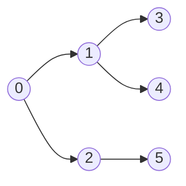
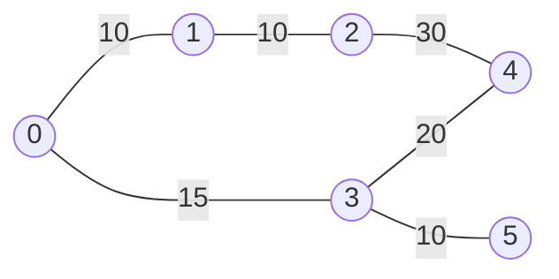
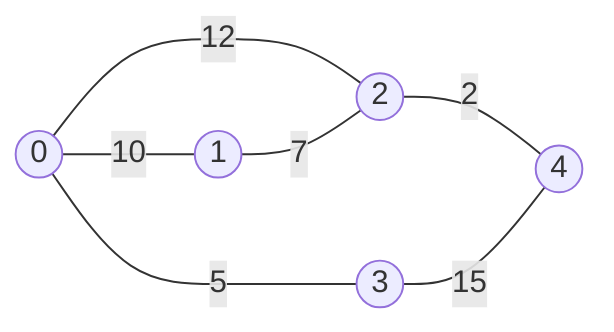

# 🔵 Exercices et projets en langage C

> Du premier « Hello World » aux threads POSIX et aux algorithmes de graphes : **13 séries d'exercices** puis **17 mini-projets**, classés par difficulté. Les énoncés sont corrigés, les exemples de sortie sont **vérifiés** (graphes de référence fournis), et le contexte de compilation est décrit **une seule fois**.

## 📑 Sommaire

1. [Contexte : compiler et exécuter](#1-contexte--compiler-et-exécuter)
2. [Partie 1 : séries d'exercices](#2-partie-1--séries-dexercices)
3. [Partie 2 : mini-programmes](#3-partie-2--mini-programmes)
4. [Partie 3 : structures de données et fichiers](#4-partie-3--structures-de-données-et-fichiers)
5. [Partie 4 : programmation concurrente (threads)](#5-partie-4--programmation-concurrente-threads)
6. [Partie 5 : algorithmes de graphes](#6-partie-5--algorithmes-de-graphes)
7. [Récapitulatif des notions](#7-récapitulatif-des-notions)

**Légende** : 🟢 débutant · 🟡 intermédiaire · 🔴 avancé · ➕ ajouté dans cette version

---

## 1. Contexte : compiler et exécuter

### Commande de base

```bash
gcc -std=c17 -Wall -Wextra -Wpedantic -g fichier.c -o programme
./programme
```

| Option | Rôle |
| --- | --- |
| `-std=c17` | Fixe le standard du langage (selon la version, le compilateur peut utiliser par défaut un standard plus récent, par exemple C23, ou une variante GNU). |
| `-Wall -Wextra -Wpedantic` | Active les avertissements utiles : **lisez-les**. |
| `-g` | Informations de débogage (`gdb`, `lldb`). |
| `-lm` | À ajouter pour utiliser `<math.h>` (`sqrt`, `pow`…) sur Linux. |
| `-pthread` | **Obligatoire** pour les programmes à threads (partie 4). |
| `-fsanitize=address,undefined` | Détecte dépassements de tampon, fuites mémoire et comportements indéfinis. |
| `-fsanitize=thread` | Détecte les **courses de données** entre threads (incompatible avec `address`). |

> 💡 Sous Linux, `valgrind ./programme` est une autre façon de traquer les fuites mémoire.

### Selon votre système

| | 🐧 Linux | 🍎 macOS | 🪟 Windows |
| --- | --- | --- | --- |
| Compilateur | `gcc` ou `clang` | `clang` (`gcc` en est un alias) | MinGW-w64, MSVC ou **WSL** |
| Parties 1 à 3, graphes | ✅ | ✅ | ✅ |
| Threads POSIX (`pthread`) | ✅ | ✅ | ⚠️ via WSL ou MinGW-w64 |
| Accents dans le terminal | UTF-8 | UTF-8 | `chcp 65001` |

### Règles d'or (valables pour tous les exercices)

- Vérifiez le **retour** de `scanf`, `fopen`, `malloc`, `pthread_create`.
- Chaque `malloc` / `calloc` a son `free`.
- N'utilisez **jamais** `gets()` (supprimée depuis C11) : employez `fgets()`.
- Lisez les avertissements du compilateur et corrigez-les tous.

---

## 2. Partie 1 : séries d'exercices

### Série 1 : premiers pas 🟢

1. Écrivez un programme qui affiche votre nom et votre âge.
2. Écrivez un programme qui affiche « Le C est puissant ! » sur une nouvelle ligne.
3. Compilez et exécutez un programme C dans votre terminal ou votre IDE.
4. Modifiez le programme `Hello World` pour afficher deux lignes avec `\n`.

### Série 2 : structure d'un programme 🟢

1. Écrivez un programme comportant : une **variable globale**, la fonction `main()` et **une fonction** définie par vous.
2. Ajoutez des commentaires sur une ligne (`//`) et sur plusieurs lignes (`/* ... */`) pour expliquer votre code.
3. Utilisez `#define` pour créer une macro pour π et calculer l'aire d'un cercle.
4. Ajoutez une seconde fonction qui renvoie le **carré** d'un nombre.

> ⚠️ `M_PI` n'est pas dans le standard C : définissez votre propre constante. Parenthésez les arguments de vos macros : `#define CARRE(x) ((x) * (x))`.

### Série 3 : identifiants, mots-clés et syntaxe 🟢

1. Déclarez des variables de type `int`, `float` et `char`, puis affichez-les.
2. Parmi cette liste, repérez les identifiants **invalides** : `main`, `3value`, `total_sum`, `float`, `__init__`.

   <details>
   <summary>Réponse</summary>

   - `3value` : invalide (commence par un chiffre).
   - `float` : invalide (mot-clé du langage).
   - `main` : valide, mais déconseillé comme nom de variable (c'est le point d'entrée).
   - `__init__` : valide pour le compilateur, mais les noms commençant par un double soulignement sont **réservés** à l'implémentation : évitez-les.
   - `total_sum` : valide.

   </details>

3. Écrivez un programme qui utilise correctement au moins 5 mots-clés du C différents.
4. Corrigez les erreurs de syntaxe de ce code (il y en a quatre) :

   ```c
   #include <stdio.h>

   int main()
       int x = 10
       printf("X is %d", x)
   return 0;
   ```

### Série 4 : types de données 🟢

1. Déclarez des variables de type `int`, `float`, `char` et `double`, puis affichez-les.
2. Avec `#define`, créez une constante pour la gravité et calculez un poids (`poids = masse × g`).
3. Calculez et affichez l'aire et le périmètre d'un rectangle.
4. Expérimentez avec `short`, `long`, `unsigned` et `signed` : affichez leur taille avec `sizeof` (format `%zu`) et leurs limites avec `<limits.h>` (`INT_MAX`, `UINT_MAX`…).
5. ➕ Utilisez les types à largeur fixe de `<stdint.h>` (`int8_t`, `uint32_t`, `int64_t`) et provoquez un **débordement** sur `unsigned char`, puis sur `int`. Lequel est un comportement défini par le standard, et lequel est **indéfini** ?

### Série 5 : constantes 🟢

1. Définissez la vitesse de la lumière de deux façons : avec `const` et avec `#define`. Comparez (type, portée, adresse mémoire).
2. Affichez un message avec des séquences d'échappement (`\n`, `\t`, `\"`, `\\`).
3. Déclarez des constantes caractère et chaîne, puis affichez-les.
4. Utilisez une constante pour convertir des degrés Fahrenheit en Celsius : `C = (F − 32) × 5 / 9`.
5. ➕ Définissez des constantes avec un `enum` (par exemple les jours de la semaine).

> ⚠️ Piège : `5 / 9` vaut **`0`** en C (division entière). Écrivez `5.0 / 9.0`.

### Série 6 : opérateurs 🟢

1. Calculez la moyenne de 3 nombres.
2. Utilisez des opérateurs relationnels et logiques pour vérifier qu'un utilisateur peut voter.
3. Montrez la différence entre `a++` et `++a`.
4. Avec l'opérateur ternaire, trouvez le plus petit de deux nombres.
5. ➕ Montrez trois pièges classiques : `=` contre `==`, la division entière (`7 / 2`), et le signe du reste (`-7 % 3`).

### Série 7 : entrées et sorties 🟢

1. Lisez le nom et l'âge de l'utilisateur, puis affichez-les.
2. Lisez deux entiers et affichez leur somme et leur produit.
3. Créez un petit système de saisie de notes sous forme de lettres (caractères).
4. Lisez une phrase avec `fgets()` et affichez-la avec `puts()`.

> 💡 Pour lire un `char` avec `scanf` après une autre saisie, ajoutez un espace avant le format (`" %c"`) pour ignorer le saut de ligne resté dans le tampon.

### Série 8 : structures de contrôle 🟢

1. Indiquez si un nombre est positif, négatif ou nul avec `if...else`.
2. Écrivez un `switch` qui affiche le jour de la semaine selon un nombre de 1 à 7 (et gérez les autres valeurs avec `default`).
3. Affichez les 10 premiers entiers naturels avec les **trois types de boucles** (`for`, `while`, `do...while`).
4. Calculez la somme des chiffres d'un nombre avec une boucle `while`.
5. Utilisez `continue` pour ne pas afficher les nombres pairs dans une boucle `for`.

### Série 9 : fonctions 🟡

1. Écrivez une fonction qui calcule la **somme des chiffres** d'un nombre.
2. Écrivez une fonction qui vérifie si un nombre est **premier**.
3. Écrivez une fonction **récursive** qui calcule le terme de Fibonacci.
4. Écrivez une fonction qui **inverse une chaîne** (sur place).
5. Montrez la différence entre le passage **par valeur** et le passage **d'un pointeur** (écrivez `echanger(int *a, int *b)`).

> ℹ️ **En C, tout est passé par valeur.** Le « passage par référence » n'existe pas : on le **simule** en passant l'adresse (un pointeur) de la variable.

### Série 10 : pointeurs et tableaux ➕ 🟡

1. Parcourez un tableau avec l'**arithmétique des pointeurs** (`*(p + i)`, `p++`).
2. Affichez `sizeof(tab)` dans `main()` puis dans une fonction qui reçoit ce tableau en paramètre. Pourquoi les deux résultats diffèrent-ils ? *(Un tableau « se dégrade » en pointeur.)*
3. Écrivez une fonction qui renvoie l'adresse d'une variable **locale**, utilisez-la, puis expliquez le résultat (**pointeur pendant**, comportement indéfini). Proposez deux corrections (tampon fourni par l'appelant, ou `malloc`).
4. Additionnez deux matrices 3×3 (tableaux à deux dimensions).

### Série 11 : chaînes de caractères (`<string.h>`) ➕ 🟡

1. Réécrivez vous-même `strlen`, `strcmp` et `strcpy`.
2. Copiez et concaténez deux chaînes **sans dépasser** la taille du tampon (`snprintf`).
3. Comptez les mots et les voyelles d'une phrase.
4. Vérifiez qu'un mot est un palindrome.

> ⚠️ `strncpy` ne garantit **pas** le `'\0'` final : ajoutez-le toujours à la main, ou préférez `snprintf`.

### Série 12 : projet en plusieurs fichiers et Makefile ➕ 🟡

1. Séparez un programme en `outils.h`, `outils.c` et `main.c`.
2. Protégez le fichier d'en-tête avec des **gardes d'inclusion** (`#ifndef OUTILS_H` / `#define OUTILS_H` / `#endif`).
3. Compilez séparément (`gcc -c outils.c`, `gcc -c main.c`), puis faites l'**édition des liens** (`gcc outils.o main.o -o programme`).
4. Automatisez la compilation avec un `Makefile` contenant les cibles `all` et `clean`.

### Série 13 : tri et recherche ➕ 🟡

1. Implémentez un tri à bulles sur un tableau d'entiers.
2. Triez le même tableau avec `qsort` de `<stdlib.h>` (écrivez la **fonction de comparaison**).
3. Cherchez une valeur avec `bsearch` sur le tableau trié.

> 💡 Dans la fonction de comparaison, écrire `return a - b;` peut **déborder** : préférez `(a > b) - (a < b)`.

---

## 3. Partie 2 : mini-programmes

### Projet 1 : moyenne de trois nombres 🟢

**Objectif** : pratiquer variables, entrées/sorties et opérations arithmétiques.

**Consignes**
1. Demandez à l'utilisateur trois nombres décimaux.
2. Calculez leur moyenne.
3. Affichez le résultat avec **2 décimales**.

**À utiliser** : `float`, `scanf` (en vérifiant son retour), `printf`.

```text
Entrez trois nombres : 10 20.5 30
La moyenne est : 20.17
```

> 💡 Avec `scanf`, `%f` lit un `float` ; il faudrait `%lf` pour un `double`.

---

### Projet 2 : le plus grand de N nombres 🟢

**Objectif** : utiliser une boucle et des conditions.

**Consignes**
1. Demandez combien de nombres (`n`) seront saisis.
2. Lisez `n` entiers.
3. Déterminez et affichez le **plus grand**.

**À utiliser** : une boucle `for` pour la lecture, un `if` pour mettre à jour le maximum.

```text
Combien de nombres allez-vous saisir ? 4
Nombre 1 : 12
Nombre 2 : 7
Nombre 3 : 29
Nombre 4 : 21
Le plus grand nombre est : 29
```

> ⚠️ Ne démarrez pas le maximum à `0` : il faut le fixer au **premier nombre lu** (sinon les nombres négatifs donnent un résultat faux).

---

### Projet 3 : fonctions et tableaux (moyenne, maximum, minimum) 🟡

**Objectif** : définir et appeler des fonctions qui reçoivent un tableau.

**Consignes**
1. Lisez `n` entiers (maximum 100) et stockez-les dans un tableau de taille fixe.
2. Utilisez trois fonctions :

```c
float calculer_moyenne(const int tab[], int n);
int   maximum(const int tab[], int n);
int   minimum(const int tab[], int n);
```

3. Vérifiez que `n` est compris entre 1 et 100.

```text
Nombre d'éléments (max 100) : 5
Nombre 1 : 10
Nombre 2 : 20
Nombre 3 : 5
Nombre 4 : 30
Nombre 5 : 25
Moyenne : 18.00
Maximum : 30
Minimum : 5
```

> 💡 `const int tab[]` indique que la fonction **ne modifie pas** le tableau. Dans une fonction, `tab` est en réalité un pointeur : la taille doit donc être passée séparément (`n`).

---

### Projet 4 : structures et chaînes 🟡

**Objectif** : utiliser des **structures** et des **chaînes** pour stocker les informations d'étudiants.

**Consignes**
1. Définissez une structure `Etudiant` avec `nom` (chaîne), `age` (entier) et `note` (décimal).
2. Créez un tableau de `Etudiant` pour `n` étudiants (alloué dynamiquement).
3. Demandez les informations de chaque étudiant (nom, âge, note).
4. Affichez un récapitulatif.

```text
Nombre d'étudiants : 2

Étudiant 1 :
Nom : Alice
Âge : 20
Note : 88.5

Étudiant 2 :
Nom : Bob
Âge : 22
Note : 92.0

--- Récapitulatif ---

Étudiant 1 :
Nom : Alice
Âge : 20
Note : 88.50

Étudiant 2 :
Nom : Bob
Âge : 22
Note : 92.00
```

> ⚠️ N'utilisez pas `scanf("%s", nom)` : il s'arrête au premier espace et ne limite pas la taille. Lisez le nom avec `fgets`.

---

### Projet 5 : tableau dynamique 🟡

**Objectif** : utiliser `malloc` (ou `calloc`) pour créer un **tableau d'entiers dynamique**.

**Consignes**
1. Demandez combien d'entiers seront saisis.
2. Allouez la mémoire correspondante avec `malloc`.
3. Lisez les `n` entiers et stockez-les.
4. Affichez-les.
5. Libérez la mémoire avec `free`.

```text
Nombre d'entiers : 5
Nombre 1 : 10
Nombre 2 : 20
Nombre 3 : 30
Nombre 4 : 40
Nombre 5 : 50

Entiers saisis :
10 20 30 40 50
```

**Notions clés**
- `malloc` alloue de la mémoire selon la saisie de l'utilisateur ; **vérifiez toujours** qu'il ne renvoie pas `NULL`.
- `free` libère la mémoire quand on n'en a plus besoin ; mettez ensuite le pointeur à `NULL` pour éviter un **pointeur pendant**.
- Vérifiez l'absence de fuite avec `valgrind` ou `-fsanitize=address`.

➕ **Bonus** : agrandissez le tableau avec `realloc` quand l'utilisateur veut saisir plus de valeurs (sans perdre l'ancien pointeur si `realloc` échoue).

---

## 4. Partie 3 : structures de données et fichiers

### Projet 6 : liste chaînée simple 🟡

**Objectif** : créer et manipuler une **liste simplement chaînée** avec allocation dynamique.

**Consignes**
1. Définissez une **structure de nœud** (donnée + pointeur vers le nœud suivant).
2. Construisez une liste avec des entiers saisis par l'utilisateur.
3. Implémentez les fonctions : **ajouter un nœud à la fin**, **afficher la liste**, **libérer toute la mémoire**.
4. Allouez chaque nœud avec `malloc`.

```text
Nombre d'éléments de la liste : 3
Élément 1 : 10
Élément 2 : 20
Élément 3 : 30

Liste chaînée : 10 20 30
```

**Notions clés**
- **Structure de nœud** : chaque nœud contient une donnée et un pointeur vers le suivant.
- **Ajout** : `malloc` pour le nouveau nœud, parcours de la liste avec une boucle `while`.
- **Libération** : parcourez la liste et libérez chaque nœud, en **sauvegardant le pointeur `suivant` avant** le `free`.

➕ **Pour aller plus loin** : insertion en tête, suppression par valeur, inversion de la liste. Pour modifier la tête de liste dans une fonction, passez un pointeur sur pointeur (`Noeud **tete`).

---

### Projet 7 : fichiers texte (écrire et lire) 🟡

**Objectif** : apprendre à **ouvrir**, **écrire** et **lire** un fichier en C.

**Consignes**
1. Demandez une série d'entiers.
2. Écrivez-les dans un fichier (`nombres.txt`).
3. Relisez-les depuis le fichier et affichez-les.

**À utiliser** : `fopen()` (modes `"w"` et `"r"`), `fprintf()`, `fscanf()`, `fclose()`.

```text
Nombre d'entiers : 3
Saisissez 3 entiers à écrire dans le fichier :
Nombre 1 : 10
Nombre 2 : 20
Nombre 3 : 30

Nombres lus dans le fichier :
10 20 30
```

**Notions clés**
- `fopen` renvoie un pointeur de fichier, ou `NULL` en cas d'échec (utilisez `perror`).
- `fprintf` écrit des données formatées ; `fscanf` les lit (**testez son retour** : il renvoie le nombre de valeurs lues, ou `EOF`).
- `fclose` : fermez toujours le fichier, pour que les données soient bien enregistrées et la ressource libérée.

---

### Projet 8 : fichiers binaires (écrire et lire des structures) 🔴

**Objectif** : stocker et relire des données structurées au format **binaire**.

**Consignes**
1. Définissez une structure `Etudiant` (`nom`, `age`, `note`).
2. Écrivez `n` étudiants dans un fichier binaire.
3. Relisez-les depuis ce fichier et affichez leur contenu.

**À utiliser** : `fwrite`, `fread`, `fopen` avec les modes `"wb"` et `"rb"`.

```text
Nombre d'étudiants : 2

Étudiant 1 :
Nom : Alice
Âge : 20
Note : 88.5

Étudiant 2 :
Nom : Bob
Âge : 22
Note : 92.0

Lecture des étudiants depuis le fichier :
Nom : Alice
Âge : 20
Note : 88.50
-----------------------
Nom : Bob
Âge : 22
Note : 92.00
-----------------------
```

**Notions clés**
- `fwrite` écrit des blocs de données brutes ; `fread` les relit. **Vérifiez leur valeur de retour** (nombre d'éléments traités).
- Le format binaire est compact et rapide.

> ⚠️ **Limites** : le fichier dépend de la machine et du compilateur (**remplissage** de la structure, ordre des octets, taille des types). Il n'est donc pas portable d'un système à l'autre. Initialisez la structure (`memset` ou `= {0}`) avant de l'écrire, sinon le remplissage contient des octets aléatoires. Pour échanger des données, préférez un format texte (CSV, JSON).

---

## 5. Partie 4 : programmation concurrente (threads)

> 🧵 **Contexte** : ces projets utilisent la bibliothèque **POSIX threads** (`pthread`). Compilez avec **`-pthread`** (oubli fréquent). Le standard C11 propose aussi `<threads.h>`, mais il n'est pas disponible partout (absent sous macOS, par exemple). Sous Windows, passez par WSL ou MinGW-w64.

### Projet 9 : somme parallèle d'un tableau 🔴

**Objectif** : créer et gérer des threads. Calculer la somme d'un tableau avec **deux threads** en parallèle.

**Consignes**
1. Créez un tableau de `n` entiers.
2. Divisez-le en deux moitiés.
3. Utilisez **deux threads** pour calculer la somme de chaque moitié.
4. Combinez les deux sommes pour obtenir le total.

**À utiliser** : `pthread_create()`, `pthread_join()`, et la mémoire partagée (le tableau) pour la communication.

```text
Nombre d'éléments du tableau : 6
Saisissez 6 entiers :
1 2 3 4 5 6
Somme totale : 21
```

**Notions clés**
- `pthread_create` : crée un thread. Paramètres : l'identifiant, les attributs (`NULL` par défaut), la fonction à exécuter (de type `void *fonction(void *)`) et son argument. **Testez son retour.**
- `pthread_join` : attend la fin d'un thread.
- **Structure `DonneesThread`** : transmet à chaque thread sa plage d'indices et stocke sa somme partielle. Comme chaque thread écrit dans **sa propre structure**, aucun verrou n'est nécessaire ici.

**Avantages du multi-threading** : *concurrence* (plusieurs tâches avancent en même temps) et *meilleure utilisation des processeurs multicœurs*.

> ℹ️ Avec 6 éléments, les threads seront plus lents qu'une simple boucle (le coût de création dépasse le gain). Mesurez le temps avec un tableau de plusieurs millions d'éléments.

---

### Projet 10 : synchronisation avec un mutex 🔴

**Objectif** : utiliser un **mutex** pour protéger une ressource partagée.

**Consignes**
1. Créez plusieurs threads (par exemple **10**).
2. Chacun incrémente un compteur partagé **1 000 000 de fois**.
3. Un **mutex** garantit qu'un seul thread modifie le compteur à la fois.

**À utiliser** : `pthread_mutex_t`, `pthread_mutex_lock()`, `pthread_mutex_unlock()`.

```text
Valeur finale du compteur : 10000000
```

**Notions clés**
- `pthread_mutex_t` : le type du mutex ; `pthread_mutex_destroy` le détruit en fin de programme.
- `lock` : verrouille la **section critique** (un seul thread à la fois) ; `unlock` la libère.
- **Pourquoi ?** Sans mutex, plusieurs threads modifient le compteur simultanément : c'est une **course de données** (*race condition*) et le résultat est inférieur à 10 000 000, différent à chaque exécution.

**Pour expérimenter**
1. Retirez le mutex et observez le résultat faux.
2. Détectez le problème avec `gcc -fsanitize=thread -g -pthread`.
3. ➕ Comparez avec les **variables atomiques** de C11 (`<stdatomic.h>`, `atomic_fetch_add`) : plus simples et plus rapides pour un simple compteur.
4. Accélérez la version à mutex : chaque thread compte dans une variable **locale**, puis ajoute son total au compteur partagé **une seule fois**.

**Autres techniques de synchronisation** : variables de condition (projet 11), verrous lecteurs-rédacteur (projet 12).

---

### Projet 11 : variables de condition (producteur-consommateur) 🔴

**Objectif** : synchroniser des threads selon une **condition**.

**Consignes**
1. Un thread **producteur** génère des données et les dépose dans un tampon circulaire de taille fixe (par exemple 5).
2. Un thread **consommateur** retire les données du tampon (ordre **FIFO**).
3. Le producteur attend quand le tampon est plein ; le consommateur attend quand il est vide.

**À utiliser** : `pthread_cond_t`, `pthread_mutex_t`, `pthread_cond_wait`, `pthread_cond_signal`.

```text
Produit : 23
Produit : 88
Consommé : 23
Produit : 37
Consommé : 88
Consommé : 37
...
```

> ℹ️ L'entrelacement des lignes varie d'une exécution à l'autre ; en revanche, les valeurs sont **toujours consommées dans l'ordre où elles ont été produites**.

**Notions clés**
- `pthread_cond_t` : le type de la variable de condition.
- `pthread_cond_wait` : le thread **libère le mutex** et s'endort jusqu'à un signal ; il reprend le mutex à son réveil.
- `pthread_cond_signal` : réveille **un** thread en attente ; `pthread_cond_broadcast` les réveille **tous**.
- **Toujours attendre dans une boucle `while`**, jamais dans un simple `if` : un thread peut être réveillé sans raison (*réveil intempestif*), ou la condition peut avoir changé entre-temps.
- Utilisez **deux** variables de condition (`non_plein`, `non_vide`) et prévoyez une manière de **terminer** proprement (drapeau « fini » ou valeur sentinelle).

---

### Projet 12 : verrous lecteurs-rédacteur 🔴

**Objectif** : autoriser **plusieurs lecteurs simultanés** mais **un seul rédacteur** à la fois.

**Consignes**
1. Plusieurs threads lecteurs lisent la donnée simultanément.
2. Un thread rédacteur la modifie, en accès **exclusif**.

**À utiliser** : `pthread_rwlock_t`, `pthread_rwlock_rdlock` (verrou de lecture), `pthread_rwlock_wrlock` (verrou d'écriture), `pthread_rwlock_unlock`.

```text
Lecteur 1 : donnée lue = 0
Lecteur 2 : donnée lue = 0
Rédacteur 1 : donnée modifiée = 1
Lecteur 3 : donnée lue = 1
Rédacteur 2 : donnée modifiée = 2
...
```

> ℹ️ L'ordre exact varie à chaque exécution.

**Pourquoi c'est utile**
- **Performance** : de nombreuses lectures peuvent avoir lieu en parallèle quand les écritures sont rares.
- **Efficacité** : moins de contention qu'avec un mutex unique, tout en garantissant l'exclusivité aux rédacteurs.

> ⚠️ Selon l'implémentation, un flux continu de lecteurs peut **affamer** le rédacteur : testez avec de nombreux lecteurs.

---

## 6. Partie 5 : algorithmes de graphes

### Graphes de référence

Pour que les **exemples de sortie soient reproductibles**, les projets utilisent les trois graphes ci-dessous (l'original ne les définissait pas).

#### Graphe G1 : orienté, pour BFS et DFS

Sommets `0` à `5`. Arcs : `0→1`, `0→2`, `1→3`, `1→4`, `2→5`. Parcourez les voisins **dans l'ordre croissant**.



#### Graphe G2 : pondéré non orienté, pour Dijkstra

Sommets `0` à `5`. Arêtes (poids) : `0-1 (10)`, `0-3 (15)`, `1-2 (10)`, `3-4 (20)`, `3-5 (10)`, `2-4 (30)`.



#### Graphe G3 : pondéré non orienté, pour Kruskal et Prim

Sommets `0` à `4`. Arêtes (poids) : `2-4 (2)`, `0-3 (5)`, `1-2 (7)`, `0-1 (10)`, `0-2 (12)`, `3-4 (15)`.



---

### Projet 13 : parcours en largeur (BFS) 🔴

**Objectif** : implémenter le **parcours en largeur** (*Breadth-First Search*) sur le graphe orienté G1, représenté par une **liste d'adjacence**.

**Consignes**
1. Construisez le graphe avec une liste d'adjacence.
2. Parcourez-le en BFS à partir d'un sommet donné.
3. Affichez l'ordre de visite des sommets.

**À utiliser** : une **file** (par exemple un tableau circulaire) et un tableau `visite[]`.

```text
Parcours BFS à partir du sommet 0 :
0 1 2 3 4 5
```

**Notions clés**
- **File** : BFS gère les sommets à explorer dans l'ordre d'arrivée (FIFO).
- **Tableau des visités** : évite de traiter un sommet plusieurs fois (et de boucler indéfiniment dans un graphe avec cycles).
- **Liste d'adjacence** : pour chaque sommet, la liste de ses voisins (l'original mentionnait par erreur une matrice d'adjacence).
- Complexité : **O(V + E)**.

---

### Projet 14 : parcours en profondeur (DFS) 🔴

**Objectif** : implémenter le **parcours en profondeur** (*Depth-First Search*) sur le **même graphe G1**. Le DFS explore une branche le plus loin possible avant de revenir en arrière.

**Consignes**
1. Implémentez le DFS avec une **fonction récursive**.
2. Partez d'un sommet donné et affichez l'ordre de visite.

```text
Parcours DFS à partir du sommet 0 :
0 1 3 4 2 5
```

**Notions clés**
- **Récursivité** : la pile d'appels gère naturellement le retour en arrière.
- **Tableau des visités** : chaque sommet n'est visité qu'une fois.

➕ **Bonus** : écrivez une version **itérative** avec une pile explicite, puis gérez un graphe **non connexe** (relancez le parcours depuis chaque sommet non visité).

**Comparaison des deux parcours**

| | BFS | DFS |
| --- | --- | --- |
| Structure utilisée | File | Pile (ou récursivité) |
| Ordre d'exploration | Niveau par niveau | Branche par branche |
| Usage typique | **Plus court chemin** dans un graphe non pondéré | Recherche exhaustive, détection de cycles, tri topologique |

---

### Projet 15 : algorithme de Dijkstra 🔴

**Objectif** : calculer le **plus court chemin** depuis un sommet source vers tous les autres dans le graphe pondéré G2.

**Consignes**
1. Représentez G2 avec des arêtes pondérées.
2. Appliquez **Dijkstra** depuis le sommet source.
3. Affichez la distance minimale vers chaque sommet.

```text
Distances les plus courtes depuis le sommet 0 :
Sommet 0 : 0
Sommet 1 : 10
Sommet 2 : 20
Sommet 3 : 15
Sommet 4 : 35
Sommet 5 : 25
```

**Deux niveaux de difficulté**
- 🟡 **Version simple, O(V²)** : à chaque étape, parcourez un tableau pour trouver le sommet non traité de plus petite distance.
- 🔴 **Version optimisée, O((V + E) log V)** : utilisez une **file de priorité** (tas-minimum, à écrire vous-même en C).

**Notions clés**
- **Dijkstra** ne fonctionne que si **tous les poids sont positifs ou nuls** (sinon, utilisez Bellman-Ford).
- **Tas-minimum** : donne en `O(log V)` le sommet de distance minimale.
- ⚠️ N'additionnez jamais à `INT_MAX` : testez `distance[u] != INT_MAX` avant de calculer `distance[u] + poids` (débordement).

➕ **Bonus** : mémorisez le **prédécesseur** de chaque sommet pour afficher le chemin complet (par exemple `0 → 3 → 4`).

---

### Projet 16 : arbre couvrant minimal avec Kruskal 🔴

**Rappel** : un **arbre couvrant minimal** (*Minimum Spanning Tree*, **MST**) est un sous-ensemble des arêtes d'un graphe pondéré qui relie tous les sommets avec un **poids total minimal**, sans cycle.

**Objectif** : trouver le MST du graphe G3 avec l'algorithme de **Kruskal** : un algorithme **glouton** qui ajoute les arêtes par poids croissant, tant qu'elles ne forment pas de cycle.

**Consignes**
1. Représentez le graphe par une **liste d'arêtes**.
2. Triez les arêtes par poids (`qsort`).
3. Utilisez une structure **Union-Find** (ensembles disjoints) pour détecter les cycles.

```text
Arêtes du MST :
2 - 4 : 2
0 - 3 : 5
1 - 2 : 7
0 - 1 : 10
Poids total : 24
```

**Notions clés**
- **Union-Find** : retient les composantes connexes (`find` et `union`) ; ajoutez la **compression de chemin** et l'**union par rang** pour une efficacité quasi constante.
- **Algorithme glouton** : on choisit à chaque étape la plus petite arête qui ne crée pas de cycle.
- Un MST d'un graphe à `V` sommets a **`V − 1` arêtes**.

---

### Projet 17 : arbre couvrant minimal avec Prim 🔴

**Objectif** : trouver le MST du **même graphe G3** avec l'algorithme de **Prim**. Contrairement à Kruskal (qui trie les arêtes), Prim démarre d'un sommet quelconque et **fait grandir l'arbre**, en ajoutant à chaque étape la plus petite arête reliant un sommet de l'arbre à un sommet extérieur.

**Consignes**
1. Représentez le graphe par une **matrice d'adjacence**.
2. Partez du sommet `0`.
3. Affichez les arêtes du MST dans l'ordre où elles sont ajoutées, avec leur poids.

```text
Arêtes du MST :
0 - 3 : 5
0 - 1 : 10
1 - 2 : 7
2 - 4 : 2
Poids total : 24
```

> ✅ Le **poids total est le même** que pour Kruskal (24) : l'ordre d'affichage diffère, mais les deux algorithmes trouvent le même arbre ici.

**Deux niveaux de difficulté**
- 🟡 **Matrice + tableau `cle[]`, O(V²)** : `cle[v]` contient le poids de la plus petite arête reliant `v` à l'arbre ; `parent[v]` mémorise l'autre extrémité.
- 🔴 **Liste d'adjacence + tas-minimum, O((V + E) log V)**.

**Kruskal ou Prim ?**

| | Kruskal | Prim |
| --- | --- | --- |
| Principe | Trie les **arêtes**, les ajoute une à une si elles ne forment pas de cycle | Fait grandir l'arbre **sommet par sommet** |
| Structure clé | Union-Find | Tableau de clés ou tas-minimum |
| Plutôt adapté aux graphes | **Épars** (peu d'arêtes) | **Denses** (beaucoup d'arêtes) |

---

## 7. Récapitulatif des notions

| Notion | Séries / projets |
| --- | --- |
| Syntaxe, types, constantes, opérateurs | Séries 1 à 6 |
| Entrées/sorties sécurisées (`fgets`, `scanf`) | Série 7, projets 1 à 4 |
| Contrôle de flux, boucles | Série 8, projet 2 |
| Fonctions, récursivité | Série 9 |
| Pointeurs, tableaux, matrices | Séries 9 et 10, projet 3 |
| Chaînes de caractères | Séries 7 et 11, projet 4 |
| Compilation séparée, Makefile | Série 12 |
| Tri et recherche (`qsort`, `bsearch`) | Série 13, projet 16 |
| Structures (`struct`), mémoire dynamique | Projets 4 à 6 |
| Fichiers texte et binaires | Projets 7 et 8 |
| Threads, mutex, variables de condition, verrous R/W, atomiques | Projets 9 à 12 |
| Graphes : BFS, DFS, plus courts chemins | Projets 13 à 15 |
| Arbres couvrants minimaux, Union-Find, algorithmes gloutons | Projets 16 et 17 |
