# Avant de commencer : mode d'emploi du cours

*Module d'apprentissage détaillé, du technicien débutant à l'administrateur système et réseau (Ubuntu Server 24.04, Windows Server 2022, Cisco IOS, MikroTik RouterOS 7 ; novembre 2026)*

**À qui s'adresse ce cours ?** À toute personne qui connaît les bases de l'informatique (fichiers, processus, installation de logiciels, usage d'un terminal) et qui veut apprendre à concevoir, configurer, sécuriser, superviser et dépanner le réseau d'une entreprise : débutant, technicien informatique, administrateur système Linux débutant, futur technicien réseau.

**Objectifs du cours.** À la fin, vous serez capable de :

1. expliquer le fonctionnement des modèles OSI et TCP/IP ;
2. calculer des plans d'adressage IPv4 (CIDR, sous-réseaux, VLSM) ;
3. utiliser les commandes réseau Windows et Linux pour diagnostiquer ;
4. configurer routeurs, switchs, VLAN, NAT et ACL (Cisco IOS, MikroTik RouterOS) ;
5. installer et sécuriser les services DHCP, DNS, SSH, Samba, Web, VPN, Active Directory ;
6. appliquer une méthodologie de dépannage structurée ;
7. déployer et documenter l'infrastructure d'une PME de 30 à 50 employés.

**Fil rouge.** Tous les exemples s'appuient sur une même entreprise fictive de 40 collaborateurs, **Atlas Conseil**, et sur un même plan d'adressage : postes en VLAN 10 et 20 (`192.168.10.0/24`, `192.168.20.0/24`), serveurs en VLAN 30 (`192.168.30.0/24`), zone DMZ en VLAN 40, invités en VLAN 50, imprimantes en VLAN 60 et administration en VLAN 99. Vous retrouvez donc toujours les mêmes noms : `srv-infra`, `srv-fic`, `srv-web`, `srv-mon`, `rb-gw`, `sw1`, `sw2`. Les travaux pratiques (section « Travaux pratiques et laboratoires ») utilisent une version réduite du réseau en machines virtuelles (`srv-lab`, `cli-ubuntu`, `192.168.10.0/24`) et le projet final (section « Projet final : infrastructure réseau d'une entreprise de 40 collaborateurs ») assemble l'ensemble. Deux noms de domaine DNS apparaissent : `entreprise.local` (exemples de cours et TP) et `int.atlas.example` (projet final) ; en production, on évite `.local` (réservé à mDNS) au profit d'un sous-domaine d'un nom que l'on possède.

**Structure de chaque section.** Chaque section suit le même schéma : *objectifs d'apprentissage* → *concepts et définitions* → *exemples commentés (commandes, configurations, résultats)* → *pièges et bonnes pratiques* → *à retenir*. Les exercices et leurs corrections sont regroupés dans deux sections dédiées (« Exercices » et « Corrections des exercices et des laboratoires ») afin de ne pas révéler les réponses.

**Légende.** *(à jour)* = pratique moderne qui remplace une ancienne ; *(ajout)* = notion absente du plan d'origine. Les marqueurs suivants servent dans tous les exemples :

| Marqueur | Signification |
|---|---|
| `$` | Commande Linux exécutée avec un utilisateur normal |
| `#` | Commande Linux exécutée avec les droits root (ou via `sudo`) |
| `C:\>` | Invite CMD Windows |
| `PS>` | Invite PowerShell |
| **Droits admin** | Commande qui demande une session administrateur ou `sudo` |
| **Obsolète** | Commande ancienne, remplacée par une alternative moderne |
| **Risque** | Modification pouvant couper la connexion : prévoir un retour arrière |

> Règle d'or : avant toute modification de configuration réseau sur une machine distante, sauvegardez la configuration actuelle et prévoyez un moyen de retour arrière (accès console, délai d'annulation automatique, second accès d'administration).

> **Note sur les versions et les sorties.** Les procédures d'installation de produits qui évoluent vite (Zabbix, LibreNMS, Grafana, GNS3), la syntaxe de fonctions dépendantes du modèle (802.1X, SNMPv3 sur Cisco, OSPF et Wi-Fi sous RouterOS) et les sorties de terminal sont donnés à titre représentatif. Vérifiez toujours dans la documentation officielle de votre version avant de les employer en production. Les adresses, noms et mots de passe des exemples sont des **valeurs d'exemple** à remplacer.

---

# Introduction aux réseaux informatiques

## Objectifs d'apprentissage

Définir ce qu'est un réseau informatique et situer LAN, WAN, WLAN, MAN et PAN ; distinguer client–serveur et pair à pair ; choisir une topologie ; expliquer les couches des modèles OSI et TCP/IP et le principe de l'encapsulation ; décrire le métier de technicien et d'administrateur réseau.

## Pourquoi les réseaux ? Le métier de technicien réseau

Un réseau informatique relie des équipements (postes, serveurs, imprimantes, téléphones, objets connectés) afin qu'ils échangent des données. Dans une entreprise, le réseau est une infrastructure critique : une panne de quelques minutes peut bloquer la facturation, la téléphonie ou l'accès aux fichiers.

Le métier de technicien réseau et d'administrateur système et réseau consiste à :

- concevoir et documenter l'adressage et la topologie ;
- installer et configurer les équipements et les services ;
- surveiller, sécuriser et sauvegarder l'infrastructure ;
- diagnostiquer et réparer les pannes avec une méthode.

Ce guide suit une progression en quatre niveaux : débutant, intermédiaire, avancé, professionnel. Chaque notion est expliquée avant d'être manipulée en ligne de commande.

## Définition et fonctionnement d'un réseau

Un réseau informatique est un ensemble d'équipements reliés par des supports de transmission (câbles, ondes radio, fibre) et qui suivent des **protocoles**, c'est-à-dire des règles communes de communication.

Les données sont découpées en **paquets** (ou **trames** selon la couche). Chaque paquet contient :

- un **en-tête** : adresses source et destination, protocole, contrôle d'erreurs ;
- une **charge utile** (payload) : les données de l'application.

## Types de réseaux selon l'étendue

| Type | Nom complet | Étendue | Exemple |
|---|---|---|---|
| PAN | Personal Area Network | Quelques mètres | Casque Bluetooth, téléphone et montre |
| LAN | Local Area Network | Un bâtiment, un site | Réseau d'un bureau |
| WLAN | Wireless LAN | Un site, en Wi-Fi | Wi-Fi de l'entreprise |
| MAN | Metropolitan Area Network | Une ville | Réseau d'une université sur plusieurs sites |
| WAN | Wide Area Network | Pays, monde | Internet, liaison entre agences |

## Client-serveur et Peer-to-Peer

| Critère | Client-serveur | Peer-to-Peer (P2P) |
|---|---|---|
| Rôle des machines | Serveurs fournissent, clients consomment | Chaque machine est client et serveur |
| Administration | Centralisée (annuaire, droits) | Décentralisée |
| Sécurité | Contrôle centralisé | Difficile à maîtriser |
| Coût | Plus élevé | Faible |
| Usage typique | Entreprise (fichiers, messagerie, Active Directory) | Petit groupe, partage occasionnel |

## Topologies réseau

| Topologie | Principe | Avantages | Inconvénients |
|---|---|---|---|
| Bus | Un câble unique partagé | Peu de câble | Une coupure paralyse tout, obsolète |
| Anneau | Chaque nœud relié à deux voisins | Accès ordonné | Une rupture peut bloquer l'anneau |
| Étoile | Tous reliés à un switch central | Simple à dépanner, standard actuel | Le switch central est un point de défaillance |
| Maillage (mesh) | Liens multiples entre nœuds | Redondance | Coûteux, complexe |

```text
        Étoile                         Maillage partiel

       PC1   PC2                      R1 ------ R2
         \   /                         |  \   /  |
        [Switch]--Serveur              |   \ /   |
         /   \                         |    X    |
       PC3   Imprimante                |   / \   |
                                      R3 ------ R4
```

En entreprise, on utilise une **étoile étendue** (hiérarchique) : accès, distribution, cœur de réseau.

## Le modèle OSI (7 couches)

Le modèle OSI (ISO/IEC 7498-1) est un modèle de référence pour décrire les communications.

| N° | Couche | Rôle | Unité de données | Exemples |
|---|---|---|---|---|
| 7 | Application | Services pour les applications | Données | HTTP, DNS, SMTP, SSH |
| 6 | Présentation | Format, chiffrement, compression | Données | TLS (placement discuté), encodages |
| 5 | Session | Ouverture, maintien, fermeture de dialogues | Données | Sessions RPC, NetBIOS |
| 4 | Transport | Fiabilité, ports, contrôle de flux | Segment (TCP) / Datagramme (UDP) | TCP, UDP |
| 3 | Réseau | Adressage logique, routage | Paquet | IP, ICMP, routeurs |
| 2 | Liaison de données | Adressage physique, accès au média | Trame | Ethernet, Wi-Fi, switchs, ARP (couche 2/3) |
| 1 | Physique | Transmission de bits | Bit | Câbles, fibre, ondes |

Moyen mnémotechnique (de 7 à 1) : « **A**ucun **P**rofesseur **S**érieux **T**ravaillant **R**arement **L**ui **P**ardonne » est une des variantes courantes ; l'important est de connaître l'ordre.

### Encapsulation

Lors de l'envoi, chaque couche ajoute son en-tête ; à la réception, chaque couche le retire (désencapsulation).

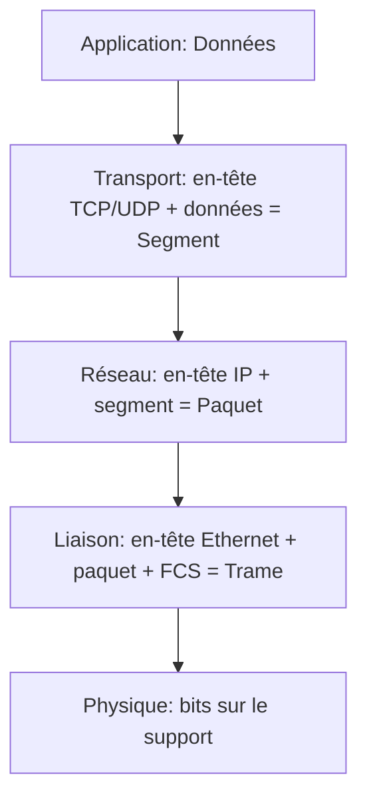

## Le modèle TCP/IP

Le modèle TCP/IP, utilisé réellement sur Internet, comporte 4 couches (parfois présentées en 5).

| Couche TCP/IP | Couches OSI | Protocoles |
|---|---|---|
| Application | 5, 6, 7 | HTTP, HTTPS, DNS, DHCP, FTP, SSH, SMTP |
| Transport | 4 | TCP, UDP |
| Internet | 3 | IP (v4, v6), ICMP, IPsec |
| Accès réseau | 1, 2 | Ethernet, Wi-Fi, ARP |

## Pièges fréquents

| Piège | Conséquence | Remède |
| --- | --- | --- |
| Confondre le modèle OSI (référence) et TCP/IP (modèle réel) | Mauvaise couche incriminée lors d'un diagnostic | Raisonner en couches OSI, savoir la correspondance avec les 4 couches TCP/IP |
| Confondre switch (couche 2) et routeur (couche 3) | Mauvais choix d'équipement, VLAN qui ne communiquent pas | Le switch commute par adresse MAC, le routeur route par adresse IP |
| Croire qu'une étoile n'a pas de point de défaillance | Panne de tout le site si le switch central tombe | Prévoir la redondance (liens agrégés, second switch, onduleur) |
| Réseau pair à pair en entreprise | Droits et sécurité ingérables, aucune traçabilité | Architecture client–serveur avec comptes centralisés |

---

# Environnement de laboratoire et outillage

## Objectifs d'apprentissage

Préparer un laboratoire virtuel isolé et reproductible (VirtualBox, réseau interne, instantanés) ; choisir les outils de simulation (Packet Tracer, GNS3) et de diagnostic ; adopter les conventions et précautions du cours (droits administrateur, commandes obsolètes, retour arrière).

## Prérequis

- Savoir utiliser un système d'exploitation (Windows ou Linux) et un terminal.
- Notions de base : fichiers, processus, installation de logiciels.
- Aucune connaissance préalable des réseaux n'est exigée.

## Outils nécessaires

| Outil | Usage | Gratuit |
|---|---|---|
| VirtualBox ou VMware Workstation Player | Machines virtuelles pour les TP | Oui |
| Ubuntu Server 24.04 LTS (ISO) | Serveurs Linux | Oui |
| Windows 11 / Windows Server (évaluation) | Postes clients et serveurs | Évaluation |
| Cisco Packet Tracer | Simulation Cisco | Oui (compte Cisco Networking Academy) |
| GNS3 | Simulation avancée | Oui |
| Wireshark | Analyse de paquets | Oui |
| Un éditeur de texte (VS Code, nano, vim) | Fichiers de configuration | Oui |

## Machines virtuelles, réseau et plan d'adressage du laboratoire

### Machines virtuelles

Hyperviseur : **VirtualBox** (gratuit) ou VMware Workstation Player. Ressources recommandées : 8 Go de RAM et 4 cœurs sur l'hôte permettent de faire fonctionner 2 ou 3 machines Ubuntu Server (1 Go de RAM chacune).

| VM | Rôle | Système | RAM |
|---|---|---|---|
| `srv-lab` | Serveur des TP (DHCP, DNS, SSH, Samba, pare-feu) | Ubuntu Server 24.04 LTS | 1 Go |
| `cli-ubuntu` | Client Linux | Ubuntu Server 24.04 LTS (ou Desktop) | 1 Go |
| `cli-win` (facultatif) | Client Windows | Windows 11 (évaluation) | 4 Go |

À l'installation d'Ubuntu Server : cocher « Install OpenSSH server », créer l'utilisateur `admin`.

### Cartes réseau de VirtualBox

Pour chaque VM (Paramètres > Réseau) :

| Carte | Mode | Rôle |
|---|---|---|
| Adapter 1 | **NAT** | Accès Internet pour installer des paquets (adresse 10.0.2.15) |
| Adapter 2 | **Réseau interne**, nom `lab-net` | Réseau du laboratoire (isolé de votre réseau réel) |

Dans les VM, les interfaces se nomment en général `enp0s3` (NAT) et `enp0s8` (réseau interne). **Vérifiez avec** `ip -br link` et adaptez les exemples. Un réseau interne VirtualBox **ne fournit pas de DHCP** : c'est exactement ce qui permet de construire le vôtre au TP 3.

### Plan d'adressage du laboratoire

| Hôte | Interface | Adresse |
|---|---|---|
| srv-lab | enp0s8 | 192.168.10.10/24 |
| cli-ubuntu | enp0s8 | 192.168.10.101/24 (statique), puis DHCP |
| cli-win | Ethernet 2 | 192.168.10.102/24 (statique), puis DHCP |
| Domaine DNS du TP | | `entreprise.local` |

### Bonnes pratiques de laboratoire

- Faire un **instantané (snapshot)** de chaque VM avant chaque TP et avant chaque panne introduite : retour à un état propre en quelques secondes.
- Ne jamais brancher le laboratoire (réseau interne) à un réseau de production, ni lancer un serveur DHCP sur un réseau partagé : vous perturberiez d'autres machines.
- Tenir un journal de bord : date, action, commande, résultat.

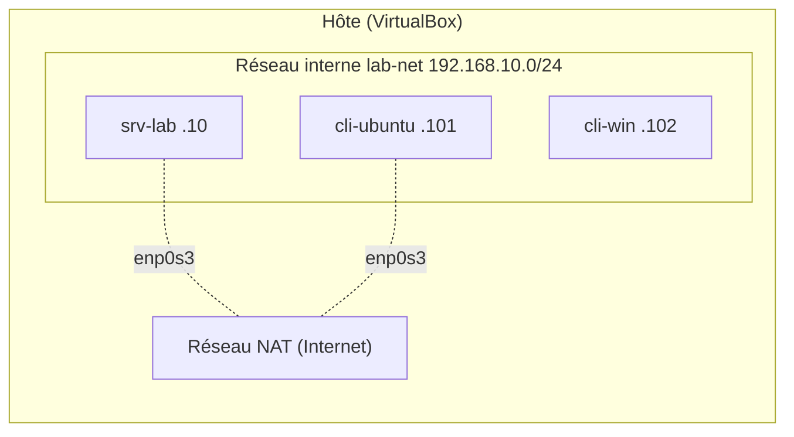

## Pièges fréquents

| Piège | Conséquence | Remède |
| --- | --- | --- |
| Brancher le laboratoire sur le réseau de production | Serveur DHCP pirate, perturbation d'autres machines | Utiliser un réseau interne VirtualBox isolé |
| Aucun instantané avant un TP | Laboratoire à reconstruire après une erreur de configuration | Instantané avant chaque TP et chaque panne introduite |
| Supposer les noms d'interface identiques (`enp0s8`) | Commandes sans effet ou erreurs | Vérifier avec `ip -br link` et adapter les exemples |
| Images d'équipements propriétaires sans licence (GNS3) | Usage illégal du logiciel | Utiliser des images libres ou dont vous détenez la licence |

---

# Protocoles, adresses et noms

## Objectifs d'apprentissage

Distinguer TCP et UDP et décrire la poignée de main en trois temps ; connaître les protocoles et ports usuels (HTTP, HTTPS, SSH, DNS, DHCP, SMB…) ; différencier adresse MAC et adresse IP et expliquer ARP ; comparer IPv4 et IPv6 ; utiliser adresses privées et publiques, masque et passerelle ; expliquer le rôle de DNS et DHCP (DORA) ; comprendre ports et sockets.

## Protocoles essentiels

### TCP et UDP

| Critère | TCP | UDP |
|---|---|---|
| Mode | Connecté | Sans connexion |
| Fiabilité | Accusés de réception, retransmission | Aucune garantie |
| Ordre des données | Garanti | Non garanti |
| Vitesse | Plus lent | Plus rapide, léger |
| Usage | Web, SSH, e-mail, fichiers | DNS (requêtes), DHCP, voix, vidéo, streaming |

Une connexion TCP s'établit par la **poignée de main en trois temps** :

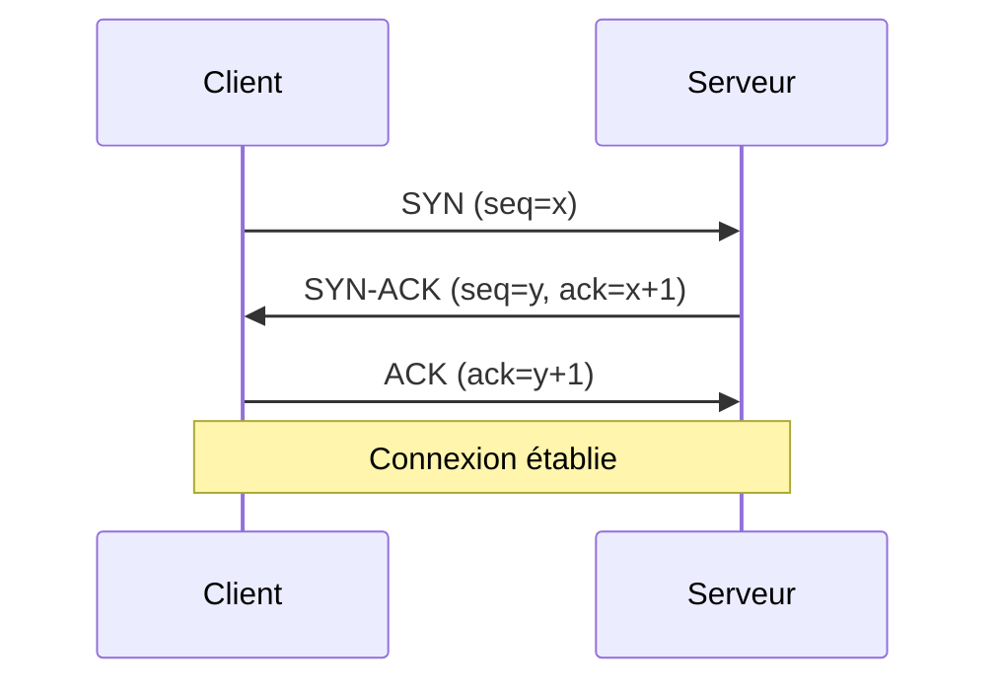

### Protocoles applicatifs et ports usuels

| Protocole | Rôle | Port(s) | Transport |
|---|---|---|---|
| HTTP | Web non chiffré | 80 | TCP |
| HTTPS | Web chiffré (TLS) | 443 | TCP (et UDP pour HTTP/3) |
| FTP | Transfert de fichiers (non chiffré) | 21 (contrôle), 20 (données en mode actif) | TCP |
| SSH / SFTP | Administration distante chiffrée / transfert | 22 | TCP |
| Telnet | Administration non chiffrée (à éviter) | 23 | TCP |
| SMTP | Envoi de courriel | 25 (relais), 587 (soumission) | TCP |
| DNS | Résolution de noms | 53 | UDP et TCP |
| DHCP | Attribution d'adresses | 67 (serveur), 68 (client) | UDP |
| NTP | Synchronisation de l'heure | 123 | UDP |
| SMB | Partage de fichiers Windows/Samba | 445 | TCP |
| RDP | Bureau à distance Windows | 3389 | TCP |

### ICMP

ICMP (Internet Control Message Protocol) transporte des messages de contrôle et d'erreur. `ping` utilise ICMP Echo Request (type 8) et Echo Reply (type 0). `traceroute` exploite le message « Time Exceeded » (type 11) lié au champ TTL.

## Adresses MAC et IP

| Critère | Adresse MAC | Adresse IP |
|---|---|---|
| Couche OSI | 2 (liaison) | 3 (réseau) |
| Taille | 48 bits (6 octets) | 32 bits (IPv4) ou 128 bits (IPv6) |
| Format | `00:1A:2B:3C:4D:5E` | `192.168.1.10` |
| Attribution | Fabricant (OUI + identifiant) | Administrateur ou DHCP |
| Portée | Segment local (non routée) | Routée à travers les réseaux |

### ARP

ARP (Address Resolution Protocol) associe une adresse IPv4 à une adresse MAC sur le réseau local : l'hôte diffuse « Qui possède 192.168.1.1 ? » en broadcast, et le propriétaire répond avec sa MAC.

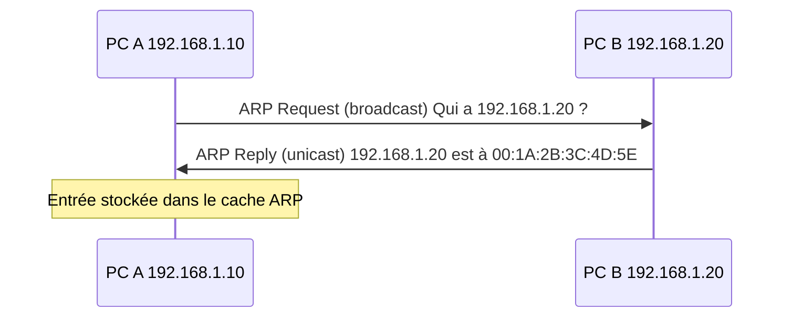

Sur IPv6, ARP est remplacé par **NDP** (Neighbor Discovery Protocol).

## IPv4 et IPv6

| Critère | IPv4 | IPv6 |
|---|---|---|
| Taille | 32 bits | 128 bits |
| Notation | Décimale pointée `192.168.1.10` | Hexadécimale `2001:db8::10` |
| Nombre d'adresses | environ 4,3 milliards | environ 3,4 x 10^38 |
| Diffusion (broadcast) | Oui | Non (multicast) |
| NAT | Très répandu | Non nécessaire en principe |
| Configuration | Manuelle, DHCP | SLAAC, DHCPv6, manuelle |

### Adresses privées et publiques (IPv4)

Les plages privées de la RFC 1918 ne sont pas routées sur Internet :

| Plage | Notation CIDR | Nombre d'adresses |
|---|---|---|
| 10.0.0.0 à 10.255.255.255 | 10.0.0.0/8 | 16 777 216 |
| 172.16.0.0 à 172.31.255.255 | 172.16.0.0/12 | 1 048 576 |
| 192.168.0.0 à 192.168.255.255 | 192.168.0.0/16 | 65 536 |

Autres plages spéciales à connaître :

| Plage | Signification |
|---|---|
| 127.0.0.0/8 | Boucle locale (loopback) |
| 169.254.0.0/16 | APIPA / lien local : un poste n'a pas obtenu d'adresse DHCP |
| 100.64.0.0/10 | CGNAT (opérateurs) |
| 224.0.0.0/4 | Multicast |

## Masque de sous-réseau et passerelle par défaut

Le **masque de sous-réseau** indique quelle partie de l'adresse identifie le réseau et laquelle identifie l'hôte. Avec `192.168.1.10` et le masque `255.255.255.0` (/24) : réseau `192.168.1.0`, hôte `.10`.

La **passerelle par défaut** est l'adresse du routeur sur le réseau local. Un hôte l'utilise pour joindre toute destination hors de son réseau. Elle doit être **dans le même sous-réseau** que l'hôte.

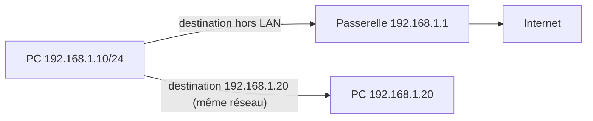

## DNS et DHCP

### DHCP (Dynamic Host Configuration Protocol)

Le serveur DHCP attribue automatiquement : adresse IP, masque, passerelle, serveurs DNS, durée du bail. Le processus est appelé **DORA** :

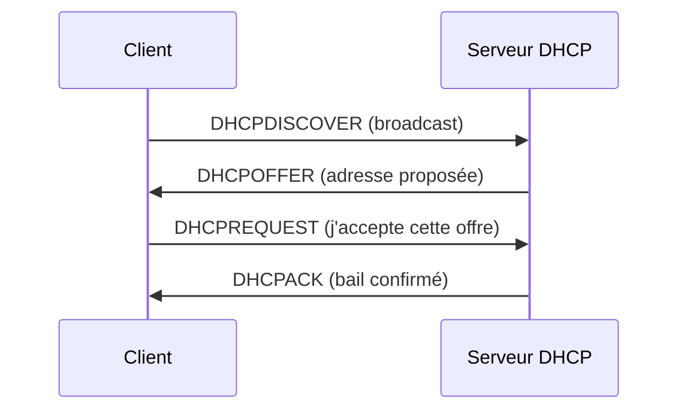

Si aucun serveur ne répond, Windows s'attribue une adresse **APIPA** en `169.254.x.x` : symptôme classique d'un DHCP indisponible.

### DNS (Domain Name System)

Le DNS traduit un nom (`www.exemple.fr`) en adresse IP. Types d'enregistrements fréquents :

| Type | Rôle | Exemple |
|---|---|---|
| A | Nom vers IPv4 | `srv1 A 192.168.10.10` |
| AAAA | Nom vers IPv6 | `srv1 AAAA 2001:db8::10` |
| CNAME | Alias | `www CNAME srv1` |
| MX | Serveur de messagerie | `exemple.fr MX 10 mail` |
| NS | Serveur de noms de la zone | `exemple.fr NS ns1` |
| PTR | Adresse vers nom (zone inverse) | `10.10.168.192.in-addr.arpa PTR srv1` |
| TXT | Texte libre (SPF, vérifications) | `v=spf1 ...` |

## Ports et sockets

Un **port** (0 à 65535) identifie une application sur une machine. Un **socket** est la combinaison adresse IP + port + protocole de transport, par exemple `192.168.1.10:51034 -> 93.184.216.34:443/TCP`.

| Plage | Nom | Usage |
|---|---|---|
| 0 à 1023 | Ports système (well-known) | Services standard (80, 443, 22...) |
| 1024 à 49151 | Ports enregistrés | Applications |
| 49152 à 65535 | Ports dynamiques (éphémères) | Côté client des connexions (la plage exacte dépend du système) |

Références : [RFC 791 (IPv4)](https://www.rfc-editor.org/rfc/rfc791), [RFC 8200 (IPv6)](https://www.rfc-editor.org/rfc/rfc8200), [RFC 793 puis RFC 9293 (TCP)](https://www.rfc-editor.org/rfc/rfc9293), [RFC 826 (ARP)](https://www.rfc-editor.org/rfc/rfc826), [RFC 1918 (adresses privées)](https://www.rfc-editor.org/rfc/rfc1918), [RFC 2131 (DHCP)](https://www.rfc-editor.org/rfc/rfc2131), [RFC 1035 (DNS)](https://www.rfc-editor.org/rfc/rfc1035).

## Pièges fréquents

| Piège | Conséquence | Remède |
| --- | --- | --- |
| Conclure qu'un hôte est éteint parce que `ping` échoue | Fausse piste, perte de temps | ICMP peut être filtré : tester aussi le port du service |
| Confondre DNS et DHCP | Mauvais service redémarré | DHCP attribue la configuration IP ; DNS résout les noms |
| Confondre port ouvert et service fonctionnel | Test de port réussi mais application en panne | Tester aussi l'application (`curl`, client réel) |
| Adresse `169.254.x.x` ignorée | Poste sans accès réseau sans que l'on comprenne pourquoi | C'est l'APIPA : le DHCP n'a pas répondu |

---

# Adressage IPv4 et subnetting

## Objectifs d'apprentissage

Lire une adresse IPv4 en binaire ; utiliser classes et notation CIDR ; calculer masque, adresse réseau, broadcast, plage utilisable et nombre d'hôtes ; découper un réseau en sous-réseaux de taille fixe puis en VLSM ; établir un plan d'adressage cohérent.

## Structure d'une adresse IPv4

Une adresse IPv4 comporte 32 bits, répartis en 4 octets notés en décimal.

```text
192      .168      .1        .10
11000000 .10101000 .00000001 .00001010
```

Chaque octet vaut de 0 à 255. Table de conversion des puissances de 2 :

| Bit | 7 | 6 | 5 | 4 | 3 | 2 | 1 | 0 |
|---|---|---|---|---|---|---|---|---|
| Valeur | 128 | 64 | 32 | 16 | 8 | 4 | 2 | 1 |

Exemple : `00001010` = 8 + 2 = 10.

## Classes d'adresses et CIDR

Le système par classes est historique (RFC 791) ; il est remplacé depuis 1993 par **CIDR** (Classless Inter-Domain Routing, RFC 4632).

| Classe | Premier octet | Masque par défaut | Usage historique |
|---|---|---|---|
| A | 1 à 126 | /8 (255.0.0.0) | Très grands réseaux |
| B | 128 à 191 | /16 (255.255.0.0) | Réseaux moyens |
| C | 192 à 223 | /24 (255.255.255.0) | Petits réseaux |
| D | 224 à 239 | n/a | Multicast |
| E | 240 à 255 | n/a | Réservé |

Le premier octet 127 est réservé au loopback.

La **notation CIDR** `192.168.1.10/24` indique que les 24 premiers bits identifient le réseau.

## Calcul des masques de sous-réseau

Un masque est une suite de bits à 1 (réseau) suivie de bits à 0 (hôtes).

| CIDR | Masque décimal | Bits hôtes | Adresses | Hôtes utilisables |
|---|---|---|---|---|
| /24 | 255.255.255.0 | 8 | 256 | 254 |
| /25 | 255.255.255.128 | 7 | 128 | 126 |
| /26 | 255.255.255.192 | 6 | 64 | 62 |
| /27 | 255.255.255.224 | 5 | 32 | 30 |
| /28 | 255.255.255.240 | 4 | 16 | 14 |
| /29 | 255.255.255.248 | 3 | 8 | 6 |
| /30 | 255.255.255.252 | 2 | 4 | 2 |
| /31 | 255.255.255.254 | 1 | 2 | 2 (liaisons point à point, RFC 3021) |

### Formules à retenir

- Nombre d'adresses d'un sous-réseau : `2^(32 - préfixe)`
- Nombre d'hôtes utilisables : `2^(32 - préfixe) - 2` (pour un préfixe inférieur à /31)
- Taille du « saut » (block size) dans l'octet concerné : `256 - valeur du masque dans cet octet`

## Adresse réseau, broadcast et plage utilisable

Pour une adresse hôte et son masque :

1. **Adresse réseau** = adresse ET (AND bit à bit) masque.
2. **Adresse de broadcast** = tous les bits hôtes à 1.
3. **Première adresse utilisable** = adresse réseau + 1.
4. **Dernière adresse utilisable** = broadcast - 1.

### Exemple détaillé : 192.168.1.130/26

- Masque /26 = 255.255.255.192, taille du saut = 256 - 192 = 64.
- Multiples de 64 dans le 4e octet : 0, 64, 128, 192. L'hôte 130 est dans le bloc 128.
- Adresse réseau : 192.168.1.128
- Broadcast : 192.168.1.191 (128 + 64 - 1)
- Plage utilisable : 192.168.1.129 à 192.168.1.190
- Hôtes utilisables : 2^6 - 2 = 62

Vérification binaire du 4e octet : `130 = 10000010`, masque `192 = 11000000`, ET = `10000000 = 128`.

## Découpage d'un réseau en sous-réseaux (subnetting à taille fixe)

**Énoncé :** découper `192.168.10.0/24` en 4 sous-réseaux égaux.

1. 4 sous-réseaux = 2^2, donc on emprunte 2 bits : nouveau préfixe /26.
2. Taille de chaque sous-réseau : 64 adresses, 62 hôtes.

| Sous-réseau | Réseau | Plage utilisable | Broadcast |
|---|---|---|---|
| 1 | 192.168.10.0/26 | .1 à .62 | .63 |
| 2 | 192.168.10.64/26 | .65 à .126 | .127 |
| 3 | 192.168.10.128/26 | .129 à .190 | .191 |
| 4 | 192.168.10.192/26 | .193 à .254 | .255 |

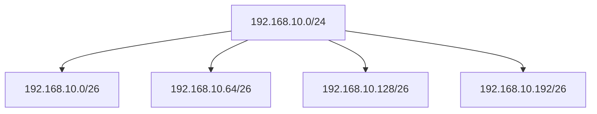

## VLSM (Variable Length Subnet Mask)

Le VLSM permet d'utiliser des masques différents selon les besoins, pour éviter le gaspillage.

**Énoncé :** à partir de `192.168.1.0/24`, créer des sous-réseaux pour : Comptabilité (100 hôtes), Technique (50 hôtes), Direction (25 hôtes), liaison routeur-routeur (2 hôtes).

**Méthode :** trier du plus grand au plus petit, puis attribuer les blocs successivement.

| Besoin | Hôtes requis | Masque retenu | Capacité | Réseau | Plage utilisable | Broadcast |
|---|---|---|---|---|---|---|
| Comptabilité | 100 | /25 | 126 | 192.168.1.0/25 | .1 à .126 | .127 |
| Technique | 50 | /26 | 62 | 192.168.1.128/26 | .129 à .190 | .191 |
| Direction | 25 | /27 | 30 | 192.168.1.192/27 | .193 à .222 | .223 |
| Liaison WAN | 2 | /30 | 2 | 192.168.1.224/30 | .225 à .226 | .227 |

Espace restant : de 192.168.1.228 à 192.168.1.255, disponible pour des extensions.

## Pièges fréquents

| Piège | Conséquence | Remède |
| --- | --- | --- |
| Oublier les deux adresses réservées (réseau et broadcast) | Nombre d'hôtes surestimé de 2 | Hôtes utilisables = 2^(32 − préfixe) − 2 |
| Attribuer les blocs VLSM dans le désordre | Chevauchements, gaspillage d'adresses | Trier du plus grand au plus petit besoin avant d'attribuer |
| Passerelle hors du sous-réseau de l'hôte | Aucune sortie du réseau local | Vérifier que la passerelle appartient au même sous-réseau |
| Plan d'adressage non prévu pour la croissance | Renumérotation coûteuse plus tard | Prévoir de la réserve (par exemple un /24 par VLAN) |

---

# IPv6 et configuration IP statique ou dynamique

## Objectifs d'apprentissage

Lire et abréger une adresse IPv6 ; identifier les types d'adresses (global, ULA, lien local, multicast) ; choisir entre configuration statique, DHCP et réservation ; configurer une adresse persistante sous Ubuntu (Netplan) et sous Windows (PowerShell) avec retour arrière.

## Notions d'adressage IPv6

Une adresse IPv6 comporte 8 groupes de 16 bits notés en hexadécimal : `2001:0db8:0000:0000:0000:0000:0000:0010`.

**Règles d'abréviation :**

1. On peut supprimer les zéros de tête de chaque groupe : `2001:db8:0:0:0:0:0:10`.
2. Une seule suite de groupes à zéro peut être remplacée par `::` : `2001:db8::10`.

| Type | Préfixe | Rôle |
|---|---|---|
| Global unicast | 2000::/3 | Adresses publiques routables |
| Unique local (ULA) | fc00::/7 (en pratique fd00::/8) | Adresses privées internes |
| Link-local | fe80::/10 | Communication sur le lien local, obligatoire sur chaque interface |
| Multicast | ff00::/8 | Diffusion groupée |
| Loopback | ::1/128 | Boucle locale |
| Documentation | 2001:db8::/32 | Exemples (RFC 3849) |

En pratique, un sous-réseau IPv6 de LAN utilise un préfixe **/64**. Un site reçoit souvent un /48 ou un /56 de son fournisseur.

## Configuration IP statique et dynamique

| Mode | Avantages | Inconvénients | Usage |
|---|---|---|---|
| Statique | Adresse stable | Gestion manuelle, risque de conflit | Serveurs, imprimantes, équipements réseau |
| Dynamique (DHCP) | Automatique, centralisé | Dépend du serveur DHCP | Postes de travail, Wi-Fi |
| DHCP avec réservation | Adresse stable gérée centralement | Configuration côté serveur | Imprimantes, serveurs non critiques |

### Configuration statique sous Ubuntu Server (Netplan, 22.04 et 24.04)

Fichier : `/etc/netplan/01-reseau.yaml` (le nom varie selon l'installation, par exemple `00-installer-config.yaml` ou `50-cloud-init.yaml`).

```yaml
network:
  version: 2
  renderer: networkd
  ethernets:
    ens18:
      dhcp4: false
      addresses:
        - 192.168.10.10/24
      routes:
        - to: default
          via: 192.168.10.1
      nameservers:
        addresses: [192.168.10.2, 1.1.1.1]
```

Application sécurisée (**Droits admin**, **Risque** : coupure de connexion SSH en cas d'erreur) :

```bash
# Sauvegarde avant modification
sudo cp /etc/netplan/01-reseau.yaml /etc/netplan/01-reseau.yaml.bak

# Test avec retour arrière automatique au bout de 120 secondes sans confirmation
sudo netplan try

# Si le test est validé et que l'on veut appliquer sans délai
sudo netplan apply
```

Le nom de l'interface (`ens18` ici) doit être adapté : `ip -br link` liste les interfaces.

### Configuration statique sous Windows (PowerShell, **Droits admin**)

```powershell
# Identifier l'interface
Get-NetAdapter

# Définir l'adresse et la passerelle
New-NetIPAddress -InterfaceAlias "Ethernet" -IPAddress 192.168.10.50 -PrefixLength 24 -DefaultGateway 192.168.10.1

# Définir les serveurs DNS
Set-DnsClientServerAddress -InterfaceAlias "Ethernet" -ServerAddresses 192.168.10.2,1.1.1.1

# Retour arrière : repasser en DHCP
Set-NetIPInterface -InterfaceAlias "Ethernet" -Dhcp Enabled
Set-DnsClientServerAddress -InterfaceAlias "Ethernet" -ResetServerAddresses
```

Si une adresse ou une route existe déjà, `New-NetIPAddress` renvoie une erreur ; il faut alors supprimer l'ancienne configuration avec `Remove-NetIPAddress` et `Remove-NetRoute`.

Références : [RFC 4632 (CIDR)](https://www.rfc-editor.org/rfc/rfc4632), [RFC 4291 (adressage IPv6)](https://www.rfc-editor.org/rfc/rfc4291), [RFC 3021 (/31)](https://www.rfc-editor.org/rfc/rfc3021), [Netplan](https://netplan.readthedocs.io/), [Microsoft Learn : NetTCPIP](https://learn.microsoft.com/powershell/module/nettcpip/).

## Pièges fréquents

| Piège | Conséquence | Remède |
| --- | --- | --- |
| Tabulations dans un fichier Netplan | `netplan generate` échoue (YAML invalide) | Indenter avec des espaces uniquement |
| `netplan apply` sur une machine distante sans filet | Perte de la session SSH en cas d'erreur | Utiliser `netplan try` (annulation automatique) |
| `New-NetIPAddress` quand le DHCP est actif | Erreur ou configuration mixte | Désactiver le DHCP de l'interface avant d'attribuer l'adresse |
| Deux fois `::` dans une adresse IPv6 | Adresse invalide ou ambiguë | Une seule suite de groupes à zéro peut être abrégée |

---

# Commandes réseau sous Windows

## Objectifs d'apprentissage

Utiliser les commandes CMD (`ipconfig`, `ping`, `tracert`, `pathping`, `nslookup`, `netstat`, `arp`, `route`, `netsh`, `net`…) et les cmdlets PowerShell (`Get-Net*`, `Test-NetConnection`, `Resolve-DnsName`, `New-NetFirewallRule`…) ; interpréter leurs résultats ; savoir quand les droits administrateur sont nécessaires ; mener un dépannage guidé par un arbre de décision.

## Principes généraux

### CMD, PowerShell et outils complémentaires

| Famille | Description | Exemples |
|---|---|---|
| Commandes CMD (exécutables classiques) | Programmes en ligne de commande hérités, texte brut en sortie | `ipconfig`, `ping`, `netstat`, `netsh` |
| Cmdlets PowerShell | Commandes orientées objets (module `NetTCPIP`, `NetAdapter`, `DnsClient`, `NetSecurity`) | `Get-NetIPConfiguration`, `Test-NetConnection` |
| Outils complémentaires | Programmes à installer ou à activer | Wireshark, Sysinternals TCPView, `pktmon` (inclus depuis Windows 10 1809) |

Les exécutables CMD (`ping`, `ipconfig`...) fonctionnent aussi dans PowerShell. Les cmdlets PowerShell, elles, ne fonctionnent pas dans CMD.

### Différences de syntaxe

| Point | CMD | PowerShell |
|---|---|---|
| Options | `/all`, `-n 4` (selon l'outil) | `-Name valeur` (paramètres nommés) |
| Sortie | Texte | Objets (filtrables avec `Where-Object`, `Select-Object`) |
| Filtrer | `\| findstr motif` | `\| Where-Object { ... }` ou `\| Select-String motif` |
| Alias piégeux | n/a | Dans Windows PowerShell 5.1, `curl` et `wget` sont des alias de `Invoke-WebRequest` ; utiliser `curl.exe` pour le vrai programme curl |

### Droits administrateur

Pour ouvrir une session élevée : clic droit sur le terminal puis « Exécuter en tant qu'administrateur ». Dans ce guide, la mention **Droits admin** signale une commande qui échoue ou reste partielle sans élévation. Les commandes de lecture simples (`ipconfig`, `ping`, `Get-NetIPConfiguration`) n'en demandent pas ; les commandes de modification (`New-NetIPAddress`, `route add`, `netsh ... set`) en demandent.

### Précautions

Toute commande qui modifie l'adresse IP, les routes, le DNS ou le pare-feu peut vous déconnecter, surtout à distance (RDP, SSH). Avant modification : noter la configuration actuelle (`ipconfig /all > C:\temp\avant.txt`), disposer d'un accès console ou d'un second accès, et connaître la commande de retour arrière.

## Commandes CMD

### ipconfig

**Rôle :** afficher et gérer la configuration IP des interfaces.

**Syntaxe :** `ipconfig [/all] [/release] [/renew] [/flushdns] [/displaydns] [/registerdns]`

| Option | Effet | Droits admin |
|---|---|---|
| (aucune) | Adresse IP, masque, passerelle de chaque interface | Non |
| `/all` | Détail complet : MAC, DHCP, DNS, bail | Non |
| `/release` | Libère le bail DHCP | Oui |
| `/renew` | Demande un nouveau bail DHCP | Oui |
| `/flushdns` | Vide le cache DNS du client | Oui |
| `/displaydns` | Affiche le cache DNS | Non |
| `/registerdns` | Réenregistre le nom dans le DNS (utile en domaine) | Oui |
| `/release6`, `/renew6` | Équivalents pour DHCPv6 | Oui |

**Exemple :**

```text
C:\> ipconfig /all

Carte Ethernet Ethernet :

   Suffixe DNS propre à la connexion. . . : entreprise.local
   Description. . . . . . . . . . . . . . : Intel(R) Ethernet Connection
   Adresse physique . . . . . . . . . . . : 00-1A-2B-3C-4D-5E
   DHCP activé. . . . . . . . . . . . . . : Oui
   Adresse IPv4. . . . . . . . . . . . . .: 192.168.10.54(préféré)
   Masque de sous-réseau. . . . . . . . . : 255.255.255.0
   Bail obtenu. . . . . . . . . . . . . . : lundi 16 novembre 2026 08:12:03
   Bail expirant. . . . . . . . . . . . . : mardi 17 novembre 2026 08:12:03
   Passerelle par défaut. . . . . . . . . : 192.168.10.1
   Serveur DHCP . . . . . . . . . . . . . : 192.168.10.2
   Serveurs DNS. . . . . . . . . . . . . .: 192.168.10.2
```

(Sortie représentative ; les libellés varient selon la langue de Windows.)

**Interprétation :** vérifier que l'adresse appartient au bon sous-réseau, que la passerelle est dans ce sous-réseau, que le serveur DHCP et le DNS sont ceux attendus. Une adresse `169.254.x.x` indique l'échec du DHCP.

**Dépannage :** poste en 169.254.x.x. Vérifier le câble, puis `ipconfig /release` et `ipconfig /renew`. Si l'échec persiste, tester un autre port ou un autre poste pour isoler un problème de VLAN ou de DHCP.

### ping

**Rôle :** tester l'accessibilité d'un hôte avec ICMP Echo et mesurer la latence.

**Syntaxe :** `ping [-t] [-n nombre] [-l taille] [-f] [-i TTL] [-w délai_ms] [-4] [-6] [-a] [-S adresse_source] cible`

| Option | Effet |
|---|---|
| `-t` | Ping continu jusqu'à Ctrl+C |
| `-n N` | Nombre de requêtes (4 par défaut) |
| `-l T` | Taille des données en octets (32 par défaut) |
| `-f` | Interdit la fragmentation (IPv4), utile pour tester la MTU |
| `-i TTL` | Durée de vie du paquet |
| `-w ms` | Délai d'attente par réponse |
| `-4`, `-6` | Force IPv4 ou IPv6 |
| `-a` | Résout l'adresse en nom |
| `-S src` | Adresse source (poste multi-adresses) |

**Exemple et résultat :**

```text
C:\> ping -n 4 192.168.10.1

Envoi d'une requête 'Ping' 192.168.10.1 avec 32 octets de données :
Réponse de 192.168.10.1 : octets=32 temps<1ms TTL=64
Réponse de 192.168.10.1 : octets=32 temps=1ms TTL=64
Réponse de 192.168.10.1 : octets=32 temps<1ms TTL=64
Réponse de 192.168.10.1 : octets=32 temps<1ms TTL=64

Statistiques Ping pour 192.168.10.1:
    Paquets : envoyés = 4, reçus = 4, perdus = 0 (perte 0%)
```

**Interprétation des messages :**

| Message | Signification probable |
|---|---|
| `Réponse de ...` | Hôte joignable |
| `Délai d'attente de la demande dépassé` | Hôte éteint, filtré (pare-feu) ou route de retour absente |
| `Impossible de joindre l'hôte de destination` | Pas de route ou de réponse ARP/routeur |
| `Échec général` | Problème de configuration locale (interface, IP) |
| `La requête n'a pas pu trouver l'hôte` | Échec de résolution DNS |

Remarque : un ping sans réponse ne prouve pas qu'un hôte est éteint ; Windows bloque par défaut les requêtes ICMP entrantes via le pare-feu.

**Dépannage :** tester dans l'ordre `ping 127.0.0.1` (pile TCP/IP), `ping <IP locale>`, `ping <passerelle>`, `ping 1.1.1.1`, `ping www.exemple.fr`. Le premier échec indique la couche à examiner.

### tracert

**Rôle :** afficher le chemin (sauts) vers une destination en incrémentant le TTL.

**Syntaxe :** `tracert [-d] [-h sauts_max] [-w délai_ms] [-4] [-6] cible`

| Option | Effet |
|---|---|
| `-d` | Pas de résolution DNS des sauts (plus rapide) |
| `-h N` | Nombre maximal de sauts (30 par défaut) |
| `-w ms` | Délai d'attente par réponse |

```text
C:\> tracert -d 1.1.1.1

  1    <1 ms    <1 ms    <1 ms  192.168.10.1
  2     4 ms     3 ms     4 ms  203.0.113.1
  3     *        *        *     Délai d'attente de la demande dépassé.
  4    12 ms    11 ms    12 ms  1.1.1.1
```

**Interprétation :** une ligne d'étoiles isolée est fréquente (routeur qui ne répond pas à ICMP) ; elle n'est un problème que si le chemin s'arrête définitivement. Un saut où la latence augmente et reste élevée ensuite localise le lien lent.

**Dépannage :** le tracert s'arrête au saut 1 : problème sur la passerelle ou le lien local. Il s'arrête chez le fournisseur : problème côté opérateur.

### pathping

**Rôle :** combine `ping` et `tracert` en mesurant la perte de paquets saut par saut sur plusieurs minutes.

**Syntaxe :** `pathping [-n] [-h sauts_max] [-q requêtes_par_saut] [-p période_ms] [-w délai_ms] [-4] [-6] cible`

**Exemple :** `pathping -n -q 50 1.1.1.1` (compter 1 à 5 minutes de mesure).

**Interprétation :** la seconde partie du résultat donne le pourcentage de perte par saut. Une perte qui apparaît à un saut et se prolonge sur les suivants désigne un lien défectueux ; une perte isolée sur un seul saut vient souvent du rate limiting ICMP du routeur et n'est pas significative.

### nslookup

**Rôle :** interroger un serveur DNS.

**Syntaxe :** `nslookup [-type=TYPE] nom [serveur_dns]` ou mode interactif `nslookup` puis `set type=MX`, `server 8.8.8.8`.

```text
C:\> nslookup www.exemple.fr 192.168.10.2

Serveur :   dns1.entreprise.local
Address:    192.168.10.2

Réponse ne faisant pas autorité :
Nom :    www.exemple.fr
Address:  93.184.216.34
```

**Interprétation :** « ne faisant pas autorité » signifie que la réponse vient du cache du serveur et non du serveur responsable de la zone. Si `nslookup` échoue avec « Request timed out », le serveur DNS ne répond pas.

**Dépannage :** comparer `nslookup nom` (serveur configuré) et `nslookup nom 1.1.1.1`. Si seul le second fonctionne, le DNS interne est en cause.

Remarque : `nslookup` est un outil historique ; PowerShell propose `Resolve-DnsName` (voir plus loin).

### netstat

**Rôle :** afficher les connexions, ports en écoute, statistiques et table de routage.

**Syntaxe :** `netstat [-a] [-n] [-o] [-b] [-e] [-r] [-s] [-p protocole] [intervalle]`

| Option | Effet | Droits admin |
|---|---|---|
| `-a` | Toutes les connexions et ports en écoute | Non |
| `-n` | Adresses et ports numériques | Non |
| `-o` | Ajoute le PID du processus | Non |
| `-b` | Affiche l'exécutable propriétaire | Oui |
| `-e` | Statistiques Ethernet | Non |
| `-r` | Table de routage | Non |
| `-s` | Statistiques par protocole | Non |
| `-p proto` | Filtre par protocole (TCP, UDP, TCPv6...) | Non |

```text
C:\> netstat -ano | findstr :443

  TCP    192.168.10.54:51034    93.184.216.34:443    ESTABLISHED    7432
  TCP    0.0.0.0:443            0.0.0.0:0            LISTENING      4
```

**Interprétation :** `LISTENING` = port en attente de connexions ; `ESTABLISHED` = connexion active ; `TIME_WAIT` = connexion fermée en attente ; `SYN_SENT` persistant = destination injoignable ou filtrée. Pour trouver le programme : `tasklist /fi "PID eq 7432"`.

### arp

**Rôle :** consulter et gérer le cache ARP (IPv4).

**Syntaxe :** `arp -a [adresse]`, `arp -d [adresse|*]`, `arp -s adresse mac`

| Option | Effet | Droits admin |
|---|---|---|
| `-a` | Affiche le cache | Non |
| `-d` | Supprime une entrée (ou `*` pour tout) | Oui |
| `-s` | Ajoute une entrée statique | Oui |

```text
C:\> arp -a 192.168.10.1

Interface : 192.168.10.54 --- 0x6
  Adresse Internet      Adresse physique      Type
  192.168.10.1          aa-bb-cc-dd-ee-01     dynamique
```

**Interprétation :** une même MAC associée à plusieurs adresses IP différentes peut signaler un proxy ARP ou une attaque d'ARP spoofing. Une adresse IP associée à `ff-ff-ff-ff-ff-ff` ou absente indique un hôte injoignable.

**Dépannage :** après le remplacement d'un routeur, un poste garde l'ancienne MAC en cache : `arp -d *` (**Droits admin**) force une nouvelle résolution.

### route

**Rôle :** afficher et modifier la table de routage IPv4/IPv6 locale.

**Syntaxe :** `route [-f] [-p] commande [destination] [MASK masque] [passerelle] [METRIC n] [IF interface]`

| Commande | Effet | Droits admin |
|---|---|---|
| `route print` | Affiche la table | Non |
| `route add` | Ajoute une route (temporaire sauf `-p`) | Oui |
| `route delete` | Supprime une route | Oui |
| `route change` | Modifie une route | Oui |
| `-p` | Rend la route persistante après redémarrage | Oui |

**Exemple :** `route add 10.20.0.0 MASK 255.255.0.0 192.168.10.254 METRIC 10`

**Retour arrière :** `route delete 10.20.0.0`. Attention : `route -f` supprime toutes les routes, y compris la route par défaut ; à éviter sur une machine distante.

### getmac

**Rôle :** afficher les adresses MAC.

**Syntaxe :** `getmac [/v] [/fo {table|list|csv}] [/s ordinateur]`

```text
C:\> getmac /v /fo table

Nom de connexion  Carte réseau            Adresse physique    Nom de transport
================= ======================= =================== ==========================
Ethernet          Intel(R) Ethernet ...   00-1A-2B-3C-4D-5E   \Device\Tcpip_{...}
```

### hostname

**Rôle :** afficher le nom de l'ordinateur.

**Syntaxe :** `hostname`. Le renommage se fait par `Rename-Computer` (PowerShell, **Droits admin**, redémarrage requis).

### nbtstat

**Rôle :** diagnostiquer NetBIOS sur TCP/IP (protocole hérité).

**Syntaxe :** `nbtstat [-a nom] [-A adresse_IP] [-c] [-n] [-r] [-R] [-RR] [-s] [-S]`

| Option | Effet |
|---|---|
| `-a nom` | Table de noms NetBIOS d'un hôte distant par nom |
| `-A IP` | Idem par adresse IP |
| `-c` | Cache de noms NetBIOS |
| `-n` | Noms locaux |
| `-R` | Purge et recharge le cache de noms distants |
| `-s` | Sessions NetBIOS |

**Usage :** utile uniquement dans des environnements anciens (WINS, partages hérités). Dans un réseau moderne, privilégier DNS et SMB sur le port 445.

### netsh

**Rôle :** utilitaire de configuration réseau en ligne de commande, organisé en contextes (`interface`, `wlan`, `advfirewall`, `winsock`...). Il est progressivement remplacé par PowerShell, mais reste très répandu.

| Besoin | Commande | Droits admin |
|---|---|---|
| Voir la configuration IP | `netsh interface ip show config` | Non |
| IP statique | `netsh interface ipv4 set address name="Ethernet" static 192.168.10.50 255.255.255.0 192.168.10.1` | Oui |
| Repasser en DHCP | `netsh interface ipv4 set address name="Ethernet" source=dhcp` | Oui |
| DNS statique | `netsh interface ipv4 set dnsservers name="Ethernet" static 192.168.10.2 primary` | Oui |
| Profils Wi-Fi | `netsh wlan show profiles` | Non |
| Rapport Wi-Fi | `netsh wlan show wlanreport` | Oui |
| État du pare-feu | `netsh advfirewall show allprofiles` | Non |
| Exporter le pare-feu | `netsh advfirewall export "C:\temp\pare-feu.wfw"` | Oui |
| Réinitialiser Winsock | `netsh winsock reset` | Oui, redémarrage |
| Réinitialiser la pile IP | `netsh int ip reset` | Oui, redémarrage |

**Risque :** `netsh winsock reset` et `netsh int ip reset` effacent des paramètres de pile ; à utiliser en dernier recours, après avoir noté la configuration. **Retour arrière du pare-feu :** `netsh advfirewall import "C:\temp\pare-feu.wfw"`.

### net

**Rôle :** gestion de ressources Windows (partages, utilisateurs, services). Syntaxe : `net commande`.

| Commande | Effet | Droits admin |
|---|---|---|
| `net use Z: \\srv\partage /persistent:yes` | Mappe un lecteur réseau | Non |
| `net use * /delete` | Supprime les connexions | Non |
| `net view \\srv` | Liste les partages d'un serveur | Non |
| `net share` | Liste les partages locaux | Oui (création) |
| `net user` / `net localgroup` | Comptes et groupes locaux | Oui (modification) |
| `net start` / `net stop service` | Démarre ou arrête un service | Oui |
| `net statistics workstation` | Statistiques du client | Non |

**Dépannage :** erreur système 53 (« chemin réseau introuvable ») : problème de résolution de nom ou port 445 bloqué ; tester `Test-NetConnection srv -Port 445`. Erreur 1219 : connexion multiple avec des identifiants différents ; `net use * /delete` puis nouvelle connexion.

### telnet

**Rôle :** client TCP en texte clair. Il n'est pas installé par défaut sur les Windows récents. **Obsolète et non sécurisé** : tout transite en clair. Pour tester un port, préférer `Test-NetConnection`. Pour administrer, préférer SSH.

Activation (**Droits admin**) : `Enable-WindowsOptionalFeature -Online -FeatureName TelnetClient` ou `dism /online /Enable-Feature /FeatureName:TelnetClient`.

Usage de test : `telnet 192.168.10.10 25` ; un écran noir signifie généralement que le port est ouvert, `Connexion impossible` qu'il est fermé ou filtré.

### ftp

**Rôle :** client FTP intégré. **Non chiffré** : à proscrire sur des réseaux non maîtrisés. Alternative : `sftp` et `scp` (client OpenSSH inclus dans Windows 10 et 11, installable en fonctionnalité facultative).

**Syntaxe :** `ftp [-v] [-n] [-i] [-s:fichier] [-A] [hôte]`. Commandes interactives usuelles : `open`, `user`, `ls`, `get`, `put`, `bye`. Option `-s:` pour automatiser par script (les identifiants s'y trouvent en clair).

### tftp

**Rôle :** transfert de fichiers sans authentification (UDP 69), utilisé pour sauvegarder ou restaurer des configurations d'équipements réseau en laboratoire. Fonctionnalité « Client TFTP » à activer : `Enable-WindowsOptionalFeature -Online -FeatureName TFTP` (**Droits admin**).

**Syntaxe :** `tftp [-i] hôte {GET|PUT} source [destination]`. Exemple : `tftp -i 192.168.10.5 PUT config.txt`. Non sécurisé : réserver à un réseau d'administration isolé.

### systeminfo

**Rôle :** informations système, dont les cartes réseau et les correctifs installés. Syntaxe : `systeminfo [/s ordinateur /u utilisateur /p mot_de_passe] [/fo {TABLE|LIST|CSV}]`.

**Usage réseau :** `systeminfo | findstr /i "Carte réseau DHCP"` (la chaîne dépend de la langue). Utile pour récupérer rapidement nom d'hôte, domaine, version de Windows et cartes réseau.

### tasklist et taskkill

**tasklist :** liste les processus. Syntaxe : `tasklist [/v] [/svc] [/fi "filtre"] [/m module]`.

**taskkill :** termine un processus. Syntaxe : `taskkill [/pid PID | /im nom.exe] [/f] [/t]`. **Droits admin** pour les processus d'autres comptes.

**Usage réseau :** après `netstat -ano`, identifier un programme qui occupe un port :

```text
C:\> tasklist /fi "PID eq 7432"
Nom de l'image     PID  Nom de la session  Mémoire utilisée
chrome.exe        7432  Console                 112 340 Ko
```

**Risque :** `taskkill /f` termine brutalement le processus et peut perdre des données ; ne jamais l'appliquer à un processus système ou à un service critique sans en connaître le rôle.

## Cmdlets PowerShell

Les modules `NetTCPIP`, `NetAdapter`, `DnsClient` et `NetSecurity` sont disponibles depuis Windows 8 et Windows Server 2012. Les exemples fonctionnent dans Windows PowerShell 5.1 et PowerShell 7. Pour afficher l'aide : `Get-Help Get-NetIPAddress -Examples`.

### Consultation

| Cmdlet | Rôle | Exemple |
|---|---|---|
| `Get-NetIPConfiguration` | Vue d'ensemble : interface, IP, passerelle, DNS | `Get-NetIPConfiguration -Detailed` |
| `Get-NetIPAddress` | Adresses IP et préfixes | `Get-NetIPAddress -AddressFamily IPv4 -InterfaceAlias "Ethernet"` |
| `Get-NetAdapter` | Cartes réseau, état, vitesse, MAC | `Get-NetAdapter -Physical` |
| `Get-NetRoute` | Table de routage | `Get-NetRoute -DestinationPrefix "0.0.0.0/0"` |
| `Get-DnsClientServerAddress` | Serveurs DNS configurés | `Get-DnsClientServerAddress -AddressFamily IPv4` |
| `Get-NetTCPConnection` | Connexions et ports TCP | `Get-NetTCPConnection -State Listen` |
| `Get-NetNeighbor` | Cache ARP (IPv4) et NDP (IPv6) | `Get-NetNeighbor -AddressFamily IPv4` |
| `Get-NetFirewallProfile` | État des profils de pare-feu | `Get-NetFirewallProfile \| Format-Table Name, Enabled` |
| `Get-NetFirewallRule` | Règles de pare-feu | `Get-NetFirewallRule -Enabled True -Direction Inbound` |

Exemple de sortie de `Get-NetAdapter` :

```text
PS> Get-NetAdapter

Name       InterfaceDescription            ifIndex Status  MacAddress         LinkSpeed
----       --------------------            ------- ------  ----------         ---------
Ethernet   Intel(R) Ethernet Connection         6  Up      00-1A-2B-3C-4D-5E  1 Gbps
Wi-Fi      Intel(R) Wi-Fi 6 AX201               9  Disconnected  ...          0 bps
```

**Interprétation :** `Status` à `Up` indique un lien actif ; `Disconnected` un câble débranché ou un Wi-Fi non associé ; `Disabled` une carte désactivée par logiciel. `LinkSpeed` à 100 Mbps sur un lien prévu à 1 Gbps suggère un câble ou un port défectueux.

### Tests

**Test-NetConnection** (équivalent moderne de `ping`, `tracert` et du test de port) :

| Usage | Commande |
|---|---|
| Ping ICMP | `Test-NetConnection 192.168.10.1` |
| Test d'un port TCP | `Test-NetConnection srv-web -Port 443` |
| Port courant par nom | `Test-NetConnection srv-web -CommonTCPPort HTTP` |
| Traceroute | `Test-NetConnection 1.1.1.1 -TraceRoute` |
| Détails | `Test-NetConnection srv-web -Port 443 -InformationLevel Detailed` |

```text
PS> Test-NetConnection srv-web -Port 443

ComputerName     : srv-web
RemoteAddress    : 192.168.10.20
RemotePort       : 443
InterfaceAlias   : Ethernet
SourceAddress    : 192.168.10.54
TcpTestSucceeded : True
```

**Interprétation :** `TcpTestSucceeded : True` prouve que le port est joignable de bout en bout. `False` avec un `PingSucceeded` à `True` signale un port fermé ou filtré alors que l'hôte est joignable.

**Resolve-DnsName :** interroge le DNS avec les types d'enregistrements.

```powershell
Resolve-DnsName www.exemple.fr -Type A
Resolve-DnsName exemple.fr -Type MX -Server 1.1.1.1
Resolve-DnsName srv-web -DnsOnly   # ignore hosts et LLMNR, teste uniquement le DNS
```

**Test-Connection :** ping orienté objets. Dans Windows PowerShell 5.1 : `Test-Connection 192.168.10.1 -Count 2` ; avec `-Quiet`, renvoie `True` ou `False`. Dans PowerShell 7, la sortie et certains paramètres diffèrent.

### Modification (**Droits admin**)

| Cmdlet | Rôle | Retour arrière |
|---|---|---|
| `New-NetIPAddress` | Ajoute une IP, un préfixe et une passerelle | `Remove-NetIPAddress` |
| `Set-NetIPInterface -Dhcp Enabled\|Disabled` | Active ou désactive le DHCP sur l'interface | Valeur inverse |
| `Set-DnsClientServerAddress` | Définit les serveurs DNS | `-ResetServerAddresses` |
| `Restart-NetAdapter` | Redémarre une carte | Aucun besoin |
| `Enable-NetAdapter` / `Disable-NetAdapter` | Active ou désactive une carte | Commande inverse |
| `New-NetFirewallRule` | Crée une règle de pare-feu | `Remove-NetFirewallRule` |

**Exemples :**

```powershell
# IP statique (voir aussi les sections « Adressage IPv4 et subnetting » et « IPv6 et configuration IP statique ou dynamique »)
New-NetIPAddress -InterfaceAlias "Ethernet" -IPAddress 192.168.10.50 -PrefixLength 24 -DefaultGateway 192.168.10.1
Set-DnsClientServerAddress -InterfaceAlias "Ethernet" -ServerAddresses 192.168.10.2,1.1.1.1

# Redémarrer une carte
Restart-NetAdapter -Name "Ethernet"

# Désactiver (risque : coupure) puis réactiver
Disable-NetAdapter -Name "Wi-Fi" -Confirm:$false
Enable-NetAdapter -Name "Wi-Fi"

# Autoriser le port TCP 8080 en entrée, uniquement depuis le réseau local, profils Domaine et Privé
New-NetFirewallRule -DisplayName "App interne 8080" -Direction Inbound -Protocol TCP -LocalPort 8080 -RemoteAddress 192.168.10.0/24 -Action Allow -Profile Domain,Private

# Retour arrière
Remove-NetFirewallRule -DisplayName "App interne 8080"
```

**Piège :** `New-NetIPAddress` échoue si une adresse DHCP existe déjà sur l'interface. Désactiver d'abord le DHCP : `Set-NetIPInterface -InterfaceAlias "Ethernet" -Dhcp Disabled`.

### Autres cmdlets utiles

| Cmdlet | Usage |
|---|---|
| `Clear-DnsClientCache`, `Get-DnsClientCache` | Vider ou afficher le cache DNS (équivalents de `ipconfig /flushdns` et `/displaydns`) |
| `Get-NetAdapterStatistics` | Compteurs d'octets, de paquets et d'erreurs |
| `Get-NetIPInterface` | État DHCP, métrique, MTU de chaque interface |
| `New-NetRoute`, `Remove-NetRoute` | Ajout et suppression de routes (équivalents de `route add` et `delete`) |
| `Get-NetUDPEndpoint` | Ports UDP en écoute |
| `Get-NetConnectionProfile` | Profil réseau (Public, Privé, Domaine) qui détermine les règles du pare-feu |
| `Set-NetFirewallProfile` | Modifie les profils de pare-feu |
| `Enable-NetFirewallRule`, `Disable-NetFirewallRule` | Active ou désactive une règle existante |

### Correspondance CMD et PowerShell

| Besoin | CMD | PowerShell |
|---|---|---|
| Configuration IP | `ipconfig /all` | `Get-NetIPConfiguration -Detailed` |
| Tester un hôte | `ping` | `Test-Connection`, `Test-NetConnection` |
| Chemin réseau | `tracert` | `Test-NetConnection -TraceRoute` |
| Résolution DNS | `nslookup` | `Resolve-DnsName` |
| Connexions et ports | `netstat -ano` | `Get-NetTCPConnection` |
| Cache ARP | `arp -a` | `Get-NetNeighbor` |
| Table de routage | `route print` | `Get-NetRoute` |
| Vider le cache DNS | `ipconfig /flushdns` | `Clear-DnsClientCache` |
| IP statique | `netsh interface ipv4 set address` | `New-NetIPAddress` |
| Pare-feu | `netsh advfirewall` | `New-NetFirewallRule`, `Get-NetFirewallRule` |
| Tester un port | `telnet hôte port` | `Test-NetConnection hôte -Port N` |

## Outils complémentaires

| Outil | Rôle | Remarque |
|---|---|---|
| `curl.exe` | Requêtes HTTP(S) | Inclus depuis Windows 10 1803 ; ne pas confondre avec l'alias PowerShell `curl` |
| `ssh`, `scp`, `sftp` | Client OpenSSH | Fonctionnalité facultative, activée par défaut sur les versions récentes |
| `pktmon` | Capture de paquets intégrée | Depuis Windows 10 1809 ; **Droits admin** ; export possible au format pcapng pour Wireshark |
| `netsh trace start capture=yes` | Capture réseau native | **Droits admin** ; format .etl |
| Wireshark | Analyse approfondie de paquets | Voir section « Outils professionnels de diagnostic et de supervision » |
| TCPView (Sysinternals) | Connexions par processus en interface graphique | Microsoft Sysinternals |
| Moniteur de ressources (`resmon`) | Activité réseau par processus | Onglet Réseau |
| `nltest`, `dcdiag` | Diagnostic de domaine Active Directory | Serveurs et postes joints au domaine ; voir les sections sur les services Ubuntu Server et Windows Server |

## Scénarios de dépannage Windows

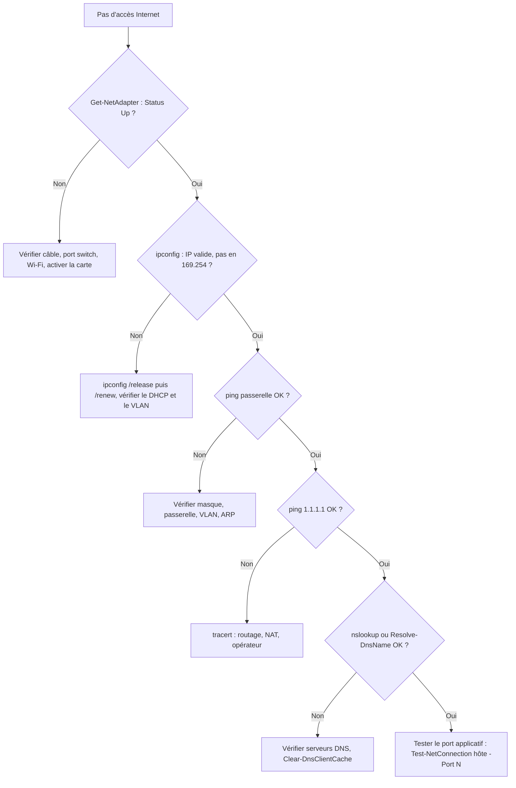

**Scénario 1 : poste sans Internet, adresse 169.254.x.x.**
1. `Get-NetAdapter` : lien `Up`.
2. `ipconfig /all` : `DHCP activé : Oui` mais IP APIPA.
3. `ipconfig /release` puis `ipconfig /renew` (**Droits admin**).
4. Si échec : changer de port ou de câble, vérifier le serveur DHCP et le VLAN du port.

**Scénario 2 : Internet fonctionne par IP mais pas par nom.**
1. `ping 1.1.1.1` répond ; `ping www.exemple.fr` échoue.
2. `Resolve-DnsName www.exemple.fr` échoue ; `Resolve-DnsName www.exemple.fr -Server 1.1.1.1` réussit : le DNS configuré est en cause.
3. Corriger avec `Set-DnsClientServerAddress` et `Clear-DnsClientCache`.

**Scénario 3 : un service web interne est inaccessible.**
1. `Test-NetConnection srv-web -Port 443` : `TcpTestSucceeded : False`, ping OK.
2. Sur le serveur : `Get-NetTCPConnection -LocalPort 443 -State Listen` : rien n'écoute, le service est arrêté ; ou règle de pare-feu manquante (`Get-NetFirewallRule`).
3. Démarrer le service, créer la règle, retester.

## Pièges fréquents

| Piège | Conséquence | Remède |
| --- | --- | --- |
| Lancer une commande de modification sans élévation | Échec silencieux ou « accès refusé » | Ouvrir une session en administrateur |
| `netsh winsock reset` / `netsh int ip reset` en première intention | Perte de paramètres de pile, VPN ou proxys cassés | En dernier recours, après avoir noté la configuration |
| `curl` dans Windows PowerShell 5.1 | C'est un alias de `Invoke-WebRequest` | Utiliser `curl.exe` |
| `route -f` sur un poste distant | Suppression de la route par défaut, perte d'accès | Supprimer une route précise (`route delete`) |
| Telnet et FTP pour administrer | Identifiants en clair sur le réseau | SSH, SFTP, ou `Test-NetConnection` pour un simple test de port |

---

# Commandes réseau sous Linux

## Objectifs d'apprentissage

Utiliser les commandes modernes (`ip`, `ss`, `ip neigh`, `dig`, `resolvectl`, `curl`, `nc`, `tcpdump`, `ethtool`, `nmap`…) et reconnaître les commandes obsolètes ; configurer le réseau avec Netplan, NetworkManager et `ip` ; administrer pare-feu (`ufw`, `iptables`, `nft`) et journaux (`journalctl`, `dmesg`) ; différencier Ubuntu Server, Debian et Red Hat.

## Principes généraux *(à jour)*

### Droits et conventions

- `$` : utilisateur normal ; `#` : root. Dans ce guide, on utilise `sudo` plutôt qu'une session root permanente.
- Un nom d'interface est de la forme `ens18`, `enp0s3`, `eth0` (noms prévisibles attribués par systemd). Adaptez-le avec `ip -br link`.
- Les modifications faites avec `ip` sont **temporaires** : elles disparaissent au redémarrage ou au redémarrage du service réseau. Pour les rendre durables, on passe par Netplan, NetworkManager ou `/etc/network/interfaces` selon la distribution.
- Avant toute modification réseau sur une machine distante, prévoir un retour arrière (voir la section « Modifier sans casser : risques et retour arrière »).

### Installer les outils manquants

Ubuntu Server minimal n'installe pas tous les outils de diagnostic.

```bash
# Debian, Ubuntu
sudo apt update
sudo apt install traceroute mtr-tiny dnsutils nmap tcpdump ethtool netcat-openbsd lsof net-tools

# RHEL 9, Rocky, AlmaLinux
sudo dnf install traceroute mtr bind-utils nmap tcpdump ethtool nmap-ncat lsof
```

`net-tools` fournit les commandes **obsolètes** `ifconfig`, `netstat`, `arp`, `route` ; il n'est cité ici que pour les reconnaître.

### Commandes obsolètes et alternatives modernes

| Obsolète | Alternative recommandée | Remarque |
|---|---|---|
| `ifconfig` | `ip addr`, `ip link` | Paquet net-tools, plus maintenu activement |
| `route` | `ip route` | |
| `netstat` | `ss` | `ss` est plus rapide et plus complet |
| `arp` | `ip neigh` | |
| `iwconfig` | `iw`, `nmcli device wifi` | |
| `service nom start` | `systemctl start nom` | `service` reste un alias de compatibilité |
| `ifup`, `ifdown` | Netplan, `nmcli`, `networkctl` | Encore valides sur Debian en mode `ifupdown` classique |
| `dhclient` | `networkctl renew`, `nmcli` | L'ISC DHCP est en fin de vie ; le client peut ne pas être installé |
| `iptables` | `nft` (ou `ufw`, `firewalld` en surcouche) | Sur les distributions récentes, `iptables` est souvent un frontal vers nftables |
| `nslookup` | `dig`, `resolvectl query` | `nslookup` n'est pas retiré, mais `dig` est plus précis |

### Différences entre distributions

| Élément | Ubuntu Server | Debian 12 | RHEL 9 / Rocky / Alma |
|---|---|---|---|
| Configuration réseau | Netplan (YAML) avec systemd-networkd ou NetworkManager | `/etc/network/interfaces` (ifupdown) par défaut en installation classique ; NetworkManager sur bureau | NetworkManager (`nmcli`, `nmtui`), fichiers de connexion keyfile |
| Résolveur DNS | systemd-resolved (stub 127.0.0.53) | Selon l'installation ; souvent `/etc/resolv.conf` simple | NetworkManager gère `/etc/resolv.conf` |
| Pare-feu simplifié | `ufw` (désactivé par défaut) | Aucun par défaut (nftables disponible) | `firewalld` (`firewall-cmd`) actif |
| Service SSH | `ssh.service` | `ssh.service` | `sshd.service` |
| Gestionnaire de paquets | `apt` | `apt` | `dnf` |

## Diagnostic réseau

### ip (famille de sous-commandes)

**Rôle :** consulter et configurer interfaces, adresses, routes et voisins (remplace `ifconfig`, `route`, `arp`). Paquet `iproute2`.

**Syntaxe :** `ip [options] objet commande` avec les objets `addr`, `link`, `route`, `neigh`.

| Option globale | Effet |
|---|---|
| `-br` (`-brief`) | Sortie résumée en tableau |
| `-4`, `-6` | Famille d'adresses |
| `-s` | Statistiques (compteurs) |
| `-c` | Sortie colorée |
| `-j` | Sortie JSON (exploitable avec `jq`) |

**Exemples :**

```bash
ip -br addr             # vue rapide des adresses
ip -br link             # état des interfaces
ip route                # table de routage
ip route get 8.8.8.8    # route que le noyau utilisera pour cette destination
ip -s link show ens18   # compteurs d'erreurs et de paquets
```

**Sortie représentative :**

```text
$ ip -br addr
lo               UNKNOWN        127.0.0.1/8 ::1/128
ens18            UP             192.168.10.10/24 fe80::be24:11ff:fe3a:5c2d/64

$ ip route
default via 192.168.10.1 dev ens18 proto static
192.168.10.0/24 dev ens18 proto kernel scope link src 192.168.10.10
```

**Interprétation :** `UP` signifie interface activée (le lien physique est indiqué par `LOWER_UP` dans `ip link`). `default via` désigne la passerelle. La route `proto kernel scope link` est le réseau local, créé automatiquement. Absence de ligne `default` : aucune sortie hors du LAN.

**Erreurs fréquentes :** oublier que `ip addr add` n'est pas persistant ; ajouter une adresse sans la retirer (l'interface cumule deux adresses) ; passerelle hors sous-réseau (`Error: Nexthop has invalid gateway`).

**Dépannage :** pas d'accès hors réseau local. `ip route` : pas de route par défaut. Correction temporaire (**sudo**) : `sudo ip route add default via 192.168.10.1 dev ens18`. Puis corriger durablement dans Netplan.

### ping

**Rôle :** test ICMP Echo. **Contrairement à Windows, le ping Linux est continu par défaut** : il faut `Ctrl+C` ou `-c`.

**Syntaxe :** `ping [-c N] [-i intervalle] [-s taille] [-W délai_s] [-w durée_totale_s] [-I interface|adresse] [-4|-6] [-M do] cible`

| Option | Effet |
|---|---|
| `-c N` | Nombre de requêtes |
| `-i s` | Intervalle entre requêtes (en dessous de 0,2 s : root) |
| `-s T` | Taille des données |
| `-W s` | Délai d'attente d'une réponse |
| `-w s` | Durée totale avant arrêt |
| `-I if` | Interface ou adresse source |
| `-M do` | Interdit la fragmentation (test de MTU) |

**Exemples :**

```bash
ping -c 4 192.168.10.1
ping -c 3 -I ens18 1.1.1.1
ping -c 2 -M do -s 1472 1.1.1.1   # 1472 + 28 octets d'en-têtes = 1500 : MTU standard
```

**Sortie :**

```text
$ ping -c 3 192.168.10.1
PING 192.168.10.1 (192.168.10.1) 56(84) bytes of data.
64 bytes from 192.168.10.1: icmp_seq=1 ttl=64 time=0.412 ms
64 bytes from 192.168.10.1: icmp_seq=2 ttl=64 time=0.389 ms
64 bytes from 192.168.10.1: icmp_seq=3 ttl=64 time=0.401 ms

--- 192.168.10.1 ping statistics ---
3 packets transmitted, 3 received, 0% packet loss, time 2043ms
rtt min/avg/max/mdev = 0.389/0.401/0.412/0.009 ms
```

**Interprétation :** `ttl` donne un indice du système distant (64 courant sous Linux, 128 sous Windows) ; `0% packet loss` et un `mdev` faible indiquent une liaison saine. `Destination Host Unreachable` venant de notre propre adresse : résolution ARP échouée. `Network is unreachable` : pas de route.

**Erreurs fréquentes :** conclure à une panne d'après un échec de ping alors qu'ICMP est filtré ; tester par nom sans savoir si c'est le DNS qui échoue (`Name or service not known`).

**Dépannage :** tester dans l'ordre `127.0.0.1`, IP locale, passerelle, `1.1.1.1`, puis un nom.

### traceroute et tracepath

**traceroute** (paquet `traceroute`) : chemin vers une destination (UDP par défaut sous Linux).

| Option | Effet | Droits |
|---|---|---|
| `-n` | Pas de résolution DNS | Non |
| `-I` | Utilise ICMP | Selon la configuration, souvent root |
| `-T -p 443` | Utilise TCP SYN vers un port (traverse mieux les pare-feu) | root |
| `-m N` | TTL maximum | Non |
| `-w s` | Délai d'attente | Non |

```text
$ traceroute -n 1.1.1.1
traceroute to 1.1.1.1 (1.1.1.1), 30 hops max, 60 byte packets
 1  192.168.10.1  0.5 ms  0.4 ms  0.4 ms
 2  203.0.113.1   4.1 ms  3.9 ms  4.0 ms
 3  * * *
 4  1.1.1.1      12.3 ms 12.1 ms 12.2 ms
```

**tracepath** (paquet `iputils-tracepath` ou inclus selon la distribution) : similaire, sans droits root, et affiche la **PMTU** détectée. `tracepath -n 1.1.1.1`.

**Interprétation :** voir tracert (section « Commandes réseau sous Windows »). `* * *` répétés jusqu'au TTL maximum : chemin coupé ou filtré. Un `pmtu 1400` signale une MTU réduite (tunnel, VPN, PPPoE).

### mtr

**Rôle :** `traceroute` et `ping` en continu, avec pourcentage de perte et latence par saut (paquet `mtr-tiny` ou `mtr`).

**Syntaxe :** `mtr [-n] [-r] [-c N] [-w] [-T -P port] [-b] cible`

```text
$ mtr -rn -c 20 1.1.1.1
HOST: srv1                  Loss%   Snt   Last   Avg  Best  Wrst StDev
  1.|-- 192.168.10.1         0.0%    20    0.5   0.5   0.4   0.7   0.1
  2.|-- 203.0.113.1          0.0%    20    4.0   4.1   3.8   5.2   0.3
  3.|-- ???                 100.0    20    0.0   0.0   0.0   0.0   0.0
  4.|-- 1.1.1.1              0.0%    20   12.2  12.3  12.0  13.1   0.3
```

**Interprétation :** la perte compte si elle persiste jusqu'à la destination. Ici le saut 3 ne répond pas à ICMP mais n'empêche pas d'atteindre le saut 4 : sans conséquence. Un saut avec 30 % de perte qui se retrouve à 30 % jusqu'à la fin désigne un lien défaillant. Usage typique : fournir un rapport `-r` à un opérateur.

### ss

**Rôle :** sockets, connexions et ports en écoute (remplace `netstat`). Paquet `iproute2`.

**Syntaxe :** `ss [options] [filtre]`

| Option | Effet |
|---|---|
| `-t`, `-u` | TCP, UDP |
| `-l` | Sockets en écoute |
| `-a` | Tous |
| `-n` | Numérique (ni noms de services, ni DNS) |
| `-p` | Processus (root pour voir ceux des autres utilisateurs) |
| `-s` | Résumé statistique |
| `-4`, `-6` | Famille |

```text
$ sudo ss -tulpn
Netid State  Recv-Q Send-Q Local Address:Port Peer Address:Port Process
udp   UNCONN 0      0      127.0.0.53%lo:53   0.0.0.0:*     users:(("systemd-resolve",pid=612,fd=13))
tcp   LISTEN 0      128    0.0.0.0:22         0.0.0.0:*     users:(("sshd",pid=801,fd=3))
tcp   LISTEN 0      511    0.0.0.0:80         0.0.0.0:*     users:(("nginx",pid=1020,fd=6))
```

**Interprétation :** `0.0.0.0:22` écoute sur toutes les interfaces IPv4 ; `127.0.0.1:5432` n'accepte que le local ; `[::]:80` écoute en IPv6 (et souvent en IPv4 selon `bindv6only`). Service attendu absent de la liste : service arrêté ou erreur de configuration.

**Exemples utiles :**

```bash
ss -tn state established '( dport = :443 )'   # connexions HTTPS établies
ss -s                                          # résumé
```

**Erreurs fréquentes :** oublier `-n` (résolution lente) ; oublier `sudo` pour `-p`.

**Dépannage :** « le site ne répond pas » : `sudo ss -tulpn | grep :80` ; si rien n'écoute, `systemctl status nginx`.

### netstat (obsolète)

Paquet `net-tools`. Équivalences : `netstat -tulpn` vaut `ss -tulpn` ; `netstat -r` vaut `ip route` ; `netstat -i` vaut `ip -s link`. À utiliser seulement s'il est imposé par un script existant.

### arp et ip neigh

**arp** est **obsolète** (net-tools). Utiliser **ip neigh**.

```bash
ip neigh show                       # table des voisins (ARP/NDP)
ip neigh show dev ens18
sudo ip neigh flush dev ens18       # vide le cache de l'interface
sudo ip neigh del 192.168.10.1 dev ens18
```

```text
$ ip neigh
192.168.10.1 dev ens18 lladdr aa:bb:cc:dd:ee:01 REACHABLE
192.168.10.54 dev ens18 lladdr 00:1a:2b:3c:4d:5e STALE
192.168.10.99 dev ens18  FAILED
```

**États :** `REACHABLE` (confirmé récemment), `STALE` (ancien, sera revalidé), `DELAY` et `PROBE` (vérification en cours), `INCOMPLETE` (requête sans réponse), `FAILED` (pas de réponse : hôte absent ou injoignable), `PERMANENT` (entrée statique).

**Dépannage :** deux IP pour la même MAC, ou une MAC qui change pour l'IP de la passerelle : suspicion d'ARP spoofing (voir section « Sécurité réseau en entreprise »).

### hostname

```bash
hostname            # nom court
hostname -f         # nom qualifié (FQDN), nécessite une résolution cohérente
hostname -I         # toutes les adresses IP (hors loopback)
```

Pour **modifier** le nom : `sudo hostnamectl set-hostname srv-fichiers`. `hostname -i` dépend de la résolution du nom local et peut renvoyer 127.0.1.1 : préférer `-I`.

### dig, nslookup, host

Paquets : `dnsutils` (Ubuntu 22.04), `bind9-dnsutils` (Ubuntu 24.04, Debian 12), `bind-utils` (RHEL).

**dig** (référence pour le diagnostic DNS) :

```bash
dig exemple.fr                      # enregistrement A, sortie complète
dig +short exemple.fr
dig exemple.fr MX
dig @192.168.10.2 exemple.fr        # interroge un serveur précis
dig -x 192.168.10.2                 # résolution inverse (PTR)
dig +trace exemple.fr               # suit la délégation depuis la racine
dig +tcp exemple.fr                 # force TCP
```

```text
$ dig @192.168.10.2 srv1.entreprise.local +noall +answer +stats
srv1.entreprise.local.  3600  IN  A  192.168.10.10
;; Query time: 1 msec
;; SERVER: 192.168.10.2#53(192.168.10.2)
```

**Interprétation :** `status: NOERROR` avec réponse : OK ; `NXDOMAIN` : le nom n'existe pas ; `SERVFAIL` : le serveur n'a pas pu répondre (zone cassée, DNSSEC, forwarder défaillant) ; `REFUSED` : le serveur refuse la requête (ACL). `connection timed out; no servers could be reached` : serveur injoignable (réseau, pare-feu, mauvais serveur).

**host** : version concise. `host exemple.fr`, `host -t MX exemple.fr`.

**nslookup** : voir section « Commandes réseau sous Windows » ; encore présent mais moins précis.

### resolvectl

**Rôle :** gérer et interroger **systemd-resolved** (Ubuntu). Remplace `systemd-resolve`, devenu obsolète.

```bash
resolvectl status                    # DNS par interface
resolvectl query exemple.fr          # résolution via le résolveur système
resolvectl flush-caches              # vide le cache
resolvectl statistics                # statistiques du cache
```

**Interprétation :** `resolvectl status` montre `Current DNS Server` et `DNS Servers` par interface. Le fichier `/etc/resolv.conf` pointe alors vers `127.0.0.53` (stub) : c'est normal. Ne modifiez pas ce fichier directement ; configurez le DNS dans Netplan ou NetworkManager.

### getent

**Rôle :** interroge les bases du système via NSS (Name Service Switch), donc **comme le font les applications** (fichier `/etc/hosts` puis DNS selon `/etc/nsswitch.conf`).

```bash
getent hosts srv1.entreprise.local
getent ahosts exemple.fr      # toutes les adresses, IPv4 et IPv6
```

**Intérêt :** si `dig` fonctionne mais `getent hosts` échoue, le problème vient de NSS, de `/etc/hosts` ou du résolveur local et non du serveur DNS.

### curl et wget

**curl :**

| Option | Effet |
|---|---|
| `-I` | En-têtes seulement (requête HEAD) |
| `-v` | Détail de la connexion, TLS et en-têtes |
| `-s` | Silencieux |
| `-L` | Suit les redirections |
| `-o fichier` | Écrit dans un fichier |
| `-k` | Ignore les erreurs de certificat (**dangereux**, diagnostic uniquement) |
| `--connect-timeout s`, `--max-time s` | Limites de temps |
| `--resolve hôte:port:ip` | Force une résolution (test d'un serveur avant bascule DNS) |
| `-w '%{http_code}\n'` | Affiche le code HTTP |

```bash
curl -I https://exemple.fr
curl -s -o /dev/null -w '%{http_code}\n' https://exemple.fr
curl --resolve exemple.fr:443:192.168.10.20 https://exemple.fr
```

**Codes de sortie fréquents :** 6 (nom non résolu), 7 (connexion refusée ou impossible), 28 (délai dépassé), 35 (échec du handshake TLS), 60 (certificat non approuvé).

**wget :** `wget -O fichier url`, `wget -q --spider url` (teste l'existence sans télécharger), `wget -c url` (reprise), `--no-check-certificate` (dangereux).

### nc (netcat)

**Rôle :** lecture et écriture sur des connexions TCP/UDP : test de port, transfert, écoute.

**Attention aux variantes :** Debian et Ubuntu installent `netcat-openbsd` (écoute avec `nc -l 9000`), RHEL fournit `ncat` de nmap (`nc -l 9000` accepte aussi `-k`, `--ssl`). La syntaxe `nc -l -p 9000` appartient à d'autres variantes.

```bash
nc -zv 192.168.10.20 443        # teste un port TCP (-z : scan sans envoi, -v : verbeux)
nc -zvu 192.168.10.2 53         # port UDP (résultat moins fiable)
nc -w 3 -zv srv 22              # délai de 3 secondes
nc -l 9000                      # écoute sur le port 9000 (côté récepteur)
```

```text
$ nc -zv 192.168.10.20 443
Connection to 192.168.10.20 443 port [tcp/https] succeeded!
```

**Erreurs :** `Connection refused` : hôte joint, aucun service n'écoute ; `Connection timed out` : filtrage ou hôte injoignable. Un test UDP réussi ne prouve pas que le service répond.

### tcpdump

**Rôle :** capture de paquets en ligne de commande. **Droits admin** (`sudo`).

**Syntaxe :** `tcpdump [-i interface] [-nn] [-c N] [-w fichier.pcap] [-r fichier] [-v|-vv] [-X] [-s taille] [filtre]`

| Option | Effet |
|---|---|
| `-i if` | Interface (`any` pour toutes) |
| `-n`, `-nn` | Pas de résolution de noms ni de ports |
| `-c N` | Arrête après N paquets |
| `-w`, `-r` | Écrire, lire une capture (ouvrable dans Wireshark) |
| `-X` | Affiche le contenu en hexadécimal et ASCII |

**Filtres (syntaxe BPF) :** `host 192.168.10.54`, `net 192.168.10.0/24`, `port 53`, `tcp`, `udp`, `icmp`, `src`, `dst`, combinés avec `and`, `or`, `not`.

```bash
sudo tcpdump -i ens18 -nn icmp
sudo tcpdump -i ens18 -nn port 53
sudo tcpdump -i ens18 -nn 'port 67 or port 68'        # DHCP
sudo tcpdump -i ens18 -nn -c 100 -w /tmp/capture.pcap host 192.168.10.54
```

```text
$ sudo tcpdump -i ens18 -nn 'port 67 or port 68'
10:12:01.101 IP 0.0.0.0.68 > 255.255.255.255.67: BOOTP/DHCP, Request from 00:1a:2b:3c:4d:5e
10:12:01.105 IP 192.168.10.2.67 > 192.168.10.54.68: BOOTP/DHCP, Reply
```

**Interprétation :** requête DHCP vue sans réponse : serveur absent, VLAN erroné ou relais manquant. Beaucoup de SYN sans SYN-ACK : service ou pare-feu en cause. **Précaution légale et éthique :** ne capturer que sur des réseaux dont vous avez l'autorisation ; une capture peut contenir des données personnelles et des mots de passe.

### ethtool

**Rôle :** état du lien physique et paramètres de la carte (paquet `ethtool`). Certaines commandes demandent **sudo**.

```bash
sudo ethtool ens18             # vitesse, duplex, lien
sudo ethtool -i ens18          # pilote et micrologiciel
sudo ethtool -S ens18          # statistiques détaillées (erreurs CRC...)
```

```text
$ sudo ethtool ens18
Settings for ens18:
        Speed: 1000Mb/s
        Duplex: Full
        Auto-negotiation: on
        Link detected: yes
```

**Interprétation :** `Speed: 100Mb/s` sur un lien 1 Gbit/s : câble ou port défectueux. `Duplex: Half` : incohérence d'autonégociation (cause de lenteur et de collisions). `Link detected: no` : câble, port ou switch. Les compteurs `rx_crc_errors` en hausse indiquent un câble mauvais ou parasité. Un changement forcé de vitesse (`ethtool -s`) est **risqué** (perte de lien) et non persistant.

### lsof

**Rôle :** liste les fichiers ouverts, donc aussi les sockets.

```bash
sudo lsof -i :80                       # processus utilisant le port 80
sudo lsof -iTCP -sTCP:LISTEN -P -n     # ports TCP en écoute
```

`-P` et `-n` évitent la résolution des ports et des noms. **Usage :** identifier le programme qui occupe un port (erreur « Address already in use » au démarrage d'un service).

### nmap

**Rôle :** découverte d'hôtes, scan de ports, détection de services. Paquet `nmap`.

> **Cadre légal :** ne scannez que vos propres systèmes ou ceux pour lesquels vous avez une autorisation écrite. Un scan non autorisé peut être illégal et peut perturber des équipements fragiles.

| Option | Effet |
|---|---|
| `-sn` | Découverte d'hôtes sans scan de ports |
| `-sS` | Scan SYN (root) |
| `-sT` | Scan par connexion complète (sans root) |
| `-sU` | Scan UDP (lent) |
| `-p 22,80,443` ou `-p-` | Ports à scanner ; tous les ports |
| `-sV` | Détection de versions de services |
| `-O` | Détection de système (root) |
| `-Pn` | Ne teste pas la présence de l'hôte |
| `--open` | N'affiche que les ports ouverts |
| `-T4` | Rythme plus rapide (réseau local de confiance) |

```bash
nmap -sn 192.168.10.0/24
sudo nmap -sS -sV -p 22,80,443 192.168.10.20
```

```text
PORT    STATE    SERVICE VERSION
22/tcp  open     ssh     OpenSSH 9.6p1 Ubuntu
80/tcp  open     http    nginx 1.24.0
443/tcp filtered https
```

**États :** `open` (service en écoute), `closed` (hôte joint, aucun service), `filtered` (paquets bloqués par un pare-feu), `open|filtered` (UDP incertain).

## Configuration réseau *(à jour)*

### ip addr, ip link, ip route, ip neigh : modification

Modifications **non persistantes**, **sudo** nécessaire, **risque** de perte de session distante.

```bash
sudo ip addr add 192.168.10.50/24 dev ens18       # ajoute une adresse
sudo ip addr del 192.168.10.50/24 dev ens18       # retire (retour arrière)
sudo ip link set ens18 down                       # désactive : ne jamais faire à distance sur l'interface de gestion
sudo ip link set ens18 up
sudo ip link set ens18 mtu 1400
sudo ip route add 10.20.0.0/16 via 192.168.10.254
sudo ip route del 10.20.0.0/16
sudo ip route replace default via 192.168.10.1
```

### netplan (Ubuntu)

Fichiers YAML dans `/etc/netplan/`. L'indentation se fait **avec des espaces, jamais avec des tabulations**. Les fichiers doivent être accessibles uniquement par root (`sudo chmod 600 /etc/netplan/*.yaml`), sinon les versions récentes affichent un avertissement.

```yaml
network:
  version: 2
  renderer: networkd
  ethernets:
    ens18:
      dhcp4: false
      addresses: [192.168.10.10/24]
      routes:
        - to: default
          via: 192.168.10.1
      nameservers:
        addresses: [192.168.10.2, 1.1.1.1]
        search: [entreprise.local]
```

| Commande | Effet |
|---|---|
| `sudo netplan generate` | Valide la syntaxe et génère la configuration du backend |
| `sudo netplan try` | Applique avec retour arrière automatique (120 s par défaut) sans confirmation |
| `sudo netplan apply` | Applique immédiatement |
| `netplan get` | Affiche la configuration fusionnée |
| `netplan status` | État des interfaces (versions récentes) |

**Erreurs fréquentes :** tabulations, mauvaise indentation, nom d'interface incorrect, deux fichiers qui définissent la même interface, absence de `dhcp4: false` quand on met une IP statique, et sur d'anciennes versions `gateway4:` (déprécié) au lieu de `routes`.

**Wi-Fi ou NetworkManager :** `renderer: NetworkManager`.

### nmcli et nmtui (NetworkManager)

Standard sur RHEL, Rocky, Alma, Fedora, Ubuntu bureau ; possible sur Debian et Ubuntu Server.

```bash
nmcli general status
nmcli device status
nmcli connection show

# Créer une connexion statique
sudo nmcli connection add type ethernet ifname ens18 con-name lan \
  ipv4.method manual ipv4.addresses 192.168.10.10/24 \
  ipv4.gateway 192.168.10.1 ipv4.dns "192.168.10.2 1.1.1.1"

sudo nmcli connection up lan
sudo nmcli connection modify lan ipv4.dns "192.168.10.2"
sudo nmcli connection down lan
sudo nmcli device wifi list
```

**Retour arrière :** `sudo nmcli connection delete lan` puis réactiver l'ancienne connexion (`nmcli connection up <nom>`). Les modifications `modify` s'appliquent à la prochaine activation (`up`).

**nmtui :** interface texte pour modifier une connexion (« Edit a connection »), pratique à la console.

### systemctl (services réseau)

```bash
systemctl status systemd-networkd
systemctl status NetworkManager
systemctl status ssh              # Ubuntu, Debian ; sur RHEL : sshd
sudo systemctl restart systemd-networkd
sudo systemctl enable --now nginx
systemctl is-active nginx
systemctl --failed
```

`restart` coupe brièvement les services ; sur une machine distante, **un redémarrage du service réseau peut interrompre votre session**. Préférez `reload` quand le service le supporte.

### ifup et ifdown

Valables avec le paquet `ifupdown` et le fichier `/etc/network/interfaces` (Debian). **Absents ou inadaptés** sur Ubuntu Server moderne (Netplan).

```text
# /etc/network/interfaces (Debian)
auto ens18
iface ens18 inet static
    address 192.168.10.10/24
    gateway 192.168.10.1
```

`sudo ifdown ens18 && sudo ifup ens18` : à exécuter en une seule ligne lorsque l'on est connecté à distance (sinon la session est perdue entre les deux). Alternatives modernes : `networkctl`, `nmcli`.

### dhclient (obsolète)

Client DHCP de l'ISC, en fin de vie. Alternatives : `sudo networkctl renew ens18` (systemd-networkd), `sudo nmcli device reapply ens18` ou `nmcli connection up` (NetworkManager). Dans un environnement ancien : `sudo dhclient -r ens18` (libère) puis `sudo dhclient ens18` (renouvelle).

### ufw

**Rôle :** pare-feu simplifié (surcouche d'iptables ou nftables). **Désactivé par défaut** sur Ubuntu. Non installé par défaut sur Debian et RHEL (qui utilise `firewalld`).

```bash
sudo ufw status verbose
sudo ufw default deny incoming
sudo ufw default allow outgoing
sudo ufw allow 22/tcp                                       # AVANT d'activer
sudo ufw allow from 192.168.10.0/24 to any port 443 proto tcp
sudo ufw limit 22/tcp                                       # limite les tentatives de connexion
sudo ufw enable
sudo ufw status numbered
sudo ufw delete 3
sudo ufw disable                                            # retour arrière rapide
```

**Risque majeur :** activer `ufw` avant d'avoir autorisé le port SSH vous coupe d'un serveur distant. Si SSH écoute sur un port non standard, autorisez ce port.

### iptables et nft

**iptables** est un frontal historique. Sur les distributions récentes, la commande `iptables` utilise souvent le backend nftables (`iptables --version` indique `nf_tables` ou `legacy`). Ne mélangez pas des règles iptables et nft sur la même machine sans les comprendre.

```bash
sudo iptables -L -n -v --line-numbers
sudo iptables -A INPUT -p tcp --dport 22 -s 192.168.10.0/24 -j ACCEPT
sudo iptables -D INPUT 3                    # supprime la règle n° 3
sudo iptables-save > /root/iptables.backup  # sauvegarde
```

Avertissement : `iptables -P INPUT DROP` sans règle d'autorisation SSH préalable coupe la session. Les règles ne sont pas persistantes sans `iptables-persistent` / `netfilter-persistent` (Debian, Ubuntu).

**nft (nftables)** : recommandé pour les nouvelles installations. Fichier de configuration : `/etc/nftables.conf`, service `nftables`.

```bash
sudo nft list ruleset
sudo nft list ruleset > /root/nft.backup     # sauvegarde
```

Exemple de jeu de règles minimal (`/etc/nftables.conf`) :

```text
#!/usr/sbin/nft -f
flush ruleset

table inet filter {
  chain input {
    type filter hook input priority 0; policy drop;
    iif lo accept
    ct state established,related accept
    ip protocol icmp accept
    ip6 nexthdr icmpv6 accept
    tcp dport 22 ip saddr 192.168.10.0/24 accept
    tcp dport { 80, 443 } accept
  }
  chain forward { type filter hook forward priority 0; policy drop; }
  chain output  { type filter hook output priority 0; policy accept; }
}
```

Application : `sudo nft -c -f /etc/nftables.conf` (vérification sans application), puis `sudo systemctl enable --now nftables`. **Retour arrière :** `sudo nft flush ruleset` supprime toutes les règles (la machine devient alors non filtrée) ; restaurez la sauvegarde avec `sudo nft -f /root/nft.backup`.

## Administration et surveillance

### journalctl

**Rôle :** lire les journaux de systemd.

| Option | Effet |
|---|---|
| `-u service` | Journal d'un service |
| `-f` | Suivi en direct |
| `-b` | Depuis le dernier démarrage (`-b -1` : le précédent) |
| `-p err` | Priorité erreur et plus grave |
| `--since "1 hour ago"` | Fenêtre de temps |
| `-k` | Messages du noyau |
| `-n 50` | 50 dernières lignes |

```bash
sudo journalctl -u ssh -n 50 --no-pager
sudo journalctl -u systemd-networkd -b
sudo journalctl -p err --since "1 hour ago"
```

**Usage :** échec de connexion SSH : `journalctl -u ssh` montre `Failed password for ...` ou `Connection closed by authenticating user`. Échec DHCP ou de lien : `journalctl -u systemd-networkd` ou `-u NetworkManager`.

### dmesg

Messages du noyau (pilotes, liens réseau). **Droits** : sur Ubuntu, `kernel.dmesg_restrict=1` impose souvent `sudo`. Options : `-T` (horodatage lisible), `-w` (suivi), `--level=err,warn`.

```text
$ sudo dmesg -T | grep -i ens18
[lun. nov. 16 09:14:02 2026] e1000e: ens18 NIC Link is Down
[lun. nov. 16 09:14:05 2026] e1000e: ens18 NIC Link is Up 1000 Mbps Full Duplex
```

Des alternances « Link is Down / Up » signalent un câble, une prise ou un port de switch défectueux.

### hostnamectl et timedatectl

```bash
hostnamectl                                     # nom, OS, noyau
sudo hostnamectl set-hostname srv-fichiers
timedatectl                                     # heure, fuseau, synchronisation
sudo timedatectl set-timezone Europe/Paris
sudo timedatectl set-ntp true
timedatectl timesync-status                     # état de systemd-timesyncd (si utilisé)
```

**Pourquoi l'heure compte :** les certificats TLS, Kerberos (Active Directory tolère 5 minutes d'écart par défaut), les journaux et la corrélation d'événements exigent des horloges synchronisées. Sur RHEL, la synchronisation est assurée par `chronyd` (`chronyc tracking`).

## Méthode de diagnostic Linux

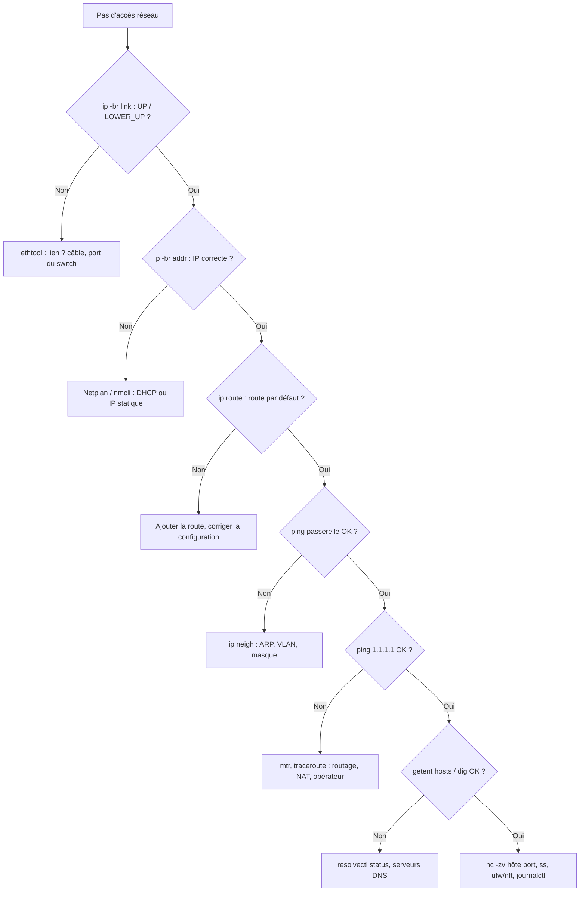

## Pièges fréquents

| Piège | Conséquence | Remède |
| --- | --- | --- |
| Croire qu'une configuration `ip addr add` est durable | Elle disparaît au redémarrage | Écrire la configuration dans Netplan, NetworkManager ou `interfaces` |
| `ufw enable` avant d'autoriser SSH | Coupure de la session distante | Créer la règle SSH d'abord, prévoir un filet de sécurité |
| Utiliser `ifconfig`, `netstat`, `arp` | Outils absents ou obsolètes | `ip addr`, `ss`, `ip neigh` |
| Se fier à `dig` seul | Les applications passent par NSS (`/etc/hosts`, résolveur local) | Comparer `dig` et `getent hosts` |
| Variantes de `nc` ignorées | Options qui ne fonctionnent pas selon la distribution | Vérifier la variante (openbsd, ncat) avec `man nc` |

---

# Équipements réseau, câblage et prise en main de Cisco IOS

## Objectifs d'apprentissage

Distinguer modem, routeur, switch, point d'accès, pare-feu et serveur ; choisir et réaliser un câblage Ethernet (catégories, T568A/B, baies, panneaux de brassage) ; naviguer dans les modes de Cisco IOS ; appliquer une configuration de base sécurisée (SSH, secrets, interfaces) et la vérifier.

## Les équipements et leur rôle

| Équipement | Couche OSI | Rôle | Exemple en entreprise |
|---|---|---|---|
| Modem / ONT | 1-2 | Convertit le signal de l'opérateur (fibre, VDSL) en Ethernet | Boîtier opérateur en mode bridge |
| Routeur | 3 | Relie des réseaux IP, route, fait du NAT | Passerelle vers Internet, routage inter-VLAN |
| Switch (commutateur) | 2 | Commute les trames selon la table MAC, gère les VLAN | Switch d'accès pour les postes |
| Switch de niveau 3 | 2-3 | Switch avec routage inter-VLAN en matériel | Cœur de réseau |
| Point d'accès Wi-Fi | 1-2 | Relie les clients sans fil au réseau filaire | AP plafonniers avec PoE |
| Pare-feu | 3-7 | Filtre le trafic selon des règles (état, applications) | Frontière avec Internet, séparation de zones |
| Serveur réseau | 7 | Fournit des services (DHCP, DNS, fichiers...) | Serveur Ubuntu ou Windows Server |

**Modem et double NAT :** si le boîtier de l'opérateur reste en mode routeur et que votre routeur fait aussi du NAT, le trafic est traduit deux fois (double NAT), ce qui complique les redirections de ports et les VPN. Solution : mode bridge sur le modem ou DMZ vers le routeur.

## Câblage Ethernet, baies et panneaux de brassage

### Catégories de câbles

| Catégorie | Débit usuel | Distance maximale | Remarque |
|---|---|---|---|
| Cat5e | 1 Gbit/s | 100 m | Minimum acceptable aujourd'hui |
| Cat6 | 1 Gbit/s ; 10 Gbit/s sur courtes distances (jusqu'à environ 55 m) | 100 m à 1 Gbit/s | |
| Cat6A | 10 Gbit/s | 100 m | Recommandé pour une nouvelle installation |
| Fibre multimode / monomode | 10 Gbit/s et plus | Centaines de mètres à dizaines de km | Liaisons entre baies et bâtiments |

Limite d'un canal Ethernet en cuivre : **100 m** au total, soit 90 m de câblage permanent (mur) et 10 m de cordons de brassage.

### Brochage RJ45

Norme **T568B** (la plus répandue en France et en entreprise) :

| Broche | 1 | 2 | 3 | 4 | 5 | 6 | 7 | 8 |
|---|---|---|---|---|---|---|---|---|
| T568B | blanc/orange | orange | blanc/vert | bleu | blanc/bleu | vert | blanc/marron | marron |
| T568A | blanc/vert | vert | blanc/orange | bleu | blanc/bleu | orange | blanc/marron | marron |

- **Câble droit** : même norme aux deux extrémités (poste vers switch).
- **Câble croisé** : T568A d'un côté et T568B de l'autre. Inutile avec les équipements modernes, qui détectent automatiquement le croisement (**Auto-MDIX**), mais utile sur du matériel ancien.
- Vérifier chaque câble avec un testeur de câble (continuité, paires croisées, longueur).

### Baie de brassage et panneaux

- **Baie 19 pouces** : l'unité de hauteur (**U**) vaut 44,45 mm. Une baie de 42U accueille switchs, panneaux, serveurs, onduleur.
- **Panneau de brassage (patch panel)** : reçoit les câbles venant des prises murales ; des cordons courts relient chaque prise au port du switch. Ce système évite de manipuler les câbles fixes.
- Bonnes pratiques : étiqueter les deux extrémités de chaque câble, utiliser des couleurs par usage (utilisateurs, serveurs, gestion), prévoir des passe-câbles et des rayons de courbure respectés, laisser de la place pour l'évolution, brancher l'équipement critique sur un onduleur.

```text
   Prise murale    Panneau de brassage     Switch
   [B-12] ==(câble fixe)==> [Port 12] --(cordon)--> [Gi0/12]
```

## Prise en main de Cisco IOS

### Modes de la ligne de commande

| Mode | Invite | Accès |
|---|---|---|
| Utilisateur (User EXEC) | `Router>` | Par défaut |
| Privilégié (Privileged EXEC) | `Router#` | `enable` |
| Configuration globale | `Router(config)#` | `configure terminal` (`conf t`) |
| Configuration d'interface | `Router(config-if)#` | `interface GigabitEthernet0/0` |
| Configuration de ligne | `Router(config-line)#` | `line vty 0 4` |

Aides : `?` (liste des commandes), `Tab` (complétion), `show running-config` (configuration active en RAM), `show startup-config` (configuration sauvegardée), `copy running-config startup-config` (sauvegarde ; sans elle, tout est perdu au redémarrage), `no commande` (annule une commande).

### Configuration de base sécurisée

```text
Router> enable
Router# configure terminal
Router(config)# hostname R1
R1(config)# no ip domain-lookup
R1(config)# ip domain-name entreprise.local
R1(config)# enable secret MotDePasseFort_A_Changer
R1(config)# username admin privilege 15 secret AutreMotDePasseFort
R1(config)# crypto key generate rsa modulus 2048
R1(config)# ip ssh version 2
R1(config)# line console 0
R1(config-line)# login local
R1(config-line)# exec-timeout 10 0
R1(config-line)# exit
R1(config)# line vty 0 4
R1(config-line)# login local
R1(config-line)# transport input ssh
R1(config-line)# exec-timeout 10 0
R1(config-line)# exit
R1(config)# banner motd # Acces reserve au personnel autorise #
R1(config)# end
R1# copy running-config startup-config
```

Explications :

- `enable secret` stocke un condensé du mot de passe (préférable à `enable password`, qui reste lisible ou faiblement chiffré).
- `service password-encryption` n'apporte qu'un chiffrement très faible (type 7, réversible) ; il ne remplace pas l'usage de `secret`.
- `transport input ssh` interdit Telnet (non chiffré).
- La clé RSA nécessite un nom d'hôte et un nom de domaine définis.
- Les mots de passe ci-dessus sont des **exemples** : utilisez des mots de passe longs et uniques.

### Configurer les interfaces d'un routeur

```text
R1(config)# interface GigabitEthernet0/0
R1(config-if)# description LAN
R1(config-if)# ip address 192.168.10.1 255.255.255.0
R1(config-if)# no shutdown
R1(config-if)# exit
R1(config)# interface GigabitEthernet0/1
R1(config-if)# description WAN
R1(config-if)# ip address 203.0.113.2 255.255.255.252
R1(config-if)# no shutdown
```

Vérification :

```text
R1# show ip interface brief
Interface              IP-Address      OK? Method Status                Protocol
GigabitEthernet0/0     192.168.10.1    YES manual up                    up
GigabitEthernet0/1     203.0.113.2     YES manual up                    up
```

| Status / Protocol | Signification |
|---|---|
| up / up | Interface opérationnelle |
| administratively down / down | Désactivée par `shutdown` : faire `no shutdown` |
| down / down | Problème physique : câble, port distant éteint, SFP |
| up / down | Problème de couche 2 : encapsulation, keepalive, incohérence de configuration |

## Pièges fréquents

| Piège | Conséquence | Remède |
| --- | --- | --- |
| Oublier `copy running-config startup-config` | Configuration perdue au redémarrage | Sauvegarder **après** validation des tests |
| `enable password` ou mots de passe en clair | Secrets lisibles dans la configuration | `enable secret`, `username … secret` |
| Interface en `administratively down` | Pas de lien malgré un câble correct | `no shutdown` |
| Câble de plus de 100 m ou de catégorie insuffisante | Pertes, débit réduit | 90 m de câblage permanent + 10 m de cordons, Cat6A recommandé |
| Câbles non étiquetés | Dépannage et évolutions très longs | Étiqueter les deux extrémités, documenter le brassage |

---

# VLAN, trunks et routage inter-VLAN

## Objectifs d'apprentissage

Expliquer VLAN, port access, trunk et VLAN natif (802.1Q) ; créer des VLAN et configurer ports et trunks sur un switch Cisco ; réaliser le routage inter-VLAN par sous-interfaces (router-on-a-stick) ; vérifier et dépanner avec les commandes `show`.

## VLAN, Access et Trunk (switch)

Un **VLAN** (IEEE 802.1Q) est un domaine de diffusion logique : il sépare le trafic sur un même switch physique. Un port **access** appartient à un seul VLAN et transporte des trames non étiquetées. Un port **trunk** transporte plusieurs VLAN en ajoutant une étiquette 802.1Q de 4 octets (identifiant de VLAN sur 12 bits). Le **VLAN natif** est celui dont les trames circulent non étiquetées sur un trunk ; il doit être identique aux deux extrémités.

### Plan de VLAN de l'exemple

| VLAN | Nom | Réseau | Usage |
|---|---|---|---|
| 10 | ADMIN | 192.168.10.0/24 | Direction et comptabilité |
| 20 | TECH | 192.168.20.0/24 | Services techniques |
| 30 | SERVEURS | 192.168.30.0/24 | Serveurs |
| 50 | INVITES | 192.168.50.0/24 | Wi-Fi invités |
| 99 | GESTION | 192.168.99.0/24 | Administration des équipements |

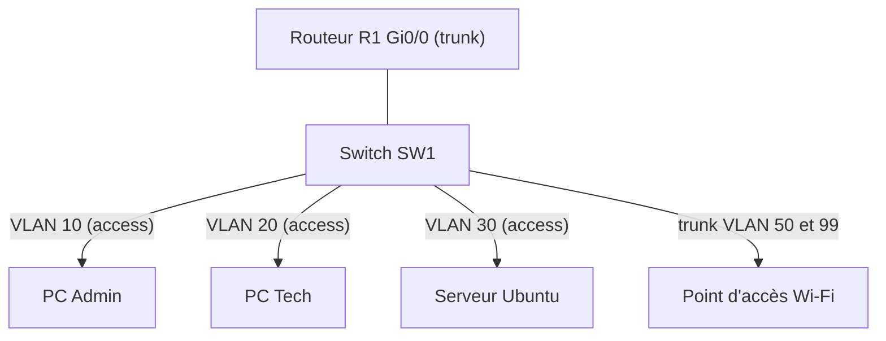

### Configuration du switch (Cisco IOS)

```text
SW1(config)# vlan 10
SW1(config-vlan)# name ADMIN
SW1(config-vlan)# vlan 20
SW1(config-vlan)# name TECH
SW1(config-vlan)# vlan 30
SW1(config-vlan)# name SERVEURS
SW1(config-vlan)# vlan 50
SW1(config-vlan)# name INVITES
SW1(config-vlan)# vlan 99
SW1(config-vlan)# name GESTION
SW1(config-vlan)# exit

! Ports d'accès utilisateurs
SW1(config)# interface range GigabitEthernet0/1 - 8
SW1(config-if-range)# switchport mode access
SW1(config-if-range)# switchport access vlan 10
SW1(config-if-range)# spanning-tree portfast
SW1(config-if-range)# spanning-tree bpduguard enable
SW1(config-if-range)# exit

! Port serveur
SW1(config)# interface GigabitEthernet0/10
SW1(config-if)# switchport mode access
SW1(config-if)# switchport access vlan 30

! Trunk vers le routeur
SW1(config)# interface GigabitEthernet0/24
SW1(config-if)# description TRUNK-VERS-R1
SW1(config-if)# switchport mode trunk
SW1(config-if)# switchport trunk native vlan 99
SW1(config-if)# switchport trunk allowed vlan 10,20,30,50,99

! Adresse de gestion du switch
SW1(config)# interface vlan 99
SW1(config-if)# ip address 192.168.99.2 255.255.255.0
SW1(config-if)# no shutdown
SW1(config-if)# exit
SW1(config)# ip default-gateway 192.168.99.1
```

Remarques de version : sur certains switchs plus anciens (par exemple Catalyst 3560), il faut d'abord `switchport trunk encapsulation dot1q` ; les Catalyst 2960 modernes n'acceptent pas cette commande (seul dot1q est géré).

**Bonnes pratiques de sécurité sur les ports :**

```text
! Ports inutilisés : désactivés et placés dans un VLAN sans usage
SW1(config)# interface range GigabitEthernet0/11 - 23
SW1(config-if-range)# switchport mode access
SW1(config-if-range)# switchport access vlan 999
SW1(config-if-range)# shutdown

! Port security sur un port utilisateur
SW1(config)# interface GigabitEthernet0/1
SW1(config-if)# switchport port-security
SW1(config-if)# switchport port-security maximum 2
SW1(config-if)# switchport port-security mac-address sticky
SW1(config-if)# switchport port-security violation restrict
```

**Vérifications :**

```text
SW1# show vlan brief
VLAN Name       Status    Ports
10   ADMIN      active    Gi0/1, Gi0/2, ...
20   TECH       active
30   SERVEURS   active    Gi0/10
...

SW1# show interfaces trunk
Port      Mode  Encapsulation  Status    Native vlan
Gi0/24    on    802.1q         trunking  99
Port      Vlans allowed on trunk
Gi0/24    10,20,30,50,99
```

Autres vérifications : `show interfaces status`, `show mac address-table`, `show interfaces GigabitEthernet0/1 switchport`.

## Routage inter-VLAN (router-on-a-stick)

Un seul lien trunk entre le switch et le routeur ; le routeur utilise une **sous-interface** par VLAN.

```text
R1(config)# interface GigabitEthernet0/0
R1(config-if)# no shutdown
R1(config-if)# exit
R1(config)# interface GigabitEthernet0/0.10
R1(config-subif)# encapsulation dot1Q 10
R1(config-subif)# ip address 192.168.10.1 255.255.255.0
R1(config-subif)# interface GigabitEthernet0/0.20
R1(config-subif)# encapsulation dot1Q 20
R1(config-subif)# ip address 192.168.20.1 255.255.255.0
R1(config-subif)# interface GigabitEthernet0/0.30
R1(config-subif)# encapsulation dot1Q 30
R1(config-subif)# ip address 192.168.30.1 255.255.255.0
R1(config-subif)# interface GigabitEthernet0/0.99
R1(config-subif)# encapsulation dot1Q 99 native
R1(config-subif)# ip address 192.168.99.1 255.255.255.0
```

Chaque sous-interface sert de passerelle à son VLAN. Limite : le lien unique est un goulot d'étranglement et un point de défaillance ; sur un switch de niveau 3, on préfère des interfaces **SVI** (`interface vlan 10` avec `ip routing`).

## Pièges fréquents

| Piège | Conséquence | Remède |
| --- | --- | --- |
| `switchport trunk allowed vlan 20` sans `add` | La liste est remplacée : les autres VLAN sont coupés | `switchport trunk allowed vlan add 20` |
| VLAN natif différent aux deux extrémités | Fuite de trames entre VLAN, avertissement CDP | Même VLAN natif, inutilisé par les utilisateurs |
| VLAN absent de la base du switch | Port inactif ou trafic perdu | `vlan N` puis `name` |
| `no shutdown` oublié sur l'interface physique du routeur | Toutes les sous-interfaces restent down | Activer l'interface physique parente |
| Ports d'accès laissés dans le VLAN 1 | Mélange de trafics, sécurité faible | VLAN dédié, ports inutilisés désactivés |

---

# Routage, NAT et listes de contrôle d'accès

## Objectifs d'apprentissage

Choisir entre routage statique et dynamique ; configurer des routes statiques et OSPF ; mettre en place NAT et PAT et des redirections de ports ; écrire et placer des ACL standard et étendues ; diagnostiquer routage, NAT et ACL avec les commandes `show`.

## Routage statique et dynamique

### Routage statique

```text
R1(config)# ip route 10.20.0.0 255.255.0.0 192.168.10.254
R1(config)# ip route 0.0.0.0 0.0.0.0 203.0.113.1      ! route par défaut
R1# show ip route
S*   0.0.0.0/0 [1/0] via 203.0.113.1
C    192.168.10.0/24 is directly connected, GigabitEthernet0/0.10
```

Codes : `C` connecté, `L` adresse locale, `S` statique, `O` OSPF, `*` route par défaut candidate.

| Critère | Statique | Dynamique |
|---|---|---|
| Configuration | Manuelle | Protocole automatique |
| Adaptation aux pannes | Aucune sans intervention (sauf suivi de route) | Automatique |
| Charge sur les équipements | Nulle | Faible à modérée |
| Usage | Petits réseaux, routes par défaut | Réseaux à plusieurs routeurs |

### Routage dynamique : OSPF (exemple)

OSPF (Open Shortest Path First, RFC 2328 pour OSPFv2) est un protocole à état de liens, standard et très répandu. RIP est ancien et peu adapté ; EIGRP est issu de Cisco ; BGP sert entre systèmes autonomes (Internet).

```text
R1(config)# router ospf 1
R1(config-router)# router-id 1.1.1.1
R1(config-router)# network 192.168.10.0 0.0.0.255 area 0
R1(config-router)# network 192.168.99.0 0.0.0.255 area 0
R1(config-router)# passive-interface GigabitEthernet0/0.10
R1(config-router)# default-information originate

R1# show ip ospf neighbor
Neighbor ID  Pri  State     Dead Time  Address      Interface
2.2.2.2      1    FULL/DR   00:00:33   10.0.0.2     GigabitEthernet0/1
```

Les masques de la commande `network` sont des masques inverses (wildcard) : `0.0.0.255` couvre un /24. `passive-interface` empêche d'envoyer des messages OSPF vers les postes. Un état `FULL` indique une adjacence établie ; `INIT` ou `2WAY` figés signalent un problème (MTU différent, temporisateurs, authentification, sous-réseaux différents).

## NAT et PAT

Le **NAT** traduit des adresses privées en adresses publiques. Le **PAT** (NAT overload) fait partager une seule adresse publique entre plusieurs hôtes en distinguant les ports sources.

```text
R1(config)# interface GigabitEthernet0/0
R1(config-if)# ip nat inside
R1(config)# interface GigabitEthernet0/1
R1(config-if)# ip nat outside
R1(config)# ip access-list standard NAT-LAN
R1(config-std-nacl)# permit 192.168.0.0 0.0.255.255
R1(config)# ip nat inside source list NAT-LAN interface GigabitEthernet0/1 overload

! Redirection de port (le serveur 192.168.30.20 est joignable en HTTPS depuis l'extérieur)
R1(config)# ip nat inside source static tcp 192.168.30.20 443 interface GigabitEthernet0/1 443
```

Sur une architecture avec sous-interfaces, `ip nat inside` se place sur chaque sous-interface concernée.

```text
R1# show ip nat translations
Pro Inside global        Inside local       Outside local     Outside global
tcp 203.0.113.2:51034    192.168.10.54:51034 93.184.216.34:443 93.184.216.34:443
R1# show ip nat statistics
```

**Pannes courantes :** `ip nat inside/outside` sur la mauvaise interface ; ACL de NAT qui ne couvre pas le sous-réseau ; absence de route par défaut ; absence de route retour côté serveur pour une redirection.

## Listes de contrôle d'accès (ACL)

Une ACL filtre les paquets selon l'adresse, le protocole et le port. Règles essentielles :

- Les règles sont lues **de haut en bas** ; la première qui correspond s'applique.
- Il existe un **`deny` implicite** à la fin de chaque ACL : tout ce qui n'est pas autorisé est bloqué.
- Une seule ACL par interface, par sens (`in` ou `out`) et par protocole.
- Placement : ACL **étendue** près de la **source** ; ACL **standard** près de la **destination**.
- Une ACL filtre le trafic qui **traverse** l'équipement, pas celui qu'il génère lui-même.

Exemple : le VLAN TECH peut accéder au serveur HTTPS mais pas au reste du VLAN ADMIN.

```text
R1(config)# ip access-list extended FILTRE-TECH
R1(config-ext-nacl)# permit tcp 192.168.20.0 0.0.0.255 host 192.168.30.20 eq 443
R1(config-ext-nacl)# permit udp 192.168.20.0 0.0.0.255 host 192.168.30.2 eq 53
R1(config-ext-nacl)# permit udp any eq 68 any eq 67       ! DHCP (si DHCP local)
R1(config-ext-nacl)# deny ip 192.168.20.0 0.0.0.255 192.168.10.0 0.0.0.255
R1(config-ext-nacl)# permit ip any any
R1(config-ext-nacl)# exit
R1(config)# interface GigabitEthernet0/0.20
R1(config-subif)# ip access-group FILTRE-TECH in

R1# show access-lists
R1# show ip interface GigabitEthernet0/0.20 | include access list
```

Limiter l'accès SSH à l'administration (ACL sur les lignes VTY) :

```text
R1(config)# ip access-list standard ADMIN-SSH
R1(config-std-nacl)# permit 192.168.99.0 0.0.0.255
R1(config)# line vty 0 4
R1(config-line)# access-class ADMIN-SSH in
```

**Risque :** appliquer une ACL sur l'interface par laquelle vous administrez l'équipement peut vous couper. Testez depuis la console ou ouvrez d'abord une règle d'administration.

## Pièges fréquents

| Piège | Conséquence | Remède |
| --- | --- | --- |
| `deny` implicite oublié en fin d'ACL | Tout le trafic non prévu est bloqué | Terminer par un `permit` explicite si nécessaire |
| Ordre des règles d'une ACL | Un `deny` général masque un `permit` plus bas | Du plus spécifique au plus général |
| `ip nat inside` et `outside` inversés | Aucune traduction | Contrôler avec `show ip nat statistics` |
| Masque inverse (wildcard) confondu avec le masque | ACL ou OSPF qui ne correspond pas | Wildcard = 255.255.255.255 − masque |
| ACL appliquée sur l'interface d'administration | Perte d'accès au routeur | Tester depuis la console, prévoir un retour arrière |

---

# DHCP relais, Spanning Tree, agrégation de liens et Wi-Fi

## Objectifs d'apprentissage

Configurer un serveur DHCP Cisco et le relais DHCP (`ip helper-address`) ; expliquer STP/RSTP, l'élection du pont racine, `portfast` et `bpduguard` ; agréger des liens (LACP, EtherChannel) ; choisir normes, modes de sécurité (WPA2/WPA3) et architecture par SSID et VLAN pour le Wi-Fi.

## DHCP sur Cisco et DHCP Relay

### Serveur DHCP sur routeur

```text
R1(config)# ip dhcp excluded-address 192.168.10.1 192.168.10.20
R1(config)# ip dhcp pool VLAN10
R1(dhcp-config)# network 192.168.10.0 255.255.255.0
R1(dhcp-config)# default-router 192.168.10.1
R1(dhcp-config)# dns-server 192.168.30.2
R1(dhcp-config)# domain-name entreprise.local
R1(dhcp-config)# lease 1

R1# show ip dhcp binding
R1# show ip dhcp pool
```

### DHCP Relay

Les requêtes DHCP sont des broadcasts, qui ne traversent pas un routeur. Si le serveur DHCP est dans un autre VLAN (par exemple le serveur Ubuntu du VLAN 30), le routeur relaie les requêtes en unicast avec `ip helper-address` placé sur l'interface **côté clients**.

```text
R1(config)# interface GigabitEthernet0/0.20
R1(config-subif)# ip helper-address 192.168.30.2
```

Le serveur DHCP doit disposer d'une étendue pour 192.168.20.0/24 : il identifie le réseau grâce à l'adresse de relais (champ `giaddr`).

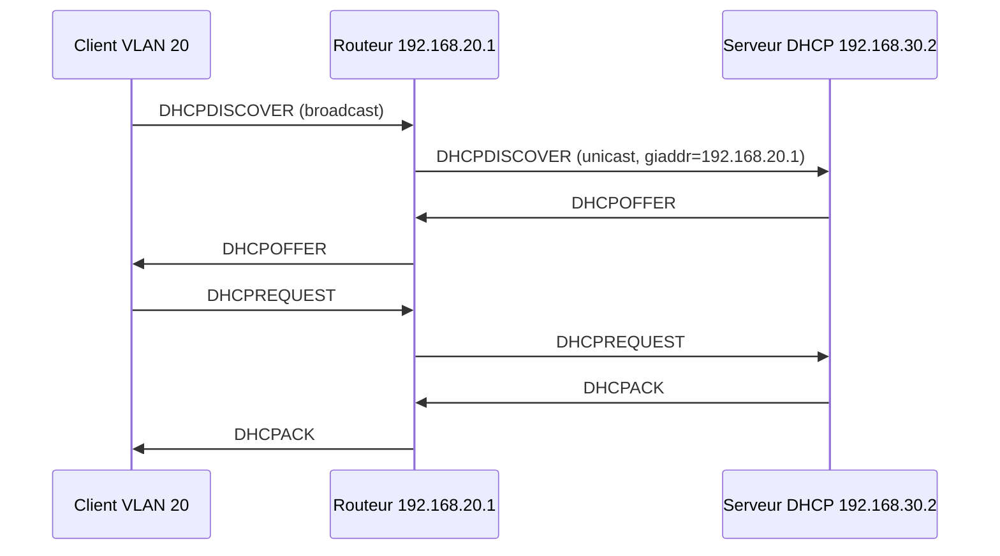

## Spanning Tree Protocol (STP)

Dans un réseau Ethernet avec des liens redondants, les trames de broadcast tourneraient indéfiniment (**boucle de commutation**, tempête de broadcast). STP bloque certains ports pour obtenir une topologie sans boucle.

| Variante | Norme | Caractéristique |
|---|---|---|
| STP | 802.1D | Convergence lente (30 à 50 s) |
| RSTP | 802.1w | Convergence rapide (quelques secondes) |
| PVST+ / Rapid PVST+ | Cisco | Une instance par VLAN |
| MSTP | 802.1s | Instances regroupant plusieurs VLAN |

**Élection :** le pont racine (root bridge) est celui dont l'identifiant (priorité puis adresse MAC) est le plus bas. Il faut **choisir** le root bridge (en général le switch de cœur) plutôt que de laisser l'élection au hasard. Rôles de ports : root (meilleur chemin vers la racine), designated (désigné sur un segment), alternate/backup (bloqué en secours).

```text
SW-CORE(config)# spanning-tree mode rapid-pvst
SW-CORE(config)# spanning-tree vlan 1,10,20,30,50,99 root primary

SW1(config)# spanning-tree mode rapid-pvst
SW1(config)# interface range GigabitEthernet0/1 - 8
SW1(config-if-range)# spanning-tree portfast
SW1(config-if-range)# spanning-tree bpduguard enable

SW1# show spanning-tree vlan 10
SW1# show spanning-tree summary
```

`portfast` met immédiatement un port en transfert (réservé aux ports d'extrémité) ; `bpduguard` désactive le port (état `err-disabled`) s'il reçoit un BPDU, ce qui protège contre un switch branché par erreur. Remise en service : `shutdown` puis `no shutdown` sur le port, après avoir supprimé la cause.

**Symptômes d'une boucle :** voyants de switch clignotant en continu, CPU très élevé, latence extrême, table MAC instable (adresses qui « sautent » de port), perte du réseau entier.

## Agrégation de liens (Link Aggregation, EtherChannel)

L'agrégation regroupe plusieurs liens physiques en un lien logique : débit cumulé (réparti par flux) et redondance. Norme **IEEE 802.1AX** (LACP, anciennement 802.3ad). Chez Cisco : EtherChannel.

| Mode Cisco | Protocole | Comportement |
|---|---|---|
| `active` | LACP | Négocie activement |
| `passive` | LACP | Répond si l'autre est actif |
| `on` | Aucun | Agrégation statique, sans négociation (à éviter si LACP possible) |

```text
SW1(config)# interface range GigabitEthernet0/23 - 24
SW1(config-if-range)# channel-group 1 mode active
SW1(config-if-range)# exit
SW1(config)# interface Port-channel1
SW1(config-if)# switchport mode trunk
SW1(config-if)# switchport trunk allowed vlan 10,20,30,50,99

SW1# show etherchannel summary
Group  Port-channel  Protocol  Ports
1      Po1(SU)       LACP      Gi0/23(P)  Gi0/24(P)
```

Flags : `S` (couche 2), `U` (en service), `P` (membre agrégé). Un flag `D` (down) ou `I` (indépendant) signale une incohérence (vitesse, duplex, VLAN ou mode différent entre les deux membres ou les deux extrémités). Un flux unique ne dépasse jamais le débit d'un seul lien membre.

Sur un serveur Linux, l'équivalent est le **bonding** (mode 802.3ad) configurable via Netplan.

## Wi-Fi et sécurité *(à jour)*

### Normes

| Nom commercial | Norme | Bandes |
|---|---|---|
| Wi-Fi 4 | 802.11n | 2,4 et 5 GHz |
| Wi-Fi 5 | 802.11ac | 5 GHz |
| Wi-Fi 6 / 6E | 802.11ax | 2,4 et 5 GHz ; 6 GHz pour 6E |
| Wi-Fi 7 | 802.11be | 2,4, 5 et 6 GHz |

- **2,4 GHz** : meilleure portée, plus d'interférences (peu de canaux sans recouvrement : 1, 6 et 11 en Amérique du Nord ; en Europe, 1, 5, 9, 13 conviennent aussi si le matériel est compatible).
- **5 GHz et 6 GHz** : débits plus élevés, portée moindre.

### Modes de sécurité

| Mode | Authentification | Chiffrement | Avis |
|---|---|---|---|
| Ouvert | Aucune | Aucun | À réserver aux portails captifs |
| WEP | Clé statique | RC4 | **Cassé : interdit** |
| WPA (TKIP) | PSK | TKIP | **Obsolète** |
| WPA2-Personal | Clé partagée (PSK) | AES-CCMP | Acceptable pour de petits usages |
| WPA2-Enterprise | 802.1X avec serveur RADIUS | AES-CCMP | Standard en entreprise |
| WPA3-Personal | SAE (remplace le PSK, résiste au dictionnaire hors-ligne) | AES | Recommandé quand les clients le gèrent |
| WPA3-Enterprise | 802.1X | AES (mode 192 bits possible) | Recommandé |

Le **6 GHz** impose WPA3.

### Architecture recommandée en entreprise

| SSID | VLAN | Sécurité | Particularités |
|---|---|---|---|
| ENTREPRISE | 10 ou 20 | WPA2/WPA3-Enterprise (802.1X) | Authentification par compte individuel |
| INVITES | 50 | WPA2/WPA3 avec mot de passe tournant, ou portail captif | Isolation des clients, accès Internet seul |
| IOT (imprimantes, capteurs) | Dédié | WPA2-PSK | Pas d'accès aux serveurs |

Pratiques : désactiver WPS, mettre à jour le micrologiciel, relier les AP par un port trunk (VLAN des SSID étiquetés + VLAN de gestion), alimentation par PoE (802.3af/at/bt), choisir les canaux et les puissances d'émission avec une étude de couverture (mesure de terrain).

## Pièges fréquents

| Piège | Conséquence | Remède |
| --- | --- | --- |
| `ip helper-address` placé du mauvais côté | Les clients n'obtiennent pas d'adresse | Le placer sur l'interface côté clients |
| `portfast` sur un lien entre switchs | Risque de boucle temporaire | Réserver `portfast` aux ports d'extrémité |
| Racine STP laissée au hasard | Chemins sous-optimaux, instabilité | Désigner explicitement la racine (`root primary`) |
| EtherChannel en mode `on` contre `active` | Agrégat non formé | LACP des deux côtés (`active`/`passive`) |
| WEP, WPA/TKIP, WPS activé | Réseau Wi-Fi compromettable | WPA2/WPA3, WPS désactivé, 802.1X en entreprise |

---

# MikroTik RouterOS et sauvegarde des configurations

## Objectifs d'apprentissage

Configurer un routeur MikroTik RouterOS 7 (LAN, DHCP, DNS, NAT, pare-feu, VLAN, OSPF, agrégation) ; utiliser le Safe Mode, l'export et la sauvegarde binaire ; comparer les équivalences Cisco/MikroTik ; appliquer des techniques de retour arrière.

## MikroTik RouterOS 7

### Principes

- Interfaces : **WinBox** (graphique), WebFig, SSH, console série. La CLI est hiérarchique (`/ip address`, `/interface bridge`) ; `print` liste, `add`, `set`, `remove` modifient, `?` affiche l'aide.
- **Safe Mode** : touche `Ctrl+X` dans le terminal (ou bouton dans WinBox) ; si la session est coupée pendant ce mode, les changements sont annulés automatiquement. C'est le principal filet de sécurité pour une configuration à distance.
- **Sauvegardes :** `/system backup save name=avant-modif` (binaire, restauration sur le même type de matériel et de version) et `/export file=avant-modif` (script texte lisible, versionnable).

```text
[admin@MikroTik] > /system identity set name=RB-CORE
[admin@MikroTik] > /system backup save name=avant-modif
[admin@MikroTik] > /export file=avant-modif
```

### LAN, DHCP, NAT, DNS

```text
/interface bridge add name=bridge-lan
/interface bridge port add bridge=bridge-lan interface=ether2
/interface bridge port add bridge=bridge-lan interface=ether3
/ip address add address=192.168.10.1/24 interface=bridge-lan

# WAN en DHCP côté opérateur (ajoute aussi la route par défaut)
/ip dhcp-client add interface=ether1 disabled=no

# Serveur DHCP
/ip pool add name=pool-lan ranges=192.168.10.100-192.168.10.200
/ip dhcp-server add name=dhcp-lan interface=bridge-lan address-pool=pool-lan lease-time=1d disabled=no
/ip dhcp-server network add address=192.168.10.0/24 gateway=192.168.10.1 dns-server=192.168.10.1

# DNS (résolveur du routeur)
/ip dns set servers=1.1.1.1,9.9.9.9 allow-remote-requests=yes

# NAT (PAT)
/ip firewall nat add chain=srcnat out-interface=ether1 action=masquerade
```

`allow-remote-requests=yes` fait du routeur un résolveur DNS pour le LAN : la règle de pare-feu doit **empêcher l'accès depuis Internet** (sinon le routeur devient un résolveur ouvert exploitable pour des attaques par amplification).

### Pare-feu (filter)

Principe : trois chaînes. `input` (vers le routeur), `forward` (à travers le routeur), `output` (depuis le routeur). Suivi d'état : `established,related` / `invalid` / `new`.

```text
/ip firewall filter
add chain=input connection-state=established,related action=accept comment="Etat etabli"
add chain=input connection-state=invalid action=drop comment="Invalide"
add chain=input protocol=icmp action=accept comment="ICMP"
add chain=input src-address=192.168.10.0/24 action=accept comment="Administration depuis le LAN"
add chain=input action=drop comment="Tout le reste vers le routeur"

add chain=forward connection-state=established,related action=accept
add chain=forward connection-state=invalid action=drop
add chain=forward in-interface=bridge-lan action=accept comment="LAN vers Internet"
add chain=forward connection-nat-state=dstnat action=accept comment="Redirections de ports"
add chain=forward action=drop comment="Le reste est bloque"
```

**Ordre des règles :** elles sont évaluées de haut en bas ; la règle `drop` finale doit rester **en dernière position**. Activer le Safe Mode avant d'ajouter la règle `input drop`, et vérifier que la règle d'administration est bien placée avant.

Redirection de port :

```text
/ip firewall nat add chain=dstnat protocol=tcp dst-port=443 in-interface=ether1 action=dst-nat to-addresses=192.168.30.20 to-ports=443
```

### VLAN avec le bridge VLAN filtering (RouterOS 7, et 6.41 et suivantes)

```text
/interface bridge add name=bridge1 vlan-filtering=no
/interface bridge port
add bridge=bridge1 interface=ether2 pvid=10 frame-types=admit-only-untagged-and-priority-tagged
add bridge=bridge1 interface=ether3 pvid=20 frame-types=admit-only-untagged-and-priority-tagged
add bridge=bridge1 interface=ether5 frame-types=admit-only-vlan-tagged     # trunk vers un switch

/interface bridge vlan
add bridge=bridge1 vlan-ids=10 tagged=bridge1,ether5 untagged=ether2
add bridge=bridge1 vlan-ids=20 tagged=bridge1,ether5 untagged=ether3

/interface vlan
add name=vlan10 interface=bridge1 vlan-id=10
add name=vlan20 interface=bridge1 vlan-id=20

/ip address
add address=192.168.10.1/24 interface=vlan10
add address=192.168.20.1/24 interface=vlan20

# EN DERNIER : activer le filtrage VLAN (Safe Mode actif)
/interface bridge set bridge1 vlan-filtering=yes
```

**Risque :** activer `vlan-filtering` avant d'avoir terminé la configuration peut vous couper du routeur. Utilisez un port de gestion hors du bridge ou le Safe Mode.

### Routage, OSPF, agrégation

```text
# Route statique
/ip route add dst-address=10.20.0.0/16 gateway=192.168.10.254

# OSPF (syntaxe RouterOS 7 ; différente de la version 6)
/routing ospf instance add name=ospf1 version=2 router-id=1.1.1.1
/routing ospf area add name=backbone area-id=0.0.0.0 instance=ospf1
/routing ospf interface-template add area=backbone networks=192.168.10.0/24 passive

# Agrégation LACP
/interface bonding add name=bond1 slaves=ether4,ether5 mode=802.3ad transmit-hash-policy=layer-2-and-3
```

Vérifications : `/ip address print`, `/ip route print`, `/ip firewall connection print`, `/ip dhcp-server lease print`, `/interface print`, `/log print`, `/tool ping 1.1.1.1 count=4`, `/tool traceroute 1.1.1.1`.

### Équivalences Cisco IOS et MikroTik

| Besoin | Cisco IOS | MikroTik RouterOS 7 |
|---|---|---|
| Voir la configuration | `show running-config` | `/export` |
| Sauvegarder | `copy running-config startup-config` (automatique sous RouterOS, pas de commande) | `/system backup save`, `/export file=` |
| Adresse d'interface | `ip address` | `/ip address add` |
| Route statique | `ip route` | `/ip route add` |
| NAT / PAT | `ip nat inside source list ... overload` | `/ip firewall nat add chain=srcnat action=masquerade` |
| Filtrage | ACL (`access-list`) | `/ip firewall filter` |
| DHCP | `ip dhcp pool` | `/ip dhcp-server` |
| VLAN | `vlan`, `switchport` | `/interface bridge vlan` |
| Relais DHCP | `ip helper-address` | `/ip dhcp-relay add` |

## Retour arrière et sauvegarde des configurations

| Technique | Cisco IOS | MikroTik |
|---|---|---|
| Sauvegarde locale | `copy running-config flash:backup-2026-11-16.cfg` | `/export file=` et `/system backup save` |
| Sauvegarde réseau | `copy running-config tftp:` ou `scp:` (préférer SCP/SFTP au TFTP non sécurisé) | Téléchargement des fichiers (SFTP) |
| Filet avant un changement risqué | `reload in 10` (redémarre dans 10 minutes sur la configuration **sauvegardée** si on ne l'annule pas) puis `reload cancel` après vérification | Safe Mode |
| Restauration | `copy flash:backup-2026-11-16.cfg running-config` (fusion, à manier avec prudence) ou redémarrage sur la startup-config | `/import file-name=` ou `/system backup load` |

Principe : ne sauvegardez **pas** la configuration modifiée (`copy running-config startup-config`) tant que vous n'avez pas vérifié que l'accès fonctionne ; ainsi un redémarrage restaure l'état précédent.

## Pièges fréquents

| Piège | Conséquence | Remède |
| --- | --- | --- |
| Règle `drop` finale placée avant une règle d'acceptation | Perte de la session d'administration | Safe Mode, ordre : état, administration, puis `drop` |
| `masquerade` sur la mauvaise interface de sortie | Aucun accès Internet | `out-interface` = interface WAN |
| `allow-remote-requests=yes` sans filtrage WAN | Résolveur DNS ouvert sur Internet | Règle `input` interdisant le DNS depuis le WAN |
| `vlan-filtering=yes` activé trop tôt | Coupure du routeur | L'activer en dernier, avec un port de gestion de secours |
| Confondre `/export` et `/system backup` | Restauration impossible sur un autre matériel | Export texte pour versionner, sauvegarde binaire pour le même matériel |

---

# Services sous Ubuntu Server : socle commun, DHCP et DNS

## Objectifs d'apprentissage

Mettre en place le socle commun d'un serveur Ubuntu (IP statique, SSH, pare-feu, heure) ; installer et configurer un serveur DHCP (Kea) avec réservations et relais ; installer BIND 9 (zones directe et inverse, redirecteurs, récursion restreinte) ; vérifier et dépanner chaque service.

## Contexte et architecture de référence

Les exemples s'appuient sur le plan d'adressage (section « VLAN, Access et Trunk (switch) »).

| Hôte | Adresse | Rôle |
|---|---|---|
| R1 (routeur) | 192.168.10.1, .20.1, .30.1... (une passerelle par VLAN) | Routage, NAT, relais DHCP |
| srv-infra | 192.168.30.2 | DHCP, DNS (`ns1`) |
| srv-web | 192.168.30.20 | Apache ou Nginx |
| srv-fic | 192.168.30.21 | Samba, NFS, SFTP |
| srv-acces | 192.168.30.3 | VPN WireGuard, proxy Squid |
| Domaine DNS interne | `entreprise.local` | Zone de l'exemple |

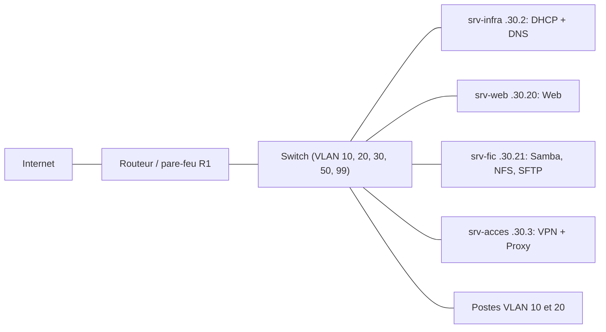

**Remarque sur le nom de domaine :** le suffixe `.local` est réservé à mDNS (RFC 6762) et peut causer des conflits de résolution. Il est utilisé ici par commodité pédagogique. En production, utilisez un sous-domaine d'un domaine que vous possédez (par exemple `int.exemple.fr`) ; la RFC 8375 réserve `home.arpa` pour les réseaux domestiques.

### Prérequis communs à tous les services

1. Ubuntu Server installé, **adresse IP statique**, nom d'hôte défini (`hostnamectl set-hostname`).
2. Heure synchronisée (`timedatectl`), paquets à jour : `sudo apt update && sudo apt upgrade`.
3. Accès SSH par clé fonctionnel avant de durcir le serveur.
4. **Avant toute modification d'un fichier de configuration** : `sudo cp -a /etc/service/fichier.conf /etc/service/fichier.conf.bak-$(date +%F)`.
5. Pare-feu : décider des ports à ouvrir (voir le tableau récapitulatif en 6.13).

### Méthode de vérification commune

```bash
systemctl status <service>            # état
sudo ss -tulpn | grep <port>          # le service écoute-t-il ?
sudo journalctl -u <service> -n 50    # dernières erreurs
<outil> -t <fichier>                  # test de syntaxe quand il existe (named-checkconf, nginx -t, sshd -t ...)
```

## Serveur DHCP *(à jour)*

### Présentation et fonctionnement

DHCP attribue automatiquement adresse, masque, passerelle, DNS et durée de bail (processus DORA, voir section « DNS et DHCP »). **ISC DHCP** (`isc-dhcp-server`) est en fin de vie ; **Kea** (`kea-dhcp4-server`), son successeur développé par l'ISC, est recommandé pour une nouvelle installation. La configuration ISC est donnée en fin de section pour reconnaître les installations existantes.

### Architecture

Les clients de plusieurs VLAN obtiennent leur bail auprès de `srv-infra`. Le routeur relaie les requêtes (`ip helper-address 192.168.30.2`). Le serveur choisit l'étendue (subnet) d'après l'adresse du relais.

### Installation et configuration (Kea)

```bash
sudo apt install kea-dhcp4-server
sudo cp -a /etc/kea/kea-dhcp4.conf /etc/kea/kea-dhcp4.conf.bak-$(date +%F)
sudo nano /etc/kea/kea-dhcp4.conf
```

```json
{
"Dhcp4": {
  "interfaces-config": { "interfaces": [ "ens18" ] },
  "control-socket": { "socket-type": "unix", "socket-name": "/run/kea/kea4-ctrl-socket" },
  "lease-database": { "type": "memfile", "lfc-interval": 3600 },
  "valid-lifetime": 86400,
  "renew-timer": 43200,
  "rebind-timer": 75600,

  "subnet4": [
    {
      "id": 10,
      "subnet": "192.168.10.0/24",
      "pools": [ { "pool": "192.168.10.100 - 192.168.10.200" } ],
      "option-data": [
        { "name": "routers", "data": "192.168.10.1" },
        { "name": "domain-name-servers", "data": "192.168.30.2" },
        { "name": "domain-name", "data": "entreprise.local" }
      ],
      "reservations": [
        { "hw-address": "00:1a:2b:3c:4d:5e", "ip-address": "192.168.10.30", "hostname": "imprimante1" }
      ]
    },
    {
      "id": 20,
      "subnet": "192.168.20.0/24",
      "pools": [ { "pool": "192.168.20.100 - 192.168.20.200" } ],
      "option-data": [
        { "name": "routers", "data": "192.168.20.1" },
        { "name": "domain-name-servers", "data": "192.168.30.2" },
        { "name": "domain-name", "data": "entreprise.local" }
      ]
    }
  ]
}
}
```

Le fichier Kea est du JSON qui tolère les commentaires `#` et `//`. Adaptez `ens18` à votre interface ; pour les clients relayés, l'interface qui reçoit le trafic unicast du relais doit être listée.

### Vérification

```bash
sudo kea-dhcp4 -t /etc/kea/kea-dhcp4.conf       # test de syntaxe
sudo systemctl enable --now kea-dhcp4-server
systemctl status kea-dhcp4-server
sudo ss -ulpn | grep ':67'
cat /var/lib/kea/kea-leases4.csv                  # baux attribués
sudo tcpdump -i ens18 -nn 'port 67 or port 68'    # trafic DHCP
```

### Sécurisation

- Pare-feu : `sudo ufw allow from 192.168.0.0/16 to any port 67 proto udp`.
- Activer **DHCP snooping** sur les switchs pour bloquer les serveurs DHCP pirates (section « Sécurité réseau en entreprise »).
- Limiter les plages aux besoins réels ; utiliser des **réservations** pour imprimantes et équipements fixes.

### Dépannage

| Symptôme | Cause probable | Vérification |
|---|---|---|
| Clients en 169.254.x.x | Service arrêté, relais absent, VLAN incorrect | `systemctl status`, `tcpdump`, `ip helper-address` |
| Service ne démarre pas | Erreur JSON, interface inexistante | `kea-dhcp4 -t`, `journalctl -u kea-dhcp4-server` |
| Pas de baux dans un VLAN | Pas de `subnet4` correspondant à l'adresse du relais | Comparer `giaddr` (tcpdump) et les sous-réseaux |
| Mauvaise passerelle distribuée | Option `routers` erronée | Contrôler `option-data` du sous-réseau |
| Bail expiré, adresse perdue | Pool épuisé ou bail trop court | Fichier de baux, augmenter la plage |

### Exemple d'usage en entreprise

Un seul serveur sert tous les VLAN via relais, avec des réservations pour imprimantes et téléphones IP, et des baux courts (1 à 4 heures) pour le Wi-Fi invités.

### Configuration ISC DHCP (ancienne, pour mémoire)

```text
# /etc/dhcp/dhcpd.conf
default-lease-time 86400;
max-lease-time 172800;
authoritative;
subnet 192.168.10.0 netmask 255.255.255.0 {
  range 192.168.10.100 192.168.10.200;
  option routers 192.168.10.1;
  option domain-name-servers 192.168.30.2;
  option domain-name "entreprise.local";
}
```

Interface d'écoute dans `/etc/default/isc-dhcp-server` (`INTERFACESv4="ens18"`) ; test : `sudo dhcpd -t -cf /etc/dhcp/dhcpd.conf` ; service `isc-dhcp-server`.

## Serveur DNS (BIND 9)

### Présentation et fonctionnement

Le DNS résout noms et adresses. **BIND 9** peut jouer deux rôles : serveur **faisant autorité** pour des zones (ici `entreprise.local`) et **résolveur récursif** pour les clients (transmet ce qu'il ne connaît pas à des forwarders).

### Architecture

Les clients interrogent `srv-infra` (192.168.30.2). Il répond pour la zone interne et relaie le reste vers des résolveurs externes.

### Installation

```bash
sudo apt install bind9 bind9-utils bind9-dnsutils
sudo mkdir -p /etc/bind/zones
```

Sur Ubuntu, le service s'appelle `named` (alias `bind9`).

### Configuration

`/etc/bind/named.conf.options` :

```text
acl "lan" { 192.168.0.0/16; 127.0.0.1; };

options {
    directory "/var/cache/bind";
    listen-on { 127.0.0.1; 192.168.30.2; };
    listen-on-v6 { none; };
    allow-query { lan; };
    allow-recursion { lan; };
    recursion yes;
    forwarders { 1.1.1.1; 9.9.9.9; };
    dnssec-validation auto;
};
```

`/etc/bind/named.conf.local` :

```text
zone "entreprise.local" {
    type primary;
    file "/etc/bind/zones/db.entreprise.local";
    allow-transfer { none; };
};

zone "30.168.192.in-addr.arpa" {
    type primary;
    file "/etc/bind/zones/db.192.168.30";
    allow-transfer { none; };
};
```

`/etc/bind/zones/db.entreprise.local` :

```text
$TTL 3600
@       IN SOA ns1.entreprise.local. admin.entreprise.local. (
                2026111601 ; numéro de série (AAAAMMJJNN) : à incrémenter à chaque modification
                3600       ; refresh
                900        ; retry
                604800     ; expire
                300 )      ; TTL négatif
        IN NS  ns1.entreprise.local.
ns1     IN A   192.168.30.2
srv-web IN A   192.168.30.20
srv-fic IN A   192.168.30.21
srv-acces IN A 192.168.30.3
www     IN CNAME srv-web
```

`/etc/bind/zones/db.192.168.30` (zone inverse) :

```text
$TTL 3600
@   IN SOA ns1.entreprise.local. admin.entreprise.local. (
            2026111601 3600 900 604800 300 )
    IN NS  ns1.entreprise.local.
2   IN PTR ns1.entreprise.local.
20  IN PTR srv-web.entreprise.local.
21  IN PTR srv-fic.entreprise.local.
3   IN PTR srv-acces.entreprise.local.
```

Les noms complets se terminent par un point (`ns1.entreprise.local.`) ; sans point final, BIND ajoute le nom de la zone, cause fréquente d'erreurs.

### Vérification

```bash
sudo named-checkconf
sudo named-checkzone entreprise.local /etc/bind/zones/db.entreprise.local
sudo named-checkzone 30.168.192.in-addr.arpa /etc/bind/zones/db.192.168.30
sudo systemctl enable --now named
sudo systemctl reload named           # après modification de zone
dig @192.168.30.2 srv-web.entreprise.local +short
dig @192.168.30.2 -x 192.168.30.20 +short
dig @192.168.30.2 exemple.fr +short   # test des forwarders
```

Résultat attendu : `192.168.30.20`, puis `srv-web.entreprise.local.`.

### Sécurisation

- **Pas de récursion ouverte** : `allow-recursion` limité au LAN (sinon le serveur peut servir d'amplificateur d'attaques DDoS).
- `allow-transfer { none; }` ou limité aux serveurs secondaires.
- Ne pas exposer `listen-on` sur des interfaces inutiles ; pare-feu : UDP et TCP 53 depuis le LAN uniquement.
- Maintenir BIND à jour ; masquer la version est secondaire par rapport aux correctifs.
- Prévoir un second serveur (`type secondary`) pour la redondance.

### Dépannage

| Symptôme | Piste |
|---|---|
| `named` ne démarre pas | `named-checkconf`, `journalctl -u named` (point-virgule manquant, chemin de fichier erroné) |
| `SERVFAIL` sur la zone interne | `named-checkzone` : erreur de syntaxe, nom sans point final |
| Modification non prise en compte | Série de zone non incrémentée, `rndc reload` ou `systemctl reload named` oublié |
| Internet non résolu | Forwarders injoignables ; tester `dig @1.1.1.1 exemple.fr` ; pare-feu sortant |
| `REFUSED` | Client hors de l'ACL `lan` |
| Résolution inverse absente | Zone inverse ou enregistrements PTR manquants |

Conflit possible avec **systemd-resolved** : il écoute sur `127.0.0.53:53`, pas sur `127.0.0.1` ; BIND configuré avec `listen-on` explicite évite le conflit de port. Le serveur lui-même doit utiliser `127.0.0.1` ou sa propre adresse dans sa configuration réseau (Netplan).

### Exemple d'usage en entreprise

DNS interne pour les serveurs et les postes (noms courts), avec transfert vers le DNS public pour Internet ; zones inverses pour les journaux lisibles et certains services (messagerie, Kerberos).

## Pièges fréquents

| Piège | Conséquence | Remède |
| --- | --- | --- |
| Numéro de série de zone non incrémenté | Modifications non répliquées ou non rechargées | Incrémenter à chaque changement, `named-checkzone` |
| Nom sans point final dans un fichier de zone | `ns1.exemple` devient `ns1.exemple.zone.` | Terminer les noms complets par un point |
| Récursion ouverte à tous | Serveur utilisable pour des attaques par amplification | `allow-recursion` limité au LAN |
| Mauvaise interface dans `interfaces-config` de Kea | Le service tourne mais ne sert personne | Vérifier `ss -ulpn | grep :67` |
| Domaine interne en `.local` | Conflit avec mDNS | Sous-domaine d'un domaine possédé |

---

# SSH, Samba, NFS et serveur de fichiers

## Objectifs d'apprentissage

Sécuriser SSH (clés, durcissement, fail2ban) ; publier des partages Samba avec des droits par groupe ; exporter un répertoire par NFS en le restreignant ; concevoir un serveur de fichiers (groupes, ACL, quotas, sauvegardes) ; diagnostiquer les erreurs courantes.

## Serveur SSH (OpenSSH)

### Présentation

SSH (port TCP 22) offre une administration à distance chiffrée, le transfert de fichiers (SFTP, SCP) et des tunnels. Il remplace Telnet et rsh.

### Installation

```bash
sudo apt install openssh-server
systemctl status ssh
```

### Authentification par clé

Sur le poste d'administration :

```bash
ssh-keygen -t ed25519 -C "admin@poste-admin"
ssh-copy-id admin@192.168.30.21
ssh admin@192.168.30.21
```

### Configuration sécurisée

Sur Ubuntu, créer un fichier de surcharge dans `/etc/ssh/sshd_config.d/` (inclus par le fichier principal) plutôt que de modifier `sshd_config` :

```text
# /etc/ssh/sshd_config.d/10-durcissement.conf
PermitRootLogin no
PasswordAuthentication no
PubkeyAuthentication yes
KbdInteractiveAuthentication no
MaxAuthTries 3
LoginGraceTime 30
AllowGroups ssh-users
ClientAliveInterval 300
ClientAliveCountMax 2
X11Forwarding no
```

```bash
sudo groupadd ssh-users
sudo usermod -aG ssh-users admin
sudo sshd -t                       # test de syntaxe (aucun message = OK)
sudo systemctl reload ssh
```

**Retour arrière et précaution :** **gardez votre session SSH ouverte**, ouvrez une seconde session pour tester la nouvelle configuration, et ne fermez la première qu'après réussite. Désactiver les mots de passe sans avoir installé de clé vous bloque.

**Changement de port :** il ne remplace pas une vraie sécurité (il réduit surtout le bruit des journaux). Sur Ubuntu 24.04, le service SSH est démarré par activation de socket (`ssh.socket`) : la directive `Port` du fichier de configuration peut ne pas suffire ; vérifiez avec `ss -tlnp | grep ssh` et consultez la documentation Ubuntu avant de changer le port.

### Protection contre le brute force : fail2ban

```bash
sudo apt install fail2ban
sudo nano /etc/fail2ban/jail.local
```

```text
[sshd]
enabled = true
maxretry = 5
findtime = 10m
bantime = 1h
```

```bash
sudo systemctl enable --now fail2ban
sudo fail2ban-client status sshd
sudo fail2ban-client set sshd unbanip 192.168.10.54    # débannir une adresse
```

### Pare-feu

```bash
sudo ufw allow from 192.168.99.0/24 to any port 22 proto tcp
```

### Dépannage

| Symptôme | Cause probable |
|---|---|
| `Connection timed out` | Pare-feu, route, serveur éteint |
| `Connection refused` | Service arrêté ou port différent (`ss -tlnp`) |
| `Permission denied (publickey)` | Clé absente de `~/.ssh/authorized_keys`, droits trop larges (dossier `~/.ssh` en 700, fichier en 600), utilisateur non autorisé par `AllowGroups` |
| `REMOTE HOST IDENTIFICATION HAS CHANGED` | Clé d'hôte modifiée (réinstallation, ou attaque de l'homme du milieu) : vérifier avant `ssh-keygen -R hôte` |
| Déconnexions fréquentes | Réglages `ClientAlive*`, NAT avec délai court |

Diagnostic côté client : `ssh -vvv admin@srv` ; côté serveur : `sudo journalctl -u ssh -n 50`.

## Serveur de fichiers Samba (SMB)

### Présentation et fonctionnement

Samba implémente SMB/CIFS (TCP 445) et permet aux postes Windows, Linux et macOS d'utiliser des partages. Ici, Samba est en mode **serveur autonome** (comptes locaux à la machine). L'intégration à un domaine Active Directory est traitée avec Windows Server (sections « Windows Server : Active Directory, DNS et DHCP » et « Windows Server : GPO, partages et permissions »).

### Installation et organisation des données

```bash
sudo apt install samba
sudo groupadd compta
sudo mkdir -p /srv/partages/compta
sudo chgrp compta /srv/partages/compta
sudo chmod 2770 /srv/partages/compta     # setgid : les nouveaux fichiers héritent du groupe
sudo adduser --no-create-home --disabled-password --gecos "" alice
sudo usermod -aG compta alice
sudo smbpasswd -a alice                   # mot de passe SMB (distinct de celui du système)
```

### Configuration `/etc/samba/smb.conf`

```text
[global]
   workgroup = ENTREPRISE
   server string = Serveur de fichiers
   server role = standalone server
   security = user
   map to guest = never
   interfaces = lo ens18
   bind interfaces only = yes
   server min protocol = SMB2
   log file = /var/log/samba/log.%m
   max log size = 1000

[Compta]
   path = /srv/partages/compta
   valid users = @compta
   read only = no
   create mask = 0660
   directory mask = 0770
```

### Vérification

```bash
testparm                                  # valide smb.conf et affiche la configuration effective
sudo systemctl restart smbd
sudo ss -tlnp | grep 445
smbclient -L //192.168.30.21 -U alice     # liste les partages
sudo apt install cifs-utils
sudo mount -t cifs //192.168.30.21/Compta /mnt/compta -o username=alice
```

Depuis Windows : `\\192.168.30.21\Compta` dans l'Explorateur.

### Sécurisation

- Pas d'accès invité, SMB1 désactivé (`server min protocol = SMB2`), partages limités à des groupes.
- Ouvrir uniquement le port 445 vers les VLAN concernés : `sudo ufw allow from 192.168.10.0/24 to any port 445 proto tcp`.
- Journaliser l'accès (`vfs objects = full_audit`) si une traçabilité est exigée.
- Sur Red Hat et dérivées, SELinux demande une étiquette adaptée (`semanage fcontext -a -t samba_share_t "/srv/partages(/.*)?"` puis `restorecon -Rv /srv/partages`) et le booléen adéquat.

### Dépannage

| Message | Signification et piste |
|---|---|
| `NT_STATUS_LOGON_FAILURE` | Mauvais mot de passe, ou utilisateur sans compte Samba (`sudo pdbedit -L`) |
| `NT_STATUS_ACCESS_DENIED` | Droits du système de fichiers (`ls -ld`), groupe manquant, `valid users` |
| `NT_STATUS_BAD_NETWORK_NAME` | Nom de partage inexistant (`testparm -s`) |
| Partage invisible sous Windows | Pare-feu (445), nom d'hôte non résolu, profil réseau public sur Windows |
| Modification sans effet | `sudo systemctl reload smbd` ou `restart` ; `testparm` signale les erreurs |

## Serveur NFS

### Présentation

NFS partage des répertoires entre systèmes Unix/Linux. NFSv4 (port TCP 2049) est recommandé : un seul port, meilleur support du pare-feu.

### Installation et configuration

Serveur :

```bash
sudo apt install nfs-kernel-server
sudo mkdir -p /srv/nfs/donnees
sudo chown nobody:nogroup /srv/nfs/donnees
```

`/etc/exports` :

```text
/srv/nfs/donnees 192.168.20.0/24(rw,sync,no_subtree_check)
```

```bash
sudo exportfs -ra            # recharge les exports
sudo exportfs -v             # affiche les exports effectifs
sudo systemctl enable --now nfs-kernel-server
sudo ufw allow from 192.168.20.0/24 to any port 2049
```

Client :

```bash
sudo apt install nfs-common
showmount -e 192.168.30.21                    # liste les exports (NFSv3/rpcbind requis)
sudo mount -t nfs4 192.168.30.21:/srv/nfs/donnees /mnt/donnees
```

Montage permanent dans `/etc/fstab` (testez avec `sudo mount -a` avant de redémarrer) :

```text
192.168.30.21:/srv/nfs/donnees  /mnt/donnees  nfs4  defaults,_netdev  0  0
```

### Sécurisation

- Restreindre les exports par réseau ou par hôte ; garder `root_squash` (par défaut) pour que l'utilisateur root d'un client ne devienne pas root sur le serveur.
- Le mode d'authentification par défaut (`sys`) fait confiance aux UID envoyés par le client : réservez NFS aux réseaux de confiance ou utilisez Kerberos (`sec=krb5p`).
- Ne jamais exporter vers `*`.

### Dépannage

- `mount.nfs: access denied by server` : l'adresse du client n'est pas dans `/etc/exports` ; relancer `exportfs -ra`.
- `Connection timed out` : pare-feu ou service arrêté (`systemctl status nfs-server`).
- Fichiers appartenant à `nobody` : correspondance d'UID/GID ou domaine d'identification (idmapd) différent.
- Montage bloqué au démarrage : option `_netdev` oubliée, ou serveur indisponible (ajouter `nofail`).

## Serveur de fichiers : conception et exploitation

Un serveur de fichiers d'entreprise combine Samba, des droits cohérents, des sauvegardes et une organisation lisible.

### Organisation

```text
/srv/partages/
├── direction/     (groupe direction)
├── compta/        (groupe compta)
├── technique/     (groupe technique)
└── commun/        (tous les employés)
```

Principes : un **groupe par fonction** (jamais des droits attribués utilisateur par utilisateur), droits donnés aux groupes, `chmod 2770` (setgid) pour hériter du groupe, répertoire `commun` en lecture/écriture pour un groupe général.

### Droits fins (ACL POSIX)

```bash
sudo apt install acl
sudo setfacl -R -m g:direction:rx /srv/partages/compta     # lecture pour la direction
sudo setfacl -R -d -m g:compta:rwx /srv/partages/compta     # ACL par défaut, héritée
getfacl /srv/partages/compta
```

### Quotas, sauvegardes, corbeille

- **Quotas** : `quota` ou quotas de système de fichiers (XFS, ext4) selon la volumétrie.
- **Sauvegarde** : voir la règle 3-2-1 (trois copies, deux supports, une hors site) ; exemple de synchronisation vers un autre serveur :

```bash
rsync -aHAX --delete -e ssh /srv/partages/ sauvegarde@192.168.30.50:/srv/sauvegardes/srv-fic/
```

`--delete` supprime à destination ce qui n'existe plus à la source : testez d'abord avec `--dry-run` et conservez des versions (instantanés, `rsnapshot`, `restic`, `borg`).

- **Corbeille Samba** : `vfs objects = recycle` (à configurer avec une rétention).
- **Surveillance** : espace disque (`df -h`), inodes (`df -i`), erreurs SMART, saturation de la RAM.

## Pièges fréquents

| Piège | Conséquence | Remède |
| --- | --- | --- |
| `PasswordAuthentication no` avant d'avoir installé une clé | Plus aucun accès SSH | Tester dans une seconde session, garder la première ouverte |
| Utilisateur Samba non créé (`smbpasswd -a`) | `NT_STATUS_LOGON_FAILURE` | Créer le compte Samba en plus du compte système |
| Confondre `valid users` et droits du système de fichiers | Accès refusé malgré un partage correct | Les deux doivent concorder (le plus restrictif l'emporte) |
| Export NFS vers `*` | Tout le monde peut monter le partage | Restreindre par réseau ou par hôte, garder `root_squash` |
| `rsync --delete` sans test | Suppression de données à destination | `--dry-run`, conserver des versions |

---

# Serveurs web, VPN, FTP/SFTP et proxy

## Objectifs d'apprentissage

Publier un site avec Apache ou Nginx (sites virtuels, HTTPS, reverse proxy) ; mettre en place un VPN d'accès distant avec WireGuard ; remplacer FTP par SFTP (utilisateurs cloisonnés) ; configurer un proxy Squid ; connaître les ports à ouvrir pour chaque service.

## Serveur Web Apache

### Présentation et architecture

Apache HTTP Server sert des pages web, applications PHP et sites virtuels. Un **VirtualHost** associe un nom (`ServerName`) à un répertoire.

### Installation et site

```bash
sudo apt install apache2
sudo mkdir -p /var/www/entreprise
echo "<h1>Site interne entreprise</h1>" | sudo tee /var/www/entreprise/index.html
```

`/etc/apache2/sites-available/entreprise.conf` :

```text
<VirtualHost *:80>
    ServerName www.entreprise.local
    DocumentRoot /var/www/entreprise

    <Directory /var/www/entreprise>
        Options -Indexes
        AllowOverride None
        Require all granted
    </Directory>

    ErrorLog ${APACHE_LOG_DIR}/entreprise-error.log
    CustomLog ${APACHE_LOG_DIR}/entreprise-access.log combined
</VirtualHost>
```

```bash
sudo a2ensite entreprise
sudo a2dissite 000-default
sudo apache2ctl configtest         # attendu : Syntax OK
sudo systemctl reload apache2
curl -I http://www.entreprise.local
```

### HTTPS

```bash
sudo a2enmod ssl headers
sudo openssl req -x509 -nodes -days 365 -newkey rsa:2048 \
  -keyout /etc/ssl/private/www.key -out /etc/ssl/certs/www.crt \
  -subj "/CN=www.entreprise.local" -addext "subjectAltName=DNS:www.entreprise.local"
```

Un certificat auto-signé déclenche un avertissement navigateur : pour un site interne, utilisez une autorité de certification interne ; pour un site public, **Let's Encrypt** (`certbot`). Bloc `VirtualHost *:443` avec `SSLEngine on`, `SSLCertificateFile`, `SSLCertificateKeyFile`.

### Sécurisation

Dans `/etc/apache2/conf-available/security.conf` : `ServerTokens Prod`, `ServerSignature Off`. Désactiver les modules inutiles (`a2dismod`), mettre à jour régulièrement, appliquer les protocoles TLS 1.2 et 1.3 uniquement, activer l'en-tête HSTS pour un site public, limiter les droits du répertoire web (propriétaire différent de l'utilisateur `www-data` pour le code).

### Dépannage

| Symptôme | Piste |
|---|---|
| `apache2` ne démarre pas | `apache2ctl configtest`, `journalctl -u apache2` ; port 80 déjà utilisé (`ss -tlnp | grep :80`, par exemple par Nginx) |
| 403 Forbidden | `Require all granted` absent, droits du répertoire (`namei -l /var/www/entreprise`) |
| 404 | `DocumentRoot` ou nom de fichier erroné |
| 500 | Application (PHP) en erreur : `/var/log/apache2/error.log` |
| Mauvais site servi | `ServerName` ne correspond pas ; ordre des VirtualHosts (`apache2ctl -S`) |

## Serveur Web Nginx

### Présentation

Nginx sert des fichiers statiques et fait office de **reverse proxy** vers des applications (Django, Node, PHP-FPM) avec une consommation mémoire faible. **Apache et Nginx ne peuvent pas écouter ensemble sur le même port** : choisissez l'un, ou changez de port.

### Installation et site

```bash
sudo apt install nginx
sudo mkdir -p /var/www/entreprise
```

`/etc/nginx/sites-available/entreprise` :

```text
server {
    listen 80;
    server_name www.entreprise.local;
    root /var/www/entreprise;
    index index.html;
    server_tokens off;

    location / {
        try_files $uri $uri/ =404;
    }

    # Exemple de reverse proxy vers une application locale
    location /app/ {
        proxy_pass http://127.0.0.1:8000/;
        proxy_set_header Host $host;
        proxy_set_header X-Real-IP $remote_addr;
        proxy_set_header X-Forwarded-For $proxy_add_x_forwarded_for;
        proxy_set_header X-Forwarded-Proto $scheme;
    }
}
```

```bash
sudo ln -s /etc/nginx/sites-available/entreprise /etc/nginx/sites-enabled/
sudo rm /etc/nginx/sites-enabled/default
sudo nginx -t
sudo systemctl reload nginx
```

HTTPS : dans un bloc `listen 443 ssl;` avec `ssl_certificate`, `ssl_certificate_key`, `ssl_protocols TLSv1.2 TLSv1.3;` ; redirection HTTP vers HTTPS par `return 301 https://$host$request_uri;`.

### Dépannage

- `nginx -t` signale la ligne en erreur (point-virgule manquant, bloc non fermé).
- `502 Bad Gateway` : l'application en amont ne répond pas (`ss -tlnp | grep 8000`).
- `403` : droits ou absence d'`index`.
- Journaux : `/var/log/nginx/error.log` et `access.log`.

## Serveur VPN (WireGuard) *(à jour)*

### Présentation et architecture

Un VPN crée un tunnel chiffré entre un client distant et le réseau de l'entreprise. **WireGuard** est moderne, rapide et simple (UDP, port 51820 par défaut, intégré au noyau Linux depuis la version 5.6). OpenVPN reste une alternative répandue (TCP ou UDP).


### Installation et clés

```bash
sudo apt install wireguard
cd /etc/wireguard
sudo sh -c 'umask 077; wg genkey | tee server.key | wg pubkey > server.pub'
```

### Configuration du serveur `/etc/wireguard/wg0.conf`

```text
[Interface]
Address = 10.8.0.1/24
ListenPort = 51820
PrivateKey = <contenu de server.key>
PostUp   = iptables -t nat -A POSTROUTING -s 10.8.0.0/24 -o ens18 -j MASQUERADE
PostDown = iptables -t nat -D POSTROUTING -s 10.8.0.0/24 -o ens18 -j MASQUERADE

[Peer]
# Portable de Alice
PublicKey = <clé publique du client>
AllowedIPs = 10.8.0.2/32
```

Le NAT (`MASQUERADE`) évite d'avoir à déclarer une route de retour sur le routeur. Alternative : conserver les adresses réelles et ajouter une route `10.8.0.0/24` via `srv-acces` sur le routeur. Sur une distribution où `iptables` est le frontal de nftables, la règle ci-dessus fonctionne ; avec nftables pur, utilisez l'équivalent `nft`.

Activer le routage IP :

```bash
echo "net.ipv4.ip_forward=1" | sudo tee /etc/sysctl.d/99-forward.conf
sudo sysctl --system
sudo ufw allow 51820/udp
sudo ufw route allow in on wg0 out on ens18    # si ufw filtre le routage
sudo systemctl enable --now wg-quick@wg0
```

### Configuration du client

```text
[Interface]
Address = 10.8.0.2/24
PrivateKey = <clé privée du client>
DNS = 192.168.30.2

[Peer]
PublicKey = <contenu de server.pub>
Endpoint = vpn.exemple.fr:51820
AllowedIPs = 192.168.0.0/16, 10.8.0.0/24
PersistentKeepalive = 25
```

`AllowedIPs` côté client définit **le trafic envoyé dans le tunnel** (ici le réseau d'entreprise : « split tunnel ») ; `0.0.0.0/0` enverrait tout le trafic Internet dans le tunnel.

### Vérification

```bash
sudo wg show                  # pairs, dernière poignée de main (« latest handshake »), octets échangés
ip -br addr show wg0
ping -c 3 10.8.0.1            # depuis le client
```

Pas de « latest handshake » : clé publique erronée, port UDP 51820 bloqué, `Endpoint` incorrect.

### Sécurisation

Protéger les clés privées (droits 600), une paire de clés par utilisateur, retirer un `[Peer]` pour révoquer un accès, filtrer ce que les clients VPN atteignent (règles de pare-feu sur `wg0`), journaliser et superviser, mettre à jour. Exiger en complément un second facteur sur les services sensibles.

## Serveur FTP et SFTP

### Choix recommandé : SFTP (OpenSSH)

FTP transmet identifiants et données en clair : **obsolète pour tout usage externe**. SFTP (sous-système SSH, port 22) chiffre tout et réutilise OpenSSH. Variante FTPS (FTP + TLS) possible avec `vsftpd`.

### SFTP avec utilisateurs cloisonnés (chroot)

```bash
sudo groupadd sftpusers
sudo useradd -m -g sftpusers -s /usr/sbin/nologin -d /upload partenaire1
sudo passwd partenaire1
sudo mkdir -p /srv/sftp/partenaire1/upload
sudo chown root:root /srv/sftp/partenaire1             # exigé par OpenSSH pour le chroot
sudo chmod 755 /srv/sftp/partenaire1
sudo chown partenaire1:sftpusers /srv/sftp/partenaire1/upload
```

Ajout à `/etc/ssh/sshd_config.d/20-sftp.conf` :

```text
Match Group sftpusers
    ChrootDirectory /srv/sftp/%u
    ForceCommand internal-sftp
    AllowTcpForwarding no
    X11Forwarding no
    PasswordAuthentication yes
```

```bash
sudo sshd -t && sudo systemctl reload ssh
sftp partenaire1@192.168.30.21
```

Règle importante : le répertoire de chroot et ses parents doivent appartenir à **root** et ne pas être modifiables par un autre utilisateur, sinon la connexion échoue (`bad ownership or modes for chroot directory`). L'utilisateur écrit dans un sous-répertoire (ici `upload`). Pour de meilleures garanties, préférez les clés SSH aux mots de passe.

### FTPS avec vsftpd (si FTP est imposé)

`/etc/vsftpd.conf` (extraits) :

```text
listen=YES
anonymous_enable=NO
local_enable=YES
write_enable=YES
chroot_local_user=YES
ssl_enable=YES
rsa_cert_file=/etc/ssl/certs/www.crt
rsa_private_key_file=/etc/ssl/private/www.key
force_local_logins_ssl=YES
force_local_data_ssl=YES
pasv_min_port=40000
pasv_max_port=40100
```

Ouvrir TCP 21 et la plage passive 40000 à 40100. Le FTP en mode passif et le NAT exigent des réglages supplémentaires (`pasv_address`).

### Dépannage

Échec SFTP en chroot : droits du dossier racine. Connexion acceptée mais shell refusé : normal avec `nologin`. FTP : problèmes de mode passif derrière pare-feu ou NAT.

## Serveur proxy (Squid)

### Présentation

Un proxy HTTP/HTTPS intercale un serveur entre les postes et Internet : filtrage de sites, journalisation, cache, contrôle d'accès. Squid écoute par défaut sur le port TCP 3128.

### Installation et configuration

```bash
sudo apt install squid
sudo cp -a /etc/squid/squid.conf /etc/squid/squid.conf.bak-$(date +%F)
```

Sous Ubuntu, `squid.conf` inclut `/etc/squid/conf.d/*.conf` à l'endroit réservé aux règles personnalisées. Créer `/etc/squid/conf.d/entreprise.conf` :

```text
acl reseaux_internes src 192.168.10.0/24 192.168.20.0/24
acl sites_bloques dstdomain "/etc/squid/sites_bloques.txt"

http_access deny sites_bloques
http_access allow reseaux_internes
```

`/etc/squid/sites_bloques.txt` (un domaine par ligne, point initial pour inclure les sous-domaines) :

```text
.reseau-social-exemple.com
.jeux-exemple.net
```

```bash
sudo squid -k parse                 # test de syntaxe
sudo systemctl restart squid
curl -x http://192.168.30.3:3128 -I https://exemple.fr
sudo tail -f /var/log/squid/access.log
sudo ufw allow from 192.168.10.0/24 to any port 3128 proto tcp
```

**Ordre des règles :** Squid applique la première règle `http_access` qui correspond ; la règle finale `http_access deny all` du fichier principal bloque tout le reste.

### Sécurité et considérations légales

Pour le HTTPS, Squid par défaut établit un tunnel (`CONNECT`) et ne voit que le nom du site. Déchiffrer le trafic (« SSL bump ») est intrusif, nécessite de déployer un certificat d'autorité sur les postes et engage des obligations de transparence et de protection de la vie privée (information des salariés, respect du droit du travail et du RGPD pour les données personnelles). Définissez cela dans une charte informatique avec les services juridique et RH.

### Dépannage

- `TCP_DENIED/403` dans `access.log` : règle `http_access` ou ACL de source.
- `TCP_MISS/503` : DNS ou connectivité sortante du proxy défaillants.
- Postes qui contournent le proxy : bloquer le trafic web sortant direct au niveau du pare-feu, sauf depuis le proxy.

## Tableau récapitulatif des ports à ouvrir *(ajout)*

| Service | Ports | Sens | Source recommandée |
|---|---|---|---|
| DHCP | UDP 67 | Entrée | Clients et relais |
| DNS | UDP et TCP 53 | Entrée | LAN |
| SSH / SFTP | TCP 22 | Entrée | VLAN de gestion |
| Samba | TCP 445 | Entrée | VLAN utilisateurs concernés |
| NFS (v4) | TCP 2049 | Entrée | Réseaux de confiance |
| HTTP, HTTPS | TCP 80, 443 | Entrée | LAN ou Internet selon l'usage |
| WireGuard | UDP 51820 | Entrée | Internet |
| Squid | TCP 3128 | Entrée | VLAN utilisateurs |
| FTPS | TCP 21 + plage passive | Entrée | Partenaires connus |

## Pièges fréquents

| Piège | Conséquence | Remède |
| --- | --- | --- |
| Apache et Nginx sur le même port | Le second ne démarre pas | Un seul serveur par port, `ss -tlnp | grep :80` |
| Certificat expiré ou nom absent des SAN | Avertissements dans les navigateurs | Renouvellement automatique, supervision de l'échéance |
| Répertoire de chroot SFTP modifiable par l'utilisateur | `bad ownership or modes for chroot directory` | Racine du chroot détenue par root, sous-dossier inscriptible |
| Transfert IP désactivé sur la passerelle VPN | Tunnel établi mais LAN inaccessible | `net.ipv4.ip_forward=1` (et règles de pare-feu) |
| Ordre des `http_access` dans Squid | Règles ignorées ou accès trop large | Première règle correspondante, `deny all` final |

---

# Windows Server : Active Directory, DNS et DHCP

## Objectifs d'apprentissage

Installer un domaine Active Directory et un contrôleur de domaine ; organiser OU, utilisateurs et groupes (AGDLP) ; configurer le DNS intégré à AD et un serveur DHCP autorisé (avec failover) ; sécuriser, sauvegarder et dépanner l'annuaire.

## Contexte et architecture de référence

Dans un environnement Windows, **Active Directory** est le cœur de l'identité : authentification (Kerberos), annuaire (LDAP), politiques (GPO) et DNS intégré. Les services s'appuient les uns sur les autres :

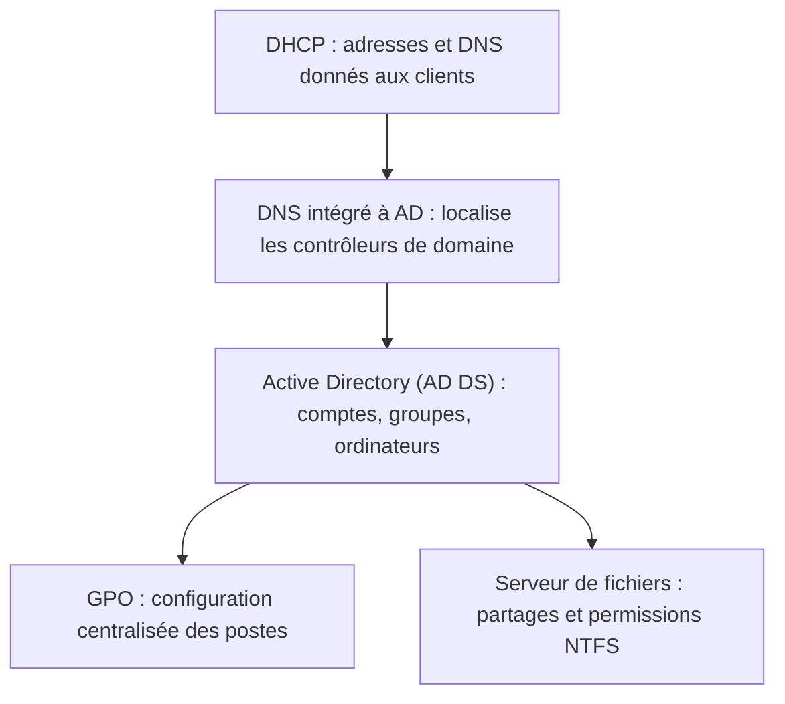

| Hôte | Adresse | Rôles |
|---|---|---|
| srv-dc1 | 192.168.30.10 | AD DS, DNS, DHCP (petit environnement) |
| srv-dc2 (recommandé) | 192.168.30.11 | AD DS, DNS (redondance) |
| srv-fic | 192.168.30.21 | Serveur de fichiers joint au domaine |
| Postes Windows | VLAN 10 et 20 | Membres du domaine |

**Remarques de conception :**

- Un domaine de production exige **au moins deux contrôleurs de domaine** (redondance, réplication).
- Éviter d'installer d'autres rôles lourds sur un contrôleur de domaine ; ici, DHCP y est placé par simplicité pour une petite entreprise.
- **Nom de domaine :** `entreprise.local` est utilisé par cohérence avec les sections précédentes. Microsoft recommande un sous-domaine d'un nom DNS que vous possédez (par exemple `ad.exemple.fr`), car `.local` entre en conflit avec mDNS. Le nom d'un domaine AD **ne se change pas facilement** : choisissez-le avec soin.
- Dans un domaine AD, **les postes doivent utiliser le DNS du contrôleur de domaine** et non un DNS public, sinon l'ouverture de session, la jonction au domaine et les GPO échouent.

### Prérequis communs

1. Windows Server installé en édition Standard ou Datacenter, mis à jour.
2. **Adresse IP statique**, nom d'hôte définitif (le renommage après promotion est contraignant).
3. Horloge correcte : Kerberos refuse les écarts de plus de **5 minutes** par défaut.
4. Sauvegarde ou instantané de la machine virtuelle avant toute opération structurante.

```powershell
Rename-Computer -NewName "SRV-DC1" -Restart
New-NetIPAddress -InterfaceAlias "Ethernet" -IPAddress 192.168.30.10 -PrefixLength 24 -DefaultGateway 192.168.30.1
Set-DnsClientServerAddress -InterfaceAlias "Ethernet" -ServerAddresses 127.0.0.1
```

(Avant la promotion, le DNS peut pointer vers un résolveur externe pour télécharger des mises à jour ; après la promotion, il doit pointer vers le contrôleur de domaine lui-même et le second contrôleur.)

## Active Directory et contrôleur de domaine

### Présentation et fonctionnement

**Active Directory Domain Services (AD DS)** stocke les objets (utilisateurs, groupes, ordinateurs) dans une base répliquée entre contrôleurs de domaine. Vocabulaire :

| Terme | Définition |
|---|---|
| Domaine | Frontière administrative et de sécurité (`entreprise.local`) |
| Forêt | Ensemble d'un ou plusieurs domaines partageant schéma et catalogue global |
| Contrôleur de domaine (DC) | Serveur hébergeant une copie de l'annuaire |
| OU (unité d'organisation) | Conteneur pour organiser objets et appliquer des GPO |
| Catalogue global | Index partiel de la forêt pour les recherches |
| Sites et sous-réseaux | Représentent la topologie réseau pour optimiser la réplication |
| FSMO | Cinq rôles à maître unique (voir ci-dessous) |

Les cinq rôles **FSMO** : Schema Master et Domain Naming Master (un par forêt) ; PDC Emulator, RID Master et Infrastructure Master (un par domaine). Le **PDC Emulator** est la source de temps du domaine.

### Installation et création de la forêt

```powershell
Install-WindowsFeature -Name AD-Domain-Services -IncludeManagementTools

Import-Module ADDSDeployment
Install-ADDSForest `
  -DomainName "entreprise.local" `
  -DomainNetbiosName "ENTREPRISE" `
  -ForestMode WinThreshold `
  -DomainMode WinThreshold `
  -InstallDns:$true `
  -SafeModeAdministratorPassword (Read-Host -AsSecureString "Mot de passe DSRM") `
  -Force
```

`WinThreshold` correspond au niveau fonctionnel Windows Server 2016, le niveau le plus élevé pour Windows Server 2019 et 2022. Windows Server 2025 introduit un niveau supérieur ; vérifiez la valeur acceptée avec `Get-Help Install-ADDSForest -Parameter ForestMode`. Le mot de passe **DSRM** (mode de restauration des services d'annuaire) sert à réparer le contrôleur : conservez-le dans un coffre sécurisé. Le serveur **redémarre automatiquement**. Un avertissement sur la délégation DNS est normal pour un domaine interne.

### Ajouter un second contrôleur de domaine

Sur `srv-dc2` (IP statique, DNS pointant vers `srv-dc1`) :

```powershell
Install-WindowsFeature -Name AD-Domain-Services -IncludeManagementTools
Install-ADDSDomainController -DomainName "entreprise.local" -InstallDns:$true `
  -Credential (Get-Credential ENTREPRISE\Administrateur) `
  -SafeModeAdministratorPassword (Read-Host -AsSecureString "Mot de passe DSRM")
```

### Vérification

```powershell
Get-ADDomain
Get-ADForest
Get-Service NTDS, DNS, Netlogon, KDC | Format-Table Name, Status
dcdiag /v                      # diagnostic complet des contrôleurs de domaine
repadmin /replsummary          # état de la réplication
netdom query fsmo              # emplacement des rôles FSMO
nltest /dsgetdc:entreprise.local
```

Résultat attendu : tous les tests `dcdiag` en `passed`, aucune erreur de réplication (`0` dans la colonne des échecs), les 5 rôles FSMO sur un contrôleur actif.

### Synchronisation de l'heure

Sur le contrôleur détenant le rôle **PDC Emulator** :

```powershell
w32tm /config /manualpeerlist:"0.fr.pool.ntp.org 1.fr.pool.ntp.org" /syncfromflags:manual /reliable:yes /update
Restart-Service w32time
w32tm /query /status
```

Les autres contrôleurs et postes se synchronisent sur le domaine automatiquement.

### Sécurisation d'Active Directory

- Limiter strictement les membres des groupes **Domain Admins**, **Enterprise Admins** et **Schema Admins** ; utiliser des comptes d'administration distincts des comptes quotidiens.
- Activer la **Corbeille Active Directory** (irréversible, à faire tôt) :
  `Enable-ADOptionalFeature 'Recycle Bin Feature' -Scope ForestOrConfigurationSet -Target 'entreprise.local'`
- Politique de mots de passe robuste (longueur, verrouillage), idéalement des stratégies de mots de passe affinées (Fine-Grained Password Policy) pour les comptes privilégiés.
- Mots de passe d'administrateur local uniques par poste : **Windows LAPS** (intégré aux mises à jour Windows récentes, serveurs 2019 et suivants).
- Désactiver SMB1 et NTLMv1 ; appliquer la signature LDAP et SMB ; le groupe **Protected Users** pour les comptes sensibles.
- Sauvegarder l'état du système des contrôleurs de domaine : `wbadmin start systemstatebackup -backupTarget:E:` (testez la restauration).
- Journaliser les connexions (événements 4624, 4625, 4740 pour les verrouillages).

### Pare-feu : ports principaux d'AD

| Service | Port(s) |
|---|---|
| DNS | TCP et UDP 53 |
| Kerberos | TCP et UDP 88 |
| LDAP | TCP et UDP 389 ; LDAPS TCP 636 |
| Catalogue global | TCP 3268 ; 3269 (chiffré) |
| SMB | TCP 445 |
| Changement de mot de passe Kerberos | TCP et UDP 464 |
| RPC (endpoint mapper) | TCP 135 |
| RPC dynamique | TCP 49152 à 65535 |
| NTP | UDP 123 |

Le blocage de ces ports entre postes et contrôleurs, ou entre contrôleurs, est une cause classique de pannes de réplication et de connexion.

### Dépannage

| Symptôme | Cause probable | Piste |
|---|---|---|
| Impossible de joindre le domaine | Le poste n'utilise pas le DNS du DC | `ipconfig /all`, `nslookup entreprise.local` |
| « Aucun serveur d'ouverture de session disponible » | DNS, enregistrements SRV absents, pare-feu | `nltest /dsgetdc:entreprise.local`, redémarrer `Netlogon` |
| « La relation d'approbation entre ce poste et le domaine a échoué » | Mot de passe du compte machine désynchronisé | `Test-ComputerSecureChannel -Repair -Credential ENTREPRISE\admin` |
| Échec d'authentification Kerberos | Écart d'horloge supérieur à 5 min | `w32tm /query /status`, `w32tm /resync` |
| Réplication en échec | DNS, pare-feu, horloge, DC éteint trop longtemps | `repadmin /replsummary`, `repadmin /showrepl`, `dcdiag /test:dns` |
| Compte qui se verrouille sans cesse | Ancien mot de passe en cache (session, service, mobile) | `Search-ADAccount -LockedOut`, événement 4740 sur le PDC Emulator |

### Jonction d'un poste au domaine

```powershell
Add-Computer -DomainName "entreprise.local" -Credential ENTREPRISE\admin -Restart
# Puis vérification
Test-ComputerSecureChannel -Verbose
whoami /fqdn
```

## Utilisateurs, groupes et unités d'organisation

### Structure d'OU conseillée

```text
entreprise.local
└── OU=Entreprise
    ├── OU=Utilisateurs
    │   ├── OU=Direction
    │   ├── OU=Compta
    │   └── OU=Technique
    ├── OU=Ordinateurs
    │   ├── OU=Postes
    │   └── OU=Portables
    ├── OU=Serveurs
    └── OU=Groupes
```

Les OU servent à **déléguer l'administration** et à **cibler les GPO**. Elles ne servent pas à attribuer des droits d'accès aux fichiers (rôle des groupes).

### Création en PowerShell

```powershell
$racine = "DC=entreprise,DC=local"
New-ADOrganizationalUnit -Name "Entreprise" -Path $racine
New-ADOrganizationalUnit -Name "Utilisateurs" -Path "OU=Entreprise,$racine"
New-ADOrganizationalUnit -Name "Compta"       -Path "OU=Utilisateurs,OU=Entreprise,$racine"
New-ADOrganizationalUnit -Name "Groupes"      -Path "OU=Entreprise,$racine"
New-ADOrganizationalUnit -Name "Ordinateurs"  -Path "OU=Entreprise,$racine"
New-ADOrganizationalUnit -Name "Postes"       -Path "OU=Ordinateurs,OU=Entreprise,$racine"

New-ADUser -Name "Alice Martin" -GivenName "Alice" -Surname "Martin" `
  -SamAccountName "amartin" -UserPrincipalName "amartin@entreprise.local" `
  -Path "OU=Compta,OU=Utilisateurs,OU=Entreprise,$racine" `
  -AccountPassword (Read-Host -AsSecureString "Mot de passe initial") `
  -ChangePasswordAtLogon $true -Enabled $true
```

Les OU peuvent être protégées contre la suppression accidentelle (option activée par défaut avec `New-ADOrganizationalUnit`).

### Groupes : portée et stratégie AGDLP

| Portée | Contient | Utilisable pour |
|---|---|---|
| Global | Comptes du même domaine | Regrouper des utilisateurs par fonction |
| Domaine local | Comptes et groupes globaux de toute la forêt | Attribuer des permissions sur des ressources |
| Universel | Comptes et groupes de toute la forêt | Regroupements multi-domaines |

**Principe AGDLP** : **A**ccounts dans des groupes **G**lobaux, placés dans des groupes **D**omaine **L**ocaux, auxquels on attribue les **P**ermissions.


```powershell
New-ADGroup -Name "GG_Compta" -GroupScope Global -GroupCategory Security `
  -Path "OU=Groupes,OU=Entreprise,$racine"
New-ADGroup -Name "DL_Compta_Modif" -GroupScope DomainLocal -GroupCategory Security `
  -Path "OU=Groupes,OU=Entreprise,$racine"

Add-ADGroupMember -Identity "GG_Compta" -Members "amartin"
Add-ADGroupMember -Identity "DL_Compta_Modif" -Members "GG_Compta"
```

Avantage : une arrivée ou un départ ne demande que de modifier l'appartenance à `GG_Compta`, jamais les permissions des dossiers.

### Gestion courante

```powershell
Get-ADUser amartin -Properties *                       # détail complet
Set-ADAccountPassword amartin -Reset -NewPassword (Read-Host -AsSecureString "Nouveau")
Unlock-ADAccount amartin
Disable-ADAccount amartin                              # départ d'un collaborateur : désactiver avant de supprimer
Search-ADAccount -LockedOut
Search-ADAccount -AccountInactive -TimeSpan 90.00:00:00 -UsersOnly
Move-ADObject -Identity "CN=Alice Martin,OU=Compta,..." -TargetPath "OU=Technique,..."
Get-ADGroupMember "GG_Compta"
```

**Bonnes pratiques :** noms de comptes normalisés (première lettre du prénom + nom), mot de passe initial unique à changer à la première connexion, désactivation puis suppression différée des comptes d'anciens collaborateurs, revue périodique des groupes privilégiés, délégation par OU plutôt que des droits d'administrateur de domaine.

**Création en masse :** à partir d'un fichier CSV (`Import-Csv utilisateurs.csv | ForEach-Object { New-ADUser ... }`) ; testez toujours sur quelques lignes avec `-WhatIf`.

## Serveur DNS Windows

### Présentation

Le rôle DNS de Windows Server héberge les zones. Avec AD, les zones sont **intégrées à Active Directory** : stockées dans l'annuaire, répliquées avec lui, avec **mises à jour dynamiques sécurisées** (les postes enregistrent leur nom ; seuls les membres authentifiés peuvent modifier leurs enregistrements). Les contrôleurs de domaine s'annoncent via des enregistrements **SRV** (`_ldap._tcp`, `_kerberos._tcp`), indispensables à la découverte du domaine.

### Installation et configuration

Avec `-InstallDns:$true`, le rôle est installé lors de la création de la forêt. Pour un serveur DNS seul :

```powershell
Install-WindowsFeature -Name DNS -IncludeManagementTools
```

```powershell
# Zone directe intégrée à AD (déjà créée par la promotion pour le domaine AD)
Add-DnsServerPrimaryZone -Name "entreprise.local" -ReplicationScope Domain -DynamicUpdate Secure

# Zone inverse
Add-DnsServerPrimaryZone -NetworkId "192.168.30.0/24" -ReplicationScope Domain -DynamicUpdate Secure

# Enregistrements
Add-DnsServerResourceRecordA -ZoneName "entreprise.local" -Name "srv-web" -IPv4Address "192.168.30.20"
Add-DnsServerResourceRecordCName -ZoneName "entreprise.local" -Name "www" -HostNameAlias "srv-web.entreprise.local"
Add-DnsServerResourceRecordPtr -ZoneName "30.168.192.in-addr.arpa" -Name "20" -PtrDomainName "srv-web.entreprise.local"

# Redirecteurs vers Internet
Set-DnsServerForwarder -IPAddress 1.1.1.1, 9.9.9.9

# Redirecteur conditionnel (par exemple vers le DNS d'un partenaire ou d'un autre domaine)
Add-DnsServerConditionalForwarderZone -Name "partenaire.exemple" -MasterServers 203.0.113.53
```

### Vérification

```powershell
Get-DnsServerZone
Get-DnsServerResourceRecord -ZoneName "entreprise.local"
Resolve-DnsName srv-web.entreprise.local -Server 192.168.30.10
Resolve-DnsName -Type SRV _ldap._tcp.dc._msdcs.entreprise.local
dcdiag /test:dns /v
Clear-DnsServerCache
```

### Sécurisation

- **Mises à jour dynamiques sécurisées uniquement** (jamais « non sécurisées »).
- Restreindre les transferts de zone aux serveurs autorisés.
- Ne pas laisser un contrôleur de domaine accessible directement depuis Internet ; limiter la récursion aux réseaux internes (propriétés du serveur DNS, onglet Avancé et pare-feu).
- Activer le **nettoyage (scavenging)** des enregistrements périmés (`Set-DnsServerScavenging`) avec des durées cohérentes avec les baux DHCP.
- DNS sur les clients : serveurs DNS du domaine uniquement.

### Dépannage

| Symptôme | Cause probable | Piste |
|---|---|---|
| Postes introuvables par nom | Enregistrement dynamique absent ou périmé | `ipconfig /registerdns` sur le poste, scavenging, droits de mise à jour |
| Enregistrements SRV absents | Service `Netlogon` ou DNS défaillant, zone mal configurée | `nltest /dsregdns`, redémarrer `Netlogon`, `dcdiag /test:dns` |
| Internet non résolu | Redirecteurs injoignables | `Resolve-DnsName exemple.fr -Server 1.1.1.1`, pare-feu |
| Réponses obsolètes | Cache DNS client ou serveur | `Clear-DnsClientCache` (poste), `Clear-DnsServerCache` (serveur) |

## Serveur DHCP Windows

### Présentation et fonctionnement

Le rôle DHCP attribue les adresses via des **étendues** (scopes) ; chacune correspond à un sous-réseau. Dans un domaine, le serveur doit être **autorisé dans Active Directory**, sans quoi il refuse de distribuer des adresses (protection contre les serveurs DHCP pirates).

### Installation et autorisation

```powershell
Install-WindowsFeature -Name DHCP -IncludeManagementTools

# Autoriser le serveur dans AD
Add-DhcpServerInDC -DnsName "srv-dc1.entreprise.local" -IPAddress 192.168.30.10

# Créer les groupes de sécurité locaux « Administrateurs DHCP » et « Utilisateurs DHCP »
Add-DhcpServerSecurityGroup
Restart-Service DHCPServer

# Supprime l'avertissement de configuration post-installation du Gestionnaire de serveur
Set-ItemProperty -Path HKLM:\SOFTWARE\Microsoft\ServerManager\Roles\12 -Name ConfigurationState -Value 2
```

### Étendues, exclusions, options et réservations

```powershell
# Étendue du VLAN 10 : plage .10 à .200, bail d'un jour
Add-DhcpServerv4Scope -Name "VLAN10-Admin" -StartRange 192.168.10.10 -EndRange 192.168.10.200 `
  -SubnetMask 255.255.255.0 -LeaseDuration 1.00:00:00 -State Active

# Réserver .10 à .99 aux adresses statiques et aux réservations
Add-DhcpServerv4ExclusionRange -ScopeId 192.168.10.0 -StartRange 192.168.10.10 -EndRange 192.168.10.99

# Options distribuées
Set-DhcpServerv4OptionValue -ScopeId 192.168.10.0 `
  -Router 192.168.10.1 -DnsServer 192.168.30.10,192.168.30.11 -DnsDomain "entreprise.local"

# Réservation pour une imprimante (adresse située dans la plage de l'étendue)
Add-DhcpServerv4Reservation -ScopeId 192.168.10.0 -IPAddress 192.168.10.30 `
  -ClientId "00-1A-2B-3C-4D-5E" -Name "imprimante1" -Description "Imprimante compta"
```

Les étendues pour les autres VLAN suivent le même modèle (passerelle propre à chaque VLAN). Le **relais DHCP** (`ip helper-address 192.168.30.10`) doit être configuré sur le routeur de chaque VLAN (section « DHCP sur Cisco et DHCP Relay ») : le serveur choisit l'étendue d'après l'adresse du relais.

### Vérification et exploitation

```powershell
Get-DhcpServerInDC
Get-DhcpServerv4Scope
Get-DhcpServerv4OptionValue -ScopeId 192.168.10.0
Get-DhcpServerv4Lease -ScopeId 192.168.10.0
Get-DhcpServerv4ScopeStatistics            # pourcentage d'utilisation
Get-WinEvent -LogName "Microsoft-Windows-DHCP Server Events/Operational" -MaxEvents 20
```

### Haute disponibilité et sauvegarde

- **DHCP Failover** (Windows Server 2012 et suivants) entre deux serveurs, en équilibrage de charge ou en attente (hot standby) :
  `Add-DhcpServerv4Failover -ComputerName srv-dc1 -PartnerServer srv-dc2 -Name "Failover-DC" -ScopeId 192.168.10.0 -LoadBalancePercent 50 -SharedSecret "<secret>"`
- Sauvegarde : `Backup-DhcpServer -Path C:\Sauvegardes\DHCP` ; restauration : `Restore-DhcpServer -Path C:\Sauvegardes\DHCP`. Exportez aussi la configuration : `Export-DhcpServer -File C:\Sauvegardes\dhcp.xml -Leases`.

### Sécurisation

Autorisation AD obligatoire ; DHCP snooping sur les switchs ; réservations pour les équipements fixes ; journalisation activée ; adresses exclues pour éviter les conflits avec les adresses statiques ; limiter les droits du groupe « Administrateurs DHCP ».

### Dépannage

| Symptôme | Piste |
|---|---|
| Aucun client n'obtient d'adresse | Serveur non autorisé (`Get-DhcpServerInDC`), service arrêté, étendue inactive |
| Un seul VLAN sans adresse | Étendue absente pour ce VLAN, relais DHCP manquant, ACL |
| Étendue épuisée | `Get-DhcpServerv4ScopeStatistics`, augmenter la plage, réduire la durée du bail |
| Conflit d'adresse | Adresse statique dans la plage distribuée : ajouter une exclusion |
| Mauvaise passerelle | Option 003 erronée sur l'étendue |
| Deux serveurs DHCP répondent | Serveur pirate ou ancien serveur : repérer avec `tcpdump` ou Wireshark, couper la source |

## Pièges fréquents

| Piège | Conséquence | Remède |
| --- | --- | --- |
| Poste de domaine configuré avec un DNS public | Jonction au domaine et ouverture de session impossibles | Les postes utilisent le DNS des contrôleurs de domaine |
| Un seul contrôleur de domaine | Panne totale de l'authentification | Au moins deux contrôleurs |
| Écart d'horloge supérieur à 5 minutes | Échecs d'authentification Kerberos | Synchronisation NTP via le PDC Emulator |
| Serveur DHCP non autorisé dans AD | Aucun bail distribué | `Add-DhcpServerInDC` |
| Nom de domaine choisi à la légère (`.local`) | Difficile à changer, conflits mDNS | Sous-domaine d'un nom DNS possédé |

---

# Windows Server : GPO, partages et permissions

## Objectifs d'apprentissage

Créer et lier des GPO, comprendre l'ordre d'application (LSDOU) et diagnostiquer avec `gpresult` ; publier des partages SMB avec permissions de partage et NTFS combinées ; appliquer la sécurité de SMB ; mettre en œuvre quotas, DFS et copies cachées.

## Stratégies de groupe (GPO)

### Présentation et fonctionnement

Une **GPO** (Group Policy Object) applique des paramètres (sécurité, bureau, lecteurs réseau, imprimantes, scripts) à des utilisateurs ou à des ordinateurs. Elle se **lie** à un site, à un domaine ou à une OU. Une GPO comporte une partie **Ordinateur** (appliquée au démarrage) et une partie **Utilisateur** (appliquée à l'ouverture de session).

**Ordre d'application (LSDOU) :** stratégie locale, puis **S**ite, **D**omaine, **OU** (de la plus générale à la plus proche) ; en cas de conflit, la **dernière appliquée l'emporte**. Modificateurs : **Enforced** (imposée, prioritaire), **Block Inheritance** (bloque l'héritage d'une OU), **filtrage de sécurité** (limite à des groupes) et **filtres WMI**.


### Création et liaison

```powershell
# Module GroupPolicy (installé avec RSAT / le serveur de gestion)
New-GPO -Name "GPO_Postes_Securite" -Comment "Paramètres de sécurité des postes"

# Exemple de paramètre utilisateur : écran de veille verrouillé après 10 minutes
Set-GPRegistryValue -Name "GPO_Postes_Securite" `
  -Key "HKCU\Software\Policies\Microsoft\Windows\Control Panel\Desktop" `
  -ValueName "ScreenSaveActive"   -Type String -Value "1"
Set-GPRegistryValue -Name "GPO_Postes_Securite" `
  -Key "HKCU\Software\Policies\Microsoft\Windows\Control Panel\Desktop" `
  -ValueName "ScreenSaveTimeOut"  -Type String -Value "600"
Set-GPRegistryValue -Name "GPO_Postes_Securite" `
  -Key "HKCU\Software\Policies\Microsoft\Windows\Control Panel\Desktop" `
  -ValueName "ScreenSaverIsSecure" -Type String -Value "1"

# Lier la GPO à l'OU des postes
New-GPLink -Name "GPO_Postes_Securite" -Target "OU=Postes,OU=Ordinateurs,OU=Entreprise,DC=entreprise,DC=local"
```

Les paramètres de la plupart des stratégies se configurent surtout dans la console **Gestion de stratégie de groupe** (`gpmc.msc`), chemin « Configuration ordinateur ou utilisateur > Stratégies > Modèles d'administration / Paramètres Windows ». Exemples courants :

| Objectif | Emplacement |
|---|---|
| Lecteurs réseau | Configuration utilisateur > Préférences > Paramètres Windows > Mappages de lecteurs |
| Imprimantes | Configuration utilisateur > Préférences > Paramètres du Panneau de configuration > Imprimantes |
| Pare-feu Windows | Configuration ordinateur > Stratégies > Paramètres Windows > Paramètres de sécurité > Pare-feu Windows avec fonctions avancées de sécurité |
| Verrouillage de compte, mots de passe | Stratégie de domaine par défaut (domaine), ou stratégie de mots de passe affinée |
| Mises à jour Windows | Configuration ordinateur > Modèles d'administration > Composants Windows > Windows Update |
| Restrictions USB | Configuration ordinateur > Modèles d'administration > Système > Accès au stockage amovible |

**Bonnes pratiques :** ne pas modifier la « Default Domain Policy » au-delà des paramètres de mot de passe et de verrouillage de compte ; créer une GPO par objectif, nommée clairement ; tester sur une OU pilote ; documenter ; **sauvegarder** (`Backup-GPO -All -Path C:\Sauvegardes\GPO`) ; utiliser un **magasin central ADMX** pour les modèles d'administration.

### Vérification et dépannage

Sur le poste client :

```cmd
gpupdate /force                    # force l'actualisation
gpresult /r                        # GPO appliquées (résumé)
gpresult /h C:\temp\rapport.html   # rapport détaillé (à ouvrir dans un navigateur)
```

Sur le serveur : `Get-GPO -All`, `Get-GPOReport -All -ReportType Html -Path rapport.html`, `Get-GPInheritance -Target "OU=Postes,..."`.

| Symptôme | Cause probable | Piste |
|---|---|---|
| La GPO ne s'applique pas | Liée à la mauvaise OU, objet ordinateur ailleurs | Vérifier l'emplacement de l'objet dans AD et `gpresult /r` |
| GPO « refusée (filtrage de sécurité) » | Le groupe cible n'a pas le droit **Lecture** et **Appliquer la stratégie** | Ajouter « Utilisateurs authentifiés » en Lecture (le droit de lecture des ordinateurs est requis depuis les correctifs de sécurité de 2016) |
| Paramètre ordinateur ignoré | Il a été placé dans la partie Utilisateur, ou l'inverse | Vérifier la partie concernée |
| Application lente | Résolution DNS, scripts de connexion, nombreuses GPO | `gpresult /h`, journaux événements « GroupPolicy » |
| Échec d'accès à SYSVOL | DNS, réplication DFSR défaillante | `dcdiag`, `repadmin`, accès à `\\entreprise.local\SYSVOL` |

## Serveur de fichiers, partages et permissions

### Présentation et fonctionnement

Un serveur de fichiers Windows publie des dossiers par SMB (TCP 445). L'accès à un fichier dépend de **deux niveaux de permissions** :

| Niveau | Où | Portée |
|---|---|---|
| Permissions de partage | Propriétés du partage | Accès réseau uniquement, 3 niveaux : Lecture, Modification, Contrôle total |
| Permissions NTFS | Propriétés du dossier (onglet Sécurité) | Accès local et réseau, granularité fine |

**Règle :** les droits effectifs d'un utilisateur par le réseau sont l'**intersection** des deux : le plus restrictif l'emporte. Un « Refuser » explicite prime sur un « Autoriser ». Approche courante : donner aux partages des droits larges (par exemple Modification aux Utilisateurs authentifiés) et gérer le détail en **NTFS** avec les groupes AGDLP.

### Installation et création

```powershell
Install-WindowsFeature -Name FS-FileServer -IncludeManagementTools
Add-Computer -DomainName "entreprise.local" -Credential ENTREPRISE\admin -Restart   # le serveur rejoint le domaine

New-Item -Path D:\Partages\Compta -ItemType Directory

# Partage avec énumération basée sur l'accès (les utilisateurs ne voient que les dossiers autorisés)
New-SmbShare -Name "Compta" -Path "D:\Partages\Compta" `
  -FullAccess "ENTREPRISE\Admins du domaine" `
  -ChangeAccess "ENTREPRISE\DL_Compta_Modif" `
  -FolderEnumerationMode AccessBased

# Permissions NTFS : héritage coupé, accès explicite
icacls "D:\Partages\Compta" /inheritance:r
icacls "D:\Partages\Compta" /grant "BUILTIN\Administrators:(OI)(CI)F" "NT AUTHORITY\SYSTEM:(OI)(CI)F" `
  "ENTREPRISE\DL_Compta_Modif:(OI)(CI)M" "ENTREPRISE\DL_Compta_Lecture:(OI)(CI)RX"
```

Signification d'`icacls` : `(OI)` hérité par les fichiers, `(CI)` hérité par les sous-dossiers, `F` contrôle total, `M` modification, `RX` lecture et exécution. Le nom du groupe « Admins du domaine » dépend de la langue de Windows (`Domain Admins` en anglais).

### Vérification

```powershell
Get-SmbShare
Get-SmbShareAccess -Name "Compta"
icacls "D:\Partages\Compta"
Get-Acl "D:\Partages\Compta" | Format-List
Get-SmbSession                      # sessions ouvertes
Get-SmbOpenFile                     # fichiers ouverts (verrous)
```

Depuis un poste : `\\srv-fic\Compta` ou `net use Z: \\srv-fic\Compta`. L'onglet « Accès effectif » (Sécurité > Avancé) calcule les droits réels d'un utilisateur.

### Fonctions complémentaires

- **FSRM** (File Server Resource Manager) : quotas, filtrage de fichiers, rapports (`Install-WindowsFeature FS-Resource-Manager`).
- **Copies cachées (Volume Shadow Copy)** : versions précédentes de fichiers pour les restaurations rapides.
- **DFS Namespaces** : chemin unique (`\\entreprise.local\Partages`) indépendant du serveur physique ; **DFS Replication** pour la redondance.
- Lecteurs réseau automatiques par GPO (mappages de lecteurs).

### Sécurisation

```powershell
Set-SmbServerConfiguration -EnableSMB1Protocol $false -Force
Set-SmbServerConfiguration -RequireSecuritySignature $true -Force
# Chiffrement SMB (Windows Server 2022 et suivants, clients Windows 8 et suivants)
Set-SmbServerConfiguration -EncryptData $true -Force
```

Vérifiez la compatibilité des clients avant d'imposer la signature ou le chiffrement. Autres bonnes pratiques : pas de droits individuels, pas de « Tout le monde » avec contrôle total, sauvegardes testées, audit des accès sensibles, antivirus adapté, séparation des données sur un volume dédié (`D:`).

### Dépannage

| Symptôme | Cause probable | Piste |
|---|---|---|
| « Accès refusé » | Droits NTFS ou de partage insuffisants, appartenance de groupe non actualisée | `icacls`, `Get-SmbShareAccess`, se déconnecter puis se reconnecter (le jeton de sécurité est créé à l'ouverture de session) |
| « Le chemin d'accès réseau est introuvable » | DNS, pare-feu (445), service Serveur arrêté | `Test-NetConnection srv-fic -Port 445`, `Get-Service LanmanServer` |
| Un dossier n'apparaît pas | Énumération basée sur l'accès (l'utilisateur n'a aucun droit dessus) | Vérifier les ACL |
| Fichier verrouillé | Session ouverte | `Get-SmbOpenFile | Close-SmbOpenFile` (avec prudence) |
| Lecteur réseau absent | GPO de mappage non appliquée | `gpresult /r`, ciblage |
| Disque plein | Absence de quota | FSRM, nettoyage, extension |

## Exemples d'utilisation en entreprise

Un cabinet de 40 personnes :

1. Deux contrôleurs de domaine (DNS intégré), DHCP en failover.
2. Une OU par service, des groupes `GG_*` et `DL_*` selon AGDLP.
3. Un serveur de fichiers avec des partages par service, énumération basée sur l'accès, sauvegarde quotidienne et copies cachées.
4. Des GPO : verrouillage d'écran, lecteurs réseau, imprimantes par service, pare-feu activé, mises à jour planifiées.
5. Procédure d'arrivée et de départ documentée (création de compte, ajout au groupe de service, désactivation puis suppression différée).

## Pièges fréquents

| Piège | Conséquence | Remède |
| --- | --- | --- |
| Modifier la « Default Domain Policy » à tout propos | Effets de bord sur tout le domaine | Une GPO par objectif, nommée clairement |
| Filtrage de sécurité sans droit de Lecture pour les ordinateurs | GPO « refusée » | Conserver la Lecture pour « Utilisateurs authentifiés » |
| Permissions de partage et NTFS contradictoires | Droits effectifs inattendus | Partage large, détail en NTFS (le plus restrictif l'emporte) |
| Droits attribués à des utilisateurs individuels | Gestion ingérable, oublis au départ | Groupes AGDLP |
| Jeton d'accès non actualisé | Accès refusé après ajout à un groupe | Fermer puis rouvrir la session |

---

# Méthodologie professionnelle de dépannage

## Objectifs d'apprentissage

Appliquer une méthode rigoureuse (définir, mesurer, hypothèse, test, un changement à la fois) ; choisir une stratégie de diagnostic ; raisonner par couches OSI ; suivre un arbre de décision ; modifier sans casser (risques et retour arrière) ; documenter un incident.

## Principes fondamentaux

Dépanner n'est pas essayer des commandes au hasard : c'est réduire progressivement le champ des causes possibles.

1. **Définir le problème précisément.** Qui est touché (un poste, un service, un étage, tout le site) ? Quoi (aucun accès, lenteur, accès partiel) ? Depuis quand ? Qu'est-ce qui a changé (mise à jour, câblage, configuration, nouveau matériel) ?
2. **Reproduire et mesurer** plutôt que croire : un test objectif (`ping`, `Test-NetConnection`, `curl`) vaut mieux que « ça ne marche pas ».
3. **Formuler une hypothèse, la tester, conclure.** Un seul changement à la fois, sinon on ne sait plus ce qui a corrigé ou aggravé la panne.
4. **Comparer** avec un équipement qui fonctionne (même VLAN, même switch, autre poste) : la différence désigne souvent la cause.
5. **Documenter** au fur et à mesure : heure, commande, résultat, changement effectué.
6. **Prévoir le retour arrière avant toute modification** (voir la section « Retour arrière et sauvegarde des configurations »).
7. **Escalader** à temps (opérateur, fournisseur, niveau supérieur) avec un dossier complet plutôt que de s'acharner.

### Stratégies de diagnostic

| Stratégie | Principe | Quand l'utiliser |
|---|---|---|
| Ascendante (bottom-up) | On part de la couche 1 (câble, lien) et on monte | Panne totale, matériel suspect |
| Descendante (top-down) | On part de l'application et on descend | Seule une application est touchée |
| Diviser pour régner | On teste au milieu (par exemple la passerelle) puis on reste du bon côté | Chemin long, cause inconnue |
| Suivi du chemin | On suit le trajet des paquets saut par saut (`tracert`, `mtr`) | Accès distant, WAN, VPN |
| Substitution | On remplace un élément (câble, port, poste) par un élément sain | Suspicion matérielle |
| Comparaison | On compare avec un poste fonctionnel | Panne limitée à un équipement |

## Méthode en 11 étapes

Chaque fiche du catalogue suit cette structure :

| N° | Étape | Contenu |
|---|---|---|
| 1 | Description du problème | Ce que l'utilisateur ou la supervision rapporte |
| 2 | Symptômes observés | Messages, indicateurs, comportements mesurables |
| 3 | Causes possibles | Liste ordonnée de la plus fréquente à la plus rare |
| 4 | Vérifications préliminaires | Contrôles rapides sans modification |
| 5 | Commandes Windows | Outils côté poste ou serveur Windows |
| 6 | Commandes Linux | Outils côté serveur ou poste Linux |
| 7 | Analyse des résultats | Interprétation des sorties |
| 8 | Cause réelle | Conclusion étayée par les preuves |
| 9 | Résolution étape par étape | Actions, avec risque et retour arrière |
| 10 | Vérification après réparation | Tests prouvant que la panne est résolue |
| 11 | Prévention | Mesures pour éviter la récidive |

## Diagnostic par couches du modèle OSI

| Couche | Questions à se poser | Symptômes typiques | Outils |
|---|---|---|---|
| 1 Physique | Câble, connecteur, voyants, alimentation ? | Pas de lien, voyants éteints, lien intermittent | Testeur de câble, `Get-NetAdapter`, `ip link`, `ethtool`, `show interfaces status` |
| 2 Liaison | VLAN, MAC, duplex, STP, ARP corrects ? | Mauvais VLAN, boucle, erreurs CRC, ARP incomplet | `arp -a`, `ip neigh`, `show mac address-table`, `show vlan brief`, `show spanning-tree` |
| 3 Réseau | IP, masque, passerelle, routes, NAT, ACL ? | `Destination unreachable`, pas de sortie du sous-réseau | `ipconfig`, `ip addr`, `ping`, `tracert`, `ip route`, `show ip route` |
| 4 Transport | Port ouvert ? Pare-feu ? Connexions établies ? | `Connection refused`, délai dépassé | `Test-NetConnection -Port`, `nc -zv`, `ss`, `netstat`, `nmap` |
| 5 Session | Sessions maintenues, authentification de session ? | Déconnexions, sessions SMB ou RPC coupées | `Get-SmbSession`, journaux |
| 6 Présentation | Chiffrement, certificats, formats ? | Erreurs TLS, caractères illisibles | `openssl s_client`, `curl -v` |
| 7 Application | Service démarré, configuration, droits, DNS ? | Erreur applicative, HTTP 5xx, échec d'authentification | `systemctl status`, `journalctl`, journaux applicatifs, `curl`, `dig` |

Règle pratique : **la couche la plus basse qui échoue est celle à réparer** ; les couches supérieures ne fonctionneront pas tant que les inférieures ne le sont pas.

## Arbre de décision général

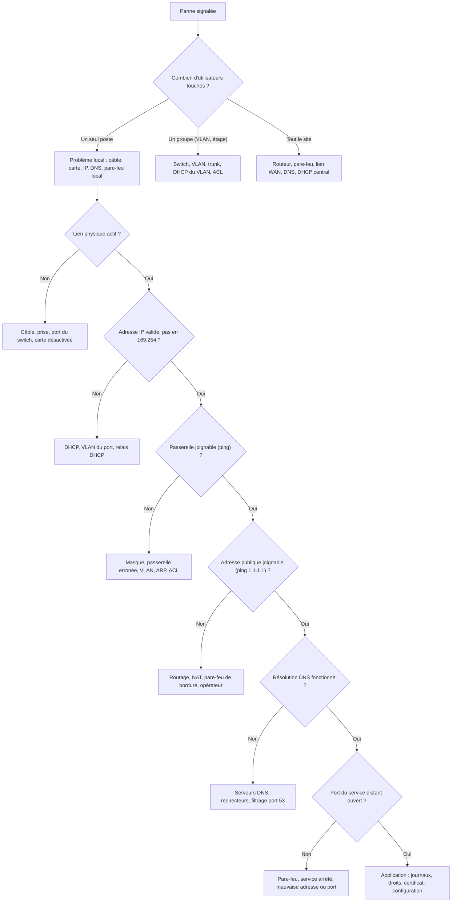

Séquence minimale de tests (à mémoriser) :

```text
Windows :  Get-NetAdapter -> ipconfig /all -> ping passerelle -> ping 1.1.1.1 -> Resolve-DnsName -> Test-NetConnection hôte -Port N
Linux   :  ip -br link    -> ip -br addr   -> ping passerelle -> ping 1.1.1.1 -> getent hosts / dig -> nc -zv hôte N
```

## Modifier sans casser : risques et retour arrière

**Aucune modification de configuration ne doit être faite sans avoir répondu à ces questions :**

| Question | Exemple |
|---|---|
| Que modifie exactement cette commande ? | `ip route replace default ...` remplace la route par défaut |
| Quel est le risque ? | Perte de la session SSH distante, panne de tout un VLAN |
| Comment revenir en arrière ? | Sauvegarde du fichier, commande inverse, minuterie automatique |
| Comment saurai-je que cela marche ? | Test de validation défini à l'avance |
| Qui est impacté, quand intervenir ? | Fenêtre de maintenance, prévenir les utilisateurs |

Techniques de retour arrière déjà vues dans ce guide :

- Fichier : `cp -a fichier fichier.bak-AAAA-MM-JJ` avant toute édition.
- Linux : `netplan try` (annulation automatique), `ufw disable` en secours, seconde session SSH ouverte avant de recharger `sshd`.
- Windows : exporter la configuration (`ipconfig /all > avant.txt`, `netsh advfirewall export`), conserver la commande inverse (`Remove-NetIPAddress`, `Set-NetIPInterface -Dhcp Enabled`).
- Cisco : `reload in 10` avant un changement risqué puis `reload cancel`, ne pas exécuter `copy running-config startup-config` avant validation.
- MikroTik : Safe Mode, `/export`, `/system backup save`.
- Machines virtuelles : instantané avant l'opération.

**Opérations à fort risque, à n'exécuter qu'en connaissance de cause :** `netsh winsock reset`, `netsh int ip reset`, `iptables -F` ou `nft flush ruleset`, `ip link set <interface> down` sur la seule interface de gestion, `taskkill /f` sur un service, suppression de route par défaut, changement de VLAN natif, activation d'un pare-feu sans règle SSH, `erase startup-config`, `rm -rf` hors d'un chemin vérifié.

## Modèle de fiche d'incident *(ajout)*

```markdown
# Incident n° AAAA-MM-JJ-01

- Date et heure de détection :
- Signalé par :
- Périmètre : (1 poste / VLAN / site) ; Services touchés :
- Impact : (bloquant / dégradé / mineur)
- Changements récents connus :

## Chronologie
| Heure | Action | Résultat |
|---|---|---|

## Diagnostic
- Couche OSI concernée :
- Preuves (sorties de commandes, captures) :
- Cause réelle :

## Résolution
- Actions réalisées et retour arrière prévu :
- Vérifications effectuées :

## Prévention
- Actions correctives et responsables :
```

## Erreurs fréquentes du dépanneur *(ajout)*

- Tester par nom avant d'avoir testé par adresse IP (on ne sait plus si c'est le DNS ou le réseau).
- Modifier plusieurs choses en même temps.
- Conclure d'un ping sans réponse que l'hôte est éteint (ICMP peut être filtré).
- Oublier le pare-feu local du poste ou du serveur.
- Négliger l'horloge (Kerberos, certificats).
- Ne pas noter l'état initial et ne pas pouvoir revenir en arrière.
- Redémarrer « pour voir » sans collecter les journaux qui disparaîtront.

## Pièges fréquents

| Piège | Conséquence | Remède |
| --- | --- | --- |
| Modifier plusieurs choses à la fois | On ignore ce qui a corrigé ou aggravé la panne | Un changement, un test |
| Tester par nom avant de tester par adresse IP | On ne sait plus si le DNS ou le réseau est en cause | Séquence : lien, IP, passerelle, IP publique, DNS, port |
| Pas de retour arrière préparé | Une erreur transforme une panne en sinistre | Sauvegarde, minuterie (`netplan try`, `reload in`, Safe Mode) |
| Redémarrer « pour voir » | Les journaux et l'état de la panne disparaissent | Collecter journaux et mesures d'abord |

---

# Les problèmes réseau rencontrés en entreprise

## Objectifs d'apprentissage

Reconnaître et traiter les pannes les plus fréquentes (connectivité, DNS et DHCP, VLAN et routage, sécurité, serveurs) ; appliquer à chaque fiche la structure en 11 étapes ; utiliser les commandes Windows et Linux adaptées ; identifier la cause réelle, corriger et vérifier.

> Les fiches de cette section suivent la méthode décrite dans la section « Méthodologie professionnelle de dépannage » (structure en 11 étapes, puis diagnostic par couches). Si vous débutez, lisez d'abord les sous-sections « Principes fondamentaux » à « Arbre de décision général ».

Le catalogue comporte des **fiches détaillées** (structure complète en 11 étapes) pour les pannes les plus formatrices, puis des **fiches synthétiques** en tableau pour les autres, avec les mêmes informations condensées. Les commandes ont été présentées dans les sections « Commandes réseau sous Windows » et « Commandes réseau sous Linux » ; elles sont ici utilisées en situation.

Conventions : **Admin** = droits administrateur ou `sudo` nécessaires. Les adresses sont celles du plan d'adressage des sections précédentes.

## Fiches détaillées

### Fiche 1 — Ordinateur sans connexion Internet

1. **Description.** Un poste du VLAN 10 ouvre le réseau local mais aucune page web ne s'affiche.
2. **Symptômes.** Navigateur : « Pas de connexion Internet » ou « Impossible d'accéder au site » ; icône réseau avec avertissement.
3. **Causes possibles.** Pas de lien, pas d'adresse IP valide, passerelle ou masque erroné, route par défaut absente, NAT ou lien WAN en panne, DNS défaillant, proxy mal configuré, pare-feu local.
4. **Vérifications préliminaires.** D'autres postes du même VLAN sont-ils touchés ? Le Wi-Fi est-il activé par erreur ? Le câble est-il branché ? Un changement récent est-il connu ?
5. **Commandes Windows.**
   ```powershell
   Get-NetAdapter
   ipconfig /all
   ping 127.0.0.1 ; ping 192.168.10.1 ; ping 1.1.1.1 ; ping www.exemple.fr
   Resolve-DnsName www.exemple.fr
   netsh winhttp show proxy
   ```
6. **Commandes Linux.**
   ```bash
   ip -br link ; ip -br addr ; ip route
   ping -c 3 192.168.10.1 ; ping -c 3 1.1.1.1 ; getent hosts www.exemple.fr
   resolvectl status
   ```
7. **Analyse.** Le premier test qui échoue désigne la couche : échec de `ping` passerelle = couche 2/3 locale ; réussite passerelle mais échec `1.1.1.1` = routage, NAT ou WAN ; `1.1.1.1` réussit mais le nom échoue = DNS ; tout réussit mais le navigateur échoue = proxy ou application.
8. **Cause réelle.** Exemple : `ipconfig` montre la passerelle `192.168.20.1` pour un poste en `192.168.10.0/24` ; elle est hors sous-réseau.
9. **Résolution.** (a) Corriger la passerelle (DHCP ou configuration statique) : `Set-NetIPInterface -InterfaceAlias "Ethernet" -Dhcp Enabled` puis `ipconfig /renew`. **Risque** : si l'adresse était statique, noter la valeur d'origine. (b) Si la cause est un DNS défectueux, voir la fiche 6. (c) Si le WAN est en cause, voir `show ip route` et `show ip nat translations` sur le routeur.
10. **Vérification.** `ping 1.1.1.1` et `ping www.exemple.fr` réussissent, une page s'ouvre, le test se répète après redémarrage du poste.
11. **Prévention.** DHCP plutôt que statique pour les postes, supervision du lien WAN, documentation du plan d'adressage.

### Fiche 2 — Connexion Ethernet inexistante

1. **Description.** L'icône réseau affiche un câble débranché ; aucun voyant au port.
2. **Symptômes.** `Get-NetAdapter` : `Disconnected` ou `Not Present` ; Linux : `NO-CARRIER`.
3. **Causes.** Câble défectueux ou mal serti, prise murale non brassée au panneau, port du switch désactivé (`shutdown`) ou en `err-disabled`, carte désactivée ou pilote absent, câble trop long, PoE ou switch éteint.
4. **Vérifications préliminaires.** Voyants de la carte et du port, autre câble connu valide, autre prise, autre poste sur la même prise.
5. **Windows.** `Get-NetAdapter` ; `Get-NetAdapter | Format-List Name, Status, LinkSpeed, MediaConnectionState` ; Gestionnaire de périphériques ; `Enable-NetAdapter -Name "Ethernet"` (**Admin**) si `Disabled`.
6. **Linux.** `ip -br link` ; `sudo ethtool ens18 | grep -E "Speed|Duplex|Link detected"` ; `sudo dmesg -T | grep -i ens18`.
7. **Analyse.** `Link detected: no` : problème physique (câble, port, équipement distant). `Disabled` : désactivation logicielle. Alternances « Link is Down / Up » dans `dmesg` : contact intermittent ou câble abîmé.
8. **Cause réelle.** Exemple : le port du switch est en `err-disabled` après une violation de port security (`show interfaces status err-disabled`).
9. **Résolution.** Tester le câble avec un testeur ; vérifier le brassage panneau-switch ; sur Cisco, `show interfaces GigabitEthernet0/5 status`, corriger la cause (poste non autorisé, boucle) puis `shutdown` / `no shutdown` sur le port. **Risque** : réactiver un port sans corriger la cause le fait retomber en erreur.
10. **Vérification.** Lien actif à la vitesse attendue (`LinkSpeed 1 Gbps`), adresse IP obtenue, `ping` de la passerelle.
11. **Prévention.** Étiquetage et documentation du brassage, cordons de qualité, recette de câblage (test de certification), alertes de supervision sur les ports.

### Fiche 3 — Réseau lent

1. **Description.** Les transferts de fichiers et les pages web sont lents pour un ou plusieurs utilisateurs.
2. **Symptômes.** Débit très inférieur à l'attendu, latence variable, délais intermittents.
3. **Causes.** Duplex ou vitesse mal négociés, câble défectueux (erreurs CRC), lien saturé, boucle ou tempête de broadcast, interférences Wi-Fi, DNS lent, WAN saturé, disque ou CPU du serveur surchargé, MTU incorrecte, application mal optimisée.
4. **Préliminaires.** Lenteur locale, vers un serveur interne, vers Internet, ou d'une seule application ? Heure d'apparition ? Même symptôme pour tous ?
5. **Windows.**
   ```powershell
   ping -n 20 192.168.10.1
   pathping -n -q 50 1.1.1.1
   Get-NetAdapter | Format-Table Name, LinkSpeed, Status
   Get-NetAdapterStatistics -Name "Ethernet"
   Resolve-DnsName www.exemple.fr   # mesurer le temps avec Measure-Command
   ```
6. **Linux.**
   ```bash
   mtr -rn -c 50 1.1.1.1
   sudo ethtool ens18 | grep -E "Speed|Duplex"
   ip -s link show ens18            # erreurs, drops
   iperf3 -s                        # sur le serveur
   iperf3 -c 192.168.30.21          # sur le client : débit réel de bout en bout
   top ; df -h ; free -h            # charge du serveur
   ```
7. **Analyse.** Débit `iperf3` proche du nominal mais transfert de fichiers lent : cause côté disque, antivirus ou protocole. Erreurs CRC et collisions : câble ou duplex. Saut avec perte persistante dans `mtr` : lien défaillant. Réponse DNS à plusieurs secondes : serveur DNS ou redirecteur lent.
8. **Cause réelle.** Exemple : `ethtool` montre `Speed: 100Mb/s` sur un lien gigabit : câble de catégorie insuffisante ou paire défectueuse.
9. **Résolution.** Remplacer le câble, vérifier le brassage ; forcer l'autonégociation des deux côtés ; séparer les flux lourds (sauvegardes) des heures de bureau ; QoS pour la voix ; corriger la boucle (fiche 9). **Risque** : forcer vitesse ou duplex d'un seul côté crée un désaccord (duplex mismatch).
10. **Vérification.** Nouvelle mesure `iperf3` et test applicatif, absence d'erreurs croissantes sur les compteurs.
11. **Prévention.** Supervision de débit et des erreurs (section « Outils professionnels de diagnostic et de supervision »), recettes de câblage, dimensionnement avec marge, QoS.

### Fiche 4 — Conflit d'adresses IP

1. **Description.** Deux machines utilisent la même adresse IPv4.
2. **Symptômes.** Message Windows « Une autre machine du réseau a la même adresse IP » ; connexions qui tombent au hasard ; un hôte joignable une minute sur deux.
3. **Causes.** Adresse statique placée dans la plage DHCP, deux statiques identiques, serveur DHCP pirate ou second serveur mal configuré, machine clonée.
4. **Préliminaires.** Lire l'événement système (journal « Système », source Tcpip, ID 4199), noter l'adresse et l'heure.
5. **Windows.** `arp -d *` (**Admin**) puis `ping 192.168.10.50` puis `arp -a` : relever la MAC ; `Get-NetNeighbor -IPAddress 192.168.10.50`.
6. **Linux.** `ip neigh show 192.168.10.50` ; `sudo arping -I ens18 -c 3 192.168.10.50` : deux MAC différentes qui répondent confirment le conflit.
7. **Analyse.** Comparer les MAC obtenues à plusieurs moments : si elles alternent, deux machines se disputent l'adresse. Retrouver le switch et le port avec `show mac address-table address <MAC>`.
8. **Cause réelle.** Exemple : une imprimante en IP fixe `.50` est aussi dans la plage DHCP.
9. **Résolution.** Changer l'adresse de l'équipement fautif (ou le passer en réservation DHCP), exclure les adresses statiques de la plage, renouveler : `ipconfig /release` puis `/renew`. **Risque** : changer l'IP d'un serveur impose de mettre à jour DNS, règles de pare-feu et clients.
10. **Vérification.** `arping` ne répond que d'une MAC, plus de message de conflit, services testés.
11. **Prévention.** Plan d'adressage documenté (IPAM), plage statique séparée de la plage DHCP, réservations DHCP, DHCP snooping.

### Fiche 5 — Adresse APIPA (169.254.x.x) et DHCP indisponible

1. **Description.** Un poste obtient `169.254.x.x` au lieu d'une adresse du réseau.
2. **Symptômes.** Aucun accès hors du lien local, `ipconfig` indique une configuration automatique.
3. **Causes.** Serveur DHCP éteint ou service arrêté, étendue épuisée ou inactive, serveur non autorisé dans AD, mauvais VLAN, relais DHCP absent, trunk n'autorisant pas le VLAN, DHCP snooping bloquant, câble défectueux.
4. **Préliminaires.** Autres postes du même VLAN touchés ? Premier brassage ou changement de prise ?
5. **Windows.** `ipconfig /release` puis `ipconfig /renew` (**Admin**) ; `ipconfig /all` ; événements DHCP-Client ; sur le serveur : `Get-DhcpServerv4Scope`, `Get-DhcpServerv4ScopeStatistics`, `Get-DhcpServerInDC`.
6. **Linux.** `sudo networkctl renew ens18` ou `sudo nmcli device reapply ens18` ; `sudo tcpdump -i ens18 -nn 'port 67 or port 68'` ; `journalctl -u systemd-networkd -n 50`.
7. **Analyse.** Requêtes DISCOVER visibles sans OFFER : le serveur ne répond pas (service, étendue, autorisation) ou n'est pas atteint (VLAN, relais). OFFER reçu mais refus : conflit ou filtrage. Aucune requête sortante : problème physique.
8. **Cause réelle.** Exemple : `ip helper-address` manquant sur la sous-interface du VLAN 20.
9. **Résolution.** Rétablir le service ou l'étendue ; ajouter le relais (`ip helper-address 192.168.30.10`) ; autoriser le VLAN sur le trunk. **Risque** : un nouveau serveur DHCP mal configuré peut perturber le réseau ; testez d'abord sur un VLAN isolé.
10. **Vérification.** Adresse correcte avec bonne passerelle et bons DNS, bail visible côté serveur (`Get-DhcpServerv4Lease`).
11. **Prévention.** DHCP en failover, supervision de l'utilisation des étendues, sauvegarde de la configuration.

### Fiche 6 — Impossible de résoudre un nom de domaine

1. **Description.** Les sites répondent par adresse IP mais pas par nom.
2. **Symptômes.** « Le serveur DNS ne répond pas » ; `ping nom` échoue avec « La requête n'a pas pu trouver l'hôte » ; `ping 1.1.1.1` réussit.
3. **Causes.** Serveur DNS configuré inexistant, DNS interne arrêté, redirecteurs injoignables, port 53 filtré, cache erroné, suffixes de recherche incorrects, entrée du fichier `hosts`, proxy.
4. **Préliminaires.** Quel DNS le poste utilise-t-il ? Tous les noms échouent-ils (externes et internes) ?
5. **Windows.**
   ```powershell
   Get-DnsClientServerAddress -AddressFamily IPv4
   Resolve-DnsName www.exemple.fr
   Resolve-DnsName www.exemple.fr -Server 1.1.1.1
   Clear-DnsClientCache
   Test-NetConnection 192.168.30.10 -Port 53
   ```
6. **Linux.**
   ```bash
   resolvectl status
   dig www.exemple.fr
   dig @192.168.30.2 www.exemple.fr
   dig @1.1.1.1 www.exemple.fr
   getent hosts www.exemple.fr
   ```
7. **Analyse.** Échec avec le DNS interne et succès avec `1.1.1.1` : le DNS interne est en cause. Échec partout : sortie UDP/TCP 53 filtrée. `dig` réussit mais `getent hosts` échoue : problème NSS, `hosts` ou résolveur local.
8. **Cause réelle.** Exemple : le service `named` s'est arrêté après une erreur de zone (`named-checkzone`).
9. **Résolution.** Corriger la zone, `sudo systemctl restart named` ; ou rétablir la configuration DNS de l'étendue DHCP ; vider les caches. **Risque** : changer le DNS d'un poste de domaine pour un DNS public casse l'authentification AD.
10. **Vérification.** Résolution de noms internes et externes par plusieurs postes, par `Resolve-DnsName` et par le navigateur.
11. **Prévention.** Deux serveurs DNS, supervision du service et d'une requête de test, sauvegarde des zones, `named-checkzone` avant chaque rechargement.

### Fiche 7 — VLAN mal configuré

1. **Description.** Un poste n'atteint pas ses serveurs, ou reçoit une adresse d'un autre réseau.
2. **Symptômes.** Adresse du mauvais sous-réseau, aucune adresse, accès impossible aux serveurs du bon VLAN, ping passerelle impossible.
3. **Causes.** Port affecté au mauvais VLAN, VLAN absent de la base du switch, trunk n'autorisant pas le VLAN, VLAN natif différent, sous-interface routeur absente.
4. **Préliminaires.** Quel est le VLAN prévu pour la prise ? D'autres ports du même switch fonctionnent-ils ?
5. **Windows.** `ipconfig /all` : sous-réseau obtenu ; `ping` passerelle.
6. **Linux.** `ip -br addr` ; `sudo tcpdump -i ens18 -nn -e vlan` (trames étiquetées visibles sur un port trunk de test).
7. **Analyse.** Sur le switch : `show interfaces GigabitEthernet0/5 switchport` (VLAN d'accès), `show vlan brief`, `show interfaces trunk`, `show mac address-table interface Gi0/5`. Un VLAN absent de `show vlan brief` ou d'une liste `allowed vlan` explique la coupure.
8. **Cause réelle.** Exemple : le port Gi0/5 est resté dans le VLAN 1 après un déménagement de poste.
9. **Résolution.** `interface Gi0/5` puis `switchport access vlan 20`. Si le VLAN manque : `vlan 20`. Si le trunk le bloque : `switchport trunk allowed vlan add 20`. **Risque** : `switchport trunk allowed vlan 20` (sans `add`) **remplace** la liste et coupe les autres VLAN.
10. **Vérification.** Le poste obtient une adresse du bon réseau, passerelle joignable, accès au serveur cible.
11. **Prévention.** Standard de nommage et de numérotation, documentation des ports, vérification de configuration régulière (sauvegardes versionnées), 802.1X ou affectation dynamique des VLAN.

### Fiche 8 — Boucle réseau

1. **Description.** Un câble relie deux ports du même réseau (ou un mini-switch non géré crée une boucle) : le broadcast circule indéfiniment.
2. **Symptômes.** Réseau très lent ou totalement indisponible, voyants des switchs clignotant en rafale, CPU des switchs à 100 %, messages `MAC flapping`.
3. **Causes.** Boucle physique, STP désactivé ou mal configuré, switch d'utilisateur branché, agrégation mal paramétrée.
4. **Préliminaires.** Changement récent de câblage ? Un équipement ajouté ? L'apparition est-elle brutale ?
5. **Windows.** Symptômes uniquement : `ping` avec pertes massives, latence extrême.
6. **Linux.** `sudo tcpdump -i ens18 -nn -c 100 broadcast` : flux massif de broadcast ou de trames identiques.
7. **Analyse (switch).** `show processes cpu sorted`, `show spanning-tree summary`, `show spanning-tree detail | include changes`, `show mac address-table` (MAC qui changent de port), `show interfaces counters` (broadcast très élevés).
8. **Cause réelle.** Exemple : deux prises murales d'un bureau reliées par un cordon.
9. **Résolution.** Identifier le segment fautif (déconnecter les ports d'accès un par un depuis la source des messages), retirer le câble ou l'équipement, remettre les ports `err-disabled` en service après correction. **Risque** : débrancher le mauvais lien d'agrégation peut isoler un étage ; agir par `shutdown` sur un port identifié.
10. **Vérification.** CPU revenu à la normale, plus de MAC flapping, topologie STP stable.
11. **Prévention.** `spanning-tree bpduguard enable` et `portfast` sur les ports d'accès, `storm-control broadcast level` selon le matériel, choix explicite du root bridge, contrôle des branchements.

### Fiche 9 — Connexion SSH refusée

1. **Description.** `ssh admin@srv-fic` échoue.
2. **Symptômes.** Trois messages distincts : `Connection timed out`, `Connection refused`, `Permission denied`.
3. **Causes.** Timed out : pare-feu, route, serveur éteint. Refused : service arrêté ou autre port. Permission denied : clé absente, droits de `~/.ssh`, groupe non autorisé, mot de passe désactivé, compte verrouillé.
4. **Préliminaires.** `ping`, test du port avec `nc`, même résultat depuis un autre poste ?
5. **Windows.** `Test-NetConnection 192.168.30.21 -Port 22` ; `ssh -vvv admin@192.168.30.21`.
6. **Linux (client).** `nc -zv 192.168.30.21 22` ; `ssh -vvv admin@192.168.30.21`. **Serveur :** `systemctl status ssh`, `sudo ss -tlnp | grep ssh`, `sudo journalctl -u ssh -n 50`, `sudo sshd -t`, `sudo ufw status`.
7. **Analyse.** Le journal serveur indique la raison réelle (`Authentication refused: bad ownership or modes for directory`, `User not allowed because not listed in AllowUsers`). `Connection refused` avec un port non listé par `ss` : le service ne tourne pas.
8. **Cause réelle.** Exemple : le répertoire `~/.ssh` est en mode 777, sshd refuse la clé.
9. **Résolution.** Corriger les droits (`chmod 700 ~/.ssh`, `chmod 600 ~/.ssh/authorized_keys`) ; relancer le service après `sshd -t` ; ouvrir le port. **Risque** : ne pas fermer la session de secours avant de valider.
10. **Vérification.** Nouvelle connexion réussie ; connexion par clé uniquement ; consulter `journalctl -u ssh`.
11. **Prévention.** Gestion centralisée des clés, fail2ban, supervision du service, accès console de secours.

### Fiche 10 — Détection d'une attaque ARP spoofing

1. **Description.** Un équipement du LAN envoie de fausses réponses ARP pour se faire passer pour la passerelle et intercepter le trafic. Cette fiche décrit la **détection et la réaction** (défensif).
2. **Symptômes.** Coupures brèves, avertissements de certificat inattendus, deux adresses IP avec la même MAC dans le cache ARP, MAC de la passerelle qui change.
3. **Causes.** Poste compromis ou machine malveillante branchée au réseau, outil d'audit non autorisé, mauvaise configuration (deux adresses identiques n'est pas une attaque mais produit un symptôme proche).
4. **Préliminaires.** Noter la MAC légitime de la passerelle (inventaire). Vérifier si un audit autorisé est en cours.
5. **Windows.** `arp -a` : plusieurs IP avec la même MAC, MAC de la passerelle différente de l'inventaire ; `Get-NetNeighbor`.
6. **Linux.** `ip neigh` ; `arpwatch` (paquet `arpwatch`) journalise les changements de couple IP/MAC ; Wireshark avec le filtre `arp.duplicate-address-detected`.
7. **Analyse.** Comparer la MAC vue pour la passerelle à l'inventaire ; retrouver le port du switch avec `show mac address-table address <MAC>`.
8. **Cause réelle.** Exemple : une MAC inconnue répond pour `192.168.10.1`, présente sur le port Gi0/17.
9. **Résolution.** Isoler le port (`shutdown`), conserver les preuves (journaux, captures), identifier et mettre le poste hors réseau, vider les caches (`arp -d *`, `ip neigh flush all`), changer les mots de passe exposés, prévenir le responsable de la sécurité. **Risque** : ne pas supprimer les preuves ni reconfigurer à chaud avant d'avoir noté l'état.
10. **Vérification.** MAC de la passerelle conforme partout, plus de doublon, trafic normal.
11. **Prévention.** **DHCP snooping** puis **Dynamic ARP Inspection** (`ip arp inspection vlan 10`), port security, 802.1X, segmentation en VLAN, protocoles chiffrés (HTTPS, SSH, SMB signé), supervision `arpwatch`.

### Fiche 11 — Serveur Web indisponible

1. **Description.** Le site interne `www.entreprise.local` ne répond plus.
2. **Symptômes.** Délai dépassé, `Connection refused`, erreur 502 ou 503, page blanche.
3. **Causes.** Machine éteinte, service arrêté, pare-feu, application plantée, disque plein, certificat expiré, DNS erroné, reverse proxy sans application en amont.
4. **Préliminaires.** Le site est-il injoignable pour tous ? Le problème est-il le nom ou l'adresse ?
5. **Windows.** `Test-NetConnection srv-web -Port 443` ; `Resolve-DnsName www.entreprise.local` ; `curl.exe -vI https://www.entreprise.local`.
6. **Linux.** Client : `curl -vI https://www.entreprise.local`, `nc -zv 192.168.30.20 443`. Serveur : `systemctl status nginx`, `sudo ss -tlnp | grep -E ':80|:443'`, `sudo journalctl -u nginx -n 50`, `sudo nginx -t`, `df -h`, `free -h`, `tail /var/log/nginx/error.log`.
7. **Analyse.** `Connection refused` : rien n'écoute. Timeout : filtrage ou serveur injoignable. HTTP 502 : le proxy n'atteint pas l'application. Erreur de certificat : fiche 12. Disque plein : le service ne peut plus écrire.
8. **Cause réelle.** Exemple : `df -h` indique `/var` à 100 %, le service a cessé de journaliser et de démarrer.
9. **Résolution.** Libérer de l'espace (rotation des journaux, `journalctl --vacuum-size=200M`), redémarrer le service après `nginx -t`. **Risque** : ne supprimez pas de fichiers sans en connaître l'usage.
10. **Vérification.** Réponse HTTP 200, test depuis plusieurs réseaux, surveillance d'espace disque.
11. **Prévention.** Supervision (Zabbix, Prometheus), alertes disque à 80 %, rotation des journaux, renouvellement automatique des certificats, redondance.

### Fiche 12 — Problème de certificat TLS

1. **Description.** Les navigateurs affichent un avertissement de sécurité, ou un client refuse la connexion TLS.
2. **Symptômes.** « Votre connexion n'est pas privée », erreurs `NET::ERR_CERT_DATE_INVALID`, `ERR_CERT_COMMON_NAME_INVALID`, `ERR_CERT_AUTHORITY_INVALID`, code curl 60.
3. **Causes.** Certificat expiré, nom ne figurant pas dans les SAN, chaîne intermédiaire absente, autorité non reconnue (certificat auto-signé ou interne non déployé), horloge incorrecte (poste ou serveur), protocole ou chiffrement trop ancien.
4. **Préliminaires.** L'heure du poste est-elle correcte ? Tous les clients sont-ils touchés ?
5. **Windows.** Détail du certificat dans le navigateur ; `curl.exe -vI https://www.exemple.fr` ; `Get-Date`.
6. **Linux.**
   ```bash
   echo | openssl s_client -connect www.exemple.fr:443 -servername www.exemple.fr 2>/dev/null \
     | openssl x509 -noout -subject -issuer -dates
   curl -vI https://www.exemple.fr
   date
   ```
7. **Analyse.** `notAfter` dans le passé : expiré. Nom absent des SAN : certificat mal émis. `unable to get local issuer certificate` : chaîne incomplète ou autorité inconnue du client.
8. **Cause réelle.** Exemple : certificat Let's Encrypt expiré, tâche de renouvellement en échec.
9. **Résolution.** Renouveler (`sudo certbot renew --dry-run` pour tester, puis `sudo certbot renew`), installer la chaîne complète (`fullchain.pem`), recharger le service. **Ne jamais** « résoudre » le problème en demandant aux utilisateurs d'ignorer l'avertissement. **Risque** : un mauvais fichier de clé empêche le service de démarrer, d'où `nginx -t` avant rechargement.
10. **Vérification.** Navigateurs sans avertissement, `openssl s_client` affichant `Verify return code: 0 (ok)`.
11. **Prévention.** Renouvellement automatique avec alerte à 30 jours de l'échéance, inventaire des certificats, autorité interne déployée par GPO pour les services internes.

## Fiches synthétiques

Même structure, condensée : **Symptômes** (étape 2), **Causes** (3), **Diagnostic** (4 à 7, noté W pour Windows, L pour Linux), **Résolution et retour arrière** (9), **Vérification et prévention** (10 et 11). Les étapes 1 et 8 se déduisent de la ligne.

### Connectivité

| Problème | Symptômes | Causes | Diagnostic | Résolution | Vérification et prévention |
|---|---|---|---|---|---|
| Wi-Fi connecté sans Internet | Icône avec point d'exclamation, accès local possible ou non | Portail captif non validé, VLAN du SSID sans DHCP ou sans routage, DNS, filtrage MAC, bande saturée | W : `ipconfig /all`, `ping 1.1.1.1`. L : `ip -br addr`, `nmcli device wifi list` | Corriger le VLAN du SSID, DHCP, route ; valider le portail ; changer de canal | Poste navigue ; étude de couverture, supervision des AP |
| Perte de connexion intermittente | Coupures brèves, voyants instables | Câble ou connecteur défectueux, port en erreur, alimentation, interférences Wi-Fi, bail DHCP trop court, conflit IP | W : `ping -t` + `Get-NetAdapterStatistics`. L : `ping`, `dmesg -T`, `ethtool -S` | Remplacer câble, port ; changer canal ; durée de bail | Plus d'alternances de lien ; supervision des liens |
| Packet loss | `ping` avec pertes | Lien saturé, erreurs physiques, filtrage ICMP, boucle, pare-feu surchargé | W : `pathping -n`. L : `mtr -rn -c 100` | Localiser le saut qui perd durablement ; câble, port, QoS | Perte nulle durablement ; supervision SNMP |
| Latence élevée | RTT en centaines de ms, voix hachée | Lien saturé, bufferbloat, WAN, VPN, route détournée, serveur surchargé | W : `ping -n 50`, `pathping`. L : `mtr`, `iperf3` | QoS, augmenter le débit, corriger le routage | RTT stable ; QoS, supervision |
| Problème de passerelle | Réseau local seul | Passerelle erronée ou hors sous-réseau, routeur éteint, ARP incomplet | W : `ipconfig`, `arp -a`. L : `ip route`, `ip neigh` | Corriger la passerelle, relancer le routeur ; DHCP | Ping passerelle OK ; documentation, DHCP |
| Mauvaise configuration du masque | Certains hôtes joignables, d'autres non | Masque trop large ou trop étroit (par exemple /25 au lieu de /24) | W : `ipconfig`. L : `ip addr` ; recalculer réseau et broadcast | Corriger le masque (DHCP ou statique) | Tous les hôtes joignables ; plan d'adressage, DHCP |

### DNS et DHCP

| Problème | Symptômes | Causes | Diagnostic | Résolution | Vérification et prévention |
|---|---|---|---|---|---|
| Serveur DNS inaccessible | Résolution en timeout | Serveur éteint, service arrêté, pare-feu 53, route | W : `Test-NetConnection srv -Port 53`. L : `dig @srv`, `ss -ulpn` | Redémarrer le service, ouvrir 53, DNS secondaire | Résolution rétablie ; DNS redondants |
| Mauvaise configuration DNS | Noms internes inconnus ou externes mal résolus | Mauvais serveurs distribués, suffixe, `hosts` erroné | W : `Get-DnsClientServerAddress`, fichier hosts. L : `resolvectl status`, `/etc/hosts` | Corriger options DHCP et fichier `hosts` | Postes cohérents ; contrôle des options DHCP |
| Aucune adresse IP attribuée | Voir fiche 5 | Voir fiche 5 | Voir fiche 5 | Voir fiche 5 | Voir fiche 5 |
| Mauvaise passerelle distribuée | Pas d'accès hors réseau, IP correcte | Option 3 (`router`) erronée, serveur DHCP pirate | W : `ipconfig /all` (serveur DHCP). L : `tcpdump` DHCP | Corriger l'étendue ; supprimer le serveur pirate ; DHCP snooping | Passerelle correcte ; DHCP snooping |
| Bail DHCP expiré | Perte d'adresse après un délai | Serveur injoignable au renouvellement, bail trop court, pool épuisé | W : `ipconfig /all` (bail). L : `journalctl -u systemd-networkd` | Rétablir le serveur, ajuster la durée, agrandir la plage | Renouvellement réussi ; supervision du pool |
| Serveur DHCP pirate | Adresses et passerelles inattendues | Routeur domestique branché, machine mal configurée | W : `ipconfig /all`. L : `tcpdump -i ens18 -nn port 67` | Localiser par MAC, couper le port | Un seul DHCP actif ; DHCP snooping |

### Routage et switching

| Problème | Symptômes | Causes | Diagnostic | Résolution | Vérification et prévention |
|---|---|---|---|---|---|
| Port de switch désactivé | Port sans lien, voyant éteint | `shutdown`, `err-disabled`, violation de sécurité | `show interfaces status`, `show interfaces status err-disabled` | Corriger la cause puis `shutdown` / `no shutdown` | Lien actif ; port security, documentation |
| Mauvaise configuration du trunk | VLAN inaccessibles à travers un lien | VLAN absent de `allowed vlan`, natif différent, mode access par erreur | `show interfaces trunk`, `show interfaces switchport` | `switchport trunk allowed vlan add N`, aligner le natif (attention : sans `add`, la liste est remplacée) | VLAN circulant ; modèle de configuration standard |
| Problème de routage | Réseaux distants injoignables | Route statique manquante, voisin OSPF absent, route par défaut absente | W : `tracert`, `route print`. L : `ip route get`, `mtr`. Routeur : `show ip route`, `show ip ospf neighbor` | Ajouter ou corriger la route, restaurer l'adjacence | Chemin complet ; routage dynamique, documentation |
| NAT défectueux | Postes internes sans Internet, redirections en échec | `ip nat inside/outside` mal placés, ACL de NAT incomplète, route de retour | `show ip nat translations`, `show ip nat statistics`, `show access-lists` | Corriger interfaces et ACL, compter les traductions | Traductions visibles ; sauvegarde de configuration |
| ACL bloquant le trafic | Un service précis inaccessible, ping passe ou non | Règle trop stricte, ordre incorrect, `deny` implicite | `show access-lists` (compteurs), `show ip interface` (ACL appliquée) | Insérer la règle avant le `deny`, tester | Service accessible ; revue régulière des ACL |

### Sécurité

| Problème | Symptômes | Causes | Diagnostic | Résolution | Vérification et prévention |
|---|---|---|---|---|---|
| Firewall bloquant une connexion | Délai dépassé, `filtered` | Règle absente ou trop restrictive, profil réseau Public | W : `Get-NetFirewallRule`, `Test-NetConnection -Port`. L : `sudo ufw status`, `sudo nft list ruleset`, `nmap -p` depuis un poste autorisé | Créer la règle minimale (source, port) ; consulter les journaux | Connexion rétablie ; changement tracé |
| Port fermé | `Connection refused` | Service arrêté, mauvais port, écoute locale uniquement | `ss -tlnp`, `Get-NetTCPConnection -State Listen` | Démarrer le service, corriger l'écoute | Service joignable ; supervision de ports |
| Accès non autorisé | Connexions inconnues, comptes inattendus | Mot de passe faible, service exposé, compte compromis | W : journal Sécurité (4624, 4625). L : `last`, `journalctl -u ssh`, `ss -tn` | Désactiver le compte, changer les secrets, isoler, enquêter | Aucune activité anormale ; MFA, fail2ban, moindre privilège |
| Détection de trafic suspect | Pic de trafic sortant, connexions vers adresses inconnues | Machine infectée, exfiltration, scan | `netstat -ano`, `Get-NetTCPConnection`, `tcpdump`, supervision de flux | Isoler la machine, analyser, restaurer | Trafic normal ; segmentation, EDR, filtrage sortant |
| Attaque ARP spoofing | Voir fiche 10 | Voir fiche 10 | Voir fiche 10 | Voir fiche 10 | Voir fiche 10 |
| Problème de certificat | Voir fiche 12 | Voir fiche 12 | Voir fiche 12 | Voir fiche 12 | Voir fiche 12 |

### Serveurs

| Problème | Symptômes | Causes | Diagnostic | Résolution | Vérification et prévention |
|---|---|---|---|---|---|
| Serveur inaccessible | Plus de ping ni de service | Panne matérielle ou virtuelle, câble, port, alimentation, kernel panic | `ping`, console de l'hyperviseur ou iDRAC, `show mac address-table` | Redémarrer, remplacer, restaurer ; accéder à la console | Serveur de nouveau joignable ; supervision, redondance |
| Service réseau arrêté | Le serveur répond au ping mais pas le service | Crash, erreur de configuration, dépendance | `systemctl status`, `journalctl -u`, `Get-Service` | Corriger la configuration, redémarrer ; `Restart` automatique | Service actif ; supervision, restart automatique |
| Serveur DNS ou DHCP en panne | Plus de résolution ou plus de nouveaux baux | Service arrêté, zone corrompue, mise à jour ratée | Voir fiches 5 et 6 | Restaurer à partir de la sauvegarde, démarrer le service | Service rétabli ; haute disponibilité |
| Partage Samba inaccessible | `NT_STATUS_...`, chemin introuvable | `smbd` arrêté, pare-feu 445, utilisateur non Samba, droits | `smbclient -L`, `testparm`, `pdbedit -L`, `ss -tlnp | grep 445`. W : `Test-NetConnection -Port 445` | Corriger droits, créer l'utilisateur (`smbpasswd -a`), ouvrir le port | Accès rétabli ; documentation des partages |
| Problème d'authentification | Mot de passe refusé, accès refusé | Compte verrouillé, mot de passe expiré, horloge, groupe non actualisé, DC injoignable | W : `Search-ADAccount -LockedOut`, `klist`, `w32tm /query /status`. L : `journalctl -u ssh`, `chronyc tracking` | Déverrouiller, réinitialiser, resynchroniser l'heure, rouvrir la session | Connexion réussie ; NTP partout, politique de verrouillage réaliste |
| Saturation de RAM ou de disque | Lenteur, services arrêtés, erreurs d'écriture | Fuite mémoire, journaux non tournés, sauvegardes accumulées, quota absent | L : `free -h`, `top`, `df -h`, `du -xh /var | sort -h | tail`, `df -i`. W : Gestionnaire des tâches, `Get-PSDrive` | Libérer l'espace, redémarrer le processus fautif, agrandir le disque | Seuils respectés ; alertes à 80 %, rotation, quotas |

### Autres problèmes fréquents

| Problème | Symptômes | Causes | Diagnostic | Résolution | Vérification et prévention |
|---|---|---|---|---|---|
| Duplex ou vitesse mal négociés | Lenteur, erreurs CRC et collisions | Autonégociation désactivée d'un seul côté | `ethtool`, `show interfaces`, `Get-NetAdapterAdvancedProperty` | Autonégociation des deux côtés | Erreurs stables ; standards de configuration |
| MTU incorrecte (VPN, tunnel) | Petits paquets passent, gros échouent, sites bloqués | MTU de 1500 non adaptée, ICMP fragmentation bloqué | W : `ping -f -l 1472 hôte`. L : `ping -M do -s 1472`, `tracepath` | Réduire la MTU ou la MSS du tunnel | Transferts complets ; documentation des MTU |
| VPN connecté sans accès au LAN | Tunnel up, ressources inaccessibles | `AllowedIPs` incomplet, routes ou NAT absents, pare-feu | `wg show`, `ip route`, `Get-NetRoute` | Ajouter routes et règles | Accès rétabli ; tests de recette |
| Décalage d'horloge | Kerberos et TLS en échec | NTP absent ou bloqué | W : `w32tm /query /status`. L : `timedatectl`, `chronyc tracking` | Configurer NTP | Écart nul ; NTP supervisé |
| Imprimante réseau injoignable | Impression bloquée | IP changée, port 9100 bloqué, file bloquée | W : `Test-NetConnection imp -Port 9100`, `Restart-Service Spooler` | Réservation DHCP, nouvelle file | Impression OK ; réservations DHCP |
| Proxy mal configuré | Navigateur échoue, `curl` direct réussit | Paramètre proxy erroné, PAC inaccessible | W : `netsh winhttp show proxy`. L : `env | grep -i proxy` | Corriger ou retirer le proxy | Navigation OK ; configuration centralisée par GPO |

## Pièges fréquents

| Piège | Conséquence | Remède |
| --- | --- | --- |
| Conclure sans mesure | Fausse cause, corrections inutiles | Comparer aux valeurs de référence (`ping`, `mtr`, `iperf3`) |
| Confondre `Connection refused` et `timed out` | Mauvaise piste (service ou pare-feu ?) | Refused : rien n'écoute ; timed out : filtrage ou hôte injoignable |
| Réactiver un port `err-disabled` sans corriger la cause | Le port retombe en erreur | Chercher d'abord la boucle, la violation de sécurité |
| « Résoudre » une erreur de certificat en l'ignorant | Exposition aux attaques d'interception | Corriger le certificat ou déployer l'autorité interne |

---

# Sécurité réseau en entreprise

## Objectifs d'apprentissage

Appliquer les principes de défense en profondeur ; segmenter par VLAN et zones (DMZ, invités, gestion) et rédiger une matrice des flux ; configurer pare-feu et VPN ; contrôler les accès (802.1X, MFA) ; contrer les attaques courantes (ARP, DHCP, STP, VLAN hopping) ; surveiller, mettre à jour, sauvegarder ; rédiger une politique de sécurité et un plan de réponse à incident.

## Principes directeurs

| Principe | Signification | Exemple |
|---|---|---|
| Défense en profondeur | Plusieurs couches de protection indépendantes | Pare-feu, segmentation, antivirus, sauvegardes, supervision |
| Moindre privilège | Chacun n'a que les droits nécessaires | Comptes nominatifs, `sudo` ciblé, groupes AGDLP |
| Refus par défaut | Tout ce qui n'est pas autorisé est bloqué | Politique `drop` par défaut, `deny` implicite des ACL |
| Séparation des tâches et des zones | Un incident ne se propage pas partout | VLAN, DMZ, réseau de gestion distinct |
| Traçabilité | Savoir qui a fait quoi, quand | Journaux centralisés, horloges synchronisées |
| Maintien en conditions de sécurité | Correctifs et mises à jour réguliers | WSUS, `unattended-upgrades` |
| Prévoir la panne | Sauvegardes testées, plan de reprise | Règle 3-2-1, exercice de restauration |

Référentiels utiles : **guide d'hygiène informatique de l'ANSSI**, **CIS Benchmarks**, **ISO/IEC 27001**, **NIST Cybersecurity Framework**.

## Segmentation et VLAN de sécurité

La **segmentation** divise le réseau en zones de confiance différentes. Un poste compromis dans un VLAN ne doit pas atteindre librement les serveurs ni l'administration des équipements.

| Zone | VLAN | Exemple d'usage | Règle générale |
|---|---|---|---|
| Utilisateurs | 10, 20 | Postes de travail | Accès aux serveurs autorisés, Internet filtré |
| Serveurs | 30 | Fichiers, DNS, DHCP | Accès entrant limité par service ; sortie restreinte |
| DMZ | 40 | Serveurs exposés (web, messagerie) | Joignable depuis Internet ; aucun accès libre vers l'interne |
| Invités | 50 | Wi-Fi invités | Internet seulement, isolation des clients |
| Gestion | 99 | Interfaces d'administration | Accès limité à quelques postes d'administration |
| IoT, imprimantes, caméras | 60 | Équipements peu sûrs | Pas d'accès aux serveurs, flux explicites |

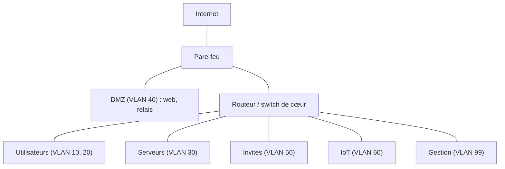

### Matrice des flux (exemple)

| Source vers destination | Utilisateurs | Serveurs | DMZ | Internet | Gestion |
|---|---|---|---|---|---|
| Utilisateurs | Non (isolation) | DNS, DHCP, SMB, web interne | HTTPS | HTTP, HTTPS, DNS via proxy | Non |
| Serveurs | Réponses seulement | Selon besoin | Non | Mises à jour (listes blanches) | Non |
| DMZ | Non | Flux applicatifs précis | Non | Selon service | Non |
| Invités | Non | Non | Non | HTTP, HTTPS, DNS | Non |
| Gestion | SSH, RDP selon besoin | SSH, RDP, WinRM | SSH | Mises à jour | Oui |

La matrice sert de **cahier des charges** du pare-feu et des ACL : chaque flux autorisé doit être justifié et documenté.

Sur les switchs, d'autres précautions de sécurité des VLAN : ne pas utiliser le VLAN 1 pour les utilisateurs, choisir un VLAN natif inutilisé (par exemple 999), désactiver la négociation de trunk (`switchport nonegotiate`) pour éviter le **VLAN hopping**, désactiver et isoler les ports inutilisés, gérer les équipements dans un VLAN de gestion.

## Pare-feu

Un pare-feu **à états** (stateful) suit les connexions : le trafic de retour d'une connexion autorisée est accepté automatiquement. Un pare-feu **nouvelle génération (NGFW)** ajoute inspection applicative, filtrage d'URL, IDS/IPS et identification des utilisateurs.

Règles d'or :

1. Politique par défaut : **bloquer en entrée** (et idéalement filtrer la sortie des serveurs).
2. Règles précises : source, destination, protocole, port.
3. Documenter chaque règle (commentaire, demandeur, date, échéance).
4. Revoir régulièrement et supprimer les règles inutiles.
5. Journaliser les refus et les accès sensibles.

### Exemples par plateforme

**Linux, ufw (Ubuntu) :**

```bash
sudo ufw default deny incoming
sudo ufw default allow outgoing
sudo ufw allow from 192.168.99.0/24 to any port 22 proto tcp
sudo ufw allow 443/tcp
sudo ufw logging medium
sudo ufw enable
```

**Linux, nftables :** jeu de règles complet (section « Configuration réseau »). Pour un routeur Linux, ajouter une chaîne `forward` à `policy drop` et des règles explicites.

**Windows (PowerShell, Admin) :**

```powershell
Set-NetFirewallProfile -Profile Domain,Private,Public -Enabled True -DefaultInboundAction Block -DefaultOutboundAction Allow
Set-NetFirewallProfile -Profile Domain,Private,Public -LogBlocked True -LogFileName "%SystemRoot%\System32\LogFiles\Firewall\pfirewall.log"
New-NetFirewallRule -DisplayName "RDP depuis gestion" -Direction Inbound -Protocol TCP -LocalPort 3389 -RemoteAddress 192.168.99.0/24 -Action Allow
```

**MikroTik et Cisco :** voir les sections sur les équipements réseau, le routage et MikroTik (règles de filtrage, ACL).

**Redirections de ports (NAT entrant) :** n'exposez que ce qui est nécessaire, de préférence **vers une DMZ**, jamais vers un poste utilisateur ; privilégiez un reverse proxy et le VPN plutôt qu'un service d'administration (RDP, SSH) exposé sur Internet.

## VPN

| Type | Usage | Technologies courantes |
|---|---|---|
| Accès distant (remote access) | Télétravail, nomades | WireGuard, OpenVPN, IPsec/IKEv2, VPN SSL des pare-feu |
| Site à site | Relier deux agences | IPsec, WireGuard |

Bonnes pratiques : **authentification forte** (certificats ou clés par utilisateur, plus un second facteur), **tunnel partiel** (split tunnel) ou tunnel complet selon la politique, filtrage de ce que les clients VPN peuvent joindre (zone dédiée, règles précises), journalisation des connexions, révocation immédiate lors du départ d'un utilisateur, mises à jour régulières de la passerelle VPN (cible fréquente d'attaques). Mise en place pas à pas : section « Serveur VPN (WireGuard) » et TP 15 (laboratoire).

## Contrôle d'accès et authentification

### Contrôle d'accès au réseau

- **Port security** (Cisco ; voir les sections sur les équipements réseau) : limite le nombre de MAC par port. Utile mais contournable (usurpation de MAC).
- **802.1X** : authentification **avant** l'accès au réseau : le poste (suppliant) s'authentifie auprès du switch (authentificateur), qui interroge un serveur **RADIUS** (FreeRADIUS, NPS de Windows Server). Il autorise l'accès et peut affecter un VLAN dynamique.

Exemple Cisco (syntaxe variable selon les versions d'IOS et de plate-forme ; à valider sur votre matériel) :

```text
aaa new-model
radius server RAD1
 address ipv4 192.168.30.5 auth-port 1812 acct-port 1813
 key MotDePasseRadiusLong
aaa authentication dot1x default group radius
dot1x system-auth-control
interface GigabitEthernet0/1
 switchport mode access
 authentication port-control auto
 dot1x pae authenticator
```

**Risque :** activer 802.1X sur tous les ports d'un coup peut couper imprimantes, téléphones et serveurs qui ne savent pas s'authentifier ; déployez par étapes, avec un mode de repli (MAB, VLAN invité) et testez d'abord sur un étage.

- **NAC** (contrôle d'admission réseau) : vérifie aussi l'état de conformité du poste.
- **Wi-Fi d'entreprise** : WPA2/WPA3-Enterprise (802.1X), voir les sections sur les équipements réseau et le Wi-Fi.

### Authentification

| Mesure | Pourquoi |
|---|---|
| Comptes **nominatifs**, pas de comptes partagés | Traçabilité |
| **Authentification multifacteur (MFA)** pour VPN, messagerie, administration | Un mot de passe volé ne suffit plus |
| Mots de passe **longs** (phrases de passe), pas de rotation forcée sans raison, interdiction des mots de passe compromis ou courants (recommandations du NIST SP 800-63B) | La longueur et l'unicité comptent plus que la complexité imposée |
| Coffre à mots de passe pour les administrateurs | Mots de passe uniques et forts |
| **LAPS** pour les administrateurs locaux | Pas de mot de passe administrateur identique sur tous les postes |
| Comptes d'administration distincts des comptes quotidiens | Limite l'exposition |
| Désactivation rapide des comptes inactifs et des départs | Réduit la surface d'attaque |

### SSH sécurisé

Rappel (section « Serveur SSH (OpenSSH) ») : clés plutôt que mots de passe, `PermitRootLogin no`, `AllowGroups`, `MaxAuthTries`, accès depuis le VLAN de gestion, fail2ban, journalisation, algorithmes modernes (clés `ed25519`), mise à jour d'OpenSSH. Pour les équipements réseau : SSH version 2 uniquement, Telnet désactivé.

## Protection contre les attaques réseau courantes

| Attaque | Principe | Contre-mesures |
|---|---|---|
| ARP spoofing | Fausses réponses ARP pour intercepter le trafic | DHCP snooping, **Dynamic ARP Inspection**, port security, 802.1X, segmentation, protocoles chiffrés |
| DHCP pirate ou épuisement du pool | Serveur DHCP non autorisé, ou requêtes massives | **DHCP snooping** (ports de confiance), limitation du débit DHCP par port, autorisation du serveur dans AD |
| Inondation de la table MAC | Saturation du switch pour le faire se comporter en hub | Port security (nombre maximal de MAC) |
| Attaques sur STP | Faux switch qui devient racine | BPDU guard, root guard |
| VLAN hopping | Sortie d'un VLAN par négociation de trunk ou double étiquetage | `switchport mode access`, `switchport nonegotiate`, VLAN natif inutilisé |
| Déni de service (DoS, DDoS) | Épuisement de ressources ou de bande passante | Limitation de débit, `tcp_syncookies`, filtrage amont (opérateur), CDN, redondance |
| Amplification DNS | Résolveur ouvert utilisé pour amplifier du trafic | Récursion limitée au LAN (section « Serveur DNS (BIND 9) »), filtrage anti-usurpation (BCP 38) |
| Brute force | Essais massifs de mots de passe | MFA, verrouillage, fail2ban, clés SSH |
| Balayage et reconnaissance | Découverte des services exposés | Surface minimale, pare-feu, IDS |
| Intercepteur (homme du milieu) | Interception de flux non chiffrés | HTTPS/TLS, SSH, SMB signé et chiffré, 802.1X |
| Rançongiciel | Chiffrement des données | Sauvegardes hors ligne et testées, correctifs, EDR, segmentation, droits limités |

### Configuration de défense sur un switch Cisco

```text
! Protection DHCP et ARP (sur les VLAN utilisateurs)
ip dhcp snooping
ip dhcp snooping vlan 10,20
interface GigabitEthernet0/24
 description TRUNK-VERS-ROUTEUR
 ip dhcp snooping trust
 ip arp inspection trust
interface range GigabitEthernet0/1 - 8
 ip dhcp snooping limit rate 15
ip arp inspection vlan 10,20

! Protection STP et VLAN
interface range GigabitEthernet0/1 - 8
 spanning-tree portfast
 spanning-tree bpduguard enable
interface GigabitEthernet0/24
 switchport nonegotiate
```

Remarques : **DAI** s'appuie sur la table de liaison créée par DHCP snooping ; les équipements en **adresse statique** (serveurs, imprimantes) nécessitent des ACL ARP (`arp access-list`) ou des ports de confiance, sinon leur trafic ARP est rejeté. Déployez en mode d'observation d'abord et testez sur un étage pilote.

### Durcissement réseau d'un serveur Linux

```bash
# /etc/sysctl.d/99-securite.conf
net.ipv4.tcp_syncookies = 1
net.ipv4.conf.all.rp_filter = 1
net.ipv4.conf.default.rp_filter = 1
net.ipv4.conf.all.accept_redirects = 0
net.ipv4.conf.all.send_redirects = 0
net.ipv4.conf.all.accept_source_route = 0
net.ipv4.icmp_echo_ignore_broadcasts = 1
```

```bash
sudo sysctl --system
```

**Attention :** `rp_filter` strict peut gêner un serveur à plusieurs interfaces ou avec du routage asymétrique ; `net.ipv4.ip_forward` ne doit être activé que sur un routeur ou une passerelle VPN. Vérifiez avec `sysctl net.ipv4.conf.all.rp_filter`.

## Surveillance du trafic et journalisation

| Besoin | Outil ou protocole | Remarque |
|---|---|---|
| Journaux centralisés | **syslog** (rsyslog, journald vers un collecteur), Graylog, ELK/OpenSearch, Loki | Conserver les journaux hors du serveur surveillé |
| Métriques d'équipements | **SNMP v3** | Éviter SNMP v1/v2c et la communauté « public » |
| Flux de trafic | NetFlow, IPFIX, sFlow | Qui parle à qui, volumes, anomalies |
| Détection d'intrusion | **IDS/IPS** (Suricata, Snort, ou fonction du pare-feu) | Nécessite un réglage pour limiter les faux positifs |
| Capture ponctuelle | `tcpdump`, Wireshark | Voir la section « Outils professionnels de diagnostic et de supervision » |
| Synchronisation des horloges | NTP/chrony | Indispensable pour corréler les événements |

Équipement Cisco : journalisation et SNMPv3 :

```text
service timestamps log datetime msec
ntp server 192.168.30.10
logging host 192.168.30.6
logging trap informational

snmp-server group SUPERVISION v3 priv
snmp-server user supervision SUPERVISION v3 auth sha MotDePasseAuthLong priv aes 128 MotDePassePrivLong
```

Événements Windows à surveiller : 4624 (ouverture de session réussie), 4625 (échec), 4740 (verrouillage de compte), 4720 (création de compte), 4728 ou 4732 (ajout à un groupe privilégié). Linux : `/var/log/auth.log` (Debian, Ubuntu) ou `journalctl -u ssh`, `last`, `lastb`.

## Gestion des mises à jour

| Élément | Windows | Linux (Ubuntu) |
|---|---|---|
| Postes et serveurs | WSUS, Windows Update for Business, Intune/outil de gestion | `unattended-upgrades` pour les correctifs de sécurité, `apt` planifié |
| Équipements réseau | Mise à jour du micrologiciel après lecture des avis de sécurité | idem |
| Méthode | Groupe pilote, puis déploiement général, fenêtre de maintenance | idem |
| Contrôle | Rapports de conformité | `apt list --upgradable`, outils de gestion de parc |

```bash
# Ubuntu : correctifs de sécurité automatiques
sudo apt install unattended-upgrades
sudo dpkg-reconfigure --priority=low unattended-upgrades
sudo unattended-upgrade --dry-run --debug      # simulation
```

Fichier `/etc/apt/apt.conf.d/20auto-upgrades` :

```text
APT::Periodic::Update-Package-Lists "1";
APT::Periodic::Unattended-Upgrade "1";
```

Les redémarrages (`Unattended-Upgrade::Automatic-Reboot`) doivent être planifiés selon la criticité du serveur. Règles générales : inventaire à jour, priorité aux vulnérabilités exploitées, test avant déploiement massif, retour arrière possible (instantané de VM), suivi des **fins de support** (systèmes et micrologiciels).

## Sauvegardes de configuration et de données

Sauvegardez **les configurations** (équipements, serveurs) en plus des données. Sans elles, reconstruire un routeur après une panne peut prendre des heures.

| Cible | Méthode |
|---|---|
| Équipements Cisco | `copy running-config tftp:` (réseau isolé) ou `scp:` ; archivage automatique avec `archive` ; outils : Oxidized, RANCID |
| MikroTik | `/export file=...` (texte, versionnable) et `/system backup save` |
| Serveurs Linux | `/etc` sauvegardé par `rsync`, `restic`, `borg` ; `etckeeper` pour versionner `/etc` avec git |
| Windows et AD | Sauvegarde de l'état du système des contrôleurs (`wbadmin`), export des GPO (`Backup-GPO`), sauvegarde DHCP (`Backup-DhcpServer`) |
| Données | Règle **3-2-1** : 3 copies, 2 supports différents, 1 copie hors site ou hors ligne |

Exemple d'archivage Cisco :

```text
archive
 path flash:config-archive
 time-period 1440
 write-memory
```

Principes : **versionner** les configurations (git), chiffrer les sauvegardes qui contiennent des secrets, tester régulièrement la **restauration**, stocker une copie hors ligne contre les rançongiciels, documenter la procédure.

## Bonnes pratiques de sécurité pour Ubuntu Server

1. Installation minimale ; désinstaller ou désactiver les services inutiles (`systemctl list-unit-files --state=enabled`).
2. Mises à jour de sécurité automatiques (voir la section « Gestion des mises à jour »).
3. SSH durci (section « Serveur SSH (OpenSSH) »), accès restreint au VLAN de gestion.
4. Pare-feu `ufw` ou `nftables` : refus par défaut, règles par service.
5. Comptes nominatifs, `sudo` plutôt que `root`, mots de passe forts ou verrouillés.
6. **AppArmor** actif (`sudo aa-status`), profils des services exposés en mode enforce.
7. Journalisation centralisée et horloge synchronisée.
8. Chiffrement du disque (LUKS) pour les serveurs portables ou exposés physiquement.
9. Droits de fichiers minimaux sur les secrets (`chmod 600`), pas de secrets dans les dépôts.
10. Audit : `sudo apt install lynis`, `sudo lynis audit system` (rapport de recommandations), et `auditd` pour tracer les actions sensibles.
11. Sauvegardes testées.

## Bonnes pratiques de sécurité pour les postes Windows

1. Windows à jour, correctifs déployés par WSUS ou outil équivalent.
2. **Microsoft Defender** (ou autre antivirus/EDR) actif, signatures à jour (`Get-MpComputerStatus`, `Update-MpSignature`).
3. Pare-feu Windows activé sur tous les profils.
4. **BitLocker** sur les portables (`Get-BitLockerVolume`, clés de récupération sauvegardées dans AD).
5. Utilisateurs sans droits d'administrateur local ; mots de passe administrateur locaux gérés par LAPS.
6. SMB1 désactivé, signature SMB, macros Office restreintes, exécution contrôlée (AppLocker ou App Control).
7. GPO de sécurité : verrouillage d'écran, politique de mot de passe et de verrouillage de compte, restrictions USB.
8. Sensibilisation des utilisateurs (hameçonnage, pièces jointes), signalement facile des incidents.
9. Journalisation des événements de sécurité vers un collecteur central.
10. Sauvegarde des données utilisateurs (redirection de dossiers, synchronisation) et procédure de réinstallation.

## Politique de sécurité réseau (plan type)

Une politique de sécurité est un **document court, approuvé par la direction**, appliqué et mis à jour. Plan conseillé :

1. Objet, périmètre et responsabilités (qui décide, qui administre, qui signale).
2. Classification des données et des systèmes (sensibles, internes, publics).
3. Gestion des accès : comptes, mots de passe, MFA, arrivées et départs.
4. Règles d'usage : postes, messagerie, Internet, BYOD, équipements personnels.
5. Règles réseau : segmentation, pare-feu, Wi-Fi, invités, accès distant et VPN.
6. Administration : accès privilégiés, SSH, journalisation, séparation des tâches.
7. Mises à jour et gestion des vulnérabilités.
8. Sauvegardes et continuité d'activité (objectifs de reprise).
9. Journaux, supervision et conservation (durées conformes au droit applicable).
10. Gestion des incidents : détection, signalement, réponse, communication, retour d'expérience.
11. Formation et sensibilisation.
12. Contrôles, revue au moins annuelle, sanctions en cas de non-respect.

## Plan de réponse à incident (version courte) *(ajout)*

1. **Détecter et qualifier** (supervision, signalement) : périmètre, gravité.
2. **Contenir** : isoler la machine ou le VLAN (couper le port, règle de pare-feu), sans éteindre brutalement si l'analyse mémoire est nécessaire.
3. **Préserver les preuves** : copie des journaux, captures, copie des disques.
4. **Éradiquer** la cause : retirer le logiciel malveillant, corriger la vulnérabilité, changer les secrets exposés.
5. **Restaurer** depuis des sauvegardes saines, surveiller.
6. **Communiquer** (direction, utilisateurs, autorités si une violation de données personnelles est constatée : obligation de notification à la CNIL sous 72 heures dans le cadre du RGPD).
7. **Retour d'expérience** et amélioration de la prévention.

## Pièges fréquents

| Piège | Conséquence | Remède |
| --- | --- | --- |
| Activer DAI sans DHCP snooping | DAI rejette tout le trafic ARP légitime | Snooping d'abord ; ACL ARP pour les adresses statiques |
| Déployer 802.1X partout d'un coup | Imprimantes, téléphones et serveurs coupés | Déploiement par étapes, mode de repli (MAB) |
| SNMP v1/v2c avec la communauté « public » | Informations d'infrastructure lisibles | SNMPv3 `authPriv`, restriction par ACL |
| Sauvegardes jamais restaurées | Découverte du problème le jour du sinistre | Test de restauration périodique, copie hors ligne |
| Règles de pare-feu trop larges ou non documentées | Surface d'attaque inutile | Matrice des flux, commentaire par règle, revue régulière |

---

# Outils professionnels de diagnostic et de supervision

## Objectifs d'apprentissage

Capturer et analyser du trafic (Wireshark, tcpdump) ; inventorier avec Nmap dans un cadre autorisé ; simuler et émuler des réseaux (Packet Tracer, GNS3) ; mettre en place une supervision (Zabbix, Nagios, LibreNMS, Prometheus, Grafana, Netdata) ; choisir l'outil adapté au besoin.

## Vue d'ensemble

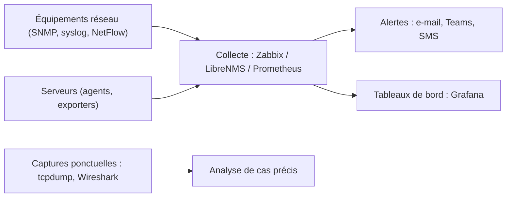

| Outil | Catégorie | Usage principal | Complexité |
|---|---|---|---|
| Wireshark | Analyse de paquets | Comprendre un échange réseau précis | Moyenne |
| tcpdump | Capture en ligne de commande | Capture sur serveur, filtrage | Moyenne |
| Nmap | Scan | Inventaire des hôtes et ports ouverts | Moyenne |
| Cisco Packet Tracer | Simulation | Apprendre Cisco, tester des topologies | Faible |
| GNS3 | Émulation | Laboratoire proche du réel | Élevée |
| Zabbix | Supervision | Surveillance complète, alertes | Moyenne à élevée |
| Nagios | Supervision | Vérifications par plugins | Moyenne |
| LibreNMS | Supervision réseau | Découverte SNMP, cartes, équipements | Moyenne |
| Prometheus | Métriques | Séries temporelles et alertes | Moyenne |
| Grafana | Visualisation | Tableaux de bord | Faible à moyenne |
| Netdata | Supervision temps réel | Diagnostic d'un serveur à la seconde | Faible |

## Wireshark

### Fonctionnement

Wireshark capture les trames d'une interface (via **libpcap** sous Linux, **Npcap** sous Windows) et les décode protocole par protocole. Il lit aussi les captures `.pcap` / `.pcapng` produites par `tcpdump`.

### Installation

```bash
# Ubuntu : installer, accepter la capture par utilisateurs non root, puis ajouter l'utilisateur au groupe
sudo apt install wireshark tshark
sudo usermod -aG wireshark $USER        # reconnexion nécessaire
```

Sous Windows : installeur officiel (inclut Npcap).

### Filtres : deux types à ne pas confondre

| Type | Syntaxe | Quand | Exemple |
|---|---|---|---|
| Filtre de **capture** (BPF, comme tcpdump) | `port 53`, `host 192.168.10.54` | Avant la capture : limite le volume | `host 192.168.10.54 and port 443` |
| Filtre d'**affichage** | `ip.addr == 192.168.10.54` | Après la capture : tri | `dns`, `tcp.analysis.retransmission` |

Filtres d'affichage courants :

```text
ip.addr == 192.168.10.54
tcp.port == 443
dns
dhcp
arp
icmp
tcp.flags.syn == 1 && tcp.flags.ack == 0          # nouvelles connexions (SYN sans ACK)
tcp.analysis.retransmission                        # retransmissions
tcp.analysis.flags                                 # anomalies TCP
dns.flags.rcode != 0                               # erreurs DNS
tls.handshake.type == 1                            # ClientHello
arp.duplicate-address-detected                     # conflit d'adresse ou usurpation
```

### Utilisation

- **Statistiques > Conversations / Endpoints** : qui parle le plus.
- **Statistiques > Graphiques d'E/S** : volume dans le temps.
- **Analyse > Expert Information** : retransmissions, résets, avertissements.
- **Clic droit > Suivre > Flux TCP** : contenu d'un échange (attention aux données sensibles).
- **tshark** (ligne de commande) :

```bash
sudo tshark -i ens18 -f "port 53" -c 20
tshark -r capture.pcap -Y "dns" -T fields -e ip.src -e dns.qry.name
```

### Exemples pratiques

1. **Diagnostic DHCP** : filtre `dhcp` ; une séquence Discover, Offer, Request, ACK doit apparaître. Discover sans Offer : serveur absent ou VLAN erroné.
2. **Réseau lent** : filtre `tcp.analysis.retransmission` ; beaucoup de retransmissions indiquent des pertes de paquets ; « Window Full » ou « Zero Window » indiquent un récepteur trop lent.
3. **DNS lent** : afficher `dns.time` en colonne ; des réponses à plusieurs secondes désignent le serveur DNS.
4. **Suspicion d'ARP spoofing** : filtre `arp` ; plusieurs MAC pour une IP, réponses ARP non sollicitées répétées.

### Cas d'usage en entreprise

Analyse d'un incident précis (échec d'authentification, lenteur applicative), preuve pour un fournisseur ou un opérateur, apprentissage des protocoles. **Précaution :** captures contenant des mots de passe et des données personnelles (protéger le fichier, le supprimer après usage).

## tcpdump

Voir la section « Commandes réseau sous Linux » pour la syntaxe détaillée. Cas d'usage en entreprise : capture sur un serveur sans interface graphique, puis analyse dans Wireshark.

```bash
sudo tcpdump -i ens18 -nn -s 0 -w /tmp/capture.pcap host 192.168.10.54 and port 443
# Arrêt avec Ctrl+C ; transfert du fichier et ouverture dans Wireshark
scp admin@srv-fic:/tmp/capture.pcap .
```

Limitez la durée et la taille (`-c`, ou `-G` et `-W` pour la rotation) pour ne pas remplir le disque.

## Nmap

Voir la section « Commandes réseau sous Linux » pour les options. Cas d'usage en entreprise : **inventaire** des hôtes, vérification que seuls les ports prévus sont ouverts après une modification de pare-feu, audit de la surface exposée.

```bash
nmap -sn 192.168.10.0/24                         # hôtes présents
sudo nmap -sS -sV -p- --open 192.168.30.20      # tous les ports ouverts, avec versions
nmap -p 22,80,443 --open 192.168.30.0/24 -oN rapport.txt
```

Les scans sont **bruyants** et peuvent perturber des équipements fragiles (imprimantes, automates) : prévenir, planifier, limiter le débit (`-T3`), obtenir l'autorisation écrite.

## Cisco Packet Tracer

### Fonctionnement

Simulateur de réseaux Cisco gratuit pour les inscrits à **Cisco Networking Academy**. Il simule routeurs, switchs, PC, serveurs, points d'accès. Deux modes : **temps réel** et **simulation** (visualisation de chaque paquet et de chaque PDU, très utile pour comprendre ARP, DHCP, NAT).

### Installation et utilisation

Création d'un compte Cisco Networking Academy, téléchargement de Packet Tracer pour Windows, macOS ou Linux, puis installation guidée. Interface : équipements en bas à gauche, câblage avec l'outil « Connections », onglets CLI et Config de chaque équipement, fichiers `.pkt`.

### Exemple pratique

Topologie : 1 routeur, 1 switch, 4 PC, VLAN 10 et 20, routage inter-VLAN. Reprendre les commandes des sections sur les équipements réseau (VLAN, trunk, sous-interfaces). Dans l'onglet **Simulation**, filtrez sur ICMP et observez le trajet d'un `ping` entre VLAN.

### Cas d'usage en entreprise

Maquette de configuration avant déploiement, formation des techniciens. **Limites :** ne reproduit pas toutes les commandes ni le comportement exact du matériel réel ; ne remplace pas un test sur équipement ou émulation fidèle.

## GNS3

### Fonctionnement

GNS3 est un émulateur : il fait fonctionner de **vraies images** de systèmes (Linux, routeurs virtuels, pare-feu), reliées dans une topologie graphique. Composants : GUI, serveur GNS3, et moteurs (Dynamips pour d'anciens routeurs Cisco, QEMU/KVM, Docker, VPCS pour des PC légers). **Les images Cisco (IOS, IOSv, IOL) sont soumises à licence :** vous devez en disposer légalement. Images librement utilisables : machines Linux, FRRouting, **MikroTik CHR** (version gratuite limitée en débit).

### Installation (Ubuntu)

```bash
sudo add-apt-repository ppa:gns3/ppa
sudo apt update
sudo apt install gns3-gui gns3-server
```

Suivre ensuite l'assistant de première configuration (serveur local), et activer la virtualisation matérielle (KVM) pour de bonnes performances. Consultez la documentation officielle pour votre version.

### Utilisation

Glisser les équipements dans le projet, les relier, démarrer, ouvrir une console. Capture intégrée : clic droit sur un lien > « Start capture » (ouvre Wireshark). Projets exportables et partageables.

### Exemple pratique

Topologie : 2 routeurs MikroTik CHR en OSPF, 2 VM Ubuntu derrière chacun, une capture Wireshark sur le lien entre routeurs pour observer les messages Hello OSPF.

### Cas d'usage en entreprise

Tester une migration, valider une configuration de routage ou de VPN, reproduire un incident, se préparer à des certifications. Consomme beaucoup de RAM et de CPU. Alternatives : EVE-NG, Containerlab.

## Zabbix

### Fonctionnement

Zabbix est une plate-forme de supervision complète : **serveur** (collecte, déclencheurs, alertes), **base de données** (MySQL/MariaDB ou PostgreSQL), **interface web**, **agents** sur les machines et supervision **SNMP** ou **ICMP** des équipements sans agent.

| Notion | Rôle |
|---|---|
| Hôte | Équipement supervisé |
| Élément (item) | Mesure collectée (CPU, trafic, état d'un service) |
| Déclencheur (trigger) | Condition d'alerte sur un item |
| Modèle (template) | Ensemble d'items, de déclencheurs et de graphiques appliqué à des hôtes |
| Action | Notification et réaction (e-mail, Teams, script) |

### Installation (principe)

Les paquets dépendent de la version : suivez l'assistant d'installation officiel de zabbix.com (choix de la version LTS, de l'OS, de la base et du serveur web). Étapes générales :

1. Ajouter le dépôt Zabbix correspondant à l'OS, installer `zabbix-server-mysql`, `zabbix-frontend-php`, `zabbix-apache-conf` (ou nginx), `zabbix-sql-scripts` et `zabbix-agent2`.
2. Installer MariaDB, créer la base et l'utilisateur, importer le schéma fourni.
3. Renseigner le mot de passe de la base dans `/etc/zabbix/zabbix_server.conf`.
4. Activer les services (`zabbix-server`, `zabbix-agent2`, serveur web) et terminer l'assistant web.

Ports : agent 10050 (passif), serveur 10051 (actif).

### Configuration d'un agent

`/etc/zabbix/zabbix_agent2.conf` :

```text
Server=192.168.30.6
ServerActive=192.168.30.6
Hostname=srv-fic
```

```bash
sudo systemctl enable --now zabbix-agent2
sudo ufw allow from 192.168.30.6 to any port 10050 proto tcp
```

Dans l'interface web : **Collecte de données > Hôtes > Créer un hôte**, associer le modèle « Linux by Zabbix agent » (ou « Windows by Zabbix agent »). Pour un switch ou routeur, activer SNMP sur l'équipement (v3) et associer un modèle SNMP adapté.

### Utilisation et exemple

- Tableaux de bord (graphiques de charge, trafic par interface, état des services).
- Déclencheur : « espace disque libre inférieur à 15 % pendant 5 minutes » ; action : e-mail à l'équipe.
- Test d'un item en ligne de commande : `zabbix_get -s 192.168.30.21 -k system.cpu.load`.
- Supervision de disponibilité : modèle « ICMP Ping », contrôle de ports et de pages web.

### Cas d'usage en entreprise

Supervision centralisée de serveurs, équipements réseau, services (DNS, DHCP, Web), alertes, rapports de disponibilité, découverte automatique (LLD) des interfaces et des disques.

## Nagios

### Fonctionnement

Nagios Core exécute des **plugins** (petits programmes qui renvoient un état : OK, WARNING, CRITICAL, UNKNOWN) à intervalles réguliers sur des hôtes et des services définis par des fichiers de configuration. Il est plus simple à comprendre que Zabbix, mais la configuration est manuelle ; **NRPE** permet l'exécution de plugins sur un hôte distant.

### Installation (Ubuntu, principe)

```bash
sudo apt install nagios4 nagios-plugins
sudo htpasswd -c /etc/nagios4/htdigest.users nagiosadmin    # selon l'empaquetage : vérifier le chemin et le mécanisme
```

Les chemins et le mode d'authentification web varient selon les versions : consultez la documentation de votre distribution.

### Configuration (exemple)

```text
define host {
    use                     linux-server
    host_name               srv-web
    address                 192.168.30.20
}

define service {
    use                     generic-service
    host_name               srv-web
    service_description     HTTP
    check_command           check_http
}
```

```bash
# Test d'un plugin à la main
/usr/lib/nagios/plugins/check_ping -H 192.168.30.1 -w 100,20% -c 200,40%
# Vérification de la configuration avant redémarrage
sudo nagios4 -v /etc/nagios4/nagios.cfg
sudo systemctl restart nagios4
```

### Cas d'usage en entreprise

Parc modeste ou besoin de contrôles très spécifiques (plugins personnalisés), héritage d'installations existantes ; la communauté fournit de nombreux plugins. Forks et alternatives modernes : Icinga, Naemon, Checkmk.

## LibreNMS

### Fonctionnement

LibreNMS est une solution de supervision **réseau** open source, centrée sur **SNMP**. Elle **découvre automatiquement** les équipements, leurs interfaces et leurs voisins (LLDP, CDP), trace des graphiques de trafic, génère des cartes et envoie des alertes. Elle repose sur PHP, une base MariaDB et RRDtool.

### Installation

L'installation par paquets est détaillée (nombreuses dépendances) ; suivez la documentation officielle de LibreNMS pour votre distribution, ou utilisez l'image **Docker** fournie par la communauté pour un essai rapide.

### Configuration et utilisation

1. Activer **SNMPv3** sur les équipements (Cisco : section « Surveillance du trafic et journalisation »).
2. Dans l'interface web : **Devices > Add Device** : nom ou IP, version SNMP et identifiants.
3. Laisser la découverte et le sondage tourner ; consulter les graphiques par port.
4. Créer des **règles d'alerte** (interface down, trafic en forte hausse, température) et des **transports** (e-mail, Slack, Teams).

Test depuis un serveur Linux (paquet `snmp`) :

```bash
snmpwalk -v3 -l authPriv -u supervision -a SHA -A 'MotDePasseAuth' -x AES -X 'MotDePassePriv' 192.168.99.2 sysName
```

### Exemple pratique et cas d'usage

Ajouter les switchs et routeurs du plan d'adressage, observer la carte du réseau obtenue par LLDP, déclencher une alerte quand un trunk tombe. Idéal pour un réseau d'équipements (switchs, routeurs, points d'accès) ; moins adapté à la supervision applicative fine des serveurs.

## Prometheus

### Fonctionnement

Prometheus **collecte** (pull) des métriques exposées en HTTP par des **exporters**, les stocke dans une base de séries temporelles et évalue des **règles d'alerte** transmises à **Alertmanager**. Il s'interroge avec le langage **PromQL**.

| Composant | Rôle | Port par défaut |
|---|---|---|
| Prometheus | Collecte, stockage, requêtes | 9090 |
| node_exporter | Métriques d'un serveur Linux | 9100 |
| blackbox_exporter | Tests ICMP, TCP, HTTP depuis l'extérieur | 9115 |
| snmp_exporter | Métriques d'équipements SNMP | 9116 |
| Alertmanager | Regroupement et envoi d'alertes | 9093 |

### Installation (Ubuntu)

```bash
sudo apt install prometheus prometheus-node-exporter prometheus-blackbox-exporter prometheus-alertmanager
```

(Les versions des paquets Ubuntu peuvent être en retard sur la version officielle : pour des fonctions récentes, utilisez les binaires officiels.)

### Configuration `/etc/prometheus/prometheus.yml` (extrait)

```yaml
global:
  scrape_interval: 15s

scrape_configs:
  - job_name: 'serveurs'
    static_configs:
      - targets: ['192.168.30.21:9100', '192.168.30.20:9100']

  - job_name: 'ping_icmp'
    metrics_path: /probe
    params:
      module: [icmp]
    static_configs:
      - targets: ['192.168.10.1', '1.1.1.1']
    relabel_configs:
      - source_labels: [__address__]
        target_label: __param_target
      - source_labels: [__param_target]
        target_label: instance
      - target_label: __address__
        replacement: 127.0.0.1:9115
```

Règle d'alerte (extrait `/etc/prometheus/rules/alertes.yml`, déclarée dans `rule_files`) :

```yaml
groups:
  - name: serveurs
    rules:
      - alert: HoteInjoignable
        expr: up == 0
        for: 2m
        labels:
          severity: critical
        annotations:
          summary: "{{ $labels.instance }} ne répond plus"
      - alert: DisqueAlmostPlein
        expr: node_filesystem_avail_bytes{fstype!~"tmpfs|overlay"} / node_filesystem_size_bytes * 100 < 15
        for: 10m
        labels:
          severity: warning
```

```bash
promtool check config /etc/prometheus/prometheus.yml
promtool check rules /etc/prometheus/rules/alertes.yml
sudo systemctl reload prometheus
```

### Requêtes PromQL utiles

```text
up == 0                                                       # cibles injoignables
100 - (avg by (instance) (rate(node_cpu_seconds_total{mode="idle"}[5m])) * 100)       # CPU utilisé en %
rate(node_network_receive_bytes_total{device="ens18"}[5m]) * 8                         # débit entrant en bits/s
probe_success{job="ping_icmp"}                                # résultat des tests ICMP
```

### Cas d'usage en entreprise

Supervision d'infrastructures dynamiques (VM, conteneurs), métriques fines avec alertes, base de tableaux de bord Grafana. **Sécurité :** les exporters exposent des métriques sans authentification : filtrez par pare-feu (seul Prometheus doit y accéder) ou utilisez TLS et authentification.

## Grafana

### Fonctionnement

Grafana est un outil de **visualisation** : il interroge des sources de données (Prometheus, Zabbix, InfluxDB, Loki, bases SQL...) et affiche des tableaux de bord et des alertes.

### Installation (Ubuntu)

Utiliser le dépôt officiel de Grafana (clé GPG et ligne de dépôt à jour sur la documentation officielle), puis :

```bash
sudo apt update
sudo apt install grafana
sudo systemctl enable --now grafana-server
```

Interface : `http://serveur:3000`. À la première connexion, le compte `admin` est proposé : **changez immédiatement le mot de passe** ; placez l'interface derrière HTTPS (reverse proxy) et limitez l'accès.

### Configuration et utilisation

1. **Connections > Data sources > Add > Prometheus**, URL `http://localhost:9090`, puis « Save & test ».
2. **Dashboards > Import** : par exemple le tableau de bord communautaire « Node Exporter Full » (identifiant 1860 sur grafana.com), associé à la source Prometheus.
3. Créer ses propres panneaux avec les requêtes PromQL de la section précédente ; définir des **alertes** et des points de contact (e-mail, Teams).

### Cas d'usage en entreprise

Tableaux de bord pour la direction informatique (disponibilité, charge, trafic), écran mural dans la salle des techniciens, corrélation de métriques de plusieurs sources.

## Netdata

### Fonctionnement

Netdata est un agent de supervision **en temps réel** (mesures à la seconde) très simple à installer : il affiche des centaines de métriques d'un serveur (CPU, mémoire, disques, interfaces, services) avec une interface web locale sur le port **19999**, et propose des alertes préconfigurées.

### Installation

```bash
wget -O /tmp/netdata-kickstart.sh https://get.netdata.cloud/kickstart.sh
sh /tmp/netdata-kickstart.sh --disable-telemetry
```

Lisez le script avant de l'exécuter (bonne pratique pour tout script téléchargé), ou utilisez les paquets de votre distribution.

### Configuration et sécurité

- Par défaut, l'interface locale est accessible à toute personne qui atteint le port : **limitez** l'écoute à `127.0.0.1` ou au VLAN de gestion (`[web]` > `bind to` dans `netdata.conf`, modifiable avec `sudo /etc/netdata/edit-config netdata.conf`) et filtrez par pare-feu.
- Netdata peut envoyer des données vers un service cloud optionnel : n'activez cette liaison que si la politique de sécurité l'autorise.

### Exemple pratique et cas d'usage

Un serveur de fichiers devient lent : en ouvrant Netdata, on observe en direct la saturation disque (latence, file d'attente) ou la charge réseau par interface. Très utile pour le **diagnostic ponctuel** et la supervision d'une machine isolée ; pour une supervision centralisée avec historique long, privilégier Zabbix ou Prometheus et Grafana.

## Choisir ses outils *(ajout)*

| Besoin | Solution recommandée |
|---|---|
| Comprendre un échange précis, prouver une anomalie | Wireshark, tcpdump |
| Inventaire et contrôle d'exposition | Nmap |
| Apprendre et tester une configuration Cisco | Packet Tracer |
| Laboratoire avec vraies images | GNS3 |
| Supervision tout-en-un d'un parc (serveurs et réseau), alertes | Zabbix |
| Supervision d'équipements réseau par SNMP, cartes | LibreNMS |
| Métriques d'infrastructures, alertes, tableaux de bord | Prometheus et Grafana |
| Diagnostic temps réel d'un serveur | Netdata |
| Parc modeste, contrôles personnalisés | Nagios ou Icinga |

Pour le projet final (section « Projet final : infrastructure réseau d'une entreprise de 40 collaborateurs » du guide) : Zabbix pour la supervision de l'infrastructure, complété par des captures Wireshark pour les tests.

## Pièges fréquents

| Piège | Conséquence | Remède |
| --- | --- | --- |
| Scanner ou capturer sans autorisation | Infraction possible, perturbation d'équipements | Autorisation écrite, périmètre défini, rythme limité |
| Exporters et Netdata accessibles sans authentification | Reconnaissance facilitée pour un attaquant | Pare-feu, écoute locale, TLS et authentification |
| Compte `admin` par défaut de Grafana ou Zabbix | Accès administrateur trivial | Changer le mot de passe dès la première connexion |
| Images Cisco sans licence dans GNS3 | Usage non conforme | Images libres (Linux, MikroTik CHR) ou licenciées |

---

# Travaux pratiques et laboratoires

## Objectifs d'apprentissage

Réaliser 16 laboratoires progressifs (réseau local, IP statiques, DHCP, DNS, SSH, Samba, UFW, VLAN, routeur Cisco, MikroTik, Wireshark, réseau lent, conflit IP, DNS, VPN, supervision Zabbix) ; diagnostiquer des pannes volontairement introduites ; évaluer ses compétences avec une grille d'auto-évaluation.

## Comment utiliser les TP

Chaque TP suit la même structure :

1. **Objectifs** : ce que vous saurez faire.
2. **Matériel et logiciels** nécessaires.
3. **Architecture** du laboratoire.
4. **Étapes de réalisation**, avec les commandes (TP guidés).
5. **Résultats attendus** et critères de réussite.
6. **Scénarios de panne** : défauts à introduire (ou à faire introduire par un binôme) puis à diagnostiquer **sans consulter les corrections**.
7. Les **corrections** se trouvent dans la section « Corrections des exercices et des laboratoires », séparée des énoncés.

Méthode de travail : appliquez la méthodologie de la section « Méthodologie professionnelle de dépannage » (une modification à la fois, notez ce que vous faites, validez par des tests objectifs). Progression : TP 1 à 3 (niveau débutant), TP 4 à 8 (intermédiaire), TP 9 à 16 (avancé).

## TP 1 — Création d'un réseau local

**Niveau :** débutant. **Durée indicative :** 45 minutes.

### Objectifs

- Relier deux machines sur un réseau local et vérifier leur communication.
- Observer la résolution ARP et l'échange ICMP.
- Utiliser `ip`, `ping`, `ip neigh` et `tcpdump`.

### Matériel et logiciels

VirtualBox, 2 VM Ubuntu Server (`srv-lab`, `cli-ubuntu`) avec un adaptateur « Réseau interne `lab-net` ». Variante : Cisco Packet Tracer (2 PC et un switch 2960).

### Architecture

```text
 [srv-lab 192.168.10.10] ---- (réseau interne lab-net) ---- [cli-ubuntu 192.168.10.101]
```

### Étapes

1. Démarrer les deux VM. Repérer l'interface du réseau interne : `ip -br link`.
2. Sur `srv-lab` (configuration **temporaire**, non persistante) :
   ```bash
   sudo ip addr add 192.168.10.10/24 dev enp0s8
   sudo ip link set enp0s8 up
   ```
3. Sur `cli-ubuntu` :
   ```bash
   sudo ip addr add 192.168.10.101/24 dev enp0s8
   sudo ip link set enp0s8 up
   ```
4. Vérifier : `ip -br addr` sur chaque machine.
5. Sur `srv-lab`, lancer la capture : `sudo tcpdump -i enp0s8 -nn arp or icmp`.
6. Sur `cli-ubuntu` : `ping -c 3 192.168.10.10`.
7. Sur `cli-ubuntu` : `ip neigh show` (table ARP).
8. Variante Packet Tracer : placer 2 PC et un switch, relier avec des câbles droits, configurer les adresses dans *Desktop > IP Configuration*, tester avec `ping` dans l'invite de commandes du PC, puis passer en mode Simulation pour observer l'ARP.

### Résultats attendus

- Les `ping` aboutissent (0 % de perte).
- La capture montre une requête ARP (« Who has 192.168.10.10 ? »), une réponse ARP, puis des Echo request et Echo reply.
- `ip neigh` liste l'adresse de l'autre machine avec sa MAC à l'état `REACHABLE`.

### Critères de réussite

Vous savez expliquer pourquoi l'ARP précède le premier ping, et pourquoi la configuration disparaît au redémarrage.

### Scénarios de panne (à diagnostiquer)

- **Panne 1A.** Sur `cli-ubuntu`, l'adresse est saisie avec le masque `/25` au lieu de `/24` et l'adresse `192.168.10.201/25`. Les machines se joignent-elles ? Pourquoi ?
- **Panne 1B.** Le client est configuré avec `192.168.20.101/24`. Quel est le symptôme ?
- **Panne 1C.** L'interface du client est désactivée (`ip link set enp0s8 down`).

## TP 2 — Configuration d'adresses IP statiques

**Niveau :** débutant. **Durée :** 45 minutes.

### Objectifs

- Rendre la configuration **persistante** avec Netplan (Linux) et PowerShell (Windows).
- Comprendre masque, passerelle et DNS.

### Matériel

Mêmes VM qu'au TP 1 ; `cli-win` facultative.

### Étapes

1. Redémarrer les VM : la configuration du TP 1 a disparu (`ip -br addr`). Constat à noter.
2. Sur `srv-lab`, créer `/etc/netplan/60-lab.yaml` :
   ```yaml
   network:
     version: 2
     ethernets:
       enp0s8:
         dhcp4: false
         addresses: [192.168.10.10/24]
   ```
   Conserver la configuration de la carte NAT (`enp0s3`) fournie à l'installation dans son fichier d'origine.
3. Appliquer avec retour arrière automatique :
   ```bash
   sudo chmod 600 /etc/netplan/60-lab.yaml
   sudo netplan generate
   sudo netplan try
   ```
4. Même opération sur `cli-ubuntu` avec `192.168.10.101/24`.
5. Windows (PowerShell, Admin) :
   ```powershell
   Get-NetAdapter
   New-NetIPAddress -InterfaceAlias "Ethernet 2" -IPAddress 192.168.10.102 -PrefixLength 24
   ```
6. Tester les communications deux à deux (`ping`) et après redémarrage.
7. Documenter dans un tableau : hôte, interface, adresse, masque, rôle.

### Résultats attendus

La configuration survit au redémarrage ; les trois machines se joignent. `ip route` montre la route du réseau `192.168.10.0/24` ; la route par défaut reste celle de la carte NAT.

### Scénarios de panne

- **Panne 2A.** Le fichier Netplan contient une tabulation ou une indentation incorrecte : `netplan generate` signale une erreur.
- **Panne 2B.** Deux machines reçoivent la même adresse `192.168.10.101`.
- **Panne 2C.** Le fichier a les droits `644` : message d'avertissement sur les permissions.

## TP 3 — Configuration d'un serveur DHCP Ubuntu

**Niveau :** intermédiaire. **Durée :** 1 h 30.

### Objectifs

- Installer et configurer **Kea DHCP4** sur Ubuntu Server.
- Distribuer adresse, passerelle, DNS et domaine ; créer une réservation.
- Diagnostiquer un échec DHCP avec `tcpdump` et les journaux.

### Matériel

`srv-lab` (serveur DHCP, 192.168.10.10/24), `cli-ubuntu` et éventuellement `cli-win` en clients. **Retirez la carte NAT des clients** pour ce TP (elle fournit déjà une route par défaut qui perturberait l'observation de la passerelle distribuée).

### Architecture

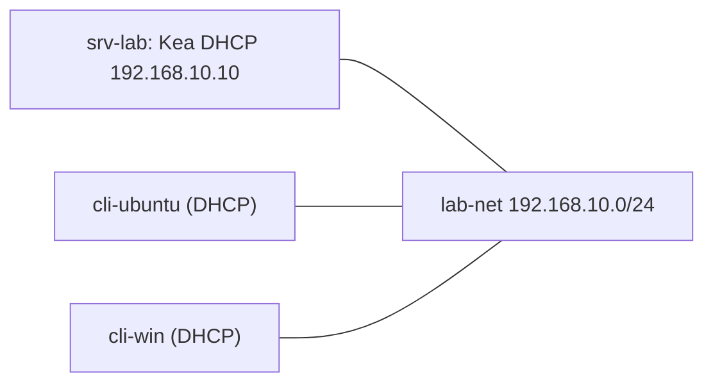

### Étapes

1. Sur `srv-lab` :
   ```bash
   sudo apt update
   sudo apt install kea-dhcp4-server
   sudo cp -a /etc/kea/kea-dhcp4.conf /etc/kea/kea-dhcp4.conf.bak
   ```
2. Éditer `/etc/kea/kea-dhcp4.conf` :
   ```json
   {
   "Dhcp4": {
     "interfaces-config": { "interfaces": [ "enp0s8" ] },
     "control-socket": { "socket-type": "unix", "socket-name": "/run/kea/kea4-ctrl-socket" },
     "lease-database": { "type": "memfile", "lfc-interval": 3600 },
     "valid-lifetime": 3600,
     "subnet4": [
       {
         "id": 1,
         "subnet": "192.168.10.0/24",
         "pools": [ { "pool": "192.168.10.100 - 192.168.10.150" } ],
         "option-data": [
           { "name": "routers", "data": "192.168.10.1" },
           { "name": "domain-name-servers", "data": "192.168.10.10" },
           { "name": "domain-name", "data": "entreprise.local" }
         ]
       }
     ]
   }
   }
   ```
3. Valider et démarrer :
   ```bash
   sudo kea-dhcp4 -t /etc/kea/kea-dhcp4.conf
   sudo systemctl enable --now kea-dhcp4-server
   systemctl status kea-dhcp4-server
   sudo ss -ulpn | grep ':67'
   ```
4. Sur `cli-ubuntu`, passer l'interface en DHCP (`/etc/netplan/60-lab.yaml`) :
   ```yaml
   network:
     version: 2
     ethernets:
       enp0s8:
         dhcp4: true
   ```
   puis `sudo netplan try`.
5. Observer côté serveur : `sudo tcpdump -i enp0s8 -nn 'port 67 or port 68'` pendant le renouvellement (`sudo networkctl renew enp0s8`).
6. Vérifier : sur le client `ip -br addr`, `ip route`, `resolvectl status enp0s8` ; sur le serveur `cat /var/lib/kea/kea-leases4.csv`.
7. Créer une **réservation** : relever la MAC du client (`ip link show enp0s8`), ajouter dans le sous-réseau :
   ```json
   "reservations": [
     { "hw-address": "08:00:27:aa:bb:cc", "ip-address": "192.168.10.30", "hostname": "cli-ubuntu" }
   ]
   ```
   puis tester la configuration, redémarrer le service, renouveler le bail du client.
8. Windows (si présent) : `ipconfig /release` puis `ipconfig /renew`, `ipconfig /all`.

### Résultats attendus

Le client obtient une adresse de `.100` à `.150` avec passerelle `.1`, DNS `.10`, domaine `entreprise.local`. La capture montre la séquence Discover, Offer, Request, ACK. Après la réservation, le client reçoit `192.168.10.30`.

### Scénarios de panne

- **Panne 3A.** Le service ne démarre pas après une modification de `kea-dhcp4.conf`.
- **Panne 3B.** Les clients restent sans adresse alors que le service est actif.
- **Panne 3C.** Une machine reçoit une adresse mais la mauvaise passerelle.
- **Panne 3D.** La plage est réduite à 2 adresses, trois clients démarrent.

## TP 4 — Installation et configuration d'un serveur DNS

**Niveau :** intermédiaire. **Durée :** 2 heures.

### Objectifs

- Installer **BIND 9**, créer une zone directe et une zone inverse.
- Configurer la récursion restreinte et des redirecteurs.
- Tester avec `dig`, `nslookup` et `resolvectl`.

### Matériel

`srv-lab` (DNS, 192.168.10.10), clients Linux et Windows (configurés en DHCP ou en statique avec ce DNS). Carte NAT conservée sur `srv-lab` pour la résolution des noms externes.

### Étapes

1. Installer : `sudo apt install bind9 bind9-utils bind9-dnsutils`.
2. `/etc/bind/named.conf.options` :
   ```text
   acl "lan" { 192.168.10.0/24; 127.0.0.1; };
   options {
       directory "/var/cache/bind";
       listen-on { 127.0.0.1; 192.168.10.10; };
       listen-on-v6 { none; };
       allow-query { lan; };
       allow-recursion { lan; };
       recursion yes;
       forwarders { 1.1.1.1; 9.9.9.9; };
       dnssec-validation auto;
   };
   ```
3. `/etc/bind/named.conf.local` :
   ```text
   zone "entreprise.local" {
       type primary;
       file "/etc/bind/zones/db.entreprise.local";
   };
   zone "10.168.192.in-addr.arpa" {
       type primary;
       file "/etc/bind/zones/db.192.168.10";
   };
   ```
4. Créer `/etc/bind/zones/db.entreprise.local` :
   ```text
   $TTL 3600
   @       IN SOA ns1.entreprise.local. admin.entreprise.local. (
                   2026111601 3600 900 604800 300 )
           IN NS  ns1.entreprise.local.
   ns1     IN A   192.168.10.10
   srv-lab IN A   192.168.10.10
   cli-ubuntu IN A 192.168.10.101
   www     IN CNAME srv-lab
   ```
5. Créer `/etc/bind/zones/db.192.168.10` (zone inverse) :
   ```text
   $TTL 3600
   @   IN SOA ns1.entreprise.local. admin.entreprise.local. (
               2026111601 3600 900 604800 300 )
       IN NS  ns1.entreprise.local.
   10  IN PTR ns1.entreprise.local.
   101 IN PTR cli-ubuntu.entreprise.local.
   ```
6. Valider et démarrer :
   ```bash
   sudo mkdir -p /etc/bind/zones
   sudo named-checkconf
   sudo named-checkzone entreprise.local /etc/bind/zones/db.entreprise.local
   sudo named-checkzone 10.168.192.in-addr.arpa /etc/bind/zones/db.192.168.10
   sudo systemctl restart named
   ```
7. Tester depuis `srv-lab` puis depuis un client :
   ```bash
   dig @192.168.10.10 srv-lab.entreprise.local +short
   dig @192.168.10.10 www.entreprise.local
   dig @192.168.10.10 -x 192.168.10.101 +short
   dig @192.168.10.10 exemple.fr +short
   ```
8. Configurer le client pour utiliser ce DNS (option distribuée par Kea au TP 3 ou, en statique, `nameservers` dans Netplan) puis vérifier `resolvectl status` et `resolvectl query srv-lab.entreprise.local`.
9. Windows : `nslookup srv-lab.entreprise.local 192.168.10.10` ; `Resolve-DnsName srv-lab.entreprise.local -Server 192.168.10.10`.

### Résultats attendus

Résolution directe, inverse et alias (CNAME) des noms de la zone ; résolution Internet par les redirecteurs ; refus (`REFUSED`) pour une requête venant d'une adresse hors de l'ACL.

### Scénarios de panne

- **Panne 4A.** Une modification de zone n'apparaît pas chez les clients.
- **Panne 4B.** `named-checkzone` signale une erreur de syntaxe après l'ajout d'un enregistrement.
- **Panne 4C.** Les noms internes se résolvent, mais pas les noms Internet.
- **Panne 4D.** `dig` renvoie `connection timed out; no servers could be reached` depuis un client.

## TP 5 — Configuration SSH

**Niveau :** intermédiaire. **Durée :** 1 h 30.

### Objectifs

- Se connecter par SSH, mettre en place l'authentification par clé.
- Durcir le serveur et protéger contre le brute force.
- Savoir diagnostiquer un refus de connexion.

### Matériel

`srv-lab` (serveur SSH), `cli-ubuntu` (client).

### Étapes

1. Sur `srv-lab` : `sudo apt install openssh-server fail2ban` ; `systemctl status ssh`.
2. Connexion par mot de passe depuis le client : `ssh admin@192.168.10.10`. Noter l'empreinte de la clé d'hôte acceptée à la première connexion.
3. Générer une clé sur le client et la copier :
   ```bash
   ssh-keygen -t ed25519 -C "admin@cli-ubuntu"
   ssh-copy-id admin@192.168.10.10
   ssh admin@192.168.10.10
   ```
4. Sur le serveur, créer le groupe d'accès :
   ```bash
   sudo groupadd ssh-users
   sudo usermod -aG ssh-users admin
   ```
5. Créer `/etc/ssh/sshd_config.d/10-durcissement.conf` :
   ```text
   PermitRootLogin no
   PasswordAuthentication no
   PubkeyAuthentication yes
   MaxAuthTries 3
   AllowGroups ssh-users
   X11Forwarding no
   ```
6. **Garder la session ouverte**, puis :
   ```bash
   sudo sshd -t
   sudo systemctl reload ssh
   ```
   Ouvrir une **seconde** session de test avec la clé ; vérifier qu'une tentative avec mot de passe est refusée (`ssh -o PubkeyAuthentication=no admin@192.168.10.10`).
7. Configurer fail2ban (`/etc/fail2ban/jail.local`) :
   ```text
   [sshd]
   enabled = true
   maxretry = 3
   findtime = 10m
   bantime = 10m
   ```
   ```bash
   sudo systemctl restart fail2ban
   ```
8. Simuler des échecs depuis un utilisateur inexistant (`ssh faux@192.168.10.10`, plusieurs fois, en désactivant la clé : `-o PubkeyAuthentication=no`) puis consulter `sudo fail2ban-client status sshd`. Débannir : `sudo fail2ban-client set sshd unbanip 192.168.10.101`.
9. Examiner les journaux : `sudo journalctl -u ssh -n 30`.

### Résultats attendus

Connexion par clé réussie, mots de passe refusés, utilisateur hors groupe refusé, adresse bannie après les échecs.

### Scénarios de panne

- **Panne 5A.** `Permission denied (publickey)` alors que la clé est copiée.
- **Panne 5B.** Après durcissement, plus personne ne peut se connecter.
- **Panne 5C.** `Connection refused`.

## TP 6 — Partage de fichiers avec Samba

**Niveau :** intermédiaire. **Durée :** 1 h 30.

### Objectifs

- Créer des partages Samba avec des droits par groupe.
- Se connecter depuis Linux (`smbclient`, `mount.cifs`) et Windows.
- Diagnostiquer des erreurs `NT_STATUS_*`.

### Matériel

`srv-lab` (Samba), `cli-ubuntu`, `cli-win` (facultatif).

### Étapes

1. Sur `srv-lab` :
   ```bash
   sudo apt install samba
   sudo groupadd compta
   sudo mkdir -p /srv/partages/compta /srv/partages/commun
   sudo chgrp compta /srv/partages/compta
   sudo chmod 2770 /srv/partages/compta
   sudo chmod 777 /srv/partages/commun
   sudo adduser --no-create-home --disabled-password --gecos "" alice
   sudo adduser --no-create-home --disabled-password --gecos "" bob
   sudo usermod -aG compta alice
   sudo smbpasswd -a alice
   sudo smbpasswd -a bob
   ```
2. Ajouter à la fin de `/etc/samba/smb.conf` (en conservant la section `[global]` d'origine, après sauvegarde du fichier) :
   ```text
   [Compta]
      path = /srv/partages/compta
      valid users = @compta
      read only = no
      create mask = 0660
      directory mask = 0770

   [Commun]
      path = /srv/partages/commun
      valid users = alice, bob
      read only = no
   ```
3. Valider et recharger :
   ```bash
   testparm
   sudo systemctl restart smbd
   ```
4. Depuis `cli-ubuntu` :
   ```bash
   sudo apt install smbclient cifs-utils
   smbclient -L //192.168.10.10 -U alice
   smbclient //192.168.10.10/Compta -U alice -c 'put /etc/hostname test.txt; ls'
   sudo mkdir -p /mnt/compta
   sudo mount -t cifs //192.168.10.10/Compta /mnt/compta -o username=alice
   ```
5. Tester l'accès de `bob` au partage `Compta` : refusé. Tester l'accès de `bob` au partage `Commun` : autorisé.
6. Windows : Explorateur, `\\192.168.10.10\Compta`, saisir les identifiants ; ou `net use Z: \\192.168.10.10\Compta /user:alice`.
7. Vérifier les permissions créées : `ls -l /srv/partages/compta` ; observer l'héritage du groupe (bit setgid).

### Résultats attendus

`alice` lit et écrit dans `Compta` ; `bob` n'y accède pas mais accède à `Commun` ; les fichiers créés appartiennent au groupe `compta`.

### Scénarios de panne

- **Panne 6A.** `NT_STATUS_LOGON_FAILURE` pour un utilisateur qui existe sur le système.
- **Panne 6B.** `NT_STATUS_ACCESS_DENIED` pour `alice` sur `Compta`.
- **Panne 6C.** Le partage `Compta` n'apparaît pas dans la liste.
- **Panne 6D.** Windows ne peut pas joindre `\\192.168.10.10` (« chemin d'accès réseau introuvable »).

## TP 7 — Configuration d'un pare-feu UFW

**Niveau :** intermédiaire. **Durée :** 1 h 15.

### Objectifs

- Définir une politique de pare-feu stricte avec `ufw`.
- Autoriser des services précis selon la source.
- Vérifier avec `nc` et `nmap` ; lire les journaux ; prévoir un retour arrière.

### Matériel

`srv-lab` (SSH, Apache), `cli-ubuntu` (client de test). Accès à la **console de la VM** (pas seulement SSH) pour récupérer la main en cas d'erreur.

### Étapes

1. Sur `srv-lab` : `sudo apt install apache2 nmap` ; vérifier `ufw status` (`inactive`).
2. **Filet de sécurité** : planifier la désactivation automatique du pare-feu dans 10 minutes :
   ```bash
   sudo systemd-run --on-active=10m --unit=ufw-secours /usr/sbin/ufw disable
   ```
3. Définir la politique :
   ```bash
   sudo ufw default deny incoming
   sudo ufw default allow outgoing
   sudo ufw allow from 192.168.10.101 to any port 22 proto tcp
   sudo ufw allow 80/tcp
   sudo ufw logging medium
   sudo ufw enable
   sudo ufw status numbered
   ```
4. Depuis `cli-ubuntu` :
   ```bash
   nc -zv 192.168.10.10 22
   nc -zv 192.168.10.10 80
   nc -zv -w 3 192.168.10.10 443
   nmap -Pn -p 22,80,443 192.168.10.10
   ```
5. Sur `srv-lab`, consulter les blocages : `sudo journalctl -k | grep UFW | tail`.
6. Une fois validé, **annuler le filet de sécurité** : `sudo systemctl stop ufw-secours.timer`.
7. Ajouter puis supprimer une règle : `sudo ufw allow 8080/tcp`, `sudo ufw status numbered`, `sudo ufw delete <numéro>`.
8. Tester `sudo ufw limit 22/tcp` et observer son effet (limite les connexions répétées).

### Résultats attendus

22 et 80 ouverts pour le client autorisé, 443 filtré (`filtered` ou délai dépassé), blocages visibles dans les journaux.

### Scénarios de panne

- **Panne 7A.** Après `ufw enable`, la session SSH se coupe.
- **Panne 7B.** Le site web est inaccessible alors que la règle semble exister.
- **Panne 7C.** Une règle trop large (`ufw allow 22`) laisse SSH ouvert à tous.

## TP 8 — Création de VLAN avec Packet Tracer

**Niveau :** intermédiaire. **Durée :** 2 heures.

### Objectifs

- Créer deux VLAN, des ports access et un trunk.
- Réaliser le routage inter-VLAN en **router-on-a-stick**.
- Vérifier avec les commandes `show` et dépanner.

### Matériel

Cisco Packet Tracer (une version récente), 1 routeur (2911), 1 switch 2960, 4 PC.

### Architecture

```mermaid
flowchart TB
    R1["R1 Gi0/0 (trunk, sous-interfaces .10 et .20)"] --- SW1["SW1 (Gi0/1 trunk)"]
    SW1 -- "Fa0/1 VLAN 10" --> PC1["PC1 192.168.10.11"]
    SW1 -- "Fa0/2 VLAN 10" --> PC2["PC2 192.168.10.12"]
    SW1 -- "Fa0/3 VLAN 20" --> PC3["PC3 192.168.20.11"]
    SW1 -- "Fa0/4 VLAN 20" --> PC4["PC4 192.168.20.12"]
```

Plan : VLAN 10 `ADMIN` (192.168.10.0/24, passerelle .1) ; VLAN 20 `TECH` (192.168.20.0/24, passerelle .1). Adaptez les noms d'interface au modèle utilisé.

### Étapes

1. Placer les équipements et les câbler (câbles droits ; PC aux ports Fa0/1 à Fa0/4, routeur vers `GigabitEthernet0/1` du switch).
2. Configurer les PC (adresse, masque, passerelle).
3. Switch :
   ```text
   Switch> enable
   Switch# configure terminal
   Switch(config)# hostname SW1
   SW1(config)# vlan 10
   SW1(config-vlan)# name ADMIN
   SW1(config-vlan)# vlan 20
   SW1(config-vlan)# name TECH
   SW1(config-vlan)# exit
   SW1(config)# interface range FastEthernet0/1 - 2
   SW1(config-if-range)# switchport mode access
   SW1(config-if-range)# switchport access vlan 10
   SW1(config-if-range)# interface range FastEthernet0/3 - 4
   SW1(config-if-range)# switchport mode access
   SW1(config-if-range)# switchport access vlan 20
   SW1(config-if-range)# interface GigabitEthernet0/1
   SW1(config-if)# switchport mode trunk
   SW1(config-if)# switchport trunk allowed vlan 10,20
   SW1(config-if)# end
   SW1# copy running-config startup-config
   ```
4. Routeur :
   ```text
   Router> enable
   Router# configure terminal
   Router(config)# hostname R1
   R1(config)# interface GigabitEthernet0/0
   R1(config-if)# no shutdown
   R1(config-if)# interface GigabitEthernet0/0.10
   R1(config-subif)# encapsulation dot1Q 10
   R1(config-subif)# ip address 192.168.10.1 255.255.255.0
   R1(config-subif)# interface GigabitEthernet0/0.20
   R1(config-subif)# encapsulation dot1Q 20
   R1(config-subif)# ip address 192.168.20.1 255.255.255.0
   R1(config-subif)# end
   R1# copy running-config startup-config
   ```
   Le routeur est relié à `GigabitEthernet0/1` du switch (trunk) par `GigabitEthernet0/0`.
5. Vérifier :
   ```text
   SW1# show vlan brief
   SW1# show interfaces trunk
   SW1# show interfaces FastEthernet0/1 switchport
   R1# show ip interface brief
   R1# show ip route
   ```
6. Tests : `ping` entre PC du même VLAN ; `ping` d'un PC du VLAN 10 vers un PC du VLAN 20 ; `tracert` (1 saut = le routeur).
7. Mode Simulation : suivre un ping inter-VLAN et observer l'étiquette 802.1Q sur le trunk.

### Résultats attendus

Même VLAN : communication directe. Entre VLAN : communication via le routeur (`tracert` montre `192.168.10.1`). `show interfaces trunk` indique les VLAN 10 et 20 autorisés et actifs.

### Scénarios de panne

- **Panne 8A.** Les PC du VLAN 20 ne joignent plus ceux du VLAN 10.
- **Panne 8B.** Un PC ne joint même pas son voisin du même VLAN.
- **Panne 8C.** Aucun PC ne joint la passerelle.
- **Panne 8D.** Un VLAN natif différent est configuré des deux côtés du trunk (message d'avertissement CDP).

## TP 9 — Configuration d'un routeur Cisco

**Niveau :** avancé. **Durée :** 2 heures. **Outil :** Cisco Packet Tracer.

### Objectifs

- Configurer un routeur (nom, accès sécurisé SSH, interfaces).
- Relier deux sites par une liaison point à point et définir des routes.
- Mettre en place NAT/PAT et limiter l'accès d'administration avec une ACL.

### Architecture

```mermaid
flowchart LR
    PCA["PC-A 192.168.10.10"] --- SWA["SW-A"] --- R1["R1 Gi0/0 192.168.10.1/24"]
    R1 -- "10.0.0.0/30 (R1 .1, R2 .2)" --- R2["R2 (simule Internet)"]
    R2 --- SWB["SW-B"] --- PCB["PC-B 192.168.20.10"]
```

| Équipement | Interface | Adresse |
|---|---|---|
| R1 | Gi0/0 (LAN) | 192.168.10.1/24 |
| R1 | Gi0/1 (WAN) | 10.0.0.1/30 |
| R2 | Gi0/0 | 10.0.0.2/30 |
| R2 | Gi0/1 | 192.168.20.1/24 |
| PC-A / PC-B | | 192.168.10.10 (passerelle .1) / 192.168.20.10 (passerelle .1) |

Une seconde machine du LAN A, `PC-A2` (192.168.10.11), sert de contre-exemple pour l'ACL d'administration.

### Étapes

1. **Base sécurisée de R1** :
   ```text
   Router> enable
   Router# configure terminal
   Router(config)# hostname R1
   R1(config)# no ip domain-lookup
   R1(config)# enable secret MotDePasseFort_TP9
   R1(config)# ip domain-name entreprise.local
   R1(config)# username admin privilege 15 secret AutreMotDePasse_TP9
   R1(config)# crypto key generate rsa modulus 2048
   R1(config)# ip ssh version 2
   R1(config)# line vty 0 4
   R1(config-line)# login local
   R1(config-line)# transport input ssh
   R1(config-line)# exit
   R1(config)# banner motd # Acces reserve #
   ```
2. **Interfaces de R1** :
   ```text
   R1(config)# interface GigabitEthernet0/0
   R1(config-if)# description LAN-A
   R1(config-if)# ip address 192.168.10.1 255.255.255.0
   R1(config-if)# no shutdown
   R1(config-if)# interface GigabitEthernet0/1
   R1(config-if)# description WAN-VERS-R2
   R1(config-if)# ip address 10.0.0.1 255.255.255.252
   R1(config-if)# no shutdown
   ```
3. **Configuration de R2** (nom, interfaces `10.0.0.2/30` et `192.168.20.1/24`, `no shutdown`). **Ne pas** lui donner de route vers `192.168.10.0/24` : R2 simule Internet, qui ne connaît pas votre réseau privé.
4. **Route par défaut sur R1** : `R1(config)# ip route 0.0.0.0 0.0.0.0 10.0.0.2`.
5. **Test sans NAT** : depuis PC-A, `ping 192.168.20.10`. Il **échoue** : le paquet atteint PC-B (R2 le route), mais la réponse vers `192.168.10.10` n'a pas de route sur R2. Constatez avec `show ip route` sur R2 et observez le trajet en mode Simulation.
6. **NAT/PAT sur R1** :
   ```text
   R1(config)# interface GigabitEthernet0/0
   R1(config-if)# ip nat inside
   R1(config-if)# interface GigabitEthernet0/1
   R1(config-if)# ip nat outside
   R1(config-if)# exit
   R1(config)# access-list 1 permit 192.168.10.0 0.0.0.255
   R1(config)# ip nat inside source list 1 interface GigabitEthernet0/1 overload
   ```
7. **Test avec NAT** : `ping 192.168.20.10` depuis PC-A réussit. Vérifier :
   ```text
   R1# show ip nat translations
   R1# show ip nat statistics
   R1# show ip route
   R1# show ip interface brief
   ```
8. **Restreindre l'administration** : seul PC-A peut ouvrir une session SSH sur R1.
   ```text
   R1(config)# ip access-list standard ADMIN-SSH
   R1(config-std-nacl)# permit host 192.168.10.10
   R1(config-std-nacl)# exit
   R1(config)# line vty 0 4
   R1(config-line)# access-class ADMIN-SSH in
   ```
9. Tester depuis PC-A : `ssh -l admin 192.168.10.1` (réussit) ; depuis PC-A2 : refusé.
10. **Sauvegarder** (après validation seulement) : `R1# copy running-config startup-config`.

### Résultats attendus

Avant NAT : ping de bout en bout en échec (route retour absente). Après NAT : réussite et traductions visibles avec l'adresse source `10.0.0.1`. SSH autorisé pour PC-A uniquement.

### Scénarios de panne

- **Panne 9A.** Après configuration, PC-A ne joint pas PC-B malgré le NAT.
- **Panne 9B.** Les traductions NAT n'apparaissent pas.
- **Panne 9C.** Plus aucun accès SSH à R1, même pour PC-A, après l'ajout de l'ACL.
- **Panne 9D.** Les deux routeurs ne se voient pas (`ping 10.0.0.2` depuis R1 échoue).

## TP 10 — Configuration d'un réseau avec MikroTik

**Niveau :** avancé. **Durée :** 2 h 30. **Outil :** MikroTik **CHR** (Cloud Hosted Router) dans VirtualBox.

### Objectifs

- Mettre en place un routeur MikroTik RouterOS 7 : LAN, DHCP, DNS, NAT, pare-feu.
- Utiliser le **Safe Mode**, l'export et la sauvegarde.

### Matériel

CHR (image disque téléchargée sur le site de MikroTik) importée dans VirtualBox : sans licence payante, le CHR fonctionne avec un **débit limité** (suffisant pour un TP). `cli-ubuntu` comme client.

| VM | Adaptateur 1 | Adaptateur 2 |
|---|---|---|
| mikrotik (CHR) | NAT (devient `ether1`, WAN) | Réseau interne `lab-net` (`ether2`, LAN) |
| cli-ubuntu | Réseau interne `lab-net` (DHCP) | (carte NAT retirée pour le TP) |

Arrêtez le serveur Kea de `srv-lab` s'il fonctionne sur `lab-net` : un seul serveur DHCP par réseau.

### Étapes (console de la VM, puis SSH depuis un client)

1. Connexion avec l'utilisateur `admin` (mot de passe vide sur une installation neuve) puis définir un mot de passe :
   ```text
   [admin@MikroTik] > /user set admin password="MotDePasseFort_TP10"
   [admin@MikroTik] > /system identity set name=RB-LAB
   ```
2. Sauvegarde de l'état initial :
   ```text
   /export file=avant-tp10
   /system backup save name=avant-tp10
   ```
3. Accès Internet (WAN) : vérifier la présence d'un client DHCP sur `ether1`, sinon le créer :
   ```text
   /ip dhcp-client print
   /ip dhcp-client add interface=ether1 disabled=no
   ```
4. Réseau local :
   ```text
   /ip address add address=192.168.10.1/24 interface=ether2 comment="LAN"
   /ip pool add name=pool-lan ranges=192.168.10.100-192.168.10.150
   /ip dhcp-server add name=dhcp-lan interface=ether2 address-pool=pool-lan lease-time=1h disabled=no
   /ip dhcp-server network add address=192.168.10.0/24 gateway=192.168.10.1 dns-server=192.168.10.1
   /ip dns set servers=1.1.1.1,9.9.9.9 allow-remote-requests=yes
   ```
5. NAT :
   ```text
   /ip firewall nat add chain=srcnat out-interface=ether1 action=masquerade comment="PAT sortant"
   ```
6. **Pare-feu avec Safe Mode** : ouvrir une session SSH depuis `cli-ubuntu` (`ssh admin@192.168.10.1`), activer le Safe Mode (touche `Ctrl+X`), puis :
   ```text
   /ip firewall filter
   add chain=input connection-state=established,related action=accept comment="etabli"
   add chain=input connection-state=invalid action=drop comment="invalide"
   add chain=input protocol=icmp action=accept comment="ICMP"
   add chain=input in-interface=ether2 action=accept comment="administration depuis le LAN"
   add chain=input action=drop comment="reste vers le routeur"
   add chain=forward connection-state=established,related action=accept
   add chain=forward connection-state=invalid action=drop
   add chain=forward in-interface=ether2 action=accept comment="LAN vers Internet"
   add chain=forward action=drop comment="reste"
   ```
   Valider en sortant du Safe Mode (`Ctrl+X` à nouveau) **seulement après** avoir vérifié que la session fonctionne et que le client accède à Internet.
7. Côté client, repasser en DHCP (`dhcp4: true`, `sudo netplan try`), puis tester :
   ```bash
   ip -br addr
   ip route
   ping -c 3 192.168.10.1
   ping -c 3 1.1.1.1
   getent hosts exemple.fr
   ```
8. Superviser sur le routeur :
   ```text
   /ip dhcp-server lease print
   /ip firewall connection print count-only
   /ip firewall nat print stats
   /log print where topics~"dhcp"
   /tool ping 1.1.1.1 count=3
   ```
9. Exporter la configuration finale : `/export file=apres-tp10` ; lister les fichiers : `/file print`.
10. **Retour arrière** (exercice) : restaurer l'état initial avec `/system backup load name=avant-tp10` (redémarrage), ou comparer les deux exports.

### Résultats attendus

Le client reçoit `192.168.10.100-150`, passerelle et DNS `192.168.10.1`, accède à Internet via le masquerade. Les règles de pare-feu affichent des compteurs en hausse. Une session coupée pendant le Safe Mode annule les changements en cours.

### Scénarios de panne

- **Panne 10A.** Le client obtient une adresse mais n'a pas d'accès Internet.
- **Panne 10B.** Le client ne reçoit aucune adresse.
- **Panne 10C.** Après l'ajout de la règle `drop` finale, la session SSH tombe.
- **Panne 10D.** Les noms ne sont pas résolus alors que `ping 1.1.1.1` fonctionne.

## TP 11 — Analyse du trafic avec Wireshark

**Niveau :** intermédiaire. **Durée :** 2 heures.

### Objectifs

- Capturer et analyser ARP, ICMP, DNS, DHCP, TCP et HTTP.
- Utiliser filtres de capture et d'affichage.
- Distinguer un port **fermé**, un port **filtré** (DROP) et un port **rejeté** (REJECT) à partir des paquets.

### Matériel

`srv-lab` (Apache installé au TP 7, DNS du TP 4, DHCP Kea du TP 3), `cli-ubuntu`. Wireshark installé sur l'hôte ou sur une VM avec interface graphique ; sinon utiliser `tshark` dans la VM.

### Étapes

1. Sur `cli-ubuntu`, lancer la capture :
   ```bash
   sudo tcpdump -i enp0s8 -nn -s 0 -w /tmp/tp11.pcap
   ```
2. Dans un second terminal, générer du trafic :
   ```bash
   ping -c 3 192.168.10.10
   dig @192.168.10.10 www.entreprise.local
   curl -s http://192.168.10.10/ -o /dev/null
   sudo networkctl renew enp0s8        # nécessite un client DHCP (TP 3)
   ```
3. Arrêter la capture (`Ctrl+C`). Analyser avec `tshark` (ou transférer le fichier vers Wireshark avec `scp`) :
   ```bash
   tshark -r /tmp/tp11.pcap -Y arp
   tshark -r /tmp/tp11.pcap -Y icmp
   tshark -r /tmp/tp11.pcap -Y dns
   tshark -r /tmp/tp11.pcap -Y dhcp
   tshark -r /tmp/tp11.pcap -Y "tcp.flags.syn==1"
   tshark -r /tmp/tp11.pcap -Y "http.request" -T fields -e ip.src -e ip.dst -e http.host -e http.request.uri
   tshark -r /tmp/tp11.pcap -q -z conv,tcp
   ```
4. Dans Wireshark : explorer *Statistiques > Conversations*, *Graphiques d'E/S*, clic droit *Suivre > Flux TCP* sur la requête HTTP.
5. **Compléter la fiche d'analyse** (répondre aux questions de la section « Fiche d'analyse » ci-dessous).
6. **Comparer trois types d'échec** sur le port 80 de `srv-lab` (une capture par cas, sur `cli-ubuntu`, avec `curl -m 5 http://192.168.10.10/`) :
   - cas 1 : Apache arrêté (`sudo systemctl stop apache2`) ;
   - cas 2 : `sudo ufw deny 80/tcp` (le pare-feu **ignore** le paquet) ;
   - cas 3 : `sudo ufw reject 80/tcp` (le pare-feu **rejette** activement).
   Rétablir ensuite : `sudo ufw delete ...` et `sudo systemctl start apache2`.

### Fiche d'analyse (à remplir)

1. Quelle adresse MAC est annoncée dans la réponse ARP et à quelle IP correspond-elle ?
2. Quel est le champ TTL d'un Echo reply ?
3. Quel port source utilise le client pour la requête DNS ? et quel port de destination ?
4. Quel type d'enregistrement est demandé, quelle est la réponse, et quel est le délai de réponse DNS ?
5. Quelles sont les adresses sources et destinations du premier message DHCP (Discover) et pourquoi ?
6. Combien de paquets compte la poignée de main TCP ? Lesquels, avec quels drapeaux ?
7. Quel code HTTP et quel en-tête `Server` voit-on dans la réponse ?
8. Comment reconnaît-on, dans les paquets, les cas 1, 2 et 3 de l'étape 6 ?

### Résultats attendus

Une analyse complète d'un échange réel et une compréhension de la différence entre `Connection refused` (RST immédiat) et `timed out` (silence).

### Scénarios de panne

- **Panne 11A.** Une capture montre des SYN répétés sans réponse.
- **Panne 11B.** Une capture montre un SYN suivi immédiatement d'un RST.
- **Panne 11C.** Une requête DNS reçoit une réponse avec un code d'erreur.

## TP 12 — Diagnostic d'un réseau lent

**Niveau :** avancé. **Durée :** 2 heures. **Travail en binôme** : un « saboteur » et un « dépanneur ».

### Objectifs

- Mesurer latence, perte et débit pour isoler la cause d'une lenteur.
- Utiliser `ping`, `mtr`, `iperf3`, `ip -s link`, `dig`.
- Rédiger un rapport de diagnostic.

### Matériel

`srv-lab` et `cli-ubuntu`, paquets `iperf3` et `mtr-tiny` sur les deux machines.

### Étapes

**Rôle du dépanneur (mesure de référence, avant toute panne) :**

1. Sur `srv-lab` : `iperf3 -s`. Sur `cli-ubuntu` :
   ```bash
   ping -c 20 192.168.10.10
   iperf3 -c 192.168.10.10 -t 10
   mtr -rn -c 20 192.168.10.10
   ip -s link show enp0s8
   time getent hosts www.entreprise.local
   ```
   Noter les valeurs de référence dans un tableau.

**Rôle du saboteur :** introduire **un** des défauts suivants sur `srv-lab` (sans le dire au dépanneur), puis faire un instantané pour pouvoir revenir en arrière :

| Défaut | Introduction |
|---|---|
| A. Latence élevée | `sudo tc qdisc add dev enp0s8 root netem delay 100ms` |
| B. Perte de paquets | `sudo tc qdisc add dev enp0s8 root netem loss 5%` |
| C. Débit limité | `sudo tc qdisc add dev enp0s8 root netem rate 10mbit` |
| D. DNS lent | Sur `cli-ubuntu`, placer en premier un serveur DNS inexistant (`nameservers: addresses: [192.168.10.99, 192.168.10.10]` dans Netplan) |

**Retour arrière pour A, B, C :** `sudo tc qdisc del dev enp0s8 root`. Pour D : restaurer la liste de serveurs DNS.

**Rôle du dépanneur (diagnostic) :**

2. Refaire les mesures, comparer aux valeurs de référence, formuler une hypothèse.
3. Choisir le test discriminant : `ping` (latence ou perte), `mtr` (où ?), `iperf3 -c` (débit TCP) et `iperf3 -c ... -u -b 50M` (UDP, perte), `dig` ou `time getent hosts` (DNS).
4. Conclure, appliquer la correction (en la demandant au saboteur ou en retirant le défaut), vérifier par une nouvelle mesure.
5. Rédiger le rapport au format de la fiche d'incident (section « Modèle de fiche d'incident »).

### Résultats attendus

Chaque défaut a une signature mesurable distincte (voir les corrections). Le rapport décrit symptômes, mesures, cause, correction et prévention.

### Scénarios de panne

Les quatre défauts A à D sont les scénarios. Ajouter, pour les plus avancés, une combinaison (par exemple A et D).

## TP 13 — Résolution d'un conflit IP

**Niveau :** intermédiaire. **Durée :** 1 h 15.

### Objectifs

- Reproduire un conflit d'adresses, le détecter et le résoudre.
- Mettre en place des mesures de prévention (exclusions, réservations).

### Contexte

Le plan des TP place `cli-ubuntu` en `192.168.10.101` en adresse statique (TP 2) et la plage DHCP de Kea couvre `192.168.10.100 - 192.168.10.150` (TP 3) : l'adresse statique est **dans la plage distribuée**, ce qui est une cause réelle de conflit.

### Étapes

1. Remettre `cli-ubuntu` en adresse statique `192.168.10.101/24`. Vérifier que Kea fonctionne sur `srv-lab`.
2. Démarrer une troisième machine (ou cloner `cli-ubuntu`), `cli-ubuntu2`, en DHCP, jusqu'à ce qu'elle reçoive `192.168.10.101` (adaptez : forcez en réservant d'abord `.100` et `.101` à d'autres MAC, ou réduisez la plage à `.101 - .101` pour garantir l'attribution de `.101`). Constater que **deux machines utilisent la même adresse**.
3. Observer les symptômes : `ping` instable depuis `srv-lab`, `ip neigh show 192.168.10.101` qui alterne entre deux MAC.
4. Détecter formellement :
   ```bash
   sudo apt install arping
   sudo arping -I enp0s8 -c 4 192.168.10.101
   sudo tcpdump -i enp0s8 -nn arp and host 192.168.10.101
   ```
   Deux adresses MAC différentes répondent pour la même IP.
5. Identifier les machines : relever les MAC (`ip link show enp0s8` sur chacune), les comparer.
6. Résoudre :
   - déplacer la plage DHCP hors des adresses statiques (par exemple `192.168.10.150 - 192.168.10.200`) ;
   - créer une réservation pour les machines qui doivent garder une adresse fixe ;
   - redémarrer Kea (après `kea-dhcp4 -t`), renouveler le bail de la machine fautive.
7. Vérifier : `arping` ne reçoit plus qu'une MAC ; `ping -c 20` sans perte ; mettre à jour le plan d'adressage.
8. Variante Windows : configurer `cli-win` avec une adresse déjà utilisée ; observer le message de conflit dans la zone de notification et l'événement système (source Tcpip, ID 4199) ; `arp -a` pour relever la MAC.

### Résultats attendus

Détection du doublon par ARP, résolution durable par séparation des plages et par réservations ; document d'adressage mis à jour.

### Scénarios de panne

- **Panne 13A.** Après correction, le conflit réapparaît au redémarrage.
- **Panne 13B.** Deux machines statiques ont la même adresse alors qu'aucun DHCP n'existe.

## TP 14 — Dépannage d'un problème DNS

**Niveau :** avancé. **Durée :** 2 heures. **Binôme saboteur et dépanneur.**

### Objectifs

- Appliquer la fiche de dépannage DNS (section « Les problèmes réseau rencontrés en entreprise », fiche 6) sans connaître la panne à l'avance.
- Distinguer problèmes de client, de serveur, de zone et de redirecteurs.

### État initial valide

La configuration du TP 4 fonctionne : `dig @192.168.10.10 www.entreprise.local` répond, ainsi que `dig @192.168.10.10 exemple.fr`. Prenez un instantané.

### Défauts à introduire (par le saboteur, un seul à la fois)

| N° | Défaut | Introduction |
|---|---|---|
| 1 | Service arrêté | `sudo systemctl stop named` sur `srv-lab` |
| 2 | Zone invalide | Modifier un enregistrement A de `db.entreprise.local` en `192.168.10.1011`, puis `sudo systemctl restart named` |
| 3 | Redirecteurs injoignables | Remplacer `forwarders { 1.1.1.1; 9.9.9.9; };` par `forwarders { 192.0.2.1; };` puis redémarrer `named` |
| 4 | Mauvais DNS côté client | Dans Netplan du client : `nameservers: addresses: [192.168.10.99]` |
| 5 | Surcharge `/etc/hosts` | Sur le client, ajouter `192.168.10.99 www.entreprise.local` à `/etc/hosts` |
| 6 | ACL trop restrictive | Retirer le réseau du client de l'ACL `lan` dans `named.conf.options` puis redémarrer |

### Étapes (dépanneur)

1. Décrire le symptôme observé par l'utilisateur : « Impossible d'ouvrir `http://www.entreprise.local` ».
2. Suivre la séquence : câble et IP (`ip -br addr`), passerelle ou serveur DNS joignable (`ping`), puis :
   ```bash
   resolvectl status
   getent hosts www.entreprise.local
   dig @192.168.10.10 www.entreprise.local
   dig @192.168.10.10 exemple.fr
   dig @1.1.1.1 exemple.fr
   sudo ss -ulpn | grep :53        # sur le serveur
   sudo named-checkconf ; sudo named-checkzone entreprise.local /etc/bind/zones/db.entreprise.local
   sudo journalctl -u named -n 30
   ```
3. Identifier la couche (client, réseau, serveur, zone, redirecteurs), corriger, **vérifier** et rédiger la fiche d'incident.

### Résultats attendus

Pour chaque défaut, un diagnostic en quelques commandes, avec identification de la cause et un retour à l'état initial vérifié.

### Scénarios de panne

Les six défauts. Un septième défaut libre peut être inventé par le saboteur.

## TP 15 — Mise en place d'un VPN (WireGuard)

**Niveau :** avancé. **Durée :** 2 h 30.

### Objectifs

- Installer et configurer un VPN d'accès distant avec WireGuard.
- Faire accéder un poste « externe » au réseau interne.
- Vérifier le chiffrement par capture et diagnostiquer les pannes classiques.

### Architecture

```mermaid
flowchart LR
    C["cli-vpn 203.0.113.2 (wg0 10.8.0.2)"] -- "réseau interne wan-net 203.0.113.0/24 (UDP 51820)" --- S["srv-lab: enp0s9 203.0.113.1, wg0 10.8.0.1, enp0s8 192.168.10.10"]
    S --- LAN["lab-net 192.168.10.0/24: cli-ubuntu .101"]
```

| VM | Interface | Réseau VirtualBox | Adresse |
|---|---|---|---|
| srv-lab | `enp0s8` | `lab-net` | 192.168.10.10/24 |
| srv-lab | `enp0s9` (adaptateur 3 à ajouter) | `wan-net` | 203.0.113.1/24 |
| cli-vpn (clone de cli-ubuntu) | `enp0s8` | `wan-net` | 203.0.113.2/24 |
| cli-ubuntu | `enp0s8` | `lab-net` | 192.168.10.101/24 |

Installer `wireguard` sur `srv-lab` et `cli-vpn` **avant** de couper la carte NAT de `cli-vpn` (ou conservez-la pour les mises à jour).

### Étapes

1. Adresses de la maquette (Netplan) : `enp0s9` sur `srv-lab` ; `enp0s8` sur `cli-vpn` (voir TP 2). Vérifier `ping 203.0.113.1` depuis `cli-vpn`.
2. Installer et générer les clés sur **chaque** machine :
   ```bash
   sudo apt install wireguard
   cd /etc/wireguard
   sudo sh -c 'umask 077; wg genkey | tee private.key | wg pubkey > public.key'
   sudo cat public.key
   ```
3. Serveur : `/etc/wireguard/wg0.conf` (droits 600) :
   ```text
   [Interface]
   Address = 10.8.0.1/24
   ListenPort = 51820
   PrivateKey = <contenu de private.key du serveur>
   PostUp   = iptables -t nat -A POSTROUTING -s 10.8.0.0/24 -o enp0s8 -j MASQUERADE
   PostDown = iptables -t nat -D POSTROUTING -s 10.8.0.0/24 -o enp0s8 -j MASQUERADE

   [Peer]
   PublicKey = <clé publique de cli-vpn>
   AllowedIPs = 10.8.0.2/32
   ```
4. Routage et pare-feu du serveur :
   ```bash
   echo "net.ipv4.ip_forward=1" | sudo tee /etc/sysctl.d/99-forward.conf
   sudo sysctl --system
   sudo ufw allow 51820/udp
   sudo ufw route allow in on wg0 out on enp0s8
   ```
   Si `ufw` est actif, activez aussi `net/ipv4/ip_forward=1` dans `/etc/ufw/sysctl.conf` (ufw réapplique ce fichier à l'activation), puis `sudo ufw reload`.
5. Démarrer : `sudo systemctl enable --now wg-quick@wg0` ; `sudo wg show`.
6. Client `cli-vpn` : `/etc/wireguard/wg0.conf` :
   ```text
   [Interface]
   Address = 10.8.0.2/24
   PrivateKey = <clé privée du client>
   DNS = 192.168.10.10

   [Peer]
   PublicKey = <clé publique du serveur>
   Endpoint = 203.0.113.1:51820
   AllowedIPs = 192.168.10.0/24, 10.8.0.0/24
   PersistentKeepalive = 25
   ```
   `sudo systemctl enable --now wg-quick@wg0`.
7. Tests depuis `cli-vpn` :
   ```bash
   sudo wg show
   ping -c 3 10.8.0.1
   ping -c 3 192.168.10.101
   dig @192.168.10.10 www.entreprise.local +short
   ```
8. Vérifier le chiffrement : sur `srv-lab`, capturer deux interfaces pendant un `ping` depuis le client :
   ```bash
   sudo tcpdump -i enp0s9 -nn udp port 51820    # paquets chiffrés UDP, contenu illisible
   sudo tcpdump -i wg0 -nn icmp                 # trafic en clair dans le tunnel
   ```
9. **Révocation** : supprimer le `[Peer]` du serveur, `sudo wg syncconf wg0 <(sudo wg-quick strip wg0)` (ou redémarrer l'interface) et constater que le client n'a plus accès.

### Résultats attendus

Poignée de main (« latest handshake ») visible ; accès du poste externe au réseau interne par `10.8.0.2` ; paquets chiffrés sur `enp0s9`.

### Scénarios de panne

- **Panne 15A.** Aucune poignée de main (`wg show` sans « latest handshake »).
- **Panne 15B.** Tunnel établi, mais `ping 192.168.10.101` échoue.
- **Panne 15C.** `ping 192.168.10.101` répond, mais la résolution de noms internes échoue.
- **Panne 15D.** Les gros transferts bloquent alors que les ping passent.

## TP 16 — Supervision d'un serveur avec Zabbix

**Niveau :** avancé. **Durée :** 3 heures.

### Objectifs

- Installer un serveur Zabbix et superviser des hôtes avec un agent.
- Créer un déclencheur et provoquer une alerte.
- Construire un petit tableau de bord.

### Matériel

Une VM dédiée `srv-zabbix` (Ubuntu Server 24.04, **2 Go de RAM**, 192.168.10.20/24 sur `lab-net`, plus la carte NAT pour installer les paquets), `srv-lab` à superviser (agent), éventuellement `cli-ubuntu`.

### Étapes

1. **Installation de Zabbix** : ouvrir la page officielle d'installation de zabbix.com, choisir la version **LTS**, la plate-forme (Ubuntu 24.04), la base **MySQL** et le serveur web **Apache**, puis exécuter les commandes affichées pour : ajouter le dépôt, installer `zabbix-server-mysql zabbix-frontend-php zabbix-apache-conf zabbix-sql-scripts zabbix-agent2`, et `mariadb-server`. Les URL et numéros de version changent : ne les recopiez pas d'un ancien guide.
2. **Base de données** (adaptez le mot de passe) :
   ```bash
   sudo mysql
   ```
   ```sql
   CREATE DATABASE zabbix CHARACTER SET utf8mb4 COLLATE utf8mb4_bin;
   CREATE USER 'zabbix'@'localhost' IDENTIFIED BY 'MotDePasseBD_TP16';
   GRANT ALL PRIVILEGES ON zabbix.* TO 'zabbix'@'localhost';
   SET GLOBAL log_bin_trust_function_creators = 1;
   QUIT;
   ```
   Import du schéma (chemin et méthode à vérifier sur la page d'installation de votre version) :
   ```bash
   sudo zcat /usr/share/zabbix-sql-scripts/mysql/server.sql.gz | mysql --default-character-set=utf8mb4 -uzabbix -p zabbix
   sudo mysql -e "SET GLOBAL log_bin_trust_function_creators = 0;"
   ```
3. Renseigner `DBPassword=MotDePasseBD_TP16` dans `/etc/zabbix/zabbix_server.conf`, puis :
   ```bash
   sudo systemctl restart zabbix-server zabbix-agent2 apache2
   sudo systemctl enable zabbix-server zabbix-agent2 apache2
   ```
4. **Assistant web** : depuis un navigateur du réseau, `http://192.168.10.20/zabbix` ; suivre l'assistant et noter le mot de passe du compte `Admin` ; **le changer immédiatement**.
5. **Agent sur `srv-lab`** :
   ```bash
   sudo apt install zabbix-agent2      # depuis le même dépôt Zabbix
   ```
   `/etc/zabbix/zabbix_agent2.conf` :
   ```text
   Server=192.168.10.20
   ServerActive=192.168.10.20
   Hostname=srv-lab
   ```
   ```bash
   sudo systemctl enable --now zabbix-agent2
   sudo ufw allow from 192.168.10.20 to any port 10050 proto tcp
   ```
6. **Ajout de l'hôte** : *Collecte de données > Hôtes > Créer un hôte* : nom `srv-lab`, groupe « Linux servers », interface Agent `192.168.10.10:10050`, modèle **Linux by Zabbix agent** (ajoutez aussi **ICMP Ping** si disponible).
7. Vérifier : *Surveillance > Dernières données* (valeurs de CPU, mémoire, trafic). Test côté serveur : `zabbix_get -s 192.168.10.10 -k system.cpu.load` (paquet `zabbix-get`).
8. **Supervision d'un service** : créer un item sur l'hôte `srv-lab` : type *Simple check*, clé `net.tcp.service[http,,80]`, intervalle 30 s. Créer un **déclencheur** `last(/srv-lab/net.tcp.service[http,,80])=0` avec la sévérité « Élevée » (la syntaxe des expressions dépend de la version : ici, celle de Zabbix 6.0 et suivants).
9. **Provoquer l'alerte** : `sudo systemctl stop apache2` sur `srv-lab` ; observer *Surveillance > Problèmes* ; redémarrer Apache et observer la résolution.
10. **Tableau de bord** : créer un tableau avec un graphique CPU, un graphique de trafic de `enp0s8`, et le widget « Problèmes ».
11. (Facultatif) Configurer un type de média e-mail et une action de notification (nécessite un serveur SMTP).

### Résultats attendus

Hôte `srv-lab` « disponible » (icône ZBX verte), données collectées, un problème apparaît à l'arrêt d'Apache et se résout au redémarrage, tableau de bord fonctionnel.

### Scénarios de panne

- **Panne 16A.** L'hôte reste en rouge (indisponible).
- **Panne 16B.** Les graphiques sont vides alors que l'agent est actif.
- **Panne 16C.** Le déclencheur ne se déclenche pas quand Apache s'arrête.

## Atelier de pannes (fin de laboratoire)

Travail en binôme : le saboteur applique **une** panne de la liste, le dépanneur applique la méthode de la section « Méthodologie professionnelle de dépannage » sans connaître la liste, chronomètre en main. Un instantané est pris avant chaque panne.

| N° | Panne (introduction par le saboteur) | Symptôme observé |
|---|---|---|
| 1 | `sudo ip link set enp0s8 down` sur `srv-lab` | Plus aucun accès au serveur |
| 2 | Changer la passerelle de Netplan en `192.168.20.1` sur `cli-ubuntu` | Pas de sortie du réseau local |
| 3 | `sudo systemctl stop kea-dhcp4-server` puis renouveler un bail | Adresse non obtenue |
| 4 | Commentaire de `PasswordAuthentication no` mal placé et service rechargé sans test | SSH inaccessible ou comportement inattendu |
| 5 | `sudo ufw deny 445/tcp` | Partage Samba inaccessible |
| 6 | `sudo chmod 000 /srv/partages/compta` | Accès refusé au partage |
| 7 | Dans la zone DNS, supprimer l'enregistrement de `srv-lab` et recharger | Nom inconnu (`NXDOMAIN`) |
| 8 | Régler l'heure de `cli-ubuntu` sur une date lointaine (`sudo timedatectl set-ntp false`, `sudo timedatectl set-time '2030-01-01 12:00:00'`) | Erreurs TLS, validations DNSSEC en échec |

Chaque panne doit être résolue avec une **fiche d'incident** et une vérification finale.

## Grille d'auto-évaluation des laboratoires

| Compétence | Atteinte si... |
|---|---|
| Adressage et configuration IP | Vous calculez réseau, broadcast, plage et configurez de façon persistante sans aide |
| Services (DHCP, DNS, SSH, Samba, UFW, VPN) | Vous installez, configurez, testez et sécurisez chacun, avec un retour arrière |
| Équipements (VLAN, trunk, routage, NAT, ACL) | Vous réalisez la maquette seul et expliquez chaque commande |
| Analyse de paquets | Vous retrouvez les échanges ARP, DHCP, DNS, TCP et interprétez RST contre silence |
| Dépannage | Vous appliquez la méthode (une hypothèse, un test, un changement), documentez et vérifiez |
| Supervision | Vous obtenez une alerte fiable et un tableau de bord utile |

## Pièges fréquents

| Piège | Conséquence | Remède |
| --- | --- | --- |
| Consulter les corrections trop tôt | Aucun apprentissage du diagnostic | Chercher d'abord, noter ses hypothèses, vérifier ensuite |
| Aucun instantané avant une panne | Retour à un état propre impossible | Instantané avant chaque TP et chaque panne |
| Plusieurs serveurs DHCP sur le même réseau interne | Baux incohérents, résultats imprévisibles | Un seul DHCP actif ; arrêter Kea avant le TP MikroTik |
| Introduire une panne sur un réseau réel | Impact sur des utilisateurs | Pannes uniquement en laboratoire isolé |

---

# Projet final : infrastructure réseau d'une entreprise de 40 collaborateurs

## Objectifs d'apprentissage

Rédiger un cahier des charges ; concevoir schémas, plan d'adressage et matrice des flux ; configurer routeur, switchs et points d'accès ; installer et sécuriser DHCP, DNS, fichiers, web, supervision et sauvegardes ; recetter avec un plan de tests ; dépanner des scénarios ; produire la documentation technique finale.

## Comment aborder le projet

Ce document est un **dossier de référence**. Deux manières de l'utiliser :

1. **Mode étudiant** : lisez uniquement la section « Cahier des charges », concevez votre propre solution (schéma, adressage, règles), puis comparez avec les sections suivantes.
2. **Mode réalisation** : suivez la solution pas à pas, en laboratoire (VirtualBox, Packet Tracer, MikroTik CHR) ou sur du matériel réel.

La solution mobilise toutes les sections précédentes : adressage, commandes Windows et Linux, équipements réseau, services Ubuntu Server et Windows Server, pannes et méthode de dépannage, sécurité et supervision, travaux pratiques.

Choix d'architecture et justifications :

| Choix | Justification |
|---|---|
| Serveurs sous **Ubuntu Server 24.04 LTS** | Demande du cahier des charges, coût de licences nul, outils étudiés |
| Routeur et pare-feu **MikroTik RouterOS 7** | Un seul équipement économique pour routage, NAT, pare-feu, VPN WireGuard |
| Switchs **Cisco IOS** (gérables) | VLAN, STP, EtherChannel, DHCP snooping et DAI |
| Postes Windows et Linux **hors domaine** | Le cahier des charges ne demande pas d'annuaire ; une variante Active Directory est décrite en 12.14 |
| Domaine DNS interne `int.atlas.example` | Le TLD `.example` est réservé (RFC 2606) ; évite le conflit de `.local` avec mDNS |

## Cahier des charges

### Contexte

**Atlas Conseil**, cabinet de conseil de **40 collaborateurs** (+ quelques visiteurs) installé sur un plateau de bureaux d'un seul site. Il utilise un site web vitrine, un serveur de fichiers par service et une messagerie externalisée (hors périmètre).

### Besoins fonctionnels

| Réf. | Exigence |
|---|---|
| F1 | Réseau local câblé pour environ 40 postes (Windows et Linux), 2 imprimantes réseau |
| F2 | Wi-Fi pour les collaborateurs et Wi-Fi séparé pour les invités |
| F3 | Attribution automatique des adresses (DHCP) et résolution de noms interne (DNS) |
| F4 | Serveur de fichiers avec espaces par service (Direction, Comptabilité, Production) et espace commun |
| F5 | Site web vitrine hébergé en interne, publié sur Internet en HTTPS |
| F6 | Accès distant sécurisé (télétravail) par VPN |
| F7 | Accès à Internet pour tous, filtré selon la zone |
| F8 | Sauvegardes quotidiennes des données et des configurations, copie hors site |
| F9 | Supervision avec alertes (disponibilité, disque, services, liens) |

### Contraintes et exigences non fonctionnelles

| Réf. | Contrainte |
|---|---|
| C1 | Une seule connexion Internet (fibre professionnelle), adresse publique fixe |
| C2 | Séparation stricte : utilisateurs, serveurs, serveur exposé (DMZ), invités, imprimantes, gestion |
| C3 | Disponibilité visée : 99 % en heures ouvrées ; reprise d'un serveur en moins de 4 heures |
| C4 | Sécurité : refus par défaut, comptes nominatifs, SSH par clé, mises à jour de sécurité automatiques |
| C5 | Évolutivité : plan d'adressage prévu pour 100 postes, nouveaux VLAN possibles |
| C6 | Documentation complète, procédures d'exploitation, plan de reprise |
| C7 | Budget raisonnable pour une PME : matériel d'entrée de gamme professionnel, logiciels libres |

### Livrables attendus

1. Cahier des charges (ci-dessus). 2. Schéma réseau. 3. Plan d'adressage IP. 4. Configuration des équipements. 5. Installation des serveurs. 6. Règles de sécurité. 7. Tests de fonctionnement (plan de recette). 8. Scénarios de dépannage. 9. Documentation technique finale.

## Schéma réseau

### Schéma logique

```mermaid
flowchart TB
    INT["Internet (fibre, IP fixe 203.0.113.2/30)"] --- RB["RB-GW MikroTik: routeur, pare-feu, VPN WireGuard"]
    RB -- "trunk VLAN 10,20,30,40,50,60,99" --- SW1["SW1 Cisco (cœur)"]
    SW1 == "EtherChannel LACP Po1" === SW2["SW2 Cisco PoE (accès)"]
    SW1 --- INFRA["srv-infra VLAN 30: DHCP, DNS, NTP"]
    SW1 --- FIC["srv-fic VLAN 30: Samba"]
    SW1 --- MON["srv-mon VLAN 30: Zabbix"]
    SW1 --- NAS["nas-sauv VLAN 30: sauvegardes"]
    SW1 --- WEB["srv-web VLAN 40 (DMZ): Nginx"]
    SW2 --- USERS["Postes VLAN 10 (Direction, Compta, RH) et VLAN 20 (Production)"]
    SW2 --- IOT["Imprimantes VLAN 60"]
    SW2 --- AP["3 points d'accès Wi-Fi (SSID CORP VLAN 20, INVITES VLAN 50)"]
```

### Schéma physique (extrait de baie)

```text
Baie 12U
 U12  [ Panneau de brassage 24 ports ]
 U11  [ Panneau de brassage 24 ports ]
 U10  [ SW2 Cisco 48 ports PoE ]
 U9   [ SW1 Cisco 24 ports ]
 U8   [ RB-GW MikroTik ]
 U7   [ srv-infra ] [ srv-mon ]        (serveurs 1U)
 U6   [ srv-fic ]   [ srv-web ]
 U5   [ nas-sauv ]
 U1-2 [ Onduleur ]
```

Liaisons : fibre opérateur vers `ether1` de RB-GW ; `ether2` de RB-GW vers `Gi1/0/1` de SW1 (trunk) ; `Gi1/0/23-24` de SW1 vers `Gi1/0/47-48` de SW2 (EtherChannel) ; serveurs sur SW1 ; postes, imprimantes et points d'accès sur SW2.

## Plan d'adressage IP

### VLAN et sous-réseaux

| VLAN | Nom | Réseau | Passerelle | Usage | DHCP |
|---|---|---|---|---|---|
| 10 | ADMIN | 192.168.10.0/24 | .1 | Direction, comptabilité, RH (12 postes) | Oui, .100-.200 |
| 20 | PRODUCTION | 192.168.20.0/24 | .1 | Consultants et Wi-Fi CORP (30 postes) | Oui, .100-.220 |
| 30 | SERVEURS | 192.168.30.0/24 | .1 | Serveurs internes | Non (statique) |
| 40 | DMZ | 192.168.40.0/24 | .1 | Serveur web exposé | Non (statique) |
| 50 | INVITES | 192.168.50.0/24 | .1 | Wi-Fi invités | Oui, .50-.250 |
| 60 | IOT | 192.168.60.0/24 | .1 | Imprimantes, équipements | Oui, .100-.150 + réservations |
| 99 | GESTION | 192.168.99.0/24 | .1 | Administration des équipements | Non (statique) |
| 999 | NATIF | (aucun) | | VLAN natif inutilisé des trunks | Non |
| 998 | INUTILISE | (aucun) | | Ports non utilisés (désactivés) | Non |
| WAN | | 203.0.113.0/30 | .1 (opérateur) | RB-GW en .2 | Statique |
| VPN | | 10.8.0.0/24 | | Clients WireGuard (RB-GW .1) | Statique |

Réserve : 192.168.0.0/16 laisse de la place pour de nouveaux VLAN (par exemple 70, 80). Les adresses du WAN appartiennent à la plage de documentation 203.0.113.0/24 ; remplacez-les par celles de l'opérateur en production.

### Adresses fixes

| Hôte | VLAN | Adresse | Rôle |
|---|---|---|---|
| rb-gw | 99 | 192.168.99.1 | Routeur, pare-feu, VPN |
| sw1 | 99 | 192.168.99.2 | Switch de cœur |
| sw2 | 99 | 192.168.99.3 | Switch d'accès PoE |
| ap1, ap2, ap3 | 99 | 192.168.99.11 à .13 | Points d'accès |
| poste-admin | 99 | 192.168.99.100 | Poste de l'administrateur réseau |
| srv-infra | 30 | 192.168.30.2 | DHCP (Kea), DNS (BIND), NTP (chrony) |
| srv-mon | 30 | 192.168.30.6 | Zabbix, journaux |
| srv-fic | 30 | 192.168.30.21 | Samba |
| nas-sauv | 30 | 192.168.30.30 | Dépôt de sauvegardes |
| srv-web | 40 | 192.168.40.20 | Nginx (DMZ) |
| imp1, imp2 | 60 | 192.168.60.10, .11 | Imprimantes (réservations DHCP) |

### Ports des switchs

| Switch | Ports | Fonction |
|---|---|---|
| SW1 | Gi1/0/1 | Trunk vers RB-GW |
| SW1 | Gi1/0/2 à 5 | Serveurs VLAN 30 (srv-infra, srv-mon, srv-fic, nas-sauv) |
| SW1 | Gi1/0/6 | srv-web, VLAN 40 |
| SW1 | Gi1/0/23-24 | Po1 vers SW2 (LACP) |
| SW2 | Gi1/0/1 à 12 | Postes VLAN 10 |
| SW2 | Gi1/0/13 à 34 | Postes VLAN 20 |
| SW2 | Gi1/0/35 à 38 | Imprimantes VLAN 60 |
| SW2 | Gi1/0/39 à 41 | Points d'accès (trunk, VLAN 20, 50, 99) |
| SW2 | Gi1/0/47-48 | Po1 vers SW1 |
| SW2 | Autres | Désactivés, VLAN 998 |

### Matrice des flux autorisés

| Source vers destination | ADMIN / PRODUCTION | SERVEURS | DMZ | INVITES | IOT | GESTION | Internet | VPN |
|---|---|---|---|---|---|---|---|---|
| ADMIN / PRODUCTION | n/a | DNS, NTP (srv-infra), SMB (srv-fic) | HTTP, HTTPS | Non | Impression (9100, 631) | Non | Oui | Non |
| SERVEURS | Réponses | Interne | Non | Non | Non | Non | Mises à jour (80, 443, DNS, NTP) | Non |
| DMZ | Non | DNS vers srv-infra | n/a | Non | Non | Non | Mises à jour (80, 443, NTP) | Non |
| INVITES | Non | Non | Non | n/a | Non | Non | Oui | Non |
| IOT | Non | DNS, NTP | Non | Non | n/a | Non | Non | Non |
| GESTION | Oui (administration) | Oui | Oui | Non | Oui | n/a | Oui | Non |
| VPN | Non | DNS, SMB | Non | Non | Non | Non | Non | n/a |
| Internet | Non | Non | HTTP, HTTPS (redirigés) | Non | Non | Non | n/a | WireGuard UDP 51820 vers RB-GW |
| srv-mon (supervision) | Agents (10050), ICMP | Interne | Agent, ICMP | Non | ICMP | SNMP (161), ICMP | n/a | Non |

## Configuration des équipements

> **Avant toute mise en service :** sauvegardez la configuration d'usine, branchez-vous à la **console** (câble série) ou à un port de gestion dédié, et appliquez les configurations par blocs en vérifiant l'accès entre chaque bloc. Les mots de passe ci-dessous sont des **exemples** à remplacer.

### RB-GW : MikroTik RouterOS 7

```text
# ---- Identité, utilisateurs, services ----
/system identity set name=rb-gw
/user add name=adm-atlas group=full password="MotDePasseFort_A_Remplacer"
/user disable admin
/ip service disable telnet,ftp,www,api,api-ssl
/ip service set ssh address=192.168.99.0/24
/ip service set winbox address=192.168.99.0/24
/ip neighbor discovery-settings set discover-interface-list=none
/tool mac-server set allowed-interface-list=none
/tool mac-server mac-winbox set allowed-interface-list=none

# ---- WAN ----
/ip address add address=203.0.113.2/30 interface=ether1 comment="WAN"
/ip route add dst-address=0.0.0.0/0 gateway=203.0.113.1
/ip dns set servers=9.9.9.9,1.1.1.1 allow-remote-requests=no

# ---- VLAN sur le trunk ether2 ----
/interface vlan
add name=vlan10 interface=ether2 vlan-id=10
add name=vlan20 interface=ether2 vlan-id=20
add name=vlan30 interface=ether2 vlan-id=30
add name=vlan40 interface=ether2 vlan-id=40
add name=vlan50 interface=ether2 vlan-id=50
add name=vlan60 interface=ether2 vlan-id=60
add name=vlan99 interface=ether2 vlan-id=99

/ip address
add address=192.168.10.1/24 interface=vlan10
add address=192.168.20.1/24 interface=vlan20
add address=192.168.30.1/24 interface=vlan30
add address=192.168.40.1/24 interface=vlan40
add address=192.168.50.1/24 interface=vlan50
add address=192.168.60.1/24 interface=vlan60
add address=192.168.99.1/24 interface=vlan99

# ---- Listes d'interfaces ----
/interface list add name=LAN
/interface list add name=USERS
/interface list member
add list=USERS interface=vlan10
add list=USERS interface=vlan20
add list=LAN interface=vlan10
add list=LAN interface=vlan20
add list=LAN interface=vlan50
add list=LAN interface=vlan60

# ---- Relais DHCP vers srv-infra ----
/ip dhcp-relay
add name=relay10 interface=vlan10 dhcp-server=192.168.30.2 local-address=192.168.10.1 disabled=no
add name=relay20 interface=vlan20 dhcp-server=192.168.30.2 local-address=192.168.20.1 disabled=no
add name=relay50 interface=vlan50 dhcp-server=192.168.30.2 local-address=192.168.50.1 disabled=no
add name=relay60 interface=vlan60 dhcp-server=192.168.30.2 local-address=192.168.60.1 disabled=no

# ---- NAT ----
/ip firewall nat
add chain=srcnat out-interface=ether1 action=masquerade comment="PAT sortant"
add chain=dstnat in-interface=ether1 protocol=tcp dst-port=80,443 action=dst-nat to-addresses=192.168.40.20 comment="Site web vers la DMZ"

# ---- Heure et journaux ----
/system ntp client set enabled=yes
/system ntp client servers add address=192.168.30.2
/system logging action add name=srv-log target=remote remote=192.168.30.6 remote-port=514
/system logging add topics=critical,error,warning action=srv-log
```

**Pare-feu : chaîne `input` (trafic vers le routeur)**

```text
/ip firewall filter
add chain=input connection-state=established,related,untracked action=accept comment="etat"
add chain=input connection-state=invalid action=drop comment="invalide"
add chain=input protocol=icmp action=accept comment="ICMP"
add chain=input protocol=udp dst-port=67 in-interface-list=LAN action=accept comment="relais DHCP : requetes des clients"
add chain=input protocol=udp src-port=67 src-address=192.168.30.2 action=accept comment="relais DHCP : reponses du serveur"
add chain=input in-interface=vlan99 action=accept comment="administration depuis la gestion"
add chain=input protocol=udp dst-port=51820 in-interface=ether1 action=accept comment="WireGuard"
add chain=input protocol=udp dst-port=161 src-address=192.168.30.6 action=accept comment="SNMP depuis srv-mon"
add chain=input action=drop comment="le reste vers le routeur"
```

**Pare-feu : chaîne `forward` (trafic à travers le routeur)**

```text
add chain=forward connection-state=established,related,untracked action=accept comment="etat"
add chain=forward connection-state=invalid action=drop comment="invalide"
add chain=forward connection-nat-state=dstnat action=accept comment="redirections WAN vers DMZ"
add chain=forward protocol=icmp src-address=192.168.30.6 action=accept comment="supervision ICMP"
add chain=forward protocol=tcp dst-port=10050 src-address=192.168.30.6 action=accept comment="agents Zabbix"

# Utilisateurs vers serveurs, DMZ, imprimantes, Internet
add chain=forward in-interface-list=USERS dst-address=192.168.30.2 protocol=udp dst-port=53,123 action=accept
add chain=forward in-interface-list=USERS dst-address=192.168.30.2 protocol=tcp dst-port=53 action=accept
add chain=forward in-interface-list=USERS dst-address=192.168.30.21 protocol=tcp dst-port=445 action=accept
add chain=forward in-interface-list=USERS dst-address=192.168.40.20 protocol=tcp dst-port=80,443 action=accept
add chain=forward in-interface-list=USERS dst-address=192.168.60.0/24 protocol=tcp dst-port=9100,631 action=accept
add chain=forward in-interface-list=USERS out-interface=ether1 action=accept

# Invités : Internet uniquement
add chain=forward in-interface=vlan50 out-interface=ether1 action=accept

# Imprimantes : DNS et NTP vers srv-infra
add chain=forward in-interface=vlan60 dst-address=192.168.30.2 protocol=udp dst-port=53,123 action=accept

# Serveurs et DMZ : mises à jour, DNS, NTP
add chain=forward in-interface=vlan30 out-interface=ether1 protocol=tcp dst-port=53,80,443 action=accept
add chain=forward in-interface=vlan30 out-interface=ether1 protocol=udp dst-port=53,123 action=accept
add chain=forward in-interface=vlan40 dst-address=192.168.30.2 protocol=udp dst-port=53 action=accept
add chain=forward in-interface=vlan40 out-interface=ether1 protocol=tcp dst-port=80,443 action=accept
add chain=forward in-interface=vlan40 out-interface=ether1 protocol=udp dst-port=123 action=accept

# Gestion : administration complète
add chain=forward in-interface=vlan99 action=accept

# VPN : DNS et SMB seulement
add chain=forward in-interface=wg0 dst-address=192.168.30.2 protocol=udp dst-port=53 action=accept
add chain=forward in-interface=wg0 dst-address=192.168.30.21 protocol=tcp dst-port=445 action=accept

# Refus final avec journal
add chain=forward action=drop log=yes log-prefix="FWD-DROP"
```

**VPN WireGuard (accès distant)**

```text
/interface wireguard add name=wg0 listen-port=51820
/ip address add address=10.8.0.1/24 interface=wg0
/interface wireguard peers add interface=wg0 public-key="<clé publique du portable d'Alice>" allowed-address=10.8.0.2/32 comment="alice-portable"
/interface wireguard print        # affiche la clé publique du routeur, à donner aux clients
```

Le client utilise le fichier de la section « Serveur VPN (WireGuard) » avec `Endpoint = 203.0.113.2:51820` (ou le nom DNS public), `DNS = 192.168.30.2` et `AllowedIPs = 192.168.30.0/24, 10.8.0.0/24`.

**Sauvegarde et retour arrière :** `/export file=rb-gw-AAAAMMJJ` et `/system backup save name=rb-gw-AAAAMMJJ` avant chaque changement ; **Safe Mode** (`Ctrl+X`) pour tout changement de pare-feu à distance.

### SW1 : Cisco IOS (switch de cœur)

```text
hostname SW1
no ip domain-lookup
ip domain-name int.atlas.example
enable secret MotDePasseEnable_A_Remplacer
username adm-atlas privilege 15 secret MotDePasseAdmin_A_Remplacer
crypto key generate rsa modulus 2048
ip ssh version 2
service timestamps log datetime msec
ntp server 192.168.30.2
logging host 192.168.30.6
logging trap informational
banner motd # Acces reserve au personnel autorise #

vlan 10
 name ADMIN
vlan 20
 name PRODUCTION
vlan 30
 name SERVEURS
vlan 40
 name DMZ
vlan 50
 name INVITES
vlan 60
 name IOT
vlan 99
 name GESTION
vlan 998
 name INUTILISE
vlan 999
 name NATIF

spanning-tree mode rapid-pvst
spanning-tree vlan 1,10,20,30,40,50,60,99 root primary

! Trunk vers RB-GW
interface GigabitEthernet1/0/1
 description TRUNK-RB-GW
 switchport trunk encapsulation dot1q
 switchport mode trunk
 switchport trunk native vlan 999
 switchport trunk allowed vlan 10,20,30,40,50,60,99
 switchport nonegotiate

! Serveurs (VLAN 30)
interface range GigabitEthernet1/0/2 - 5
 description SERVEURS
 switchport mode access
 switchport access vlan 30
 spanning-tree portfast
 spanning-tree bpduguard enable

! srv-web (DMZ)
interface GigabitEthernet1/0/6
 description SRV-WEB-DMZ
 switchport mode access
 switchport access vlan 40
 spanning-tree portfast
 spanning-tree bpduguard enable

! Ports inutilisés
interface range GigabitEthernet1/0/7 - 22
 switchport mode access
 switchport access vlan 998
 shutdown

! EtherChannel vers SW2
interface range GigabitEthernet1/0/23 - 24
 description LACP-VERS-SW2
 switchport trunk encapsulation dot1q
 switchport mode trunk
 switchport trunk native vlan 999
 switchport trunk allowed vlan 10,20,30,40,50,60,99
 switchport nonegotiate
 channel-group 1 mode active
interface Port-channel1
 switchport trunk encapsulation dot1q
 switchport mode trunk
 switchport trunk native vlan 999
 switchport trunk allowed vlan 10,20,30,40,50,60,99

! Gestion
interface vlan 99
 ip address 192.168.99.2 255.255.255.0
 no shutdown
ip default-gateway 192.168.99.1

! Accès SSH limité à la gestion
ip access-list standard ACCES-SSH
 permit 192.168.99.0 0.0.0.255
line vty 0 15
 login local
 transport input ssh
 access-class ACCES-SSH in
 exec-timeout 10 0

! SNMPv3 (supervision)
snmp-server group SUPERVISION v3 priv
snmp-server user supervision SUPERVISION v3 auth sha MotDePasseAuth_A_Remplacer priv aes 128 MotDePassePriv_A_Remplacer
```

Remarques : `switchport trunk encapsulation dot1q` n'existe que sur certains modèles (à supprimer s'il est refusé). Avant `shutdown` des ports inutilisés, vérifiez qu'ils sont bien inutilisés.

### SW2 : Cisco IOS (switch d'accès PoE)

La base (nom, utilisateurs, SSH, NTP, journaux, SNMP, VLAN, STP en `rapid-pvst`) est identique à SW1, avec `hostname SW2`, l'adresse `192.168.99.3` et `spanning-tree vlan 1,10,20,30,40,50,60,99 root secondary`. Configuration propre à SW2 :

```text
! Postes VLAN 10
interface range GigabitEthernet1/0/1 - 12
 description POSTES-ADMIN
 switchport mode access
 switchport access vlan 10
 switchport nonegotiate
 spanning-tree portfast
 spanning-tree bpduguard enable
 switchport port-security
 switchport port-security maximum 2
 switchport port-security violation restrict
 switchport port-security mac-address sticky

! Postes VLAN 20
interface range GigabitEthernet1/0/13 - 34
 description POSTES-PRODUCTION
 switchport mode access
 switchport access vlan 20
 switchport nonegotiate
 spanning-tree portfast
 spanning-tree bpduguard enable
 switchport port-security
 switchport port-security maximum 2
 switchport port-security violation restrict
 switchport port-security mac-address sticky

! Imprimantes VLAN 60
interface range GigabitEthernet1/0/35 - 38
 description IMPRIMANTES
 switchport mode access
 switchport access vlan 60
 spanning-tree portfast
 spanning-tree bpduguard enable

! Points d'accès : trunk, VLAN de gestion non étiqueté
interface range GigabitEthernet1/0/39 - 41
 description POINTS-ACCES
 switchport trunk encapsulation dot1q
 switchport mode trunk
 switchport trunk native vlan 99
 switchport trunk allowed vlan 20,50,99
 switchport nonegotiate
 power inline auto
 spanning-tree portfast trunk

! Ports inutilisés
interface range GigabitEthernet1/0/42 - 46
 switchport mode access
 switchport access vlan 998
 shutdown

! Liaison agrégée vers SW1
interface range GigabitEthernet1/0/47 - 48
 description LACP-VERS-SW1
 switchport trunk encapsulation dot1q
 switchport mode trunk
 switchport trunk native vlan 999
 switchport trunk allowed vlan 10,20,30,40,50,60,99
 switchport nonegotiate
 channel-group 1 mode active
interface Port-channel1
 switchport trunk encapsulation dot1q
 switchport mode trunk
 switchport trunk native vlan 999
 switchport trunk allowed vlan 10,20,30,40,50,60,99
 ip dhcp snooping trust
 ip arp inspection trust

! DHCP snooping et DAI sur les VLAN utilisateurs
no ip dhcp snooping information option
ip dhcp snooping
ip dhcp snooping vlan 10,20,50,60
ip arp inspection vlan 10,20,50,60
interface range GigabitEthernet1/0/1 - 38
 ip dhcp snooping limit rate 15
```

Note : les ports d'accès des points d'accès sont un **cas d'exception** à la règle « VLAN natif inutilisé » : le VLAN de gestion y circule non étiqueté pour permettre l'administration des AP ; ils restent dans un VLAN dédié (99) et sont protégés par les règles du pare-feu. `no ip dhcp snooping information option` évite que l'option 82 insérée par le switch fasse rejeter les requêtes par le relais DHCP du routeur. Les imprimantes ayant des réservations DHCP, DAI les accepte (liaison issue du snooping).

### Points d'accès Wi-Fi

| SSID | VLAN | Sécurité | Remarques |
|---|---|---|---|
| ATLAS-CORP | 20 | WPA2/WPA3-Personal, phrase de passe longue (20 caractères ou plus) | Rotation lors du départ d'un collaborateur. **Évolution recommandée** : WPA2/WPA3-Enterprise avec FreeRADIUS sur srv-infra |
| ATLAS-INVITES | 50 | WPA2/WPA3-Personal ou portail captif | Isolation des clients (client isolation), débit limité |

Gestion des AP : adresses `192.168.99.11 à .13`, accès par un compte nominatif, mises à jour du micrologiciel, WPS désactivé, canaux 1/6/11 en 2,4 GHz (largeur 20 MHz) et canaux 5 GHz non recouvrants, puissance réduite pour limiter les interférences entre AP. Étude de couverture avant installation.

## Installation et configuration des serveurs

### Socle commun à tous les serveurs Ubuntu

```bash
sudo hostnamectl set-hostname srv-infra            # adapter
sudo apt update && sudo apt upgrade -y
sudo apt install unattended-upgrades chrony ufw fail2ban
sudo dpkg-reconfigure --priority=low unattended-upgrades
```

`/etc/netplan/01-reseau.yaml` (exemple pour srv-infra, VLAN 30) :

```yaml
network:
  version: 2
  renderer: networkd
  ethernets:
    ens18:
      dhcp4: false
      addresses: [192.168.30.2/24]
      routes:
        - to: default
          via: 192.168.30.1
      nameservers:
        addresses: [192.168.30.2]
        search: [int.atlas.example]
```

(srv-infra utilise son propre DNS ; les autres serveurs pointent vers `192.168.30.2`, avec 9.9.9.9 en secours si la politique l'autorise.)

SSH durci (`/etc/ssh/sshd_config.d/10-durcissement.conf`) :

```text
PermitRootLogin no
PasswordAuthentication no
PubkeyAuthentication yes
MaxAuthTries 3
AllowGroups ssh-users
```

Pare-feu local (modèle) :

```bash
sudo ufw default deny incoming
sudo ufw default allow outgoing
sudo ufw allow from 192.168.99.0/24 to any port 22 proto tcp
# + règles propres au serveur (voir ci-dessous)
sudo ufw enable
```

Synchronisation : `srv-infra` sert de source de temps interne (voir la section « srv-infra : DHCP, DNS, NTP ») ; les autres serveurs utilisent `server 192.168.30.2 iburst` dans `/etc/chrony/chrony.conf` (`chronyc sources -v` pour vérifier).

Sauvegardez `/etc` avec `etckeeper` (`sudo apt install etckeeper`) pour versionner les changements de configuration.

### srv-infra : DHCP, DNS, NTP

**Rôles :** Kea DHCP4, BIND 9, chrony. Détail du fonctionnement : voir les sections sur les services sous Ubuntu Server. Valeurs du projet :

`/etc/kea/kea-dhcp4.conf` (voir la section « Serveur DHCP » pour l'installation et le test) :

```json
{
"Dhcp4": {
  "interfaces-config": { "interfaces": [ "ens18" ] },
  "control-socket": { "socket-type": "unix", "socket-name": "/run/kea/kea4-ctrl-socket" },
  "lease-database": { "type": "memfile", "lfc-interval": 3600 },
  "subnet4": [
    {
      "id": 10, "subnet": "192.168.10.0/24", "valid-lifetime": 43200,
      "pools": [ { "pool": "192.168.10.100 - 192.168.10.200" } ],
      "option-data": [
        { "name": "routers", "data": "192.168.10.1" },
        { "name": "domain-name-servers", "data": "192.168.30.2" },
        { "name": "domain-name", "data": "int.atlas.example" },
        { "name": "ntp-servers", "data": "192.168.30.2" }
      ]
    },
    {
      "id": 20, "subnet": "192.168.20.0/24", "valid-lifetime": 43200,
      "pools": [ { "pool": "192.168.20.100 - 192.168.20.220" } ],
      "option-data": [
        { "name": "routers", "data": "192.168.20.1" },
        { "name": "domain-name-servers", "data": "192.168.30.2" },
        { "name": "domain-name", "data": "int.atlas.example" },
        { "name": "ntp-servers", "data": "192.168.30.2" }
      ]
    },
    {
      "id": 50, "subnet": "192.168.50.0/24", "valid-lifetime": 3600,
      "pools": [ { "pool": "192.168.50.50 - 192.168.50.250" } ],
      "option-data": [
        { "name": "routers", "data": "192.168.50.1" },
        { "name": "domain-name-servers", "data": "9.9.9.9, 1.1.1.1" }
      ]
    },
    {
      "id": 60, "subnet": "192.168.60.0/24", "valid-lifetime": 86400,
      "pools": [ { "pool": "192.168.60.100 - 192.168.60.150" } ],
      "option-data": [
        { "name": "routers", "data": "192.168.60.1" },
        { "name": "domain-name-servers", "data": "192.168.30.2" },
        { "name": "ntp-servers", "data": "192.168.30.2" }
      ],
      "reservations": [
        { "hw-address": "aa:bb:cc:00:00:10", "ip-address": "192.168.60.10", "hostname": "imp1" },
        { "hw-address": "aa:bb:cc:00:00:11", "ip-address": "192.168.60.11", "hostname": "imp2" }
      ]
    }
  ]
}
}
```

Les adresses MAC des imprimantes sont des **exemples** à remplacer. Le sous-réseau est choisi d'après l'adresse du **relais DHCP** de RB-GW. Pare-feu : `sudo ufw allow from 192.168.0.0/16 to any port 67 proto udp`.

**DNS (BIND 9)** : `named.conf.options` (extrait) :

```text
acl "interne" { 192.168.0.0/16; 10.8.0.0/24; 127.0.0.1; };
options {
    directory "/var/cache/bind";
    listen-on { 127.0.0.1; 192.168.30.2; };
    listen-on-v6 { none; };
    allow-query { interne; };
    allow-recursion { interne; };
    recursion yes;
    forwarders { 9.9.9.9; 1.1.1.1; };
    dnssec-validation auto;
};
```

Zone `int.atlas.example` :

```text
$TTL 3600
@         IN SOA ns1.int.atlas.example. admin.int.atlas.example. (
                2026120101 3600 900 604800 300 )
          IN NS  ns1.int.atlas.example.
ns1       IN A   192.168.30.2
srv-infra IN A   192.168.30.2
srv-mon   IN A   192.168.30.6
srv-fic   IN A   192.168.30.21
nas-sauv  IN A   192.168.30.30
srv-web   IN A   192.168.40.20
www       IN A   192.168.40.20       ; résolution interne directe vers la DMZ (split DNS)
rb-gw     IN A   192.168.99.1
sw1       IN A   192.168.99.2
sw2       IN A   192.168.99.3
ap1       IN A   192.168.99.11
ap2       IN A   192.168.99.12
ap3       IN A   192.168.99.13
imp1      IN A   192.168.60.10
imp2      IN A   192.168.60.11
```

Ajouter les zones inverses pour `30.168.192.in-addr.arpa`, `99.168.192.in-addr.arpa` et `60.168.192.in-addr.arpa`. Contrôle : `named-checkconf`, `named-checkzone`, `dig @192.168.30.2 srv-fic.int.atlas.example +short`. Pare-feu : `sudo ufw allow from 192.168.0.0/16 to any port 53` (UDP et TCP), plus `10.8.0.0/24`.

**NTP (chrony)** : dans `/etc/chrony/chrony.conf`, conserver les `pool` ou `server` externes, ajouter `allow 192.168.0.0/16` ; `sudo systemctl restart chrony` ; `sudo ufw allow from 192.168.0.0/16 to any port 123 proto udp` ; vérifier `chronyc tracking` et `chronyc sources`.

**Résilience :** srv-infra est un point de défaillance unique pour DHCP et DNS. Recommandations : sauvegarde de `/etc/kea`, `/etc/bind`, `/var/lib/kea` ; machine virtuelle ou image de restauration prête ; évolution : second serveur (DNS secondaire et Kea en haute disponibilité).

### srv-fic : serveur de fichiers Samba et sauvegarde

**Organisation :**

```bash
sudo apt install samba acl restic
for g in direction compta production tous; do sudo groupadd "$g"; done
sudo mkdir -p /srv/partages/{direction,compta,production,commun}
sudo chgrp direction  /srv/partages/direction  && sudo chmod 2770 /srv/partages/direction
sudo chgrp compta     /srv/partages/compta     && sudo chmod 2770 /srv/partages/compta
sudo chgrp production /srv/partages/production && sudo chmod 2770 /srv/partages/production
sudo chgrp tous       /srv/partages/commun     && sudo chmod 2770 /srv/partages/commun
```

**Création d'un utilisateur** (procédure d'arrivée) :

```bash
sudo adduser --no-create-home --disabled-password --gecos "" alice.martin
sudo usermod -aG compta,tous alice.martin
sudo smbpasswd -a alice.martin
```

**Départ d'un collaborateur :** `sudo smbpasswd -d alice.martin` et `sudo usermod -L alice.martin`, conservation des données selon la politique, suppression différée.

`/etc/samba/smb.conf` :

```text
[global]
   workgroup = ATLAS
   server string = Serveur de fichiers Atlas
   server role = standalone server
   security = user
   map to guest = never
   interfaces = lo ens18
   bind interfaces only = yes
   hosts allow = 192.168.10.0/24 192.168.20.0/24 10.8.0.0/24 192.168.99.0/24 127.0.0.1
   server min protocol = SMB2
   log file = /var/log/samba/log.%m
   max log size = 1000

[Direction]
   path = /srv/partages/direction
   valid users = @direction
   read only = no
   create mask = 0660
   directory mask = 0770

[Compta]
   path = /srv/partages/compta
   valid users = @compta
   read only = no
   create mask = 0660
   directory mask = 0770

[Production]
   path = /srv/partages/production
   valid users = @production
   read only = no
   create mask = 0660
   directory mask = 0770

[Commun]
   path = /srv/partages/commun
   valid users = @tous
   read only = no
   create mask = 0660
   directory mask = 0770
```

Vérification : `testparm`, `sudo systemctl restart smbd`, `smbclient -L //192.168.30.21 -U alice.martin`. Pare-feu : `sudo ufw allow from 192.168.10.0/24 to any port 445 proto tcp` (idem VLAN 20, VPN `10.8.0.0/24`).

**Sauvegarde quotidienne (restic) vers nas-sauv :**

Sur `nas-sauv` : créer l'utilisateur `sauv`, le répertoire `/srv/restic/fic`, autoriser la clé SSH de srv-fic. Sur srv-fic :

```bash
sudo mkdir -p /etc/restic
echo "UnMotDePasseDeDepotLongEtUnique" | sudo tee /etc/restic/password && sudo chmod 600 /etc/restic/password
sudo tee /etc/restic/env <<'EOF'
RESTIC_REPOSITORY=sftp:sauv@192.168.30.30:/srv/restic/fic
RESTIC_PASSWORD_FILE=/etc/restic/password
EOF
sudo chmod 600 /etc/restic/env
sudo sh -c 'set -a; . /etc/restic/env; restic init'
```

`/etc/systemd/system/sauvegarde-fic.service` :

```text
[Unit]
Description=Sauvegarde restic des partages
After=network-online.target
Wants=network-online.target

[Service]
Type=oneshot
EnvironmentFile=/etc/restic/env
ExecStart=/usr/bin/restic backup /srv/partages /etc
ExecStartPost=/usr/bin/restic forget --keep-daily 7 --keep-weekly 4 --keep-monthly 6 --prune
```

`/etc/systemd/system/sauvegarde-fic.timer` :

```text
[Unit]
Description=Sauvegarde quotidienne des partages

[Timer]
OnCalendar=*-*-* 01:30:00
Persistent=true

[Install]
WantedBy=timers.target
```

```bash
sudo systemctl daemon-reload
sudo systemctl enable --now sauvegarde-fic.timer
sudo systemctl start sauvegarde-fic.service      # premier essai manuel
sudo sh -c 'set -a; . /etc/restic/env; restic snapshots; restic check'
```

**Règle 3-2-1 :** (1) données en production sur srv-fic, (2) copie quotidienne sur nas-sauv, (3) copie **hors ligne ou hors site** (disque USB chiffré tourné chaque semaine, ou dépôt distant chiffré). **Test de restauration mensuel :** `restic restore latest --target /tmp/restauration --include /srv/partages/compta`.

**Sauvegarde des configurations d'équipements** (nightly, depuis srv-mon, avec des comptes de lecture dédiés et des clés SSH) : export MikroTik (`ssh adm-sauv@192.168.99.1 "/export"`), `show running-config` des switchs (`ssh adm-sauv@192.168.99.2 "show running-config"`), stockage dans un dépôt git local ; outils recommandés pour automatiser : **Oxidized**.

### srv-web : site web en DMZ (Nginx)

```bash
sudo apt install nginx certbot python3-certbot-nginx
sudo mkdir -p /var/www/atlas
```

`/etc/nginx/sites-available/atlas` :

```text
server {
    listen 80;
    server_name www.atlas.example;
    return 301 https://$host$request_uri;
}

server {
    listen 443 ssl;
    server_name www.atlas.example;
    ssl_certificate     /etc/letsencrypt/live/www.atlas.example/fullchain.pem;
    ssl_certificate_key /etc/letsencrypt/live/www.atlas.example/privkey.pem;
    ssl_protocols TLSv1.2 TLSv1.3;
    server_tokens off;
    root /var/www/atlas;
    index index.html;
    location / { try_files $uri $uri/ =404; }
}
```

Le certificat Let's Encrypt n'est obtenu qu'avec un nom de domaine **public réel** (`www.atlas.example` est un nom de démonstration) : `sudo certbot --nginx -d <votre domaine>`. En laboratoire, utilisez un certificat auto-signé (section « Serveur Web Apache »). Contrôle : `sudo nginx -t`, `sudo systemctl reload nginx`, `sudo certbot renew --dry-run`.

Pare-feu : `sudo ufw allow 80/tcp`, `sudo ufw allow 443/tcp`, SSH depuis `192.168.99.0/24` uniquement. Le serveur de la DMZ ne contient **aucun secret interne** et n'a pas accès aux partages.

### srv-mon : supervision (Zabbix)

Installation : voir TP 16 (section « Travaux pratiques et laboratoires »). Éléments de supervision définis pour le projet :

| Cible | Mesure | Seuil d'alerte |
|---|---|---|
| Tous les équipements | Ping (ICMP) | Perte supérieure à 20 % pendant 5 min, ou indisponible 2 min |
| Switchs et routeur (SNMPv3) | État des interfaces, trafic, erreurs | Interface en `down` pour un port critique (trunks, Po1), erreurs en forte hausse |
| srv-infra | Services `kea-dhcp4-server`, `named`, `chrony` | Service arrêté |
| srv-infra | Test DNS : `dns.query[...]` ou résolution d'un nom interne | Échec |
| srv-fic | Service `smbd`, port 445, espace disque `/srv` | Disque libre inférieur à 15 % |
| srv-web | Port 443 depuis srv-mon, expiration du certificat | Échéance inférieure à 30 jours |
| nas-sauv | Espace disque, âge du dernier instantané restic | Aucun instantané depuis 26 h |
| Tous les serveurs | CPU, RAM, disque, charge | CPU supérieur à 90 % pendant 10 min |

Les agents Zabbix des serveurs autorisent `srv-mon` (`Server=192.168.30.6`, règle `ufw allow from 192.168.30.6 to any port 10050`). Les alertes sont envoyées par e-mail et/ou messagerie d'équipe ; une astreinte (qui reçoit quoi, quand) est définie dans la documentation.

### Postes clients

| Poste | Configuration |
|---|---|
| Windows 10/11 | DHCP ; connexion aux partages par `net use Z: \\srv-fic\Compta` (identifiants nominatifs) ou Explorateur ; pare-feu Windows actif ; Defender à jour ; mises à jour Windows Update ; chiffrement BitLocker pour les portables |
| Linux (Ubuntu Desktop) | DHCP ; montage cifs dans `/etc/fstab` avec un fichier d'identifiants (droits 600) ; `unattended-upgrades` ; `ufw` actif |
| Imprimantes | Réservations DHCP en VLAN 60 ; accès par IP ou nom (`imp1.int.atlas.example`) |

Exemple de montage Linux :

```text
//srv-fic.int.atlas.example/Compta  /mnt/compta  cifs  credentials=/etc/smb-compta.cred,uid=1000,iocharset=utf8,_netdev,nofail  0  0
```

## Règles de sécurité du projet

| Domaine | Règle appliquée |
|---|---|
| Pare-feu | Refus par défaut (`input` et `forward`), règles issues de la matrice des flux, journalisation du refus final |
| Segmentation | 7 VLAN, DMZ isolée, invités sans accès interne, IoT cloisonné, gestion séparée |
| Administration | SSH uniquement, depuis le VLAN 99 (et par VPN pour l'administrateur), comptes nominatifs, `admin` par défaut désactivé |
| Authentification | Clés SSH, mots de passe longs, comptes nominatifs, désactivation immédiate des comptes d'anciens collaborateurs |
| Switchs | DHCP snooping, DAI, port security, BPDU guard, VLAN natif inutilisé, ports inutilisés désactivés |
| Wi-Fi | WPA2/WPA3, invités isolés, WPS désactivé |
| Serveurs | `unattended-upgrades`, `ufw`, `fail2ban`, AppArmor, services minimaux |
| Mises à jour | Correctifs de sécurité automatiques sur Ubuntu, fenêtre mensuelle pour les micrologiciels des équipements |
| Journalisation | Journaux des équipements vers srv-mon, horloge unique (chrony) |
| Sauvegardes | 3-2-1, chiffrées, test de restauration mensuel |
| VPN | WireGuard, une clé par utilisateur, accès limité aux serveurs DNS et SMB, révocation par suppression du pair |
| Politique | Charte informatique signée, plan de réponse à incident (section « Plan de réponse à incident (version courte) ») |

## Plan de tests de fonctionnement (recette)

Cochez chaque ligne : **[ ]** à faire, **[x]** réussi, **[!]** anomalie à traiter.

| ID | Domaine | Test | Commande | Résultat attendu | Statut |
|---|---|---|---|---|---|
| T01 | Couche 1 | Certification des câbles | Testeur | Aucun défaut, longueur correcte | [ ] |
| T02 | Couche 2 | Liens et vitesses | `show interfaces status`, `ethtool` | Ports `connected`, 1 Gbit/s full duplex | [ ] |
| T03 | Couche 2 | EtherChannel | `show etherchannel summary` | `Po1(SU)` avec `Gi1/0/23(P)` et `24(P)` | [ ] |
| T04 | Couche 2 | VLAN et trunks | `show vlan brief`, `show interfaces trunk` | VLAN autorisés sur les trunks, natif 999 | [ ] |
| T05 | Couche 2 | STP | `show spanning-tree vlan 20` | SW1 racine, ports stables | [ ] |
| T06 | DHCP | Poste VLAN 10 | `ipconfig /all` | IP dans `.100-.200`, passerelle `.1`, DNS `.30.2` | [ ] |
| T07 | DHCP | Poste VLAN 20, invité VLAN 50, imprimante VLAN 60 | `ipconfig /all`, `ip -br addr` | Bonnes plages, imprimantes en `.10` et `.11` | [ ] |
| T08 | DNS | Résolution interne et externe | `dig @192.168.30.2 srv-fic.int.atlas.example +short`, `dig exemple.fr` | `192.168.30.21`, réponse externe | [ ] |
| T09 | NTP | Synchronisation | `chronyc tracking` | Décalage faible, `Leap status : Normal` | [ ] |
| T10 | Routage | Passerelle, Internet | `ping 192.168.10.1`, `ping 1.1.1.1` | Réponses | [ ] |
| T11 | Pare-feu | Flux autorisé : VLAN 10 vers srv-fic en 445 | `Test-NetConnection 192.168.30.21 -Port 445` | `True` | [ ] |
| T12 | Pare-feu | Flux interdit : VLAN 10 vers SSH de srv-fic | `Test-NetConnection 192.168.30.21 -Port 22` | `False` | [ ] |
| T13 | Pare-feu | Invité vers réseau interne | `ping 192.168.10.1`, accès à `192.168.30.21` | Échec ; Internet fonctionne | [ ] |
| T14 | Pare-feu | DMZ vers réseau interne | Depuis srv-web : `nc -zv 192.168.30.21 445` | Échec | [ ] |
| T15 | Fichiers | Droits par groupe | Accès de `alice.martin` à `Compta` et `Direction` | Compta oui, Direction non | [ ] |
| T16 | Web | Accès externe (simulé) | `curl -I https://<IP ou nom public>` | `200` ou redirection, certificat valide | [ ] |
| T17 | Web | Accès interne | `curl -I https://www.atlas.example` depuis VLAN 20 | Réponse | [ ] |
| T18 | VPN | Connexion WireGuard | `sudo wg show` | Poignée de main récente, accès à `srv-fic` en 445 | [ ] |
| T19 | Wi-Fi | Association CORP et INVITES | Connexion de test | Bon VLAN, isolation des invités | [ ] |
| T20 | Imprimantes | Impression depuis VLAN 10 et 20 | Page de test | Impression réussie | [ ] |
| T21 | Sauvegarde | Exécution et restauration d'un fichier | `restic snapshots`, `restic restore` | Instantané récent, fichier restauré | [ ] |
| T22 | Supervision | Alerte de test | Arrêt de `smbd` puis redémarrage | Alerte puis résolution | [ ] |
| T23 | Sécurité | SSH hors gestion | `ssh admin@192.168.30.21` depuis VLAN 10 | Refusé ; accepté depuis VLAN 99 | [ ] |
| T24 | Sécurité | Serveur DHCP pirate | Brancher un routeur domestique sur un port d'accès | Port protégé, aucun bail pirate (snooping) | [ ] |
| T25 | Performance | Débit inter-VLAN | `iperf3` poste vers srv-fic | Proche de la capacité du lien | [ ] |
| T26 | Reprise | Redémarrage complet | Coupure et remise sous tension de la baie | Tous les services reviennent sans intervention | [ ] |

## Scénarios de dépannage du projet

Chaque scénario est introduit par un « saboteur » sur le laboratoire ou le site d'essai ; le dépanneur applique la méthode de la section « Méthodologie professionnelle de dépannage » et rédige une fiche d'incident. Les corrections figurent dans « Corrections de l'atelier de pannes ».

| N° | Symptôme rapporté |
|---|---|
| S1 | Les postes du VLAN 20 ne reçoivent plus d'adresse ; ceux du VLAN 10 fonctionnent |
| S2 | Un smartphone connecté au Wi-Fi invités atteint l'imprimante interne `192.168.60.10` |
| S3 | Une nouvelle collaboratrice de la comptabilité obtient « Accès refusé » sur `Compta` |
| S4 | Le site web affiche un avertissement de certificat depuis Internet |
| S5 | Tout l'étage est lent, voyants clignotants en rafale, CPU de SW2 à 100 % |
| S6 | Un nom de serveur récemment ajouté ne se résout pas ; les anciens fonctionnent |
| S7 | Après un redémarrage, les deux imprimantes ont changé d'adresse et ne sont plus joignables |
| S8 | Le télétravailleur ne peut plus se connecter au VPN ; aucune poignée de main |
| S9 | Zabbix signale « Aucun instantané restic depuis 26 h » |
| S10 | Zabbix indique que l'agent de `srv-fic` est injoignable ; le serveur fonctionne |

## Phasage et planning du projet

```mermaid
gantt
    title Planning de mise en oeuvre (exemple)
    dateFormat  YYYY-MM-DD
    section Préparation
    Audit et cahier des charges           :a1, 2026-12-07, 3d
    Conception et validation              :a2, after a1, 4d
    Commande du matériel                  :a3, after a2, 5d
    section Réalisation
    Câblage et installation de la baie    :b1, after a3, 4d
    Configuration réseau (RB, SW)         :b2, after b1, 3d
    Serveurs (infra, fichiers, web)       :b3, after b2, 5d
    Wi-Fi, VPN, supervision               :b4, after b3, 3d
    section Recette et exploitation
    Tests de recette                      :c1, after b4, 3d
    Formation et documentation            :c2, after c1, 3d
    Mise en production et suivi           :c3, after c2, 2d
```

| Phase | Livrable | Critère de passage |
|---|---|---|
| Conception | Schémas, plan d'adressage, matrice des flux validés | Signature du client |
| Câblage | Plan de brassage, rapport de certification | Tous les liens conformes |
| Réseau | Configurations versionnées | Tests T02 à T10 réussis |
| Serveurs | Services installés et sécurisés | Tests T06 à T17 réussis |
| Sécurité et supervision | Règles, alertes | T11 à T14, T22 à T24 réussis |
| Recette | Plan de tests complété | Aucune anomalie bloquante |
| Exploitation | Documentation, formation | Procédures validées |

**Risques et parades :**

| Risque | Parade |
|---|---|
| Perte d'accès à un équipement lors d'un changement | Console, Safe Mode, `reload in`, sauvegardes |
| Panne de srv-infra | Sauvegardes, image de restauration, second serveur en évolution |
| Retard du matériel | Commande anticipée, matériel de secours |
| Erreur de règle de pare-feu | Matrice des flux, tests T11 à T14 avant mise en production |
| Départ de l'administrateur | Documentation complète, coffre de mots de passe, accès d'urgence |

## Documentation technique finale (plan type et contenu clé)

```markdown
# Atlas Conseil - Documentation technique du réseau (version AAAA-MM-JJ)

1. Présentation et périmètre
2. Schémas (logique, physique, brassage)
3. Plan d'adressage et matrice des flux
4. Inventaire du matériel (modèle, numéro de série, emplacement, garantie)
5. Configuration des équipements (référence au dépôt versionné)
6. Serveurs : rôles, versions, ports, utilisateurs
7. Comptes et accès (qui a accès à quoi ; mots de passe dans le coffre, jamais ici)
8. Procédures d'exploitation
9. Supervision et astreinte
10. Sauvegardes et restauration
11. Sécurité : politique, règles, audits
12. Incidents : fiches et retours d'expérience
13. Évolutions prévues
14. Annexes : contacts fournisseurs, contrats, licences
```

### Inventaire (modèle)

| Équipement | Modèle | N° de série | Adresse | Emplacement | Fin de garantie |
|---|---|---|---|---|---|
| rb-gw | | | 192.168.99.1 | Baie U8 | |
| sw1 | | | 192.168.99.2 | Baie U9 | |
| sw2 | | | 192.168.99.3 | Baie U10 | |
| srv-infra | | | 192.168.30.2 | Baie U7 | |

### Procédures d'exploitation essentielles

**Arrivée d'un collaborateur :**
1. Créer le compte Samba et l'ajouter aux groupes de son service (12.5.3).
2. Préparer le poste (DHCP, partages, mises à jour, chiffrement du disque).
3. Fournir la phrase de passe du Wi-Fi CORP (sans la diffuser par e-mail non protégé).
4. Si télétravail : générer sa paire de clés WireGuard, ajouter son pair sur RB-GW.
5. Enregistrer l'arrivée dans le journal.

**Départ d'un collaborateur :** désactiver les comptes (Samba, VPN : retirer le pair), récupérer le matériel, régénérer la phrase de passe Wi-Fi si nécessaire, archiver les données, journaliser.

**Ajout d'un VLAN :** réserver un VLAN et un sous-réseau, créer le VLAN sur SW1 et SW2, l'ajouter aux trunks, créer l'interface VLAN sur RB-GW, le relais DHCP, la portée Kea, les règles de pare-feu selon la matrice des flux (mise à jour de la matrice), tester, documenter.

**Changement planifié (modèle) :** description, risques, fenêtre de maintenance, sauvegarde préalable, test de validation, retour arrière, annonce aux utilisateurs, compte rendu.

**Restauration d'un serveur :** (1) réinstaller Ubuntu ou restaurer l'image, (2) appliquer le socle commun, (3) restaurer `/etc` et les données depuis restic, (4) tester, (5) mettre à jour la documentation.

**Mise à jour des équipements :** lire les notes de version, sauvegarder la configuration, mettre à jour hors des heures ouvrées, vérifier les services, conserver l'ancienne version pour un retour arrière.

## Variante avec Active Directory (résumé) *(ajout)*

Pour un parc entièrement Windows géré par domaine : déployer deux contrôleurs de domaine Windows Server 2022 (VLAN 30, `192.168.30.11` et `.12`) avec DNS intégré et DHCP en failover (sections « Windows Server : Active Directory, DNS et DHCP » et « Windows Server : GPO, partages et permissions ») ; les clients utilisent ces DNS ; remplacer Samba par un serveur de fichiers Windows (permissions AGDLP, énumération basée sur l'accès) ; gérer les postes par GPO ; conserver BIND/Kea pour les zones non Windows seulement si nécessaire. Les règles de pare-feu doivent alors autoriser les ports d'Active Directory entre postes et contrôleurs (tableau de la section « Active Directory et contrôleur de domaine »).

## Pièges fréquents

| Piège | Conséquence | Remède |
| --- | --- | --- |
| Règle `input` manquante pour le relais DHCP du routeur | Les clients des VLAN relayés n'obtiennent pas d'adresse | Autoriser UDP 67 depuis les VLAN clients et depuis le serveur DHCP |
| DAI activé sur des serveurs en adresse statique | Serveurs injoignables | ACL ARP ou ports de confiance, réservations DHCP |
| Un seul serveur pour DHCP, DNS et NTP | Point de défaillance unique | Image de restauration, évolution vers un second serveur |
| Certificat Let's Encrypt avec un nom fictif | Échec de l'émission | Nom de domaine public réel, ou certificat auto-signé en laboratoire |
| Documentation faite après coup | Procédures introuvables au premier incident | Documenter à chaque phase, versionner les configurations |

---

# Exercices

## Objectifs d'apprentissage

S'entraîner section par section avec des questions de compréhension, des QCM, des exercices de calcul, de configuration et de diagnostic, et des scénarios de dépannage ; progresser du niveau débutant au niveau avancé ; réserver les corrections (section « Corrections des exercices et des laboratoires ») à la vérification.

## Adressage et protocoles

Les corrections se trouvent dans la section suivante. Essayez de répondre avant de les consulter.

### Questions de compréhension (niveau débutant)

1. Quelle est la différence entre un LAN et un WAN ?
2. Citez les 7 couches du modèle OSI dans l'ordre.
3. À quelle couche OSI travaille un switch classique ? un routeur ?
4. Pourquoi DNS utilise-t-il principalement UDP pour les requêtes ?
5. Que signifie une adresse en 169.254.x.x sur un poste Windows ?
6. Quelle est la différence entre une adresse MAC et une adresse IP ?

### QCM

**Q1.** Quel protocole associe une adresse IPv4 à une adresse MAC ?
a) DNS  b) ARP  c) DHCP  d) ICMP

**Q2.** Quel port utilise SSH par défaut ?
a) 21  b) 22  c) 23  d) 25

**Q3.** Laquelle de ces adresses est publique ?
a) 10.4.5.6  b) 172.20.1.1  c) 192.168.5.5  d) 8.8.8.8

**Q4.** Combien d'hôtes utilisables dans un réseau /27 ?
a) 32  b) 30  c) 28  d) 62

**Q5.** Quelle commande teste la connectivité avec ICMP Echo ?
a) tracert  b) ping  c) netstat  d) nslookup

### Exercices de calcul (progressifs)

**Exercice 1 (débutant).** Pour l'hôte `192.168.1.77/26`, donnez l'adresse réseau, le broadcast, la plage utilisable et le nombre d'hôtes.

**Exercice 2 (débutant).** Convertissez le masque `255.255.255.224` en notation CIDR et donnez le nombre d'hôtes utilisables.

**Exercice 3 (intermédiaire).** Pour l'hôte `172.16.45.200/20`, donnez l'adresse réseau, le broadcast, la plage utilisable et le nombre d'hôtes.

**Exercice 4 (intermédiaire).** Découpez `192.168.50.0/24` en 8 sous-réseaux égaux. Donnez le masque et les adresses réseau et de broadcast des 3 premiers.

**Exercice 5 (avancé).** À partir de `10.10.0.0/24`, appliquez le VLSM pour : Ventes (60 hôtes), RH (28 hôtes), Serveurs (12 hôtes), Wi-Fi invités (28 hôtes), deux liaisons point à point (2 hôtes chacune). Donnez le plan complet.

### Exercices de configuration

**Exercice 6.** Un serveur Ubuntu doit avoir l'adresse `10.10.0.20/24`, la passerelle `10.10.0.1` et pour DNS `10.10.0.2`. Écrivez le fichier Netplan correspondant et indiquez la commande de test avec retour arrière automatique.

**Exercice 7.** Écrivez les commandes PowerShell pour configurer un poste Windows avec `10.10.0.50/24`, la passerelle `10.10.0.1`, puis la commande de retour au DHCP.

### Exercices de diagnostic

**Exercice 8.** Un poste a l'adresse `192.168.1.25/24` et la passerelle `192.168.2.1`. Il ne sort pas du réseau local. Quelle est la cause et comment la corriger ?

**Exercice 9.** Un poste affiche `169.254.31.8`. Listez 4 causes possibles, dans l'ordre où vous les vérifieriez.

**Scénario de dépannage.** Deux postes de l'étage reçoivent la même adresse `192.168.10.50`. Les connexions de l'un des deux se coupent par intermittence. Décrivez comment confirmer un conflit d'adresses et comment le résoudre durablement (réservation DHCP, plage statique hors pool).

### Mini travaux pratiques

**TP A.** Avec deux machines virtuelles Ubuntu en réseau interne VirtualBox, attribuez-leur des adresses du même /24 et vérifiez avec `ping` qu'elles communiquent. Attribuez ensuite à l'une un masque /25 incompatible et observez ce qui se passe.

**TP B.** Dans Packet Tracer, construisez un réseau de 2 PC et d'un switch, configurez des adresses statiques et vérifiez avec `ping`.

## Commandes Windows

### Questions de compréhension

1. Quelle est la différence entre `ipconfig /release` et `ipconfig /flushdns` ?
2. Pourquoi un ping sans réponse ne prouve-t-il pas qu'un hôte est éteint ?
3. Quelle cmdlet PowerShell remplace `netstat -ano` ? et `arp -a` ?
4. Pourquoi faut-il éviter `telnet` et `ftp` en production ?
5. Que signifie un état `SYN_SENT` qui persiste dans `netstat` ?

### QCM

**Q1.** Quelle commande affiche les adresses MAC des cartes ?
a) `getmac`  b) `hostname`  c) `route print`  d) `nbtstat -c`

**Q2.** Quelle commande teste le port TCP 3389 d'un serveur sans installer de client supplémentaire ?
a) `ping`  b) `Test-NetConnection srv -Port 3389`  c) `tracert`  d) `Get-NetRoute`

**Q3.** Quelle option de `route add` rend la route persistante ?
a) `-f`  b) `-p`  c) `-n`  d) `-t`

**Q4.** Quel état d'interface `Get-NetAdapter` indique un câble débranché ?
a) `Up`  b) `Disabled`  c) `Disconnected`  d) `Not Present`

### Exercices de configuration

**Exercice 1.** Écrivez les commandes PowerShell pour : configurer `10.10.0.60/24` avec la passerelle `10.10.0.1` et le DNS `10.10.0.2` sur l'interface « Ethernet », puis annuler et repasser en DHCP.

**Exercice 2.** Créez une règle de pare-feu autorisant le ping (ICMPv4 Echo Request) entrant uniquement depuis `192.168.10.0/24`, puis donnez la commande de suppression.

**Exercice 3.** Ajoutez une route persistante vers `172.20.0.0/16` via `192.168.10.254`, puis supprimez-la.

### Exercices de diagnostic

**Exercice 4.** Voici un résultat :

```text
PS> Test-NetConnection 192.168.10.20 -Port 445
ComputerName     : 192.168.10.20
RemoteAddress    : 192.168.10.20
RemotePort       : 445
PingSucceeded    : True
TcpTestSucceeded : False
```

Que peut-on conclure et quelles vérifications faire ensuite ?

**Exercice 5.** Un poste a pour résultat `ipconfig` : `192.168.10.54`, masque `255.255.255.0`, passerelle `192.168.20.1`. Il joint les postes de son réseau mais pas Internet. Expliquez.

**Scénario de dépannage.** Après un changement de routeur, un poste accède à Internet mais pas à une imprimante réseau en `192.168.10.30`, alors que ses voisins y accèdent. Proposez une démarche avec les commandes de la section « Commandes réseau sous Windows ».

## Commandes Linux

### Questions de compréhension

1. Quelle commande remplace `ifconfig` ? `netstat` ? `arp` ?
2. Pourquoi une adresse ajoutée avec `ip addr add` disparaît-elle après redémarrage ?
3. Quelle est la différence entre `netplan try` et `netplan apply` ?
4. Que signifie `FAILED` dans `ip neigh` ?
5. Pourquoi `dig` peut-il réussir alors que `getent hosts` échoue ?

### QCM

**Q1.** Quelle commande liste les ports TCP/UDP en écoute avec le processus ?
a) `ip route`  b) `sudo ss -tulpn`  c) `ping -c1`  d) `hostnamectl`

**Q2.** Quel outil affiche vitesse, duplex et détection de lien d'une carte ?
a) `ethtool`  b) `dig`  c) `curl`  d) `nft`

**Q3.** Quel fichier configure le réseau sur Ubuntu Server 24.04 par défaut ?
a) `/etc/network/interfaces`  b) `/etc/netplan/*.yaml`  c) `/etc/hosts`  d) `/etc/resolv.conf`

**Q4.** `curl` retourne le code de sortie 7. Que signifie-t-il ?
a) Nom non résolu  b) Échec de connexion  c) Certificat invalide  d) Délai dépassé

### Exercices de configuration

**Exercice 1.** Écrivez un fichier Netplan pour un serveur `ens18` : `10.10.0.20/24`, passerelle `10.10.0.1`, DNS `10.10.0.2` puis `1.1.1.1`, domaine de recherche `entreprise.local`. Donnez les commandes de validation avec retour arrière.

**Exercice 2.** Avec `nmcli`, créez une connexion statique `lan` sur `ens18` avec les mêmes paramètres.

**Exercice 3.** Écrivez les commandes `ufw` pour : refuser tout en entrée par défaut, autoriser SSH depuis `10.10.0.0/24` uniquement, autoriser HTTP et HTTPS depuis partout, puis activer. Précisez l'ordre.

### Exercices de diagnostic

**Exercice 4.** Voici un résultat :

```text
$ ip -br addr
ens18  UP  169.254.17.4/16
```

Que concluez-vous et que vérifiez-vous ?

**Exercice 5.**

```text
$ dig @192.168.10.2 srv1.entreprise.local
;; status: NXDOMAIN
```

Quelles hypothèses ? Quelle commande confirmer ?

**Exercice 6.** `nc -zv 192.168.10.20 443` renvoie `Connection refused`, alors que `ping` fonctionne. Interprétez, puis donnez les commandes à lancer sur le serveur.

**Scénario de dépannage.** Un serveur Ubuntu est lent en transfert de fichiers (10 Mo/s sur un lien censé fournir 1 Gbit/s). Donnez une démarche avec les commandes de la section « Commandes réseau sous Linux ».

## Équipements réseau

### Questions de compréhension

1. Quelle est la différence entre un port access et un port trunk ?
2. Pourquoi une requête DHCP ne traverse-t-elle pas un routeur sans `ip helper-address` ?
3. Qu'est-ce que le `deny` implicite d'une ACL ?
4. Pourquoi faut-il activer `portfast` et `bpduguard` ensemble sur les ports utilisateurs ?
5. Pourquoi WEP et WPA/TKIP sont-ils à proscrire ?

### QCM

**Q1.** Un statut d'interface `administratively down / down` signifie :
a) câble débranché  b) interface désactivée par `shutdown`  c) erreur d'encapsulation  d) interface en service

**Q2.** Quelle commande Cisco affiche les VLAN et leurs ports ?
a) `show ip route`  b) `show vlan brief`  c) `show ip nat translations`  d) `show access-lists`

**Q3.** Où place-t-on de préférence une ACL étendue ?
a) près de la destination  b) près de la source  c) sur le switch d'accès uniquement  d) n'importe où sans conséquence

**Q4.** Quel mode LACP négocie activement sur un EtherChannel ?
a) `on`  b) `passive`  c) `active`  d) `desirable`

**Q5.** Sur MikroTik, à quel moment active-t-on `vlan-filtering=yes` ?
a) au début  b) à la fin de la configuration, avec le Safe Mode  c) jamais  d) avant de créer le bridge

### Exercices de configuration

**Exercice 1.** Écrivez la configuration Cisco d'un switch pour : VLAN 10 (ADMIN) et 20 (TECH), ports Gi0/1 à Gi0/4 en VLAN 10, Gi0/5 à Gi0/8 en VLAN 20, trunk sur Gi0/24 autorisant uniquement les VLAN 10, 20 et 99 avec le natif 99.

**Exercice 2.** Écrivez la configuration du routeur (router-on-a-stick) pour les VLAN 10 (`192.168.10.0/24`) et 20 (`192.168.20.0/24`).

**Exercice 3.** Écrivez le NAT/PAT d'un routeur avec Gi0/0 côté LAN et Gi0/1 côté WAN, puis une redirection du port TCP 443 vers `192.168.30.20`.

**Exercice 4.** Écrivez une ACL qui interdit au VLAN 50 (invités, `192.168.50.0/24`) d'accéder à tous les réseaux privés (`10.0.0.0/8`, `172.16.0.0/12`, `192.168.0.0/16`) mais autorise Internet, et appliquez-la.

**Exercice 5.** Traduisez en RouterOS la NAT en masquerade sur `ether1` et un pare-feu `input` qui n'autorise que le LAN `192.168.10.0/24`.

### Exercices de diagnostic

**Exercice 6.** `show interfaces trunk` indique `Native vlan 1` sur SW1 et `Native vlan 99` sur SW2. Quelles conséquences et quelle correction ?

**Exercice 7.** Les postes du VLAN 20 n'obtiennent pas d'adresse, ceux du VLAN 10 oui. Le serveur DHCP est dans le VLAN 30. Citez les vérifications.

**Exercice 8.** Un seul port d'un EtherChannel apparaît avec le flag `I`. Que contrôler ?

**Scénario de dépannage.** Tout le réseau du premier étage est lent, les voyants des switchs clignotent en continu et la console du switch affiche des messages `MAC flapping`. Quelle est l'hypothèse la plus probable et comment procéder ?

### Mini travaux pratiques

**TP A.** Dans Packet Tracer, construisez : 1 routeur, 1 switch, 4 PC, VLAN 10 et 20, routage inter-VLAN en router-on-a-stick. Vérifiez par `ping` entre VLAN, puis ajoutez l'ACL de l'exercice 4 et testez.

**TP B.** Ajoutez un second switch relié au premier par deux câbles ; observez avec `show spanning-tree` quel port est bloqué, puis remplacez les deux liens par un EtherChannel LACP.

## Services sous Ubuntu Server

### Questions de compréhension

1. Pourquoi Kea est-il préféré à `isc-dhcp-server` pour une nouvelle installation ?
2. À quoi sert le numéro de série d'une zone DNS et que se passe-t-il s'il n'est pas incrémenté ?
3. Pourquoi désactiver l'accès SSH de `root` et l'authentification par mot de passe ?
4. Quelle différence entre `valid users` et les droits du système de fichiers dans Samba ?
5. Pourquoi `allow-recursion` doit-il être restreint dans BIND ?
6. Pourquoi préférer SFTP à FTP ?

### QCM

**Q1.** Quelle commande teste la syntaxe de la configuration Nginx ?
a) `nginx -v`  b) `nginx -t`  c) `nginx -s stop`  d) `systemctl status nginx`

**Q2.** Quel port UDP utilise WireGuard par défaut ?
a) 500  b) 1194  c) 51820  d) 4500

**Q3.** Un `ChrootDirectory` SFTP doit être détenu par :
a) l'utilisateur  b) root  c) `www-data`  d) n'importe qui

**Q4.** Quelle commande recharge les exports NFS ?
a) `exportfs -ra`  b) `mount -a`  c) `systemctl reload ssh`  d) `smbpasswd -a`

### Exercices de configuration

**Exercice 1.** Écrivez une étendue Kea pour `192.168.50.0/24` (VLAN invités) : plage `.100` à `.250`, passerelle `192.168.50.1`, DNS public `9.9.9.9`, bail d'1 heure.

**Exercice 2.** Ajoutez à la zone `entreprise.local` un enregistrement `imprimante1` en `192.168.10.30`, un alias `wiki` vers `srv-web`, et le PTR correspondant. Précisez ce qu'il faut modifier d'autre.

**Exercice 3.** Écrivez le fichier de durcissement SSH qui n'autorise que le groupe `ssh-users`, interdit root et les mots de passe, limite à 3 essais.

**Exercice 4.** Créez un partage Samba `Technique` accessible en lecture/écriture au groupe `technique` uniquement, avec les commandes système nécessaires.

**Exercice 5.** Écrivez un `VirtualHost` Apache pour `intranet.entreprise.local` sur `/var/www/intranet`, sans listing de répertoire.

### Exercices de diagnostic

**Exercice 6.** `sudo named-checkzone entreprise.local /etc/bind/zones/db.entreprise.local` affiche `dns_rdata_fromtext: ... bad dotted quad`. Que rechercher ?

**Exercice 7.** Un client Windows obtient « Le chemin d'accès réseau est introuvable » pour `\\192.168.30.21\Compta`. `ping` fonctionne. Établissez la liste des vérifications.

**Exercice 8.** `wg show` côté serveur n'affiche aucun « latest handshake ». Que vérifier ?

**Scénario de dépannage.** Les postes du VLAN 20 ne reçoivent plus d'adresse depuis ce matin. Les postes du VLAN 10 fonctionnent. `kea-dhcp4-server` est actif. Proposez une démarche.

## Services sous Windows Server

### Questions de compréhension

1. Pourquoi les postes d'un domaine doivent-ils utiliser le DNS du contrôleur de domaine ?
2. Quelle est la différence entre une OU et un groupe de sécurité ?
3. Expliquez la stratégie AGDLP.
4. Pourquoi un serveur DHCP doit-il être « autorisé » dans Active Directory ?
5. Quelle est la règle de combinaison entre permissions de partage et permissions NTFS ?
6. Dans quel ordre s'appliquent les GPO ? Laquelle l'emporte en cas de conflit ?

### QCM

**Q1.** Quelle commande contrôle l'état de la réplication AD ?
a) `ipconfig /all`  b) `repadmin /replsummary`  c) `tracert`  d) `gpupdate`

**Q2.** Quel est l'écart d'horloge maximal toléré par défaut par Kerberos ?
a) 30 secondes  b) 5 minutes  c) 30 minutes  d) 1 heure

**Q3.** Quelle cmdlet crée un partage SMB ?
a) `New-SmbShare`  b) `New-NetFirewallRule`  c) `Add-Computer`  d) `New-GPLink`

**Q4.** Quel rôle FSMO sert de source de temps du domaine ?
a) Schema Master  b) RID Master  c) PDC Emulator  d) Infrastructure Master

### Exercices de configuration

**Exercice 1.** Écrivez les commandes PowerShell pour créer l'étendue DHCP du VLAN 20 : `192.168.20.0/24`, plage `.10` à `.200`, exclusion de `.10` à `.99`, passerelle `192.168.20.1`, DNS `192.168.30.10` et `192.168.30.11`, bail de 8 heures.

**Exercice 2.** Créez l'OU `Technique` sous `Utilisateurs`, un utilisateur `bdurand`, un groupe global `GG_Technique` et un groupe domaine local `DL_Technique_Modif` ; appliquez AGDLP.

**Exercice 3.** Créez le partage `Technique` sur `D:\Partages\Technique` avec accès basé sur l'énumération, droits NTFS en modification pour `DL_Technique_Modif` et contrôle total pour les administrateurs, héritage coupé.

**Exercice 4.** Écrivez la commande pour lier une GPO nommée `GPO_Utilisateurs_Lecteurs` à l'OU `Technique` des utilisateurs.

### Exercices de diagnostic

**Exercice 5.** Un poste affiche « Un contrôleur de domaine pour le domaine entreprise.local est introuvable » lors de la jonction. `ipconfig /all` montre comme DNS `192.168.1.254` (box de l'opérateur). Diagnostic et correction ?

**Exercice 6.** Un utilisateur du groupe `GG_Compta` n'accède pas à `\\srv-fic\Compta` après avoir été ajouté au groupe ce matin. Un collègue ajouté hier y accède. Pourquoi ?

**Exercice 7.** `gpresult /r` montre que la GPO `GPO_Postes_Securite` est « Refusée (filtrage de sécurité) ». Que vérifier ?

**Scénario de dépannage.** Plus aucun poste du siège n'obtient d'adresse DHCP depuis le redémarrage de `srv-dc1` après une mise à jour. Le service DHCP Server est démarré. Proposez une démarche.

## Dépannage

### Questions de compréhension

1. Citez les trois premières informations à recueillir avant de toucher à une configuration.
2. Pourquoi ne faut-il changer qu'un paramètre à la fois ?
3. À quelle couche OSI appartient un conflit d'adresses MAC ? un certificat expiré ? une route manquante ?
4. Pourquoi tester par adresse IP avant de tester par nom ?
5. Que signifie `Connection refused` comparé à `Connection timed out` ?
6. Pourquoi `netsh winsock reset` est-il considéré comme une opération à risque ?

### QCM

**Q1.** `ping 1.1.1.1` réussit, `ping www.exemple.fr` échoue. Quelle couche d'investigation en priorité ?
a) câble  b) DNS  c) VLAN  d) trunk

**Q2.** `ethtool ens18` indique `Link detected: no`. Que contrôle-t-on d'abord ?
a) le serveur DNS  b) le câble et le port  c) le certificat  d) les ACL

**Q3.** Que fait `switchport trunk allowed vlan 20` (sans `add`) sur un trunk portant 10, 20 et 30 ?
a) ajoute le VLAN 20  b) remplace la liste par le seul VLAN 20  c) supprime le VLAN 20  d) rien

**Q4.** Quelle mesure protège contre l'ARP spoofing ?
a) Dynamic ARP Inspection  b) augmenter le bail DHCP  c) désactiver STP  d) changer le DNS

### Exercices de diagnostic

**Exercice 1.** Un poste affiche `192.168.10.57/24` avec la passerelle `192.168.10.1`. `ping 192.168.10.1` répond, `ping 1.1.1.1` échoue. Quelles hypothèses, dans quel ordre vérifier ?

**Exercice 2.** `tracert -d 1.1.1.1` s'arrête au saut 2 (`* * *`) pour tous les postes depuis ce matin ; hier tout fonctionnait. Quelles hypothèses ? Quelle information demander en priorité ?

**Exercice 3.** `curl -vI https://intranet.entreprise.local` renvoie `SSL certificate problem: unable to get local issuer certificate` sur les postes Linux, mais pas sur les postes Windows du domaine. Explication et correction ?

**Exercice 4.** `show mac address-table` d'un switch affiche la même MAC alternant entre Gi0/3 et Gi0/17 toutes les secondes, le réseau est très lent. Cause probable et actions, dans l'ordre ?

**Exercice 5.** Un serveur Linux répond au ping mais `ssh` renvoie `Connection refused`. Donnez 3 causes et la commande de vérification de chacune.

**Scénario de dépannage global.** Lundi 8 h 30 : les utilisateurs du VLAN 20 ne peuvent plus accéder au serveur de fichiers `\\srv-fic\Compta`, mais accèdent à Internet. Le VLAN 10 n'a aucun souci. Rédigez la fiche d'incident (étapes 1 à 11) avec votre démarche.

## Sécurité

### Questions de compréhension

1. Expliquez la défense en profondeur avec trois exemples.
2. Pourquoi placer les équipements d'administration dans un VLAN de gestion ?
3. Quelle différence entre port security et 802.1X ?
4. Pourquoi DAI nécessite-t-il DHCP snooping ?
5. Pourquoi le NIST déconseille-t-il la rotation périodique forcée des mots de passe ?
6. Pourquoi conserver une sauvegarde hors ligne ?

### QCM

**Q1.** Quelle fonction empêche un serveur DHCP pirate de répondre sur un port d'accès ?
a) port security  b) DHCP snooping  c) STP  d) NAT

**Q2.** Quelle mesure limite l'usage d'un résolveur DNS ouvert dans une attaque par amplification ?
a) désactiver DHCP  b) limiter la récursion au LAN  c) changer le TTL  d) activer NAT

**Q3.** Quel protocole SNMP est à privilégier ?
a) v1  b) v2c  c) v3  d) aucun

**Q4.** Sur un trunk Cisco, quelle commande empêche la négociation DTP ?
a) `switchport nonegotiate`  b) `spanning-tree portfast`  c) `ip dhcp snooping`  d) `no shutdown`

### Exercices de configuration

**Exercice 1.** Écrivez les règles `ufw` d'un serveur web : SSH depuis `192.168.99.0/24` uniquement, HTTP et HTTPS depuis partout, journalisation, politique par défaut stricte.

**Exercice 2.** Écrivez la configuration Cisco de DHCP snooping et de DAI pour les VLAN 10 et 20, avec trunk de confiance `Gi0/24` et limitation du débit DHCP sur `Gi0/1 - 8`.

**Exercice 3.** Écrivez les commandes PowerShell pour activer le pare-feu Windows sur tous les profils avec blocage entrant par défaut, et autoriser RDP uniquement depuis `192.168.99.0/24`.

### Exercices de diagnostic

**Exercice 4.** Après activation de DAI sur le VLAN 30, le serveur Ubuntu en adresse statique n'est plus joignable. Pourquoi, et quelles solutions ?

**Exercice 5.** Le journal d'un serveur SSH montre 4 000 échecs de connexion en une heure depuis une adresse externe. Que faire, dans l'ordre ?

**Scénario.** Un poste du VLAN 20 génère un trafic sortant massif vers une adresse inconnue la nuit. Rédigez la démarche de réponse (contenir, analyser, éradiquer, rétablir).

## Outils de diagnostic et de supervision

### Questions de compréhension

1. Quelle différence entre filtre de capture et filtre d'affichage dans Wireshark ?
2. Pourquoi privilégier SNMPv3 pour la supervision ?
3. Quelle différence de modèle entre Zabbix (agent) et Prometheus (exporters) ?
4. Pourquoi sécuriser l'accès aux exporters et à Netdata ?
5. Quelles limites de Packet Tracer face à GNS3 ?

### QCM

**Q1.** Quel port utilise l'interface web de Grafana par défaut ?
a) 3000  b) 9090  c) 10051  d) 19999

**Q2.** Quel composant de Prometheus envoie les notifications ?
a) node_exporter  b) Alertmanager  c) blackbox_exporter  d) Grafana

**Q3.** Quel filtre Wireshark affiche les retransmissions TCP ?
a) `tcp.analysis.retransmission`  b) `dns`  c) `arp`  d) `tcp.port == 443`

**Q4.** Quel outil est le plus adapté à un diagnostic temps réel d'un seul serveur ?
a) Nagios  b) Netdata  c) Packet Tracer  d) LibreNMS

### Exercices pratiques

**Exercice 1.** Écrivez la commande `tcpdump` qui capture le trafic DNS du poste `192.168.10.54` vers un fichier, puis le filtre Wireshark pour n'afficher que les réponses DNS en erreur.

**Exercice 2.** Écrivez un fichier `prometheus.yml` minimal qui supervise `192.168.30.21:9100` et `192.168.30.20:9100` toutes les 30 secondes, et la règle d'alerte « hôte injoignable pendant 3 minutes ».

**Exercice 3.** Écrivez la configuration d'agent Zabbix pour `srv-web` supervisé par un serveur `192.168.30.6`.

**Exercice 4.** Décrivez les étapes pour superviser un switch Cisco avec LibreNMS en SNMPv3.

### Exercices de diagnostic

**Exercice 5.** Une capture Wireshark montre un `DHCP Discover` toutes les 4 secondes sans `Offer`. Interprétation et vérifications ?

**Exercice 6.** `promtool check config` signale une erreur. Prometheus affiche `up == 0` pour un `node_exporter`. Citez 4 causes possibles.

## Projet final

| N° | Extension | Compétence travaillée |
|---|---|---|
| E1 | Ajouter un second serveur DNS (secondaire BIND) et Kea en haute disponibilité | Résilience |
| E2 | Passer ATLAS-CORP en WPA2/WPA3-Enterprise avec FreeRADIUS | 802.1X |
| E3 | Mettre en place un second lien Internet avec bascule automatique (RouterOS) | Redondance WAN |
| E4 | Remplacer Samba par un domaine Active Directory (Windows Server 2022, DHCP, DNS, GPO) | services Ubuntu Server et Windows Server |
| E5 | Mettre en place un serveur de journaux centralisé (rsyslog ou Graylog) | Traçabilité |
| E6 | Ajouter un IDS (Suricata) sur le miroir de port de SW1 | Détection |
| E7 | Automatiser la sauvegarde des configurations avec Oxidized | Exploitation |
| E8 | Ajouter un VLAN « Téléphonie IP » avec QoS | Voix |
| E9 | Rédiger le plan de reprise d'activité (RTO, RPO) et le tester | Continuité |
| E10 | Auditer le réseau avec Nmap (autorisé) et corriger les écarts | Sécurité |

**Questions de réflexion :**

1. Pourquoi le serveur web est-il en DMZ et non dans le VLAN des serveurs ?
2. Quels sont les points de défaillance uniques de cette architecture ? Proposez des améliorations par ordre de priorité.
3. Pourquoi résoudre `www` vers l'adresse DMZ en interne (split DNS) ?
4. Quels flux faut-il ouvrir pour que Zabbix supervise un serveur de la DMZ ?
5. Quelle différence entre sauvegarde et réplication ? Laquelle protège d'un rançongiciel ?

**Grille d'évaluation du projet (sur 100) :**

| Critère | Points |
|---|---|
| Conception : schémas, adressage, matrice des flux cohérents | 20 |
| Configuration des équipements fonctionnelle et sécurisée | 20 |
| Serveurs et services opérationnels (DHCP, DNS, fichiers, web, VPN) | 20 |
| Sécurité et supervision (règles, alertes testées) | 15 |
| Plan de tests complété, anomalies traitées | 10 |
| Documentation et procédures | 10 |
| Dépannage : scénarios résolus avec méthode | 5 |

## Pièges fréquents

| Piège | Conséquence | Remède |
| --- | --- | --- |
| Lire la correction avant d'avoir essayé | Illusion de comprendre | Répondre par écrit puis comparer |
| Copier-coller des commandes sans les comprendre | Compétence non acquise, risques en production | Expliquer chaque option avant de l'exécuter |
| Ne pas vérifier le résultat | Un exercice « fini » mais faux | Définir le test de validation avant de commencer |

---

# Corrections des exercices et des laboratoires

## Objectifs d'apprentissage

Vérifier ses réponses aux exercices et aux travaux pratiques ; comprendre la démarche de résolution (et pas seulement le résultat) ; réutiliser les corrections comme modèles de configuration et de fiches d'incident.

## Adressage et protocoles

### Questions de compréhension

1. Un LAN couvre un site restreint (bâtiment, bureau) et appartient à une organisation ; un WAN relie des sites distants, souvent via des opérateurs (Internet en est l'exemple).
2. 7 Application, 6 Présentation, 5 Session, 4 Transport, 3 Réseau, 2 Liaison de données, 1 Physique.
3. Un switch classique travaille à la couche 2 (il commute les trames selon les MAC) ; un routeur à la couche 3 (il route les paquets selon les IP). Un switch de niveau 3 combine les deux fonctions.
4. Une requête DNS et sa réponse tiennent généralement dans un seul datagramme : UDP évite le coût d'établissement d'une connexion. TCP est utilisé pour les réponses volumineuses et les transferts de zone.
5. Le poste n'a pas obtenu d'adresse par DHCP et s'est attribué une adresse APIPA (lien local). Il ne peut communiquer qu'avec les machines du même segment ayant aussi une adresse 169.254.x.x.
6. L'adresse MAC est physique (couche 2), liée à la carte réseau, non routable ; l'adresse IP est logique (couche 3), attribuée selon le réseau, et routable.

### QCM

Q1 : **b** (ARP). Q2 : **b** (22). Q3 : **d** (8.8.8.8 ; les autres sont des plages privées RFC 1918, 172.20.1.1 étant dans 172.16.0.0/12). Q4 : **b** (30 = 2^5 - 2). Q5 : **b** (ping).

### Exercice 1

192.168.1.77/26 : taille du saut 64 ; 77 est dans le bloc 64 à 127.
- Réseau : 192.168.1.64
- Broadcast : 192.168.1.127
- Plage utilisable : 192.168.1.65 à 192.168.1.126
- Hôtes : 62

### Exercice 2

255.255.255.224 : 224 = 11100000, soit 3 bits à 1 dans le dernier octet, donc 24 + 3 = **/27**. Hôtes utilisables : 2^5 - 2 = 30.

### Exercice 3

172.16.45.200/20 : masque 255.255.240.0. Le saut dans le 3e octet est 256 - 240 = 16. 45 est dans le bloc 32 à 47.
- Réseau : 172.16.32.0
- Broadcast : 172.16.47.255
- Plage utilisable : 172.16.32.1 à 172.16.47.254
- Hôtes : 2^12 - 2 = 4094

### Exercice 4

8 sous-réseaux = 2^3 donc 3 bits empruntés : /27 (255.255.255.224), 32 adresses par sous-réseau.

| N° | Réseau | Broadcast |
|---|---|---|
| 1 | 192.168.50.0/27 | 192.168.50.31 |
| 2 | 192.168.50.32/27 | 192.168.50.63 |
| 3 | 192.168.50.64/27 | 192.168.50.95 |

(Les suivants : .96, .128, .160, .192, .224.)

### Exercice 5

On trie par taille décroissante. Besoins : 60 (Ventes), 28 (RH), 28 (Wi-Fi invités), 12 (Serveurs), 2, 2.

Pour 60 hôtes : /26 (62). Pour 28 hôtes : /27 (30). Pour 12 hôtes : /28 (14). Pour 2 hôtes : /30.

| Besoin | Masque | Réseau | Plage utilisable | Broadcast |
|---|---|---|---|---|
| Ventes | /26 | 10.10.0.0/26 | .1 à .62 | .63 |
| RH | /27 | 10.10.0.64/27 | .65 à .94 | .95 |
| Wi-Fi invités | /27 | 10.10.0.96/27 | .97 à .126 | .127 |
| Serveurs | /28 | 10.10.0.128/28 | .129 à .142 | .143 |
| Liaison 1 | /30 | 10.10.0.144/30 | .145 à .146 | .147 |
| Liaison 2 | /30 | 10.10.0.148/30 | .149 à .150 | .151 |

Espace libre restant : à partir de 10.10.0.152.

### Exercice 6

```yaml
network:
  version: 2
  renderer: networkd
  ethernets:
    ens18:
      dhcp4: false
      addresses:
        - 10.10.0.20/24
      routes:
        - to: default
          via: 10.10.0.1
      nameservers:
        addresses: [10.10.0.2]
```

Commande de test avec retour arrière automatique : `sudo netplan try` (la configuration est annulée si elle n'est pas confirmée avant le délai).

### Exercice 7

```powershell
New-NetIPAddress -InterfaceAlias "Ethernet" -IPAddress 10.10.0.50 -PrefixLength 24 -DefaultGateway 10.10.0.1
Set-DnsClientServerAddress -InterfaceAlias "Ethernet" -ServerAddresses 10.10.0.2

# Retour au DHCP
Set-NetIPInterface -InterfaceAlias "Ethernet" -Dhcp Enabled
Set-DnsClientServerAddress -InterfaceAlias "Ethernet" -ResetServerAddresses
```

### Exercice 8

La passerelle `192.168.2.1` n'est pas dans le sous-réseau `192.168.1.0/24` du poste : il ne peut pas la joindre en couche 2, donc ne peut pas sortir. Correction : utiliser une passerelle de 192.168.1.0/24 (par exemple 192.168.1.1) ou corriger l'adresse du poste si elle appartient en réalité à 192.168.2.0/24.

### Exercice 9

Ordre de vérification : (1) câble branché, voyant de lien, port du switch actif ; (2) serveur DHCP en fonctionnement ; (3) pool d'adresses non épuisé ; (4) VLAN du port correct ou relais DHCP (DHCP Relay) configuré si le serveur est dans un autre sous-réseau. Autres causes : filtrage DHCP (DHCP snooping) mal configuré, pare-feu.

### Scénario de dépannage (conflit d'adresses)

1. Confirmation : sous Windows, l'événement de conflit s'affiche et `arp -a` montre une MAC différente de celle attendue pour 192.168.10.50 ; sous Linux, `arping -D -I <interface> 192.168.10.50` détecte un doublon.
2. Identification : relever les MAC en conflit, retrouver les équipements via la table MAC du switch.
3. Résolution : passer le poste fautif en DHCP ou lui attribuer une autre adresse.
4. Prévention : réserver les adresses statiques hors de la plage DHCP, créer des réservations DHCP pour les équipements fixes, tenir un plan d'adressage à jour.

## Commandes Windows

### Questions de compréhension

1. `ipconfig /release` abandonne le bail DHCP (l'adresse IP est retirée de l'interface) ; `ipconfig /flushdns` vide uniquement le cache de résolution DNS locale et ne modifie pas l'adresse IP.
2. Parce que l'hôte ou un pare-feu intermédiaire peut bloquer ICMP Echo (Windows le bloque par défaut en entrée) ; l'absence de route de retour produit le même symptôme.
3. `Get-NetTCPConnection` (et `Get-NetUDPEndpoint` pour UDP) remplace `netstat -ano` ; `Get-NetNeighbor` remplace `arp -a`.
4. Ces protocoles transmettent identifiants et données en clair : n'importe qui capturant le trafic peut les lire. Alternatives : SSH, SFTP, FTPS.
5. Le client a envoyé un SYN sans recevoir de SYN-ACK : l'hôte est injoignable, le port est filtré par un pare-feu, ou le service ne répond pas.

### QCM

Q1 : **a**. Q2 : **b**. Q3 : **b**. Q4 : **c** (`Disabled` signifie désactivée logiciellement).

### Exercice 1

```powershell
New-NetIPAddress -InterfaceAlias "Ethernet" -IPAddress 10.10.0.60 -PrefixLength 24 -DefaultGateway 10.10.0.1
Set-DnsClientServerAddress -InterfaceAlias "Ethernet" -ServerAddresses 10.10.0.2

# Annulation
Remove-NetRoute -InterfaceAlias "Ethernet" -DestinationPrefix "0.0.0.0/0" -Confirm:$false
Remove-NetIPAddress -InterfaceAlias "Ethernet" -IPAddress 10.10.0.60 -Confirm:$false
Set-NetIPInterface -InterfaceAlias "Ethernet" -Dhcp Enabled
Set-DnsClientServerAddress -InterfaceAlias "Ethernet" -ResetServerAddresses
```

### Exercice 2

```powershell
New-NetFirewallRule -DisplayName "ICMPv4 Echo entrant (LAN)" -Direction Inbound -Protocol ICMPv4 -IcmpType 8 -RemoteAddress 192.168.10.0/24 -Action Allow -Profile Domain,Private

Remove-NetFirewallRule -DisplayName "ICMPv4 Echo entrant (LAN)"
```

### Exercice 3

```cmd
route -p add 172.20.0.0 MASK 255.255.0.0 192.168.10.254
route delete 172.20.0.0
```

Équivalent PowerShell : `New-NetRoute -DestinationPrefix 172.20.0.0/16 -NextHop 192.168.10.254 -InterfaceAlias "Ethernet"` puis `Remove-NetRoute -DestinationPrefix 172.20.0.0/16 -Confirm:$false`.

### Exercice 4

L'hôte répond au ping, donc il est allumé et joignable, mais le port 445 (SMB) n'est pas accessible. Causes possibles : service « Serveur » arrêté, pare-feu local ou réseau bloquant SMB, SMB désactivé. Vérifications : sur le serveur, `Get-NetTCPConnection -LocalPort 445 -State Listen`, `Get-NetFirewallRule` du groupe « Partage de fichiers et d'imprimantes », profil réseau (`Get-NetConnectionProfile`), puis `Get-Service LanmanServer`.

### Exercice 5

La passerelle `192.168.20.1` n'est pas dans le sous-réseau `192.168.10.0/24` du poste : il ne peut pas l'atteindre directement, donc aucun trafic sortant du réseau local ne passe. Les échanges locaux fonctionnent car ils ne nécessitent pas de passerelle. Correction : mettre la passerelle correcte (par exemple `192.168.10.1`), de préférence par DHCP.

### Scénario de dépannage (imprimante)

1. `ping 192.168.10.30` puis `Test-NetConnection 192.168.10.30 -Port 9100` (ou 631/445 selon le protocole) : localiser si l'hôte ou le port répond.
2. `Get-NetNeighbor -IPAddress 192.168.10.30` ou `arp -a` : une MAC obsolète ? Si oui, `arp -d 192.168.10.30` (**Droits admin**) pour forcer une nouvelle résolution.
3. `Get-NetRoute` : une route persistante parasite vers l'imprimante ?
4. `Get-NetIPConfiguration` : bon sous-réseau et bonne passerelle ?
5. Comparer avec un poste voisin qui fonctionne : différence d'IP, de masque, de profil réseau, de règle de pare-feu sortante.
6. Prévention : réservation DHCP de l'imprimante, documentation du plan d'adressage.

## Commandes Linux

### Questions de compréhension

1. `ifconfig` : `ip addr` et `ip link` ; `netstat` : `ss` ; `arp` : `ip neigh`.
2. `ip` modifie la configuration du noyau en mémoire ; seul un fichier de configuration (Netplan, NetworkManager, ifupdown) est relu au démarrage.
3. `netplan apply` applique immédiatement sans filet ; `netplan try` applique puis annule automatiquement au bout du délai si vous ne confirmez pas, ce qui protège d'une coupure de session.
4. Le noyau n'a obtenu aucune réponse ARP/NDP : hôte éteint, absent du VLAN, ou filtré.
5. `dig` interroge directement un serveur DNS ; `getent hosts` suit la chaîne du système (`/etc/nsswitch.conf`, `/etc/hosts`, résolveur local). Une ligne parasite dans `/etc/hosts`, une configuration NSS ou un cache local erroné peut donc faire échouer `getent` seul.

### QCM

Q1 : **b**. Q2 : **a**. Q3 : **b**. Q4 : **b**.

### Exercice 1

```yaml
network:
  version: 2
  renderer: networkd
  ethernets:
    ens18:
      dhcp4: false
      addresses: [10.10.0.20/24]
      routes:
        - to: default
          via: 10.10.0.1
      nameservers:
        addresses: [10.10.0.2, 1.1.1.1]
        search: [entreprise.local]
```

```bash
sudo cp /etc/netplan/01-reseau.yaml /etc/netplan/01-reseau.yaml.bak   # sauvegarde (hors dossier actif si possible)
sudo chmod 600 /etc/netplan/01-reseau.yaml
sudo netplan generate        # contrôle de syntaxe
sudo netplan try             # test avec annulation automatique
```

Remarque : un fichier `.bak` dans `/etc/netplan/` est ignoré (seuls les `.yaml` sont lus), mais il vaut mieux le ranger dans `/root/`.

### Exercice 2

```bash
sudo nmcli connection add type ethernet ifname ens18 con-name lan \
  ipv4.method manual ipv4.addresses 10.10.0.20/24 \
  ipv4.gateway 10.10.0.1 ipv4.dns "10.10.0.2 1.1.1.1" ipv4.dns-search entreprise.local
sudo nmcli connection up lan
```

### Exercice 3

```bash
sudo ufw default deny incoming
sudo ufw default allow outgoing
sudo ufw allow from 10.10.0.0/24 to any port 22 proto tcp   # d'abord SSH
sudo ufw allow 80/tcp
sudo ufw allow 443/tcp
sudo ufw enable                                              # en dernier
sudo ufw status verbose
```

L'ordre compte : activer avant d'autoriser SSH coupe une session distante.

### Exercice 4

`169.254.0.0/16` est une adresse de lien local (IPv4LL) : l'interface n'a pas reçu de bail DHCP. Vérifier : lien (`ip link`, `ethtool`), serveur DHCP et VLAN, `sudo tcpdump -i ens18 -nn 'port 67 or port 68'` pour voir si les requêtes partent et si une réponse revient, `journalctl -u systemd-networkd` ou `-u NetworkManager`.

### Exercice 5

`NXDOMAIN` : le serveur répond mais ne connaît pas ce nom. Hypothèses : enregistrement manquant dans la zone, faute de frappe, mauvaise zone interrogée, enregistrement dynamique non créé. Confirmer : `dig @192.168.10.2 entreprise.local SOA` (la zone existe-t-elle), `dig @192.168.10.2 srv1.entreprise.local A +norecurse`, puis consulter la zone sur le serveur DNS.

### Exercice 6

`Connection refused` signifie que l'hôte répond (une réponse RST est arrivée) mais qu'aucun service n'écoute sur ce port. Ce n'est pas un filtrage (qui donnerait un délai dépassé). Sur le serveur :

```bash
sudo ss -tulpn | grep :443
systemctl status nginx          # ou apache2 / httpd selon le service
sudo journalctl -u nginx -n 50
```

### Scénario de dépannage (transferts lents)

1. `sudo ethtool ens18` : vitesse (100 Mbit/s au lieu de 1 Gbit/s ?), duplex (Half ?).
2. `sudo ethtool -S ens18 | grep -i err` et `ip -s link show ens18` : erreurs CRC, paquets perdus.
3. `ping -c 50 <serveur de transfert>` puis `mtr -rn -c 50 <serveur>` : perte et latence.
4. `sudo dmesg -T | grep -i ens18` : alternances de lien.
5. Test de débit avec `iperf3` (si disponible) pour séparer le réseau du disque ou du protocole.
6. Si l'origine est le câble ou le port : changer de câble et de port, puis revérifier. Si c'est le duplex : rétablir l'autonégociation des deux côtés (serveur et switch).
7. Prévention : supervision des erreurs d'interface (voir section « Outils professionnels de diagnostic et de supervision »).

## Équipements réseau

### Questions de compréhension

1. Un port access appartient à un VLAN et émet des trames sans étiquette ; un port trunk transporte plusieurs VLAN, avec des trames étiquetées 802.1Q (sauf le VLAN natif).
2. La requête est un broadcast ; un routeur ne transmet pas les broadcasts. Le relais DHCP reçoit la requête et la retransmet en unicast au serveur.
3. À la fin de toute ACL, une règle invisible refuse tout le trafic qui n'a pas été explicitement autorisé. Une ACL qui ne contient que des `deny` bloque donc tout.
4. `portfast` fait passer le port en transfert immédiatement (les postes obtiennent vite une adresse) ; `bpduguard` désactive le port si un BPDU arrive, ce qui bloque un switch ou une boucle branchés par erreur sur un port prévu pour un poste.
5. Leurs algorithmes de chiffrement sont cassés : une clé peut être retrouvée en quelques minutes avec des outils courants.

### QCM

Q1 : **b**. Q2 : **b**. Q3 : **b**. Q4 : **c**. Q5 : **b**.

### Exercice 1

```text
SW1(config)# vlan 10
SW1(config-vlan)# name ADMIN
SW1(config-vlan)# vlan 20
SW1(config-vlan)# name TECH
SW1(config-vlan)# vlan 99
SW1(config-vlan)# name GESTION
SW1(config-vlan)# exit
SW1(config)# interface range GigabitEthernet0/1 - 4
SW1(config-if-range)# switchport mode access
SW1(config-if-range)# switchport access vlan 10
SW1(config-if-range)# exit
SW1(config)# interface range GigabitEthernet0/5 - 8
SW1(config-if-range)# switchport mode access
SW1(config-if-range)# switchport access vlan 20
SW1(config-if-range)# exit
SW1(config)# interface GigabitEthernet0/24
SW1(config-if)# switchport mode trunk
SW1(config-if)# switchport trunk native vlan 99
SW1(config-if)# switchport trunk allowed vlan 10,20,99
```

### Exercice 2

```text
R1(config)# interface GigabitEthernet0/0
R1(config-if)# no shutdown
R1(config)# interface GigabitEthernet0/0.10
R1(config-subif)# encapsulation dot1Q 10
R1(config-subif)# ip address 192.168.10.1 255.255.255.0
R1(config)# interface GigabitEthernet0/0.20
R1(config-subif)# encapsulation dot1Q 20
R1(config-subif)# ip address 192.168.20.1 255.255.255.0
```

### Exercice 3

```text
R1(config)# interface GigabitEthernet0/0
R1(config-if)# ip nat inside
R1(config)# interface GigabitEthernet0/1
R1(config-if)# ip nat outside
R1(config)# ip access-list standard NAT-LAN
R1(config-std-nacl)# permit 192.168.0.0 0.0.255.255
R1(config)# ip nat inside source list NAT-LAN interface GigabitEthernet0/1 overload
R1(config)# ip nat inside source static tcp 192.168.30.20 443 interface GigabitEthernet0/1 443
```

### Exercice 4

```text
R1(config)# ip access-list extended FILTRE-INVITES
R1(config-ext-nacl)# permit udp any eq 68 any eq 67
R1(config-ext-nacl)# deny ip 192.168.50.0 0.0.0.255 10.0.0.0 0.255.255.255
R1(config-ext-nacl)# deny ip 192.168.50.0 0.0.0.255 172.16.0.0 0.15.255.255
R1(config-ext-nacl)# deny ip 192.168.50.0 0.0.0.255 192.168.0.0 0.0.255.255
R1(config-ext-nacl)# permit ip 192.168.50.0 0.0.0.255 any
R1(config)# interface GigabitEthernet0/0.50
R1(config-subif)# ip access-group FILTRE-INVITES in
```

Remarque : si le DNS des invités est un résolveur interne, il faudra une règle `permit udp ... eq 53` vers ce serveur **avant** les `deny` (ou utiliser un DNS public pour ce VLAN). L'ordre des règles est déterminant.

### Exercice 5

```text
/ip firewall nat add chain=srcnat out-interface=ether1 action=masquerade
/ip firewall filter
add chain=input connection-state=established,related action=accept
add chain=input connection-state=invalid action=drop
add chain=input src-address=192.168.10.0/24 action=accept
add chain=input action=drop
```

### Exercice 6

Un VLAN natif différent aux deux extrémités provoque un **mélange de VLAN** (les trames non étiquetées d'un VLAN atterrissent dans un autre), des messages CDP `native VLAN mismatch` et des avertissements STP. Correction : aligner les deux côtés (`switchport trunk native vlan 99` des deux côtés) puis vérifier avec `show interfaces trunk`.

### Exercice 7

1. Le serveur DHCP possède-t-il une étendue pour `192.168.20.0/24` ?
2. `ip helper-address 192.168.30.2` est-il présent sur la sous-interface du VLAN 20 (`show running-config interface Gi0/0.20`) ?
3. Le routeur joint-il le serveur DHCP (`ping 192.168.30.2`) ?
4. Une ACL sur le VLAN 20 ou 30 bloque-t-elle UDP 67/68 (`show access-lists`) ?
5. Le port du poste est-il dans le bon VLAN (`show vlan brief`) ?
6. Le trunk autorise-t-il le VLAN 20 (`show interfaces trunk`) ?
7. Contrôle côté serveur : `sudo tcpdump -i ens18 -nn 'port 67 or port 68'` pour voir si la requête relayée arrive.

### Exercice 8

Le flag `I` (indépendant) indique que le port ne participe pas à l'agrégat. Contrôler que les deux membres ont les mêmes paramètres (vitesse, duplex, mode access/trunk, VLAN autorisés, VLAN natif), le même mode LACP des deux côtés (`active` ou `passive`, pas `on` contre `active`) et que le lien physique est actif (`show interfaces status`).

### Scénario de dépannage (réseau lent, MAC flapping)

L'hypothèse la plus probable est une **boucle de commutation** (câble branché entre deux ports du même réseau, mini-switch non géré ajouté par un utilisateur, STP désactivé ou mal configuré).

1. Confirmer : `show processes cpu` (CPU élevé), `show spanning-tree` (changements de topologie fréquents), `show mac address-table` (MAC qui changent de port), compteurs `show interfaces` (broadcast très élevés).
2. Localiser : repérer le port source du flapping dans les messages, ou débrancher/désactiver (`shutdown`) les ports d'accès un par un en commençant par les derniers ajouts.
3. Rétablir : retirer le câble ou le switch fautif ; remettre en service les ports `err-disabled` après correction.
4. Prévenir : `spanning-tree bpduguard enable` sur les ports d'accès, `storm-control broadcast level` selon le matériel, étiquetage et contrôle des branchements, root bridge choisi explicitement.

## Services sous Ubuntu Server

### Questions de compréhension

1. L'ISC a mis fin au développement d'ISC DHCP ; Kea est son successeur, maintenu, avec une API de gestion, des bases de baux externes, une architecture modulaire et la haute disponibilité.
2. Les serveurs secondaires et les caches comparent ce numéro pour savoir si la zone a changé ; sans incrément, les modifications ne sont pas répliquées sur les secondaires et peuvent ne pas être rechargées comme prévu.
3. Le compte `root` est connu de tous les attaquants et ne trace pas qui agit ; les mots de passe sont exposés au brute force. Les clés sont bien plus robustes et les actions sont attribuées à des comptes nominatifs (puis élevées par `sudo`).
4. `valid users` filtre qui peut ouvrir le partage ; les droits du système de fichiers (propriétaire, groupe, ACL) déterminent ce que l'utilisateur peut lire ou écrire ensuite. Les deux doivent être cohérents, le plus restrictif l'emporte.
5. Un serveur récursif ouvert peut être utilisé pour des attaques par amplification DNS (DDoS) et exposer des informations de cache.
6. SFTP chiffre l'authentification et les données ; FTP expose identifiants et contenus.

### QCM

Q1 : **b**. Q2 : **c**. Q3 : **b**. Q4 : **a**.

### Exercice 1

```json
{
  "id": 50,
  "subnet": "192.168.50.0/24",
  "valid-lifetime": 3600,
  "pools": [ { "pool": "192.168.50.100 - 192.168.50.250" } ],
  "option-data": [
    { "name": "routers", "data": "192.168.50.1" },
    { "name": "domain-name-servers", "data": "9.9.9.9" }
  ]
}
```

(À insérer dans le tableau `subnet4`, avec une virgule entre les éléments. Test : `kea-dhcp4 -t`.) Le routeur doit disposer d'un `ip helper-address` sur la sous-interface du VLAN 50.

### Exercice 2

Dans `db.entreprise.local` :

```text
imprimante1 IN A     192.168.10.30
wiki        IN CNAME srv-web
```

Le PTR de `192.168.10.30` doit figurer dans une **autre zone inverse** (`10.168.192.in-addr.arpa`) : créer la zone dans `named.conf.local` et le fichier `db.192.168.10` avec `30 IN PTR imprimante1.entreprise.local.`. Dans tous les cas, **incrémenter le numéro de série** puis `named-checkzone` et `systemctl reload named`.

### Exercice 3

```text
# /etc/ssh/sshd_config.d/10-durcissement.conf
PermitRootLogin no
PasswordAuthentication no
PubkeyAuthentication yes
MaxAuthTries 3
AllowGroups ssh-users
```

Contrôle : `sudo sshd -t`, `sudo systemctl reload ssh`, test dans une **seconde session** avant de fermer la première.

### Exercice 4

```bash
sudo groupadd technique
sudo mkdir -p /srv/partages/technique
sudo chgrp technique /srv/partages/technique
sudo chmod 2770 /srv/partages/technique
sudo usermod -aG technique bob
sudo smbpasswd -a bob
```

Dans `smb.conf` :

```text
[Technique]
   path = /srv/partages/technique
   valid users = @technique
   read only = no
   create mask = 0660
   directory mask = 0770
```

Puis `testparm` et `sudo systemctl reload smbd`.

### Exercice 5

```text
<VirtualHost *:80>
    ServerName intranet.entreprise.local
    DocumentRoot /var/www/intranet
    <Directory /var/www/intranet>
        Options -Indexes
        Require all granted
    </Directory>
    ErrorLog ${APACHE_LOG_DIR}/intranet-error.log
    CustomLog ${APACHE_LOG_DIR}/intranet-access.log combined
</VirtualHost>
```

Activation : `sudo a2ensite intranet`, `sudo apache2ctl configtest`, `sudo systemctl reload apache2` ; ajouter l'enregistrement DNS correspondant.

### Exercice 6

Une adresse IPv4 mal écrite dans un enregistrement `A` : octet supérieur à 255, adresse incomplète, adresse suivie d'un caractère parasite, ou un nom saisi à la place d'une adresse. La ligne est indiquée dans le message ; corriger, puis relancer `named-checkzone`.

### Exercice 7

1. Port 445 joignable : `Test-NetConnection 192.168.30.21 -Port 445`.
2. Service `smbd` actif : `systemctl status smbd` ; `ss -tlnp | grep 445`.
3. Pare-feu du serveur (`ufw status`) : règle pour le VLAN du client.
4. Nom de partage exact et sensible à la configuration : `testparm -s`, `smbclient -L`.
5. Utilisateur présent dans la base Samba (`sudo pdbedit -L`) et dans `valid users`.
6. ACL du routeur entre le VLAN client et le VLAN serveurs.
7. Côté Windows : anciennes connexions en conflit (`net use * /delete`), profil réseau.

### Exercice 8

Port UDP 51820 ouvert (pare-feu serveur, routeur, redirection de port vers `srv-acces`), `Endpoint` du client correct et résolu, clés publiques correctes **des deux côtés** (clé publique du serveur dans le client, clé publique du client dans le `[Peer]` du serveur), `AllowedIPs` du pair serveur cohérents, interface `wg0` active (`ip -br addr show wg0`), horloge système raisonnable, trafic UDP observable avec `sudo tcpdump -i ens18 -nn udp port 51820`.

### Scénario de dépannage (VLAN 20 sans DHCP)

1. Confirmer côté serveur : `sudo tcpdump -i ens18 -nn 'port 67 or port 68'` pendant qu'un poste du VLAN 20 redemande une adresse. Les `DISCOVER` relayés arrivent-ils avec `giaddr` 192.168.20.1 ?
2. Si rien n'arrive : problème en amont (relais, VLAN, trunk, ACL) : `show running-config interface Gi0/0.20` (présence d'`ip helper-address`), `show vlan brief`, `show interfaces trunk` (le VLAN 20 est-il autorisé ?), `show access-lists`.
3. Si les requêtes arrivent sans réponse : `journalctl -u kea-dhcp4-server -n 50`, présence du `subnet4` `192.168.20.0/24`, plage épuisée (`/var/lib/kea/kea-leases4.csv`), pool réduit récemment, fichier modifié sans redémarrage du service.
4. Rétablir, puis vérifier avec un poste de test (`ipconfig /renew`) et surveiller.
5. Prévention : supervision du taux d'utilisation du pool, sauvegarde versionnée de `kea-dhcp4.conf`, test de syntaxe avant chaque rechargement.

## Services sous Windows Server

### Questions de compréhension

1. Les contrôleurs de domaine s'enregistrent dans le DNS avec des enregistrements SRV ; les postes les y recherchent pour s'authentifier, joindre le domaine et récupérer les GPO. Un DNS public ne connaît pas ces enregistrements.
2. Une OU est un conteneur d'administration (délégation, GPO) ; un groupe de sécurité sert à **attribuer des permissions** sur des ressources. Un utilisateur ne peut être que dans une OU mais dans plusieurs groupes.
3. Les comptes (Accounts) vont dans des groupes globaux par fonction ; ceux-ci sont membres de groupes de domaine local (Domain Local) attachés à une ressource ; les permissions (Permissions) sont données à ces groupes de domaine local.
4. Pour empêcher qu'un serveur DHCP non contrôlé (pirate, test, mal configuré) distribue des adresses dans le domaine.
5. Le droit effectif par le réseau est l'intersection des deux : la permission la plus restrictive s'applique ; un « Refuser » l'emporte.
6. Locale, Site, Domaine, OU (du parent à l'enfant) ; la dernière appliquée l'emporte, sauf GPO « Enforced » et paramètres hérités.

### QCM

Q1 : **b**. Q2 : **b**. Q3 : **a**. Q4 : **c**.

### Exercice 1

```powershell
Add-DhcpServerv4Scope -Name "VLAN20-Tech" -StartRange 192.168.20.10 -EndRange 192.168.20.200 `
  -SubnetMask 255.255.255.0 -LeaseDuration 0.08:00:00 -State Active
Add-DhcpServerv4ExclusionRange -ScopeId 192.168.20.0 -StartRange 192.168.20.10 -EndRange 192.168.20.99
Set-DhcpServerv4OptionValue -ScopeId 192.168.20.0 -Router 192.168.20.1 `
  -DnsServer 192.168.30.10,192.168.30.11 -DnsDomain "entreprise.local"
```

Vérification : `Get-DhcpServerv4Scope -ScopeId 192.168.20.0`. N'oubliez pas le `ip helper-address` sur la sous-interface du VLAN 20.

### Exercice 2

```powershell
$racine = "DC=entreprise,DC=local"
New-ADOrganizationalUnit -Name "Technique" -Path "OU=Utilisateurs,OU=Entreprise,$racine"
New-ADUser -Name "Bruno Durand" -SamAccountName "bdurand" -UserPrincipalName "bdurand@entreprise.local" `
  -Path "OU=Technique,OU=Utilisateurs,OU=Entreprise,$racine" `
  -AccountPassword (Read-Host -AsSecureString "Mot de passe") -ChangePasswordAtLogon $true -Enabled $true
New-ADGroup -Name "GG_Technique" -GroupScope Global -GroupCategory Security -Path "OU=Groupes,OU=Entreprise,$racine"
New-ADGroup -Name "DL_Technique_Modif" -GroupScope DomainLocal -GroupCategory Security -Path "OU=Groupes,OU=Entreprise,$racine"
Add-ADGroupMember -Identity "GG_Technique" -Members "bdurand"
Add-ADGroupMember -Identity "DL_Technique_Modif" -Members "GG_Technique"
```

### Exercice 3

```powershell
New-Item -Path D:\Partages\Technique -ItemType Directory
New-SmbShare -Name "Technique" -Path "D:\Partages\Technique" `
  -FullAccess "ENTREPRISE\Admins du domaine" -ChangeAccess "ENTREPRISE\DL_Technique_Modif" `
  -FolderEnumerationMode AccessBased
icacls "D:\Partages\Technique" /inheritance:r
icacls "D:\Partages\Technique" /grant "BUILTIN\Administrators:(OI)(CI)F" "NT AUTHORITY\SYSTEM:(OI)(CI)F" `
  "ENTREPRISE\DL_Technique_Modif:(OI)(CI)M"
```

### Exercice 4

```powershell
New-GPLink -Name "GPO_Utilisateurs_Lecteurs" -Target "OU=Technique,OU=Utilisateurs,OU=Entreprise,DC=entreprise,DC=local"
```

Remarque : une GPO contenant des **paramètres utilisateur** s'applique aux utilisateurs situés dans l'OU liée, quel que soit l'ordinateur utilisé.

### Exercice 5

Le poste interroge la box de l'opérateur, qui ne connaît pas le domaine interne. Corriger : configurer le DNS du poste (ou, mieux, de l'étendue DHCP) sur `192.168.30.10` et `192.168.30.11`, vider le cache (`ipconfig /flushdns`), vérifier avec `nslookup entreprise.local` et `nltest /dsgetdc:entreprise.local`, puis relancer la jonction.

### Exercice 6

Le jeton de sécurité (la liste des groupes de l'utilisateur) est créé à l'**ouverture de session**. L'utilisateur ajouté ce matin doit fermer sa session puis la rouvrir (ou redémarrer le poste ; `klist purge` peut aider pour les tickets Kerberos) pour que le nouveau groupe soit pris en compte.

### Exercice 7

Dans la console GPMC, onglet « Délégation » de la GPO : le groupe ou les comptes ciblés ont-ils les droits **Lecture** et **Appliquer la stratégie de groupe** ? Si le filtrage de sécurité a remplacé « Utilisateurs authentifiés » par un groupe, vérifier que le **compte ordinateur** (pour les paramètres ordinateur) est bien dans ce groupe, et que « Utilisateurs authentifiés » (ou « Ordinateurs du domaine ») conserve au moins le droit de **Lecture**. Vérifier ensuite l'emplacement de l'objet ordinateur et les filtres WMI.

### Scénario de dépannage (DHCP après redémarrage)

1. `Get-DhcpServerInDC` : le serveur est-il toujours autorisé ? Une mise à jour ou un redémarrage peut avoir changé le nom ou l'adresse, ou le contrôleur n'a pas pu valider l'autorisation (AD ou DNS indisponible au démarrage).
2. Journal `Microsoft-Windows-DHCP Server Events/Operational` : événements de non-autorisation (par exemple l'événement 1046) ou d'échec de liaison réseau.
3. Vérifier que l'interface du serveur est liée à la bonne adresse IP (propriétés du serveur DHCP > Liaisons) et que la carte réseau est active.
4. `Get-DhcpServerv4Scope` : les étendues sont-elles `Active` ? `Get-DhcpServerv4ScopeStatistics` : pool épuisé ?
5. Sur le réseau : `tcpdump` ou Wireshark pour voir arriver les `DISCOVER` du relais ; vérifier que le routeur n'a pas perdu son `ip helper-address`.
6. Corriger (`Add-DhcpServerInDC`, redémarrage du service `DHCPServer`), puis tester avec `ipconfig /renew` sur un poste.
7. Prévention : DHCP en **failover** sur deux serveurs, supervision de l'état du service, documentation de la procédure post-mise à jour.

## Dépannage

### Questions de compréhension

1. Qui est touché, depuis quand, et ce qui a changé. S'y ajoutent un message d'erreur exact et le résultat d'un test objectif.
2. Pour savoir quelle modification a eu un effet, et pour pouvoir revenir en arrière proprement.
3. Conflit de MAC : couche 2. Certificat expiré : couche 6 (présentation) ou 7 selon le modèle choisi. Route manquante : couche 3.
4. Pour séparer les pannes de résolution de noms (DNS) des pannes de transport (réseau).
5. `refused` : l'hôte est joint mais aucun service n'écoute (ou le service rejette activement). `timed out` : aucun retour, donc paquets filtrés ou hôte injoignable.
6. Elle réinitialise le catalogue Winsock (fournisseurs de services réseau) : des logiciels de sécurité, VPN ou proxys peuvent cesser de fonctionner, et un redémarrage est exigé.

### QCM

Q1 : **b**. Q2 : **b**. Q3 : **b**. Q4 : **a**.

### Exercice 1

La couche 2 et la passerelle fonctionnent. Hypothèses dans l'ordre : (1) route par défaut du routeur ou lien WAN en panne (`show ip route`, `ping` depuis le routeur) ; (2) NAT (`show ip nat translations`) ; (3) ACL sortante du VLAN ; (4) pare-feu de bordure ; (5) opérateur. Si d'autres postes ont le même symptôme, l'incident est central, pas local ; vérifier sur le routeur avec `traceroute 1.1.1.1`.

### Exercice 2

Le saut 1 (routeur local) répond, le saut 2 ne répond plus ou le chemin s'arrête : routeur opérateur ou lien WAN. Informations prioritaires : état du lien WAN (`show interfaces`), journal du routeur, avis de maintenance de l'opérateur, changement de configuration de la veille (NAT, route, ACL). Appeler l'opérateur avec les résultats de `mtr` et l'heure de début.

### Exercice 3

Les postes Windows du domaine reçoivent le certificat de l'autorité interne par GPO ; les postes Linux ne l'ont pas. Correction : installer le certificat racine interne dans le magasin des autorités de confiance (`/usr/local/share/ca-certificates/`, puis `sudo update-ca-certificates`), ou fournir `--cacert` à curl. Ne pas utiliser `-k` en production.

### Exercice 4

Une MAC qui alterne entre deux ports toutes les secondes indique une **boucle de commutation** (MAC flapping) et une tempête de broadcast. Actions : (1) `shutdown` du port Gi0/17 ou Gi0/3 (le plus récent ou celui qui mène à un équipement non géré), (2) repérer l'équipement ou le câble en cause, (3) le retirer, (4) rétablir le port, (5) vérifier STP et le CPU. Prévention : BPDU guard, storm-control.

### Exercice 5

1. Service SSH arrêté : `systemctl status ssh`, `sudo ss -tlnp | grep ssh`.
2. Service sur un autre port : `sudo ss -tlnp | grep sshd` ; essayer le port annoncé.
3. Pare-feu qui rejette (REJECT) au lieu de laisser tomber : `sudo ufw status verbose`, `sudo nft list ruleset`.
Une quatrième : écoute limitée à une autre adresse (`ListenAddress`), vérifiée avec `sshd -T | grep -i listen`.

### Scénario de dépannage global (fiche d'incident modèle)

1. **Description.** Le VLAN 20 n'atteint plus `srv-fic` (partages SMB) ; Internet fonctionne ; VLAN 10 non concerné.
2. **Symptômes.** « Le chemin d'accès réseau est introuvable » ; `ping 192.168.30.21` ? à tester ; `Test-NetConnection 192.168.30.21 -Port 445`.
3. **Causes possibles.** ACL sur le VLAN 20 (une modification récente) ; route entre VLAN 20 et 30 ; serveur de fichiers ou service `smbd` ; pare-feu du serveur limité au VLAN 10 ; DNS (nom non résolu) ; utilisateur sans droits (mais le VLAN 10 fonctionne, d'où réseau plus probable).
4. **Vérifications préliminaires.** Un poste du VLAN 20 accède-t-il à d'autres serveurs du VLAN 30 ? Un changement a-t-il eu lieu ce week-end ?
5. **Windows.** `Test-NetConnection srv-fic -Port 445`, `Resolve-DnsName srv-fic`, `tracert 192.168.30.21`.
6. **Linux (serveur).** `sudo ss -tlnp | grep 445`, `sudo ufw status`, `sudo tcpdump -i ens18 -nn host 192.168.20.54 and port 445`.
7. **Analyse.** Aucun paquet SMB du VLAN 20 n'arrive sur le serveur alors que le VLAN 10 y arrive : le blocage est entre le VLAN 20 et le serveur (ACL ou règle du serveur). Si les paquets arrivent mais sans réponse : service ou pare-feu local.
8. **Cause réelle.** Sur le routeur, `show access-lists` montre que la règle `permit tcp 192.168.20.0 0.0.0.255 host 192.168.30.21 eq 445` a été supprimée lors d'une mise à jour de l'ACL `FILTRE-TECH`, et le `deny ip` suivant bloque le trafic (compteurs en hausse).
9. **Résolution.** Prévoir un retour arrière : sauvegarde de la configuration, `reload in 10`. Rétablir la règle **avant** le `deny` ; enregistrer seulement après validation.
10. **Vérification.** `Test-NetConnection srv-fic -Port 445` réussit depuis le VLAN 20, ouverture du partage, aucun effet de bord sur les autres VLAN ; compteurs de l'ACL en cohérence.
11. **Prévention.** Gestion des changements (revue avant modification d'ACL), versionnage des configurations, supervision de l'accès au service SMB depuis chaque VLAN (test automatisé).

## Sécurité

**Questions de compréhension**

1. Plusieurs couches indépendantes : pare-feu de bordure et pare-feu local ; segmentation et ACL ; antivirus, correctifs et sauvegardes. Si une couche tombe, les autres limitent les dégâts.
2. Pour que l'administration ne soit accessible qu'à quelques postes de confiance, et qu'un poste utilisateur compromis ne puisse pas atteindre les interfaces des équipements.
3. Port security limite les adresses MAC sur un port (facilement usurpable) ; 802.1X authentifie l'utilisateur ou le poste avec des identifiants ou un certificat et peut affecter un VLAN dynamique.
4. DAI valide les réponses ARP à partir de la table de liaison IP/MAC/port construite par DHCP snooping ; sans elle, DAI n'a pas de référence (sauf ACL ARP statiques).
5. La rotation forcée pousse à choisir des mots de passe prévisibles (variantes) ; mieux vaut des phrases de passe longues, uniques, avec changement en cas de compromission avérée ou suspectée.
6. Un rançongiciel chiffre aussi les sauvegardes accessibles en ligne ; une copie hors ligne ou immuable reste exploitable.

**QCM :** Q1 **b**. Q2 **b**. Q3 **c**. Q4 **a**.

**Exercice 1**

```bash
sudo ufw default deny incoming
sudo ufw default allow outgoing
sudo ufw allow from 192.168.99.0/24 to any port 22 proto tcp
sudo ufw allow 80/tcp
sudo ufw allow 443/tcp
sudo ufw logging medium
sudo ufw enable
sudo ufw status verbose
```

**Exercice 2**

```text
ip dhcp snooping
ip dhcp snooping vlan 10,20
ip arp inspection vlan 10,20
interface GigabitEthernet0/24
 ip dhcp snooping trust
 ip arp inspection trust
interface range GigabitEthernet0/1 - 8
 ip dhcp snooping limit rate 15
```

**Exercice 3**

```powershell
Set-NetFirewallProfile -Profile Domain,Private,Public -Enabled True -DefaultInboundAction Block
New-NetFirewallRule -DisplayName "RDP depuis gestion" -Direction Inbound -Protocol TCP -LocalPort 3389 -RemoteAddress 192.168.99.0/24 -Action Allow
```

**Exercice 4.** Le serveur a une adresse statique, donc aucune entrée dans la table de liaison DHCP snooping ; DAI rejette ses réponses ARP. Solutions : créer une ACL ARP (`arp access-list SERVEURS` / `permit ip host 192.168.30.21 mac host <MAC>` et `ip arp inspection filter SERVEURS vlan 30`), déclarer le port du serveur comme `ip arp inspection trust` s'il est sous contrôle, ou migrer vers une réservation DHCP.

**Exercice 5.** (1) Ne pas s'inquiéter si l'authentification par mots de passe est désactivée, sinon la désactiver. (2) Vérifier qu'aucun compte n'a été compromis (`last`, `journalctl -u ssh`). (3) Bloquer l'adresse (pare-feu) ou activer fail2ban. (4) Limiter l'accès SSH au VLAN de gestion ou au VPN. (5) Supprimer l'exposition SSH sur Internet si elle n'est pas indispensable.

**Scénario.** Contenir : isoler le port du poste (`shutdown`) ou le mettre dans un VLAN de quarantaine ; conserver les preuves (journaux du pare-feu, captures, NetFlow, copie du disque). Analyser : identifier la destination, le processus (`netstat -ano`, EDR), la période, les autres postes touchés. Éradiquer : nettoyer ou réinstaller, changer les mots de passe exposés, corriger la vulnérabilité. Rétablir : restaurer, surveiller. Informer : direction, responsable de la sécurité, et notification si des données personnelles sont concernées. Prévenir : filtrage sortant, EDR, segmentation, sensibilisation.

## Outils de diagnostic et de supervision

**Questions de compréhension**

1. Le filtre de capture (BPF) limite ce qui est enregistré ; il s'applique avant l'enregistrement. Le filtre d'affichage trie ce qui est affiché à partir d'une capture complète ; il peut être modifié à volonté.
2. SNMPv3 offre authentification et chiffrement ; v1 et v2c envoient la « communauté » en clair, qui équivaut à un mot de passe lisible sur le réseau.
3. Zabbix : un agent (ou SNMP) envoie ou répond au serveur central ; Prometheus : le serveur **interroge** (pull) des exporters qui exposent les métriques en HTTP.
4. Ils exposent des informations détaillées sur l'infrastructure, sans authentification par défaut : un attaquant s'en servirait pour la reconnaissance.
5. Packet Tracer simule un sous-ensemble de fonctions Cisco ; GNS3 exécute des images réelles et gère d'autres équipementiers, avec un comportement plus fidèle mais plus lourd à mettre en œuvre.

**QCM :** Q1 **a**. Q2 **b**. Q3 **a**. Q4 **b**.

**Exercice 1**

```bash
sudo tcpdump -i ens18 -nn -w /tmp/dns.pcap host 192.168.10.54 and port 53
```

Filtre d'affichage : `dns.flags.response == 1 && dns.flags.rcode != 0`.

**Exercice 2**

```yaml
global:
  scrape_interval: 30s
rule_files:
  - /etc/prometheus/rules/alertes.yml
scrape_configs:
  - job_name: 'serveurs'
    static_configs:
      - targets: ['192.168.30.21:9100', '192.168.30.20:9100']
```

```yaml
groups:
  - name: serveurs
    rules:
      - alert: HoteInjoignable
        expr: up == 0
        for: 3m
        labels:
          severity: critical
        annotations:
          summary: "{{ $labels.instance }} injoignable"
```

**Exercice 3**

```text
Server=192.168.30.6
ServerActive=192.168.30.6
Hostname=srv-web
```

Ensuite : `sudo systemctl enable --now zabbix-agent2`, ouvrir le port 10050 depuis le serveur, créer l'hôte `srv-web` avec le modèle Linux et la même valeur de `Hostname`.

**Exercice 4.** (1) Configurer SNMPv3 et le NTP sur le switch (section « Surveillance du trafic et journalisation ») et restreindre l'accès SNMP (ACL) à l'IP du serveur LibreNMS. (2) Tester `snmpwalk -v3 ...` depuis le serveur. (3) Dans LibreNMS, **Add Device** avec l'adresse (VLAN de gestion), SNMP v3, niveau `authPriv`, identifiants. (4) Attendre la découverte, vérifier les ports et les voisins LLDP. (5) Créer les règles d'alerte (interface down, erreurs) et un transport de notification.

**Exercice 5.** Le client envoie des requêtes DHCP sans réponse : serveur DHCP éteint ou hors de portée, VLAN du port incorrect, relais DHCP absent, DHCP snooping bloquant (port de confiance mal défini), filtrage. Vérifier le serveur (`kea-dhcp4`, `Get-DhcpServerv4Scope`), le relais (`ip helper-address`), le VLAN et le trunk, et capturer côté serveur pour voir si le Discover relayé arrive.

**Exercice 6.** Erreur de syntaxe YAML ; port 9100 bloqué par le pare-feu ; `node_exporter` arrêté (`systemctl status prometheus-node-exporter`) ; mauvaise adresse ou mauvais port dans `targets` ; hôte éteint ; politique réseau (ACL) entre le serveur Prometheus et la cible.

## Projet final

| N° | Diagnostic | Cause réelle | Résolution et vérification |
|---|---|---|---|
| S1 | `ipconfig /all` : 169.254.x.x sur VLAN 20 ; `tcpdump` sur srv-infra : pas de Discover du VLAN 20 | Relais DHCP `relay20` désactivé ou supprimé sur RB-GW, ou règle `input` bloquant UDP 67 depuis `vlan20` | `/ip dhcp-relay print`, rétablir `relay20`, vérifier la règle `input` du relais, `ipconfig /renew`. Prévention : export de configuration versionné, test T07 |
| S2 | `/ip firewall filter print stats` : compteur d'une règle trop large ; `ping 192.168.60.10` réussit depuis VLAN 50 | Une règle `accept` mal placée ou trop large (par exemple `in-interface=vlan50 action=accept` sans `out-interface=ether1`) avant le `drop` final | Restreindre la règle à `out-interface=ether1`, tester T13. Prévention : revue des règles par la matrice des flux |
| S3 | `id alice.martin` : pas dans `compta` ; `smbclient` : `NT_STATUS_ACCESS_DENIED` | Utilisateur non ajouté au groupe ou session SMB déjà ouverte avant l'ajout | `sudo usermod -aG compta alice.martin`, nouvelle session (déconnexion, `net use * /delete`). Prévention : procédure d'arrivée |
| S4 | `echo \| openssl s_client -connect ...:443 -servername ... \| openssl x509 -noout -dates` : `notAfter` dépassé | Renouvellement certbot en échec (port 80 bloqué, timer arrêté) | `sudo certbot renew`, vérifier le timer (`systemctl list-timers`), la redirection du port 80 sur RB-GW ; alerte Zabbix à 30 jours |
| S5 | `show spanning-tree summary`, MAC flapping, CPU élevé | Boucle (mini-switch ou câble entre deux prises) | Localiser le port, `shutdown`, retirer l'équipement, `no shutdown` après correction. Prévention : BPDU guard, `storm-control`, contrôle des branchements |
| S6 | `dig @192.168.30.2 nouveau.int.atlas.example` : `NXDOMAIN` | Enregistrement ajouté sans incrémenter le numéro de série, ou `named` non rechargé | Incrémenter, `named-checkzone`, `systemctl reload named`. Prévention : procédure de modification de zone |
| S7 | Imprimantes avec des adresses du pool ; `kea-leases4.csv` | Les MAC des réservations sont erronées (faute de frappe) ou la réservation n'a pas été rechargée | Corriger la MAC, `kea-dhcp4 -t`, redémarrer Kea, renouveler le bail des imprimantes. Prévention : relever les MAC depuis les équipements |
| S8 | `/interface wireguard peers print` ; `wg show` côté client | Règle `input` de port 51820 absente ou en aval du `drop`, clé publique inversée, mauvaise adresse d'`Endpoint` | Remonter la règle avant le `drop`, vérifier les clés, tester `tcpdump` côté WAN. Prévention : test T18 après chaque changement de pare-feu |
| S9 | `systemctl status sauvegarde-fic.service`, `journalctl -u sauvegarde-fic` | Clé SSH vers nas-sauv invalide, disque du NAS plein, dépôt verrouillé (`restic unlock`) | Corriger l'accès ou libérer de l'espace (`restic forget --prune`), relancer, vérifier `restic snapshots`. Prévention : alerte d'espace disque sur le NAS |
| S10 | `zabbix_get -s 192.168.30.21 -k agent.ping` depuis srv-mon ; `ufw status` | Règle `ufw` pour 10050 absente (réinstallation ou réinitialisation) ou règle `forward` de RB-GW manquante (agents de zones différentes) | Rétablir la règle, vérifier le service `zabbix-agent2` ; documenter les ports de supervision dans la matrice |

## Travaux pratiques 1 à 8

### Corrections TP 1

**Validation.** Les `ping` réussissent ; `tcpdump` affiche ARP request, ARP reply puis ICMP. Raison de l'ARP : un hôte ne peut construire une trame Ethernet qu'avec la **MAC** de destination ; l'ARP la découvre à partir de l'IP. La configuration `ip addr add` modifie l'état du noyau en mémoire : elle disparaît au redémarrage, d'où la nécessité de Netplan (TP 2).

**Panne 1A (masque `/25` côté client).** `192.168.10.201/25` appartient au réseau `192.168.10.128/25` ; `192.168.10.10/24` est dans `192.168.10.0/24`. Le client considère `192.168.10.10` comme hors de son réseau (il l'enverrait à une passerelle absente) : `ping` échoue avec `Network is unreachable`. Le serveur, lui, peut répondre à des requêtes ARP, mais la communication est asymétrique ou nulle. Correction : même masque des deux côtés.

**Panne 1B (réseau `192.168.20.0/24`).** Réseaux différents sans routeur : `Network is unreachable` ou `Destination Host Unreachable`. Correction : placer les machines dans le même sous-réseau, ou ajouter un routeur.

**Panne 1C (interface désactivée).** `ip -br link` montre `DOWN`. Correction : `sudo ip link set enp0s8 up`.

### Corrections TP 2

**Validation.** `ip -br addr` montre l'adresse après redémarrage ; `ping` entre les trois machines réussit ; `ip route` contient `192.168.10.0/24 dev enp0s8 proto kernel scope link`.

**Panne 2A (YAML).** Netplan n'accepte que des espaces. Message du type `Invalid YAML` avec numéro de ligne. Corriger l'indentation (2 espaces par niveau), relancer `sudo netplan generate`.

**Panne 2B (doublon d'adresse).** Symptômes : pertes intermittentes, `arp -a` ou `ip neigh` montrant deux MAC successives. Diagnostic : `sudo arping -I enp0s8 -c 3 192.168.10.101` (deux MAC répondent). Correction : changer l'adresse d'une machine, documenter dans le plan.

**Panne 2C (droits 644).** Netplan avertit que les fichiers doivent être lisibles par root uniquement : `sudo chmod 600 /etc/netplan/60-lab.yaml`.

### Corrections TP 3

**Validation.** Séquence DORA visible, baux dans `/var/lib/kea/kea-leases4.csv`, client avec `192.168.10.100-150`, gateway `.1`, DNS `.10`. Après réservation : `192.168.10.30`.

**Panne 3A (le service ne démarre pas).** `sudo kea-dhcp4 -t /etc/kea/kea-dhcp4.conf` indique l'erreur (virgule manquante, accolade non fermée, nom d'option erroné). Corriger puis redémarrer ; `sudo journalctl -u kea-dhcp4-server -n 50`. Retour arrière : restaurer `kea-dhcp4.conf.bak`.

**Panne 3B (service actif, aucun client servi).** Causes à tester dans l'ordre : nom d'interface erroné dans `interfaces-config` (le service n'écoute pas sur `enp0s8`, vérifier `sudo ss -ulpn | grep :67`), pare-feu, sous-réseau du `subnet4` différent de celui de l'interface, VM clientes sur un autre réseau interne (nom `lab-net` mal saisi). `tcpdump` sur le serveur indique si les Discover arrivent.

**Panne 3C (mauvaise passerelle).** Option `routers` erronée. Contrôle : `ip route` du client et `kea-dhcp4.conf`. Corriger, redémarrer le service, `networkctl renew enp0s8` côté client.

**Panne 3D (plage de 2 adresses).** Le troisième client n'obtient pas d'adresse (pool épuisé) ; les journaux Kea signalent l'épuisement (`DHCP4_...` avec message de pool vide). Correction : agrandir la plage, réduire la durée du bail.

### Corrections TP 4

**Validation.** `dig` retourne `192.168.10.10` pour `srv-lab.entreprise.local`, la cible CNAME `srv-lab` pour `www`, le PTR pour `-x 192.168.10.101`, et une adresse pour `exemple.fr` via les redirecteurs.

**Panne 4A (modification non visible).** Numéro de série non incrémenté, ou service non rechargé : augmenter le numéro (`2026111602`), `sudo named-checkzone`, `sudo systemctl reload named`. Pour les serveurs secondaires, le numéro de série est le critère de mise à jour.

**Panne 4B (erreur de syntaxe).** Cause typique : nom sans point final, adresse IP mal écrite, point-virgule oublié dans la zone ou la configuration. Le message de `named-checkzone` indique la ligne. Exemple d'erreur : `ns1.entreprise.local` (sans point final) devient `ns1.entreprise.local.entreprise.local.`.

**Panne 4C (noms externes non résolus).** Vérifier les redirecteurs (`dig @1.1.1.1 exemple.fr` depuis `srv-lab`), la carte NAT de `srv-lab`, `forwarders` dans `named.conf.options`, `dnssec-validation` (horloge incorrecte provoque des échecs de validation), `recursion yes`, et que l'ACL `allow-recursion` contient le client.

**Panne 4D (timeout depuis un client).** Pare-feu (UDP et TCP 53), `listen-on` qui exclut l'adresse du serveur, service arrêté, mauvaise adresse DNS configurée côté client. Contrôles : `sudo ss -ulpn | grep :53`, `sudo ufw status`, `dig @192.168.10.10 ...` depuis le serveur lui-même.

### Corrections TP 5

**Validation.** Connexion par clé réussie ; `PasswordAuthentication no` refuse les mots de passe ; un utilisateur hors `ssh-users` est refusé ; fail2ban affiche l'adresse bannie.

**Panne 5A (`Permission denied (publickey)`).** Causes : droits (`~/.ssh` doit être en `700`, `authorized_keys` en `600`, le répertoire personnel non accessible en écriture par d'autres), clé non copiée, utilisateur absent de `AllowGroups`. Diagnostic : côté client `ssh -vvv`, côté serveur `sudo journalctl -u ssh -n 30` (le message `Authentication refused: bad ownership or modes` est explicite). Correction : `chmod 700 ~/.ssh; chmod 600 ~/.ssh/authorized_keys`.

**Panne 5B (plus aucune connexion).** Authentification par mot de passe désactivée avant que la clé ne soit installée, ou `AllowGroups` sans l'utilisateur. Récupération par la **console de la VM** : corriger `/etc/ssh/sshd_config.d/10-durcissement.conf`, `sudo sshd -t`, `sudo systemctl reload ssh`. Prévention : conserver une session ouverte, tester dans une seconde session.

**Panne 5C (`Connection refused`).** Service arrêté (`systemctl status ssh`), port différent (`sudo ss -tlnp | grep ssh`), ou service qui n'a pas redémarré après une erreur de configuration (`sudo sshd -t`).

### Corrections TP 6

**Validation.** `smbclient -L` liste `Compta` et `Commun` ; `alice` écrit dans `Compta` ; `bob` reçoit `NT_STATUS_ACCESS_DENIED` sur `Compta` mais écrit dans `Commun` ; les fichiers créés ont le groupe `compta`.

**Panne 6A (`NT_STATUS_LOGON_FAILURE`).** Utilisateur créé sur le système mais pas dans la base Samba (`sudo pdbedit -L`) ou mot de passe SMB différent. Correction : `sudo smbpasswd -a utilisateur`.

**Panne 6B (`NT_STATUS_ACCESS_DENIED` pour `alice`).** Vérifier l'appartenance au groupe (`id alice`), les droits du dossier (`ls -ld /srv/partages/compta`, attendu `drwxrws--- ... root compta`), `valid users` dans `smb.conf` (`testparm -s`). Après ajout au groupe, ouvrir une nouvelle session SMB (déconnexion, `net use * /delete` sous Windows).

**Panne 6C (partage absent).** Erreur de syntaxe dans `smb.conf` (crochets manquants), service non rechargé, `browseable = no`. `testparm` signale les erreurs ; `sudo systemctl restart smbd`.

**Panne 6D (chemin introuvable sous Windows).** Test `Test-NetConnection 192.168.10.10 -Port 445` ; vérifier `smbd` (`systemctl status smbd`), le pare-feu (`sudo ufw allow from 192.168.10.0/24 to any port 445 proto tcp`), `interfaces` et `bind interfaces only` dans `smb.conf`, ou un adaptateur Windows au profil réseau « Public » avec règles trop restrictives.

### Corrections TP 7

**Validation.** `nc -zv` : 22 et 80 réussis ; 443 en délai dépassé ; `nmap` : 22/tcp open, 80/tcp open, 443/tcp filtered ; journaux : blocs `[UFW BLOCK]` pour 443.

**Panne 7A (session SSH coupée).** Le pare-feu a été activé sans règle SSH correspondant à la source (ou la règle autorise une autre adresse). Récupération : console de la VM ou attente du filet de sécurité (`ufw-secours`) ; corriger avec `sudo ufw allow from <votre IP> to any port 22 proto tcp`. Leçon : toujours créer la règle SSH **avant** `ufw enable` et planifier un retour arrière.

**Panne 7B (site inaccessible).** Vérifier l'ordre et le contenu (`sudo ufw status numbered`) : une règle `deny` placée avant la règle `allow`, une règle pour le mauvais protocole (`80/udp`), ou Apache arrêté (`systemctl status apache2`, `sudo ss -tlnp | grep :80`). Contrôle depuis le client avec `curl -I http://192.168.10.10`.

**Panne 7C (règle trop large).** `ufw allow 22` ouvre SSH à toutes les sources. Supprimer (`sudo ufw delete allow 22`) et recréer avec la source limitée.

### Corrections TP 8

**Validation.** `show vlan brief` : VLAN 10 avec Fa0/1-2, VLAN 20 avec Fa0/3-4 ; `show interfaces trunk` : Gi0/1 en `trunking`, VLAN 10,20 autorisés ; `show ip interface brief` : `Gi0/0` up/up (les sous-interfaces up) ; ping inter-VLAN réussi.

**Panne 8A (VLAN 20 sans accès au VLAN 10).** Causes : VLAN 20 absent de `allowed vlan` du trunk (`show interfaces trunk`), sous-interface `Gi0/0.20` mal configurée (encapsulation, adresse, `show ip interface brief`), passerelle des PC erronée. Correction : `switchport trunk allowed vlan add 20`, rectifier la sous-interface.

**Panne 8B (même VLAN impossible).** Port affecté au mauvais VLAN (`show interfaces fa0/2 switchport`, `show vlan brief`) ou adresses de PC dans des sous-réseaux différents. Correction : `switchport access vlan 10`, ou adresses cohérentes.

**Panne 8C (aucun PC ne joint la passerelle).** Interface physique `Gi0/0` en `administratively down` (`no shutdown` oublié sur l'interface parente), trunk non configuré côté switch (`switchport mode trunk`), câble sur le mauvais port. Les sous-interfaces dépendent de l'interface physique.

**Panne 8D (VLAN natif différent).** Message CDP `native VLAN mismatch` et risque de fuite de trames entre VLAN. Correction : `switchport trunk native vlan 99` des deux côtés (côté routeur : `encapsulation dot1Q 99 native`), et utiliser un VLAN natif inutilisé pour les utilisateurs.

## Travaux pratiques 9 à 16 et atelier de pannes

### Corrections TP 9

**Validation.** `show ip nat translations` contient des entrées `10.0.0.1:port` pour `192.168.10.10:port` ; `show ip route` sur R1 : `S* 0.0.0.0/0 via 10.0.0.2` ; SSH réussi depuis PC-A et refusé depuis PC-A2.

**Panne 9A (NAT configuré, pas de ping).** Causes à examiner : `ip nat inside` et `ip nat outside` inversés ou absents ; ACL du NAT qui ne couvre pas `192.168.10.0/24` (`show access-lists`) ; absence de route par défaut sur R1 ; PC-A sans bonne passerelle. `show ip nat statistics` indique les interfaces inside et outside et le nombre de traductions.

**Panne 9B (aucune traduction).** Mêmes causes : interfaces mal marquées ou ACL qui ne correspond pas au trafic. Autre piège : la commande `ip nat inside source list 1 interface ... overload` référence un numéro d'ACL qui n'existe pas.

**Panne 9C (SSH impossible après l'ACL).** Une ACL de type `access-class` avec seulement `permit host 192.168.10.10` bloque tout le reste ; si l'adresse du PC-A est différente (faute de frappe) ou si l'ACL a été appliquée sans la règle voulue, l'accès est refusé. Diagnostic : `show access-lists ADMIN-SSH` (les compteurs de `permit` restent à zéro). Récupération : accès console (ou par Packet Tracer, onglet CLI) pour corriger l'ACL. Leçon : tester l'ACL d'administration depuis la **console** avant de quitter une session distante.

**Panne 9D (routeurs sans liaison).** Incohérence de masque (`/30` d'un côté, `/24` de l'autre), adresses dans des sous-réseaux différents, interface `administratively down` (`no shutdown` oublié), câble sur la mauvaise interface. `show ip interface brief` des deux côtés révèle la cause.

### Corrections TP 10

**Validation.** Le client a une adresse de `192.168.10.100-150`, passerelle `.1`, DNS `.1` ; `/ip firewall nat print stats` montre des paquets pour le masquerade ; l'export `apres-tp10` contient la configuration.

**Panne 10A (adresse sans Internet).** Vérifier dans l'ordre : `/ip route print` (route par défaut via `ether1` obtenue par le client DHCP), règle `masquerade` sur la bonne interface de sortie (`out-interface=ether1`), règle de pare-feu `forward` qui autorise `in-interface=ether2` placée **avant** le `drop` final, `/tool ping 1.1.1.1` depuis le routeur.

**Panne 10B (aucune adresse).** Serveur DHCP sur la mauvaise interface, pool absent ou `disabled=yes`, absence du `dhcp-server network`, conflit avec un autre serveur DHCP sur `lab-net` (Kea de `srv-lab` encore actif). `/ip dhcp-server print` et `/log print where topics~"dhcp"` aident. Autre cause : la règle d'entrée `drop` bloque le DHCP si l'interface source n'est pas autorisée.

**Panne 10C (session coupée par la règle `drop`).** La règle `drop` finale de la chaîne `input` a été ajoutée **avant** la règle d'acceptation de l'administration, ou sans elle. Si le Safe Mode était actif, la déconnexion annule les changements (la session redevient possible) ; sinon, accès par la console de la VM pour corriger. Ordre correct : `established,related`, `invalid`, ICMP, administration, puis `drop`.

**Panne 10D (pas de résolution de noms).** `allow-remote-requests=no`, ou règle `input` qui bloque UDP et TCP 53 depuis le LAN, ou option `dns-server` du `dhcp-server network` erronée. Test : `dig @192.168.10.1 exemple.fr`, `/ip dns print`, `/ip dns cache print`.

### Corrections TP 11

**Réponses de la fiche d'analyse (valeurs de principe ; les vôtres diffèrent).**

1. Réponse ARP : la MAC de la carte `enp0s8` de `srv-lab` pour `192.168.10.10`.
2. TTL d'un Echo reply d'une machine Linux : 64.
3. Port source éphémère (haut, par exemple 4xxxx) ; port de destination 53 (UDP).
4. Enregistrement de type A pour `www.entreprise.local` ; réponse : un CNAME vers `srv-lab` puis l'adresse A `192.168.10.10` ; délai en général inférieur à quelques millisecondes (champ `dns.time`).
5. Discover : source `0.0.0.0:68`, destination `255.255.255.255:67` (le client n'a pas encore d'adresse et diffuse). Si `networkctl renew` fait un renouvellement, le message peut être un Request en unicast vers le serveur.
6. Trois paquets : SYN, SYN-ACK, ACK (drapeaux correspondants).
7. Code `200 OK` ; en-tête `Server: Apache/2.4.x (Ubuntu)` (si `ServerTokens` n'est pas réduit).
8. Cas 1 (Apache arrêté, port fermé) : SYN suivi immédiatement d'un **RST,ACK** du serveur. Cas 2 (`ufw deny`, DROP) : SYN **sans aucune réponse**, retransmissions du SYN à intervalles croissants (1 s, 2 s, 4 s...), `curl` finit en délai dépassé. Cas 3 (`ufw reject`) : SYN suivi d'un **RST** (ou d'un message ICMP « port unreachable ») envoyé par le pare-feu, comme si le port était fermé.

**Panne 11A.** SYN répétés sans réponse : filtrage (DROP) ou hôte injoignable. Distinguer en regardant s'il y a une réponse ARP (hôte présent) et si d'autres ports répondent.

**Panne 11B.** SYN puis RST : l'hôte est joint, aucun service n'écoute (ou rejet actif).

**Panne 11C.** Filtre `dns.flags.rcode != 0` : `NXDOMAIN` (nom inexistant), `SERVFAIL` (serveur incapable de répondre), `REFUSED` (ACL).

### Corrections TP 12

**Valeurs de référence typiques sur un réseau interne VirtualBox :** RTT inférieur à 1 ms, aucune perte, débit `iperf3` de plusieurs Gbit/s (selon la machine), DNS local en quelques ms.

| Défaut | Signature | Test discriminant | Correction |
|---|---|---|---|
| A. Latence 100 ms | RTT proche de 100 ms stables, pas de perte, débit TCP réduit à cause de la latence | `ping` (RTT), `mtr` (latence dès le saut du serveur) | `sudo tc qdisc del dev enp0s8 root` |
| B. Perte 5 % | `ping` affiche environ 5 % de perte, `mtr` `Loss%` voisin de 5 %, débit TCP fortement dégradé (les retransmissions pénalisent TCP) | `ping -c 100`, `iperf3 -u -b 50M` (perte visible en UDP) | idem |
| C. Débit limité à 10 Mbit/s | `ping` normal, `iperf3` plafonne autour de 10 Mbit/s | `iperf3 -c` | idem |
| D. DNS lent | `ping` par IP rapide, mais `time getent hosts nom` prend plusieurs secondes (délai d'attente du premier serveur) | Comparer `ping IP` et `ping nom`, `resolvectl query nom`, `dig @serveur` | Retirer ou corriger le serveur DNS inexistant |

Une même lenteur ressentie par l'utilisateur peut venir de causes très différentes : seules les mesures permettent de trancher. **Modèle de rapport :** symptôme, mesures de référence, mesures en panne, hypothèse, test discriminant, cause, correction, vérification, prévention (supervision de latence, de perte et de débit).

### Corrections TP 13

**Validation.** Après correction : `arping` ne reçoit qu'une MAC, plus de perte de ping, plage DHCP distincte des adresses statiques, plan d'adressage mis à jour.

**Résolution durable.** Séparer les plages : statiques `.1 - .99` (équipements), réservations `.100 - .149`, pool dynamique `.150 - .250`. Exemple dans Kea : `"pool": "192.168.10.150 - 192.168.10.200"`.

**Panne 13A (le conflit revient).** Le bail ancien est encore en mémoire du serveur ou du client ; la plage n'a pas été modifiée dans le sous-réseau actif ; Kea n'a pas été redémarré ; ou la machine en statique n'a pas changé d'adresse. Vérifier le fichier de baux, redémarrer, renouveler les baux.

**Panne 13B (doublon statique sans DHCP).** Aucune protection automatique : détection par `arping`, `ip neigh`, Wireshark (filtre `arp.duplicate-address-detected`), journaux de Windows ; correction manuelle et gestion centralisée de l'adressage (tableau IPAM, documentation).

### Corrections TP 14

| N° | Signature du diagnostic | Cause | Correction |
|---|---|---|---|
| 1 | `dig @192.168.10.10 ...` : `connection timed out; no servers could be reached` (ou `connection refused`) ; rien sur le port 53 (`ss`) | Service arrêté | `sudo systemctl start named` ; examiner le journal |
| 2 | `dig` interne : `SERVFAIL` ; externe : OK ; `named-checkzone` signale `bad dotted quad` | Zone invalide non chargée | Corriger l'enregistrement, `named-checkzone`, redémarrer |
| 3 | Noms internes OK ; externes en `SERVFAIL` ou lents ; `dig @1.1.1.1` direct fonctionne | Redirecteur injoignable | Restaurer `forwarders { 1.1.1.1; 9.9.9.9; };` |
| 4 | `resolvectl status` : DNS = `192.168.10.99` ; `dig @192.168.10.10` fonctionne | Mauvais DNS côté client | Corriger Netplan, `sudo netplan try` |
| 5 | `dig` retourne la bonne IP, `getent hosts` la mauvaise (`192.168.10.99`) | Entrée `/etc/hosts` | Supprimer la ligne |
| 6 | `dig` retourne `status: REFUSED` | Client hors ACL `lan` | Rétablir l'ACL, recharger |

**Méthode gagnante :** comparer `dig @serveur` (le serveur répond-il bien ?) et `getent hosts` (ce que voient les applications) ; tester un nom interne et un nom externe ; consulter `journalctl -u named`. La différence entre noms internes et externes sépare la zone locale des redirecteurs.

### Corrections TP 15

**Validation.** `wg show` : « latest handshake » récent, compteurs de transfert non nuls ; le client joint `10.8.0.1` et `192.168.10.101` ; `tcpdump` sur `enp0s9` montre des paquets UDP 51820 opaques ; sur `wg0`, des ICMP en clair.

**Panne 15A (pas de poignée de main).** Clés publiques inversées ou mal copiées ; `Endpoint` incorrect ; port UDP 51820 bloqué (`ufw`, pare-feu amont) ; interface non démarrée ; horloge très décalée. Vérifier en capturant `sudo tcpdump -i enp0s9 -nn udp port 51820` : les paquets arrivent-ils ? Reviennent-ils ?

**Panne 15B (tunnel up, LAN inaccessible).** `net.ipv4.ip_forward` inactif ou écrasé par `/etc/ufw/sysctl.conf`, règle `ufw route` absente (la politique de transfert de ufw est `DROP`), masquerade manquant, `AllowedIPs` du client sans `192.168.10.0/24`. Contrôler : `sysctl net.ipv4.ip_forward`, `sudo ufw status verbose`, `sudo iptables -t nat -S`, `ip route get 192.168.10.101` côté client.

**Panne 15C (ping IP OK, noms KO).** Serveur DNS non joignable par le tunnel : `DNS =` absent ou erroné dans la configuration du client, `allow-query` de BIND ne couvrant pas `10.8.0.0/24` (ou source masquée `192.168.10.10`), pare-feu du serveur DNS. Test : `dig @192.168.10.10 ...` depuis le client.

**Panne 15D (gros paquets bloqués).** Problème de MTU : la MTU de `wg0` (1420 par défaut) n'est pas adaptée au chemin ; réduire (`MTU = 1380` dans l'interface) ou vérifier le filtrage d'ICMP. Test : `ping -M do -s 1372 10.8.0.1` ; diminuer jusqu'à passer.

### Corrections TP 16

**Validation.** L'icône ZBX de l'hôte passe au vert ; *Dernières données* affiche CPU, mémoire, trafic ; l'arrêt d'Apache produit un problème « Élevé », sa remise en route résout le problème.

**Panne 16A (hôte indisponible).** `Server=` de l'agent ne contient pas l'adresse du serveur Zabbix (`/etc/zabbix/zabbix_agent2.conf`), port 10050 filtré (`sudo ufw status`), mauvaise adresse d'interface dans l'hôte, agent arrêté (`systemctl status zabbix-agent2`), pare-feu du serveur. Diagnostic : depuis `srv-zabbix`, `zabbix_get -s 192.168.10.10 -k agent.ping` ; journal de l'agent (`/var/log/zabbix/zabbix_agent2.log`).

**Panne 16B (graphiques vides).** Aucun modèle lié à l'hôte, items désactivés, intervalles longs, agent en mode actif avec `Hostname` différent du nom de l'hôte dans l'interface, serveur sans données car `zabbix-server` arrêté. Contrôler *Collecte de données > Hôtes > Éléments* (état et messages d'erreur).

**Panne 16C (déclencheur muet).** Mauvaise syntaxe d'expression ou nom d'hôte erroné dans l'expression, item en état « non supporté », intervalle de l'item trop long, service HTTP lancé sur un autre port que celui testé. Vérifier l'item (*Dernières données*), tester l'expression dans l'éditeur de déclencheur.

### Corrections de l'atelier de pannes

| N° | Diagnostic | Correction |
|---|---|---|
| 1 | `ip -br link` : `DOWN` ; console de la VM | `sudo ip link set enp0s8 up` |
| 2 | `ip route` : passerelle hors sous-réseau (`192.168.20.1` pour un `/24` en `192.168.10.x`) | Corriger Netplan, `sudo netplan try` |
| 3 | `systemctl status kea-dhcp4-server`, Discover sans Offer dans `tcpdump` | `sudo systemctl start kea-dhcp4-server` |
| 4 | `sudo sshd -t` signale l'erreur ; usage de la console | Corriger le fichier, tester avant `reload` |
| 5 | `nc -zv 192.168.10.10 445` en délai dépassé ; `ufw status` | `sudo ufw delete deny 445/tcp` puis règle `allow` ciblée |
| 6 | `ls -ld` montre `d---------` ; `NT_STATUS_ACCESS_DENIED` | `sudo chmod 2770 /srv/partages/compta` |
| 7 | `dig` : `NXDOMAIN` pour `srv-lab` ; zone modifiée | Rétablir l'enregistrement, incrémenter le numéro de série, recharger |
| 8 | `timedatectl` : date aberrante ; erreurs de certificat et de validation DNSSEC | `sudo timedatectl set-ntp true`, vérifier la synchronisation |

## Pièges fréquents

| Piège | Conséquence | Remède |
| --- | --- | --- |
| Chercher une réponse identique mot pour mot | Valeurs (adresses MAC, délais) propres à votre laboratoire | Comparer la démarche et les critères de réussite |
| Appliquer une correction sans adapter les noms et les adresses | Configurations incohérentes | Remplacer les valeurs d'exemple par les vôtres |
| Passer sous silence l'étape de vérification | Panne non réellement résolue | Refaire le test qui avait échoué |

---

# Aide-mémoire : index des commandes et dépannage rapide

## Objectifs d'apprentissage

Retrouver rapidement une commande Windows ou Linux et la section qui l'explique ; repérer les commandes obsolètes et leurs alternatives ; suivre un tableau de dépannage rapide du symptôme à la cause probable.

## Index des commandes Windows

Sauf mention contraire, les renvois pointent vers la section « Commandes réseau sous Windows ».

| Commande | Rôle | Section |
|---|---|---|
| `arp` | Cache ARP | 6.2 |
| `Clear-DnsClientCache` | Vider le cache DNS du client | 6.3 |
| `Disable-NetAdapter` / `Enable-NetAdapter` / `Restart-NetAdapter` | Gérer une carte réseau | 6.3 |
| `ftp` | Client FTP (non chiffré) | 6.2 |
| `Get-DnsClientServerAddress` | Serveurs DNS du client | 6.3 |
| `Get-NetAdapter` | Cartes réseau et état | 6.3 |
| `Get-NetFirewallProfile` / `Get-NetFirewallRule` | Pare-feu Windows | 6.3 |
| `Get-NetIPAddress` / `Get-NetIPConfiguration` | Adresses et configuration IP | 6.3 |
| `Get-NetNeighbor` | Voisins ARP et NDP | 6.3 |
| `Get-NetRoute` | Table de routage | 6.3 |
| `Get-NetTCPConnection` | Connexions et ports TCP | 6.3 |
| `getmac` | Adresses MAC | 6.2 |
| `gpresult`, `gpupdate` | Résultat et actualisation des GPO | 17.1 |
| `hostname` | Nom de l'ordinateur | 6.2 |
| `ipconfig` | Configuration IP (`/all`, `/release`, `/renew`, `/flushdns`) | 6.2 |
| `nbtstat` | Diagnostic NetBIOS (hérité) | 6.2 |
| `net` | Partages, comptes, services | 6.2 |
| `netsh` | Configuration réseau (interface, wlan, advfirewall, winsock) | 6.2 |
| `netstat` | Connexions et ports en écoute | 6.2 |
| `New-NetFirewallRule` | Créer une règle de pare-feu | 6.3 |
| `New-NetIPAddress` / `Remove-NetIPAddress` | Ajouter / retirer une adresse IP | 6.3 |
| `New-NetRoute` / `Remove-NetRoute` | Ajouter / retirer une route | 6.3 |
| `nslookup` | Requête DNS (historique) | 6.2 |
| `pathping` | Chemin et perte de paquets par saut | 6.2 |
| `ping` | Test ICMP | 6.2 |
| `pktmon` | Capture de paquets intégrée | 6.4 |
| `Resolve-DnsName` | Résolution DNS en PowerShell | 6.3 |
| `route` | Table de routage (`print`, `add`, `delete`) | 6.2 |
| `Set-DnsClientServerAddress` | Définir les serveurs DNS | 6.3 |
| `Set-NetIPInterface` | Activer ou désactiver le DHCP d'une interface | 6.3 |
| `systeminfo` | Informations système | 6.2 |
| `taskkill` / `tasklist` | Processus | 6.2 |
| `Test-Connection` / `Test-NetConnection` | Ping et test de port en PowerShell | 6.3 |
| `tftp` | Client TFTP (non sécurisé) | 6.2 |
| `telnet` | Client Telnet (obsolète, non sécurisé) | 6.2 |
| `tracert` | Traceroute | 6.2 |
| `w32tm` | Service de temps Windows | 16.2 |
| `dcdiag`, `repadmin`, `nltest`, `netdom` | Diagnostic Active Directory | 16.2 |
| `Add-DhcpServerv4Scope`, `Get-DhcpServerv4Lease`... | Serveur DHCP Windows | 16.5 |
| `Add-DnsServerPrimaryZone`, `Add-DnsServerResourceRecordA`... | Serveur DNS Windows | 16.4 |
| `New-ADUser`, `New-ADGroup`, `New-ADOrganizationalUnit` | Gestion d'Active Directory | 16.3 |
| `New-GPO`, `New-GPLink`, `Backup-GPO` | Stratégies de groupe | 17.1 |
| `New-SmbShare`, `icacls` | Partages et permissions NTFS | 17.2 |

## Index des commandes Linux

Sauf mention contraire, les renvois pointent vers la section « Commandes réseau sous Linux ». **Obsolète** : à éviter, alternative indiquée.

| Commande | Rôle | Section |
|---|---|---|
| `arping` | Détection de doublons d'adresse (ARP) | section « Les problèmes réseau rencontrés en entreprise », fiche 4 |
| `arp` (obsolète) | Cache ARP ; utiliser `ip neigh` | 7.2 |
| `chronyc` | État de la synchronisation d'horloge | 20.8, 23.6 |
| `curl` | Requêtes HTTP(S) | 7.2 |
| `dhclient` (obsolète) | Client DHCP ; utiliser `networkctl renew` ou `nmcli` | 7.3 |
| `dig` | Requêtes DNS | 7.2 |
| `dmesg` | Messages du noyau | 7.4 |
| `ethtool` | Lien physique, vitesse, duplex | 7.2 |
| `fail2ban-client` | Gestion de fail2ban | 14.1 |
| `getent` | Interrogation NSS (comme les applications) | 7.2 |
| `host` | Requêtes DNS concises | 7.2 |
| `hostname`, `hostnamectl` | Nom d'hôte | 7.2, 7.4 |
| `ifconfig` (obsolète) | Interfaces ; utiliser `ip addr` | 7.1 |
| `ifup` / `ifdown` | Interfaces (Debian, ifupdown) | 7.3 |
| `ip addr`, `ip link`, `ip route`, `ip neigh` | Adresses, interfaces, routes, voisins | 7.2, 7.3 |
| `iperf3` | Mesure de débit | section « Les problèmes réseau rencontrés en entreprise », fiche 3 |
| `iptables` | Pare-feu historique | 7.3 |
| `journalctl` | Journaux systemd | 7.4 |
| `lsof` | Fichiers ouverts, sockets | 7.2 |
| `mtr` | Traceroute et ping continus | 7.2 |
| `nc` (netcat) | Test de port, écoute | 7.2 |
| `netplan` | Configuration réseau Ubuntu | 7.3 |
| `netstat` (obsolète) | Connexions ; utiliser `ss` | 7.2 |
| `nft` | Pare-feu nftables | 7.3 |
| `nmap` | Scan de ports et d'hôtes | 7.2 |
| `nmcli`, `nmtui` | NetworkManager | 7.3 |
| `nslookup` | Requêtes DNS (historique) | 7.2 |
| `openssl s_client` | Test TLS et certificats | section « Les problèmes réseau rencontrés en entreprise », fiche 12 |
| `ping` | Test ICMP | 7.2 |
| `resolvectl` | systemd-resolved | 7.2 |
| `route` (obsolète) | Routes ; utiliser `ip route` | 7.1 |
| `rsync`, `restic` | Sauvegardes | 14.4, 23.6 |
| `smbclient`, `smbpasswd`, `testparm` | Samba | 14.2 |
| `ss` | Sockets et ports | 7.2 |
| `sshd -t`, `ssh-keygen`, `ssh-copy-id` | SSH | 14.1 |
| `sysctl` | Paramètres du noyau | 20.6 |
| `systemctl` | Services | 7.3 |
| `tc` | Contrôle du trafic, émulation (netem) | TP 12 |
| `tcpdump` | Capture de paquets | 7.2 |
| `timedatectl` | Heure et fuseau | 7.4 |
| `traceroute`, `tracepath` | Chemin vers une destination | 7.2 |
| `ufw` | Pare-feu simplifié (Ubuntu) | 7.3 |
| `wg`, `wg-quick` | WireGuard | 15.3 |
| `wget` | Téléchargement HTTP(S) | 7.2 |
| `zabbix_get` | Test d'item Zabbix | TP 16 |

## Tableau de dépannage rapide

Appliquez toujours : **une hypothèse, un test, un changement**, avec un retour arrière préparé.

| Symptôme | Premières vérifications | Commandes | Cause probable |
|---|---|---|---|
| Pas de lien (câble) | Câble, prise, port du switch, voyants | `Get-NetAdapter`, `ip -br link`, `ethtool`, `show interfaces status` | Câble, brassage, port en `shutdown` ou `err-disabled` |
| Adresse `169.254.x.x` | Câble, VLAN, serveur DHCP | `ipconfig /all`, `tcpdump port 67 or port 68` | DHCP absent, relais manquant, VLAN erroné |
| Pas d'accès hors du LAN | Masque, passerelle | `ipconfig`, `ip route`, `ping passerelle` | Passerelle erronée ou hors sous-réseau |
| Internet par IP mais pas par nom | DNS configuré | `Resolve-DnsName`, `dig`, `resolvectl status` | DNS inaccessible ou mal configuré |
| Nom interne non résolu | Zone, suffixe, cache | `dig @serveur`, `getent hosts`, `Clear-DnsClientCache` | Enregistrement manquant, série non incrémentée |
| Réseau très lent, voyants affolés | Switchs, MAC flapping | `show spanning-tree`, `show processes cpu` | Boucle de commutation |
| Lenteur d'un seul poste | Vitesse, duplex, erreurs | `ethtool`, `Get-NetAdapterStatistics`, `iperf3` | Câble défectueux, duplex mismatch |
| Pertes ou latence | Chemin, liens | `pathping`, `mtr` | Lien saturé ou défectueux, WAN |
| Conflit d'adresse | Même IP sur deux machines | `arp -a`, `ip neigh`, `arping` | IP statique dans la plage DHCP |
| Un VLAN isolé | Ports, trunk, relais DHCP | `show vlan brief`, `show interfaces trunk` | VLAN absent du trunk, mauvais port |
| `Connection timed out` | Pare-feu, route, hôte | `Test-NetConnection -Port`, `nc -zv`, `tracert` | Filtrage (DROP), hôte injoignable |
| `Connection refused` | Service, port | `ss -tlnp`, `systemctl status` | Service arrêté ou autre port |
| SSH `Permission denied` | Clé, droits, groupes | `ssh -vvv`, `journalctl -u ssh` | Droits de `~/.ssh`, `AllowGroups`, clé absente |
| Partage Samba refusé | Utilisateur, groupe, droits | `smbclient -L`, `testparm`, `pdbedit -L` | Compte Samba absent, permissions |
| Partage Windows refusé | Groupes, NTFS, partage | `icacls`, `Get-SmbShareAccess` | Droits NTFS, jeton d'accès non actualisé |
| Site web indisponible | Service, port, disque | `curl -vI`, `ss -tlnp`, `df -h`, `journalctl` | Service arrêté, disque plein, certificat |
| Avertissement de certificat | Date, nom, chaîne | `openssl s_client`, `curl -v` | Expiré, nom absent des SAN, autorité inconnue |
| Échec Kerberos / domaine | Heure, DNS | `w32tm /query /status`, `nltest /dsgetdc` | Écart d'horloge, DNS erroné |
| GPO non appliquée | Emplacement, filtrage | `gpresult /h`, `gpupdate /force` | Mauvaise OU, filtrage de sécurité |
| VPN sans poignée de main | Port, clés | `wg show`, `tcpdump udp port 51820` | UDP bloqué, clés publiques inversées |
| VPN actif sans accès au LAN | Routage, pare-feu | `sysctl net.ipv4.ip_forward`, `ufw status` | Transfert IP, `AllowedIPs`, règles |
| Trafic sortant suspect | Processus, destination | `netstat -ano`, `ss -tn`, supervision de flux | Poste compromis ; isoler et analyser |
| ARP : deux MAC pour la passerelle | Cache ARP, port | `arp -a`, `ip neigh`, `show mac address-table` | ARP spoofing ; isoler le port, DAI |

## Pièges fréquents

| Piège | Conséquence | Remède |
| --- | --- | --- |
| Se fier à l'aide-mémoire sans lire la section | Options ou risques ignorés | Suivre le renvoi vers la section de référence |
| Supposer que toutes les distributions se ressemblent | Paquets, services et chemins différents | Vérifier la distribution (Ubuntu, Debian, Red Hat) |
| Exécuter une commande de réparation sans retour arrière | Aggravation de la panne | Appliquer la méthode de la section « Méthodologie professionnelle de dépannage » |

---

# Bonnes pratiques, ressources et glossaire

## Objectifs d'apprentissage

Situer les évolutions de pratique (outils obsolètes et alternatives modernes) ; synthétiser les bonnes pratiques et les erreurs classiques ; retrouver les références officielles ; suivre un parcours d'apprentissage ; réviser le vocabulaire avec le glossaire.

## Évolutions et pratiques modernes *(à jour)*

| Ancienne pratique | Pratique actuelle | Où la retrouver |
| --- | --- | --- |
| `ifconfig`, `route`, `netstat`, `arp` | `ip addr`, `ip route`, `ss`, `ip neigh` | Section « Commandes réseau sous Linux — Principes généraux » |
| `nslookup` | `dig`, `resolvectl query` | Section « Diagnostic réseau » |
| `iptables` seul | `nft` (nftables), ou `ufw` / `firewalld` en surcouche | Section « Configuration réseau » |
| `/etc/network/interfaces` sous Ubuntu | **Netplan** (avec systemd-networkd ou NetworkManager) | Section « Configuration réseau » |
| ISC DHCP (`isc-dhcp-server`, en fin de vie) | **Kea DHCP** | Section « Serveur DHCP » |
| Telnet, FTP | SSH, SFTP ou FTPS | Sections « Serveur SSH (OpenSSH) », « Serveur FTP et SFTP » |
| SNMP v1 / v2c | **SNMPv3** (`authPriv`) | Section « Surveillance du trafic et journalisation » |
| WEP, WPA/TKIP | WPA2, WPA3 (SAE), 802.1X en entreprise | Section « Wi-Fi et sécurité » |
| SMB1 | SMB 2 et supérieur, signature et chiffrement SMB | Section « Serveur de fichiers, partages et permissions » |
| Rotation forcée des mots de passe | Phrases de passe longues, MFA, listes de mots de passe compromis (NIST SP 800-63B) | Section « Contrôle d'accès et authentification » |
| Mot de passe administrateur local identique partout | **LAPS** | Section « Active Directory et contrôleur de domaine » |
| Domaine interne en `.local` | Sous-domaine d'un domaine possédé (`ad.exemple.fr`), `.example` en documentation | Sections « Contexte et architecture de référence » (Ubuntu Server et Windows Server) |
| Sauvegarde sans test | Règle **3-2-1** et restauration testée | Sections « Sauvegardes de configuration et de données », « Serveur de fichiers : conception et exploitation » |

## Bonnes pratiques générales

| Domaine | Pratique |
| --- | --- |
| **Adressage et documentation** | Plan d'adressage et matrice des flux à jour, étiquetage, inventaire, schémas versionnés |
| **Équipements** | Configuration de base sécurisée (SSH v2, `secret`), VLAN natif inutilisé, ports inutilisés coupés, configurations sauvegardées et versionnées |
| **Services** | Test de syntaxe avant chaque rechargement, redondance DHCP/DNS, pare-feu local, durcissement SSH |
| **Sécurité** | Refus par défaut, segmentation, MFA, DHCP snooping et DAI, mises à jour automatiques de sécurité |
| **Supervision** | Surveiller liens, services, disques, certificats ; seuils et alertes ; journaux centralisés |
| **Sauvegardes** | 3-2-1, chiffrées, restauration testée, copie hors ligne |
| **Dépannage** | Méthode, un changement à la fois, retour arrière préparé, fiche d'incident |
| **Exploitation** | Procédures d'arrivée et de départ, gestion des changements, fenêtres de maintenance |

## Les erreurs classiques

- Activer un pare-feu ou durcir SSH **sans avoir testé** l'accès de secours · modifier un trunk sans `add`.
- Mots de passe par défaut, communauté SNMP « public », comptes partagés · administrateur local identique partout.
- Adresse statique dans la plage DHCP · plan d'adressage non documenté · passerelle hors sous-réseau.
- DNS public sur un poste de domaine · un seul serveur DHCP/DNS · horloges non synchronisées.
- Récursion DNS ouverte · export NFS vers `*` · FTP en clair · service d'administration exposé sur Internet.
- Sauvegardes jamais restaurées · `rsync --delete` sans `--dry-run` · configuration non sauvegardée avant un changement.
- Conclure d'un `ping` sans réponse que l'hôte est éteint · redémarrer avant de collecter les journaux.
- Boucle de commutation non prévenue (pas de BPDU guard) · `portfast` sur un lien entre switchs.

## Ressources et références

### Références générales

#### Systèmes et services
- Ubuntu Server : https://documentation.ubuntu.com/server/
- Debian : https://www.debian.org/doc/
- Red Hat Enterprise Linux : https://docs.redhat.com/
- Netplan : https://netplan.readthedocs.io/
- Pages de manuel Linux : `man ip`, `man ss`, `man nft`, `man sshd_config`...
- Microsoft Learn (Windows, PowerShell, Windows Server) : https://learn.microsoft.com/
- Kea DHCP : https://kea.readthedocs.io/ ; BIND 9 : https://bind9.readthedocs.io/
- OpenSSH : https://man.openbsd.org/sshd_config
- Samba : https://www.samba.org/samba/docs/
- Apache HTTP Server : https://httpd.apache.org/docs/2.4/ ; Nginx : https://nginx.org/en/docs/
- WireGuard : https://www.wireguard.com/ ; Squid : http://www.squid-cache.org/Doc/
- restic : https://restic.readthedocs.io/

#### Équipements
- Cisco (IOS, IOS XE, Packet Tracer) : https://www.cisco.com/c/en/us/support/index.html et https://www.netacad.com/
- MikroTik RouterOS : https://help.mikrotik.com/docs/

#### Outils
- Wireshark : https://www.wireshark.org/docs/ ; Nmap : https://nmap.org/book/man.html
- GNS3 : https://docs.gns3.com/
- Zabbix : https://www.zabbix.com/documentation/current/ ; LibreNMS : https://docs.librenms.org/
- Prometheus : https://prometheus.io/docs/ ; Grafana : https://grafana.com/docs/ ; Netdata : https://learn.netdata.cloud/
- Nagios : https://www.nagios.org/documentation/

#### Normes et recommandations
- RFC 791 (IPv4), RFC 8200 (IPv6), RFC 9293 (TCP), RFC 826 (ARP), RFC 1918 (adresses privées), RFC 2131 (DHCP), RFC 1035 (DNS), RFC 4632 (CIDR), RFC 2328 (OSPFv2), RFC 3022 (NAT), RFC 6762 (mDNS), RFC 8375 (`home.arpa`), RFC 2606 (noms réservés) : https://www.rfc-editor.org/
- IEEE 802.1Q, 802.1AX, 802.1X : https://standards.ieee.org/
- ANSSI, guide d'hygiène informatique : https://cyber.gouv.fr/publications/guide-dhygiene-informatique
- CIS Benchmarks : https://www.cisecurity.org/cis-benchmarks
- NIST SP 800-63B : https://pages.nist.gov/800-63-3/sp800-63b.html
- CNIL (violations de données personnelles) : https://www.cnil.fr/fr/les-violations-de-donnees-personnelles

### Références par section

**Commandes Windows**

- [Microsoft Learn : référence des commandes Windows](https://learn.microsoft.com/windows-server/administration/windows-commands/windows-commands)
- [Microsoft Learn : module NetTCPIP](https://learn.microsoft.com/powershell/module/nettcpip/)
- [Microsoft Learn : module NetAdapter](https://learn.microsoft.com/powershell/module/netadapter/)
- [Microsoft Learn : module DnsClient](https://learn.microsoft.com/powershell/module/dnsclient/)
- [Microsoft Learn : module NetSecurity (pare-feu)](https://learn.microsoft.com/powershell/module/netsecurity/)
- [Microsoft Learn : pktmon](https://learn.microsoft.com/windows-server/administration/windows-commands/pktmon)

**Commandes Linux**

- [Ubuntu Server : configuration réseau](https://documentation.ubuntu.com/server/explanation/networking/about-networking/)
- [Netplan : documentation](https://netplan.readthedocs.io/)
- [Debian : Network Configuration (Reference Manual)](https://www.debian.org/doc/manuals/debian-reference/ch05.en.html)
- [Red Hat : Configuring and managing networking](https://docs.redhat.com/en/documentation/red_hat_enterprise_linux/9/html/configuring_and_managing_networking/)
- Pages de manuel : `man ip`, `man ss`, `man tcpdump`, `man nft`, `man nmcli`
- [Documentation de nftables](https://wiki.nftables.org/)
- [Documentation de nmap](https://nmap.org/book/man.html)

**Équipements**

- [Cisco : documentation de configuration IOS et IOS XE](https://www.cisco.com/c/en/us/support/index.html)
- [MikroTik : documentation RouterOS](https://help.mikrotik.com/docs/)
- [IEEE 802.1Q (VLAN)](https://standards.ieee.org/ieee/802.1Q/10323/)
- [IEEE 802.1AX (agrégation de liens)](https://standards.ieee.org/ieee/802.1AX/6768/)
- [RFC 2328 : OSPF version 2](https://www.rfc-editor.org/rfc/rfc2328)
- [RFC 3022 : NAT traditionnel](https://www.rfc-editor.org/rfc/rfc3022)
- [Wi-Fi Alliance : sécurité WPA3](https://www.wi-fi.org/discover-wi-fi/security)

**Services sous Ubuntu Server**

- [Documentation Ubuntu Server](https://documentation.ubuntu.com/server/)
- [Kea DHCP : manuel administrateur](https://kea.readthedocs.io/)
- [BIND 9 : manuel de référence](https://bind9.readthedocs.io/)
- [OpenSSH : pages de manuel `sshd_config`](https://man.openbsd.org/sshd_config)
- [Samba : documentation officielle](https://www.samba.org/samba/docs/)
- [Apache HTTP Server : documentation](https://httpd.apache.org/docs/2.4/)
- [Nginx : documentation](https://nginx.org/en/docs/)
- [WireGuard : documentation](https://www.wireguard.com/)
- [Squid : documentation](http://www.squid-cache.org/Doc/)
- [RFC 6762 (mDNS, domaine .local)](https://www.rfc-editor.org/rfc/rfc6762), [RFC 8375 (home.arpa)](https://www.rfc-editor.org/rfc/rfc8375)

**Services sous Windows Server**

- [Microsoft Learn : Active Directory Domain Services](https://learn.microsoft.com/windows-server/identity/ad-ds/get-started/virtual-dc/active-directory-domain-services-overview)
- [Microsoft Learn : module ActiveDirectory (PowerShell)](https://learn.microsoft.com/powershell/module/activedirectory/)
- [Microsoft Learn : serveur DHCP (module DhcpServer)](https://learn.microsoft.com/powershell/module/dhcpserver/)
- [Microsoft Learn : serveur DNS (module DnsServer)](https://learn.microsoft.com/powershell/module/dnsserver/)
- [Microsoft Learn : stratégies de groupe (module GroupPolicy)](https://learn.microsoft.com/powershell/module/grouppolicy/)
- [Microsoft Learn : module SmbShare](https://learn.microsoft.com/powershell/module/smbshare/)
- [Microsoft Learn : bonnes pratiques de sécurité d'Active Directory](https://learn.microsoft.com/windows-server/identity/ad-ds/plan/security-best-practices/best-practices-for-securing-active-directory)
- [Microsoft Learn : Windows LAPS](https://learn.microsoft.com/windows-server/identity/laps/laps-overview)

**Dépannage**

- [Microsoft Learn : dépannage de la connectivité réseau Windows](https://learn.microsoft.com/windows-server/networking/technologies/network-subsystem/net-sub-performance-top)
- [Ubuntu Server : dépannage réseau](https://documentation.ubuntu.com/server/explanation/networking/about-networking/)
- [Cisco : dépannage des commutateurs Catalyst](https://www.cisco.com/c/en/us/support/switches/index.html)
- [Wireshark : guide de l'utilisateur](https://www.wireshark.org/docs/wsug_html_chunked/)
- [RFC 1918 (adresses privées)](https://www.rfc-editor.org/rfc/rfc1918), [RFC 826 (ARP)](https://www.rfc-editor.org/rfc/rfc826)
- [OpenSSL : `s_client`](https://docs.openssl.org/master/man1/openssl-s_client/)
- [Let's Encrypt : documentation](https://letsencrypt.org/docs/)

**Sécurité**

- [ANSSI : guide d'hygiène informatique](https://cyber.gouv.fr/publications/guide-dhygiene-informatique)
- [CIS Benchmarks](https://www.cisecurity.org/cis-benchmarks)
- [NIST SP 800-63B : lignes directrices sur l'authentification](https://pages.nist.gov/800-63-3/sp800-63b.html)
- [Ubuntu : sécurité du serveur](https://documentation.ubuntu.com/server/explanation/security/)
- [Microsoft Learn : sécurité de Windows](https://learn.microsoft.com/windows/security/)
- [CNIL : violations de données personnelles](https://www.cnil.fr/fr/les-violations-de-donnees-personnelles)

**Outils**

- [Wireshark : documentation](https://www.wireshark.org/docs/)
- [Nmap : manuel de référence](https://nmap.org/book/man.html)
- [Cisco Networking Academy : Packet Tracer](https://www.netacad.com/cisco-packet-tracer)
- [GNS3 : documentation](https://docs.gns3.com/)
- [Zabbix : documentation](https://www.zabbix.com/documentation/current/)
- [Nagios Core : documentation](https://www.nagios.org/documentation/)
- [LibreNMS : documentation](https://docs.librenms.org/)
- [Prometheus : documentation](https://prometheus.io/docs/)
- [Grafana : documentation](https://grafana.com/docs/grafana/latest/)
- [Netdata : documentation](https://learn.netdata.cloud/)

**Travaux pratiques : TP 1 à 8**

- [Ubuntu Server : Netplan](https://netplan.readthedocs.io/)
- [Kea DHCP : manuel](https://kea.readthedocs.io/)
- [BIND 9 : manuel de référence](https://bind9.readthedocs.io/)
- [OpenSSH : `sshd_config`](https://man.openbsd.org/sshd_config)
- [Samba : documentation](https://www.samba.org/samba/docs/)
- [UFW : documentation Ubuntu](https://documentation.ubuntu.com/server/how-to/security/firewalls/)
- [Cisco Networking Academy : Packet Tracer](https://www.netacad.com/cisco-packet-tracer)
- [VirtualBox : réseaux internes](https://www.virtualbox.org/manual/ch06.html)

**Travaux pratiques : TP 9 à 16**

- [Cisco : documentation IOS et IOS XE](https://www.cisco.com/c/en/us/support/index.html)
- [MikroTik : documentation RouterOS et CHR](https://help.mikrotik.com/docs/)
- [Wireshark : guide de l'utilisateur](https://www.wireshark.org/docs/wsug_html_chunked/)
- [Linux Foundation : netem (émulation de réseau)](https://wiki.linuxfoundation.org/networking/netem)
- [iperf3 : documentation](https://iperf.fr/)
- [WireGuard : documentation](https://www.wireguard.com/)
- [Zabbix : documentation et assistant d'installation](https://www.zabbix.com/documentation/current/)

**Projet final**

- [ANSSI : guide d'hygiène informatique](https://cyber.gouv.fr/publications/guide-dhygiene-informatique)
- [MikroTik : documentation RouterOS (firewall, WireGuard, VLAN)](https://help.mikrotik.com/docs/)
- [Cisco : configuration de DHCP snooping et de Dynamic ARP Inspection](https://www.cisco.com/c/en/us/support/index.html)
- [Kea DHCP : manuel](https://kea.readthedocs.io/), [BIND 9 : manuel](https://bind9.readthedocs.io/)
- [Samba : documentation](https://www.samba.org/samba/docs/)
- [restic : documentation](https://restic.readthedocs.io/)
- [Zabbix : documentation](https://www.zabbix.com/documentation/current/)
- [Ubuntu Server : documentation](https://documentation.ubuntu.com/server/)
- [RFC 2606 : noms de domaine réservés (`.example`)](https://www.rfc-editor.org/rfc/rfc2606)
- [RFC 1918 : adresses privées](https://www.rfc-editor.org/rfc/rfc1918)

## Parcours d'apprentissage suggéré

| Étape | Sections | Objectif |
| --- | --- | --- |
| **1. Fondations** | 1 à 5 | Comprendre les modèles, les protocoles, calculer un plan d'adressage |
| **2. Commandes et diagnostic de base** | 6 et 7 | Configurer et tester une machine Windows ou Linux |
| **3. Équipements** | 8 à 12 | VLAN, routage, NAT, ACL, STP, Wi-Fi, MikroTik |
| **4. Services** | 13 à 17 | DHCP, DNS, SSH, fichiers, web, VPN, Active Directory |
| **5. Dépannage, sécurité, supervision** | 18 à 21 | Méthode, pannes courantes, sécurisation, outils |
| **6. Pratique** | 22 à 25 | Laboratoires, projet final, exercices et corrections |

**Projet de synthèse proposé.** Reproduisez en laboratoire le réseau d'Atlas Conseil (section « Projet final : infrastructure réseau d'une entreprise de 40 collaborateurs ») : deux switchs, un routeur MikroTik, quatre VLAN au minimum, DHCP et DNS sur un serveur Ubuntu, serveur de fichiers Samba avec droits par groupe, site web en DMZ, VPN WireGuard, sauvegardes restic testées, supervision Zabbix ; passez les 26 tests de recette, résolvez les 10 scénarios de panne et rédigez la documentation technique finale. C'est l'ensemble du cours mis en pratique.

## Glossaire récapitulatif

| Terme | Définition |
|---|---|
| **802.1Q** | Norme IEEE de balisage des VLAN sur un lien trunk (étiquette de 4 octets). |
| **802.1X** | Norme de contrôle d'accès au réseau par port : authentification (souvent via RADIUS) avant l'accès. |
| **ACL** (Access Control List) | Liste de règles qui autorisent ou refusent du trafic selon adresses, protocoles, ports. Se termine par un refus implicite. |
| **AD DS** (Active Directory Domain Services) | Service d'annuaire de Microsoft : comptes, groupes, ordinateurs, authentification Kerberos, GPO. |
| **AGDLP** | Méthode de gestion des droits : comptes dans des groupes globaux, eux-mêmes dans des groupes de domaine local, auxquels on attribue les permissions. |
| **AP** (point d'accès) | Équipement qui relie les clients Wi-Fi au réseau filaire. |
| **APIPA** | Adresse automatique `169.254.0.0/16` attribuée quand aucun serveur DHCP ne répond. |
| **ARP** | Protocole qui associe une adresse IPv4 à une adresse MAC sur le réseau local. |
| **ARP spoofing** | Attaque qui diffuse de fausses réponses ARP pour détourner du trafic. |
| **Bail DHCP** | Durée pendant laquelle une adresse IP est attribuée à un client. |
| **BGP** | Protocole de routage entre systèmes autonomes (Internet). |
| **BPDU** | Message de contrôle échangé entre switchs par le Spanning Tree Protocol. |
| **BPDU guard** | Protection qui désactive un port d'accès recevant un BPDU. |
| **Broadcast** | Diffusion vers toutes les machines d'un même réseau local. |
| **CIDR** | Notation d'adressage sans classes (`192.168.1.0/24`). |
| **CNAME** | Enregistrement DNS qui crée un alias vers un autre nom. |
| **DAI** (Dynamic ARP Inspection) | Fonction de switch qui valide les réponses ARP à partir de la table de DHCP snooping. |
| **DHCP** | Protocole d'attribution automatique de configuration IP (adresse, masque, passerelle, DNS). |
| **DHCP snooping** | Fonction de switch qui bloque les serveurs DHCP non autorisés et construit une table IP/MAC/port. |
| **DMZ** | Zone réseau isolée qui héberge les serveurs exposés à Internet. |
| **DNS** | Système de noms de domaine : traduit les noms en adresses IP. |
| **DNSSEC** | Extensions de sécurité qui authentifient les réponses DNS par signature. |
| **DORA** | Séquence DHCP : Discover, Offer, Request, Acknowledge. |
| **DSRM** | Mode de restauration des services d'annuaire d'un contrôleur de domaine. |
| **EtherChannel** | Agrégation de liens Cisco (LACP ou PAgP). |
| **FSMO** | Cinq rôles à maître unique d'Active Directory (schéma, nommage, PDC, RID, infrastructure). |
| **FTP / FTPS / SFTP** | Transfert de fichiers : FTP (non chiffré), FTPS (FTP avec TLS), SFTP (sous-système SSH). |
| **GPO** | Objet de stratégie de groupe : paramètres appliqués aux utilisateurs et ordinateurs d'un domaine. |
| **HSTS** | En-tête HTTP qui impose HTTPS aux navigateurs. |
| **HTTP / HTTPS** | Protocole du web, sans chiffrement / avec TLS. |
| **ICMP** | Protocole de messages de contrôle et d'erreur (utilisé par `ping`). |
| **IDS / IPS** | Système de détection / de prévention d'intrusion. |
| **IPAM** | Gestion centralisée des adresses IP. |
| **IPv4 / IPv6** | Versions du protocole IP (32 bits / 128 bits). |
| **Kerberos** | Protocole d'authentification par tickets, utilisé par Active Directory. |
| **LACP** | Protocole d'agrégation de liens standard (IEEE 802.1AX). |
| **LAN / WAN / WLAN / MAN / PAN** | Réseaux local, étendu, sans fil local, métropolitain, personnel. |
| **LDAP** | Protocole d'accès aux annuaires. |
| **LLDP** | Protocole standard de découverte de voisins (équivalent du CDP de Cisco). |
| **MAC (adresse)** | Adresse physique de 48 bits d'une interface réseau. |
| **MFA** | Authentification multifacteur. |
| **MTU** | Taille maximale d'un paquet sur un lien (1500 octets sur Ethernet standard). |
| **Multicast** | Diffusion vers un groupe d'abonnés. |
| **NAT / PAT** | Traduction d'adresses / avec partage d'une adresse publique par les ports. |
| **NDP** | Protocole IPv6 de découverte des voisins (remplace ARP). |
| **NFS** | Système de fichiers réseau Unix/Linux. |
| **NTP** | Protocole de synchronisation d'horloge. |
| **OSI (modèle)** | Modèle de référence à 7 couches. |
| **OSPF** | Protocole de routage à état de liens standard. |
| **OU** | Unité d'organisation : conteneur Active Directory pour déléguer l'administration et cibler les GPO. |
| **PoE** | Alimentation électrique par câble Ethernet (802.3af/at/bt). |
| **Port (réseau)** | Nombre de 0 à 65535 identifiant une application sur une machine. |
| **Port security** | Fonction de switch qui limite les adresses MAC autorisées sur un port. |
| **PTR** | Enregistrement DNS de résolution inverse (adresse vers nom). |
| **QoS** | Qualité de service : priorisation de certains flux. |
| **RADIUS** | Protocole d'authentification, d'autorisation et de comptabilité (utilisé avec 802.1X). |
| **RJ45** | Connecteur des câbles Ethernet en cuivre. |
| **RFC** | Document normatif de l'IETF décrivant un protocole. |
| **SAE** | Échange d'authentification de WPA3-Personal (remplace le PSK). |
| **SMB / CIFS** | Protocole de partage de fichiers Windows, implémenté par Samba. |
| **SNMP** | Protocole de supervision d'équipements ; préférer la version 3. |
| **Socket** | Combinaison adresse IP, port et protocole de transport. |
| **SSH** | Protocole d'accès distant chiffré (TCP 22). |
| **SSID** | Nom d'un réseau Wi-Fi. |
| **STP / RSTP** | Spanning Tree Protocol et sa version rapide : évitent les boucles de commutation. |
| **Sous-réseau (subnet)** | Découpage d'un réseau IP défini par un masque. |
| **Syslog** | Protocole d'envoi de journaux vers un serveur central. |
| **TCP / UDP** | Protocoles de transport : avec connexion et fiabilité / sans connexion. |
| **TLS** | Protocole de chiffrement des communications (successeur de SSL). |
| **Trunk** | Lien qui transporte plusieurs VLAN. |
| **TTL** | Durée de vie d'un paquet IP (décrémentée à chaque routeur) ; en DNS, durée de mise en cache. |
| **VLAN** | Réseau local virtuel : domaine de diffusion logique. |
| **VLSM** | Découpage en sous-réseaux de tailles différentes. |
| **VPN** | Réseau privé virtuel : tunnel chiffré. |
| **WireGuard** | VPN moderne, simple et rapide (UDP, port 51820 par défaut). |
| **WPA2 / WPA3** | Protocoles de sécurité Wi-Fi ; WPA3 apporte SAE et de meilleures protections. |
| **Zone DNS** | Portion de l'espace de noms gérée par un serveur DNS (directe ou inverse). |

---

*Fin du cours. Bonne continuation dans l'administration des réseaux !*
